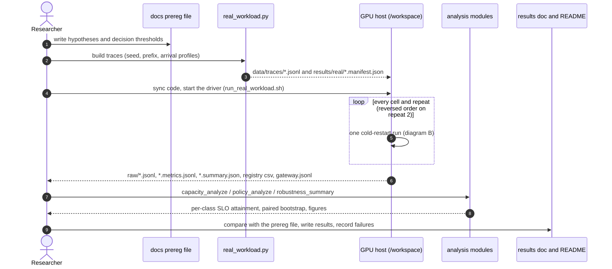
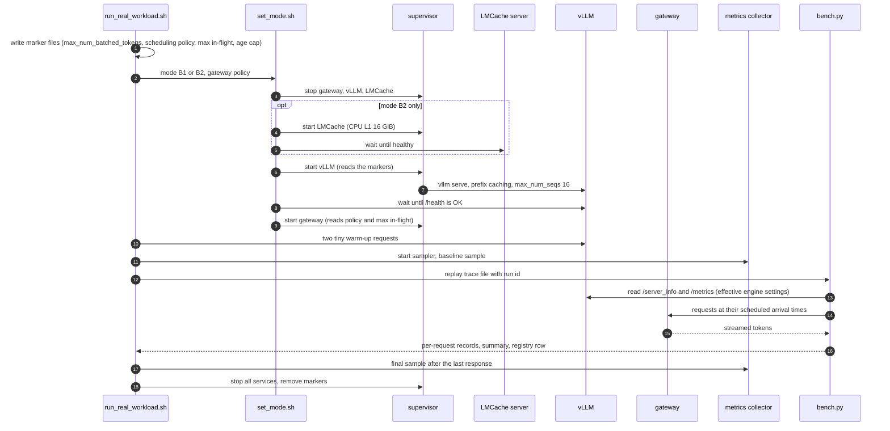
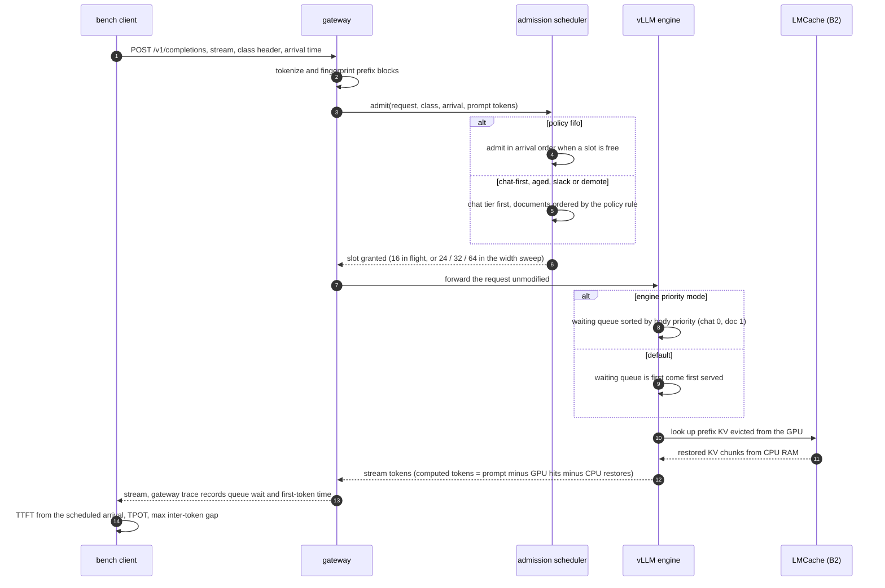
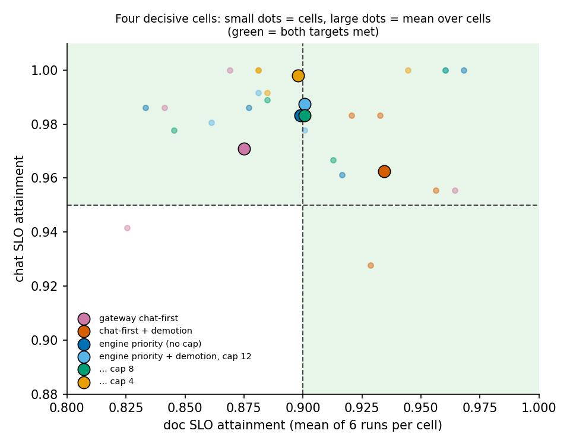

# CacheFlow: SLO-aware serving of mixed chat and long-document traffic on one GPU

A set of pre-registered, paired experiments on a single RTX 3090 with vLLM 0.22.0, an LMCache CPU KV tier and an asyncio admission gateway, using real document and chat content, real arrival structure where available, and a Qwen3-1.7B model. The question that runs through all of it is practical: **when short interactive requests and long-document requests share one inference server, what actually moves latency-SLO attainment, and by how much?**

> Status: 422 serving runs plus an isolated prefill probe, across eleven studies. Start with [docs/interview_brief.md](docs/interview_brief.md) (two-page summary) or [docs/PROCESS_LOG.md](docs/PROCESS_LOG.md) (the whole process in order). The numbers are from one host, one small model, three document sets, and mostly two repeats per cell. Read the limitations (section 9) before quoting any of them.

Contents: [1. TL;DR](#1-tldr) · [2. System](#2-the-system) · [3. Research questions](#3-research-questions) · [4. Data](#4-data) · [5. Literature and survey](#5-literature-review-and-survey) · [6. Experimental setup and workflow](#6-experimental-setup) · [7. Studies and results](#7-studies-and-results) · [8. What failed](#8-what-failed-and-what-i-got-wrong) · [9. Limitations](#9-limitations-and-threats-to-validity) · [10. Reading the results](#10-what-the-results-support) · [11. Repository map](#11-repository-map) · [12. Reproduction commands](#12-reproduction-commands) · [13. Next steps](#13-next-steps)

---

## 1. TL;DR

**What was built.** A reproducible harness: a FastAPI admission gateway with pluggable ingress policies, a trace builder that turns QuALITY (long documents with questions) and ShareGPT (chat prompts) into fixed-schedule traces, a replay client that records per-request clocks, and analysis code that computes per-class SLO attainment with paired bootstraps. Every run is a cold restart of vLLM, LMCache and the gateway.

**What was found** (chat SLO: TTFT <= 1 s; doc SLO: TTFT <= 3 s; TPOT <= 100 ms):

| # | Result | Evidence | Strength |
|---|---|---|---|
| 1 | A CPU KV tier (LMCache) raises SLO-constrained capacity when the working set exceeds GPU KV | seed 7: 4.0 to 5.5 req/s (+37%); under burst chat p95 -32 to -34%, computed prefill tokens -48% | fairly solid: mechanism measured, large gap |
| 2 | Chat-first admission rescues chat under overload, at a cost to documents | chat SLO +0.53 to +0.64 on two document sets, +0.24 to +0.55 on two BurstGPT windows; doc SLO -0.17 to -0.19 | replicated on 3 datasets; trade-off, not a free lunch |
| 3 | Engine-level priority (vLLM `--scheduling-policy priority`) vs gateway chat-first | **weaker than first reported.** After 6 repeats at the 4 decisive cells (study 9) it passes a heavier load level than gateway chat-first on **1 of 3 seeds** (tie on two) and improves attainment in 3 of 4 cells, but is worse on chat at one; the first headline (7.6 vs 6.9 req/s on seed 7) did not survive, the seed-7 ladder tops out at 6.9 req/s for all three policies (**1.7x over B1**, not 1.9x) | weak: the pre-registered R2 is no longer met |
| 4 | Priority only works in the **first queue where requests wait**; an FCFS queue upstream defeats it | gateway chat-first falls from chat SLO 0.94 to 0.57 (FIFO level) once the gateway admits more than the engine's 16 sequences | fairly solid on seed 7 |
| 5 | Demoting documents that can no longer meet their SLO shifts misses toward savable documents | most consistent configuration in the hardening: passes 3 of the 4 decisive cells (pass probability 0.86 to 1.00), smallest run-to-run spread (doc SD 0.010 to 0.018), the only one passing seed 11 burst (doc 0.921 vs 0.833 for engine priority, interval excludes 0); adds no capacity by itself and lengthens the demoted documents' tail | moderate |
| 6 | A scheduler step costs about 12 ms | isolated probe, 95% CI 10.9 to 13.2 ms | solid for this measurement |
| 7 | Combining engine priority with demotion does **not** raise the SLO-constrained load level, but does combine their balance at overloaded cells | 0 of 3 seeds heavier than the better parent; 3 of 4 complementary cells within 0.03 of the better parent per class | negative for capacity, descriptive for balance |
| 8 | **Replicate noise is large relative to the thresholds, depends on the configuration, and comes from correlated outcomes rather than noisier requests**: doc SLO run SD 0.010 to 0.018 for demotion, 0.019 to 0.039 for gateway chat-first, 0.025 to 0.041 for engine priority; the spread is not explained by more unstable requests (corr -0.08) or noisier per-request timings (smallest for engine priority); it is explained by positive correlation between documents' outcomes within a run (variance inflation 1.94 for engine priority, 0.30 for demotion) | studies 8 to 10 (offline variance investigation on 12 cells x 6 runs) | solid for the description; a 3-way decomposition (study 11) points at the **demotion order**, not queue location or the concurrency cap: with FIFO order the design effect stays high (gateway queue, cap 4: 1.65; engine queue: 1.94), with demotion order it falls (0.77 at cap 4, 0.30 without a cap); the concurrency-only contrast was not obtained (vLLM `max_num_seqs` 4 collapsed the server), so this rests on the valid contrasts and is post hoc |
| 9 | The capacity ladder holds at run level: 4.0 to 5.5 req/s with the CPU tier (+37%), to 6.9 with class ordering (+25%), **1.7x over B1** on seed 7; the ordering of configurations holds on three document sets; **chat-first + demotion is the most robust configuration** (3 of 4 decisive cells, lowest spread, the highest mean doc attainment, 0.935, with chat 0.963 (the cap-8 and cap-12 variants of engine priority also clear both targets in the mean, but by 0.001 on doc)); the engine-priority family plateaus at doc ~0.90 whatever the document cap | study 10 (boundary cells with 6 runs, cap sweep with 6 runs per cell) | moderate to fairly solid |

**What did not work** (and is reported as such): age-capped promotion of documents, slack-based promotion, a larger prefill budget as a capacity lever (it lowers p95 but moves no capacity bracket), the original delay-hit-aware admission (DHAS), the combination of engine priority and demotion (as a capacity lever), and several hypotheses I wrote down in advance.

**Honest framing.** None of the techniques is new; this is an experimental confirmation with controls and replication. The most informative findings are the *negative*, *mechanism* and *noise* ones: ordering only moves misses between classes unless capacity changes; priority (and demotion) must act at the first queue where requests wait; the best configuration depends on the document set; and two-repeat cells near a 0.90 threshold are within noise.

---

## 2. The system

```
 replay client                gateway (FastAPI, :8100)                 vLLM 0.22.0 (:8000)                LMCache MP server
 fixed-schedule trace  --->   tokenize, fingerprint blocks,  ---->     Qwen3-1.7B BF16, prefix cache,  <-> CPU L1 KV tier, 16 GiB
 + class header               admission policy, max 16 in-flight       max_num_seqs 16, enforce-eager        (restores evicted KV)
                              (queue <= 64), per-request trace         GPU KV 6 GiB = 56,160 tokens
```

| Component | Detail |
|---|---|
| GPU | RTX 3090 24 GB (Vast.ai instance; `/workspace` is **not** persistent) |
| Host | 31 GB RAM, 12 vCPU, 50 GB overlay disk |
| Engine | vLLM 0.22.0, V1 engine, `--enforce-eager`, `--max-num-seqs 16`, `--max-model-len 12288`, GPU KV budget 6 GiB (3,510 blocks x 16 = 56,160 tokens), prefix caching on |
| Model | Qwen3-1.7B BF16, revision `70d244cc86ccca08cf5af4e1e306ecf908b1ad5e`, thinking disabled through the chat template |
| CPU KV tier | LMCache 0.5.3 multi-process server, 16 GiB L1; connector `LMCacheMPConnector` |
| Gateway | `src/cacheflow/gateway.py`: tokenizes, computes prefix block fingerprints, applies an admission policy (`src/cacheflow/scheduler.py`), forwards the unmodified request, writes a per-request trace |
| Metrics | vLLM Prometheus counters (prefix hits, external/CPU hits, computed prefill tokens, preemptions) sampled at the start and end of each run |

Configuration names used throughout:

| Name | Meaning |
|---|---|
| **B1** | GPU prefix cache only |
| **B2** | GPU prefix cache + LMCache CPU tier |
| suffix **T** | `max_num_batched_tokens` 8192 (default on this GPU is 2048; **M** = 4096) |
| **P** (`class_first`) | gateway chat-first: queued chat is admitted before queued documents |
| **A** (`class_aged`) | chat-first, but a request that waited >= 1.5 s counts as chat |
| **S** (`class_slack`) | chat-first, but documents are promoted when remaining slack < expected service time + margin |
| **D** (`class_demote`) | chat-first, plus documents that can no longer meet their SLO go to a best-effort tier (still served) |
| **V** | engine-level priority (vLLM `--scheduling-policy priority`, chat 0 / doc 1), gateway passes through with 64 in-flight; **V24/V32** use 24/32 in-flight |
| **W / PW** | controls: gateway with 64 in-flight and no engine priority (FIFO / chat-first) |

---

## 3. Research questions

The project began as a six-hour sprint on one question (RQ0) with a negative answer, and grew into a chain where each study was designed from the previous one's gap.

| | Question | Study |
|---|---|---|
| **RQ0** | Can bounded deferral and cache-locality-aware admission (DHAS, inspired by Strata's *delay hits*) reduce redundant prefill and latency for requests that share a long prefix? | original sprint (section 7.0) |
| **RQ1** | With chat and long-document QA on one server, what do a CPU KV tier and the prefill budget (`max_num_batched_tokens`) change in latency, throughput and SLO attainment, using real content? | study 1 |
| **RQ2** | Under mixed load, is short-request TTFT bound by queueing or by prefill-step granularity, and does the answer change with load? | study 2 |
| **RQ3** | Is chat-first admission still a trade-off below saturation, and what does one scheduler step cost? | study 3 |
| **RQ4** | Does the chat-first result hold on other documents, and does slack-based admission help? | study 4 |
| **RQ5** | Does demoting documents that cannot meet their SLO recover capacity? | study 5 |
| **RQ6** | What is the SLO-constrained capacity of each configuration, does engine-level priority beat the gateway, and does real arrival structure change the picture? | study 6 |
| **RQ7** | Is the capacity ordering robust across document sets, and why does engine-level priority win? | study 7 |
| **RQ8** | Does combining engine-level priority (for chat) with gateway demotion (for documents) beat either alone? | study 8 |
| **RQ9** | Do the decisive comparisons survive run-level statistics with 6 repeats? | study 9 |
| **RQ11** | Which factor decorrelates the documents' outcomes: where the queue lives, how many documents run, or the demotion order? | study 11 |
| **RQ10** | Why does engine priority have the largest run-to-run spread, does the capacity ladder survive run-level statistics, and does lowering the document cap reduce the spread? | study 10 |

Practices applied from study 2 on: hypotheses and decision thresholds written down **before** the runs (study 2 states them in its own document; studies 3 to 7 have separate `docs/*_prereg.md` files); paired comparisons over request IDs; negative results kept; post-hoc additions labelled as such (the control runs in study 6 are marked in the pre-registration file).

---

## 4. Data

**Real content, simulated or re-timed arrivals.** No request is synthetic text.

| Element | Source | Notes |
|---|---|---|
| Documents and questions | **QuALITY v1.0.1** `htmlstripped.dev` (230 articles, 2.3K to 8.4K tokens) | 14 documents per trace, 5,500 to 8,400 tokens, complete articles, 3 real questions each, gold letters kept for a sanity-check accuracy |
| Chat prompts | **ShareGPT_V3 unfiltered**, dataset revision `192ab2185289094fc556ec8ce5ce1e8e587154ca` (94,145 conversations) | first human turn; 30 to 600 chars, <= 3 newlines, no code fence, >= 99% ASCII, keyword blocklist, 8 to 120 tokens; 60 per trace |
| Arrival times | **Simulated** fixed-seed schedules (studies 1 to 5, 7) or **BurstGPT** structure (study 6) | BurstGPT (Azure OpenAI GPT service trace) has integer-second timestamps and token counts but no text; here it only re-times existing content |
| Seeds | 7, 11, 23 | each seed draws a different set of 14 documents and 60 chats |
| Output budgets | doc 48 tokens, chat 96 tokens, `temperature=0` | outputs were not bit-identical across runs even at temperature 0 (section 8) |

**Trace structure** (102 requests per trace = 60 chat + 14 documents x 3 visits): **q0** first visit (full prefill), **q1** shortly after (GPU prefix hit), **q2** late revisit after all documents were seen (the KV has been evicted from the GPU; B2 restores it from CPU, B1 recomputes it). The 14 documents total 98,130 unique tokens against 56,160 tokens of GPU KV: a **1.75x** working-set pressure by design.

**Arrival profiles** (first-visit spacing and offered load = 102 requests over the trace span):

| Profile | First-visit spacing | q1 delay | Span | Offered load |
|---|---|---|---|---|
| moderate | 2.0 s | 3.0 s | 52.5 s | 1.9 req/s |
| medium | 0.9 s | 2.0 s | 25.3 s | 4.0 req/s |
| mid65 | 0.65 s | 1.6 s | 18.6 s | 5.5 req/s |
| mid50 | 0.5 s | 1.4 s | 14.9 s | 6.9 req/s |
| mid45 | 0.45 s | 1.3 s | 13.5 s | 7.6 req/s |
| mid42 | 0.42 s | 1.24 s | 12.5 s | 8.2 req/s |
| burst | 0.4 s | 1.2 s | 11.8 s | 8.6 req/s |

The spacing is a knob, not a capacity measure: the same spacing stresses different document sets differently (study 4 and 7), which is why study 6 introduced the capacity ladder.

**BurstGPT windows** (`src/cacheflow/burst_arrivals.py`): 74 consecutive "Conversation log" rows, timestamps jittered inside their second and rescaled to 10 s; the 14 longest requests by `Request tokens` become document first visits, the others chats; q1 = q0 + 1.3 s, q2 = q0 + 8 s. Window w1 spans 845 s of the real trace (gap CV 0.82, peak 10 arrivals/s); w2 spans 21,079 s (CV 2.08, peak 21/s). The compression factor is large, so burstiness is stronger than in the source. The BurstGPT "document" requests are 1.4 to 2.6K tokens, far below the 6 to 8K-token documents; the class assignment is my fixed rule, not a property of the dataset.

**Provenance.** Dataset hashes, article/question/conversation IDs, per-request prompt hashes and token statistics are in `results/real/*.manifest.json`. Prompt text is not committed (`data/` is git-ignored).

---

## 5. Literature review and survey

Two passes: (1) a first reading to frame the project, (2) a keyword survey after the first positive/negative results, to look for stronger techniques. **Reading depth is stated per paper because it limits what I can claim.**

### 5.1 Papers used as design input

| Paper | Claim relevant here | How it was used | Depth |
|---|---|---|---|
| Strata, OSDI 2026 ([2508.18572](https://arxiv.org/abs/2508.18572)) | hierarchical context caching; scheduler addresses *delay hits* and balances prefill compute with cache I/O; reports up to 5x TTFT vs vLLM+LMCache | motivation for RQ0 / DHAS (the original sprint); **not reproduced**, its figures are not claimed | snippets + abstract |
| LMCache ([2510.09665](https://arxiv.org/abs/2510.09665)) | KV cache layer across GPU/CPU/disk/network, control APIs for schedulers | the CPU tier used in every B2 run | abstract + docs |
| QoServe (ASPLOS 2026), SLOWEAVE ([2609.07883](https://arxiv.org/abs/2609.07883)) | slack/deadline-aware chunk sizing | framed the budget/queue question in study 2; slack idea tested as `class_slack` in study 4 | abstracts only |
| FlowPrefill ([2602.16603](https://arxiv.org/abs/2602.16603)) | cooperative operator-boundary preemption + slack-aware EDF; built on vLLM 0.11.2, 8 GPUs; goodput up to 2.0x vs chunked prefill at 2K; "limited" gains for inputs < 2K | read in full in the survey; judged infeasible to reproduce (no code found, engine execution rewritten) | **full text** |
| SLOs-Serve ([2504.08784](https://arxiv.org/abs/2504.08784)) | defines "serving capacity" as the maximum load per GPU that keeps 90% SLO attainment; soft admission control declines about 2% of requests to a best-effort tier; reports 2.2x capacity over the best of vLLM/Sarathi | origin of the capacity ladder (study 6) and of the "best-effort tier" in `class_demote` | first ~40% of the HTML read, the rest summarized; **ablation split not verified** |
| Overload control for black-box LLM endpoints ([2604.06970](https://arxiv.org/abs/2604.06970)) | client-side closed-form admission; rejections concentrate on the longest class, short requests never rejected | design input for demotion; evidence is weak for this setting (mock provider, synthetic mixes, hand-tuned weights, FIFO goodput not reported) | **full text** |
| BurstGPT ([2401.17644](https://arxiv.org/abs/2401.17644)) | real LLM-serving arrival trace with bursts | arrival structure in study 6 | abstract + data inspection (the paper versions disagree on trace size: 5.29M vs 10.31M) |

### 5.2 Survey results: what was feasible on one 3090

Survey keyword groups were chosen from the bottlenecks measured so far; each result was critiqued against *this* setup.

| Technique (keywords) | Verdict | Reason |
|---|---|---|
| Overload control / early rejection / demotion (SLOs-Serve, black-box paper) | **done** (study 5) | acts at the saturation bottleneck, lives in the gateway, needs only a cost model |
| Engine-level priority scheduling | **done** (studies 6 and 7) | one vLLM flag plus a request field |
| SLO-constrained capacity as the metric (SLOs-Serve) | **done** (studies 6 and 7) | makes configurations comparable |
| BurstGPT real arrival trace | **done** (study 6) | file is public (50 MB); timestamps only |
| Prefill-decode disaggregation (DistServe, Mooncake, Splitwise, llm-d, Dynamo) | rejected | needs >= 2 GPUs and a fast KV link |
| Operator-level preemption (FlowPrefill, Niyama, MuxWise) | rejected | no released code; thread/stream-per-request engine rewrite; benefit confounded with policy in the paper; gains limited for short prompts |
| Adaptive chunk sizing (SLOWEAVE, QoServe, SlidingServe) | rejected for now | workload has no long decodes to protect; SLO does not measure inter-token tail |
| Non-prefix KV reuse (CacheBlend, SpecCache) | not applicable | traces only have exact-prefix reuse |
| Hierarchical context caching schedulers (Strata) | not applicable here | CPU restore is not the bottleneck (144 ms restore vs 475 ms recompute); delay-hit admission was already tried and was negative |
| Sparse prefill (MInference, UniPrefill, BFLA) | deferred, **not** rejected | needs kernel integration and an accuracy check on QuALITY; my back-of-envelope estimate that attention is a non-trivial share of FLOPs at 8K was not measured |
| FP8 KV cache as a substitute for the CPU tier | **not tested** | flag exists in vLLM 0.22; support on sm86 attention backends unverified |

---

## 6. Experimental setup

**Run protocol.** Each run: stop services, set mode and policy, cold-restart LMCache (B2), vLLM and the gateway, two tiny warm-up requests, replay the trace open-loop, collect metrics, stop services. No cache carries over between runs. Two repeats per cell, order reversed on the second repeat (ABBA-style) to spread drift. Effective engine settings (`max_num_batched_tokens`, `max_num_seqs`, scheduling policy, KV capacity) are read from the live server (`/server_info`, `/metrics`) and stored in each run's summary.

**Metrics.**

- **TTFT** is measured from the *scheduled arrival*, not from when the client sent it, so queueing counts.
- **SLOs** (fixed before the runs): chat TTFT <= 1 s, doc TTFT <= 3 s, TPOT <= 100 ms. A failed request counts as an SLO failure. Attainment is over **all offered requests** of the class; nothing is removed from the denominator.
- **Goodput** = requests meeting both SLOs divided by run duration. It counts requests, and chat requests are cheap, so per-class attainment is the primary readout.
- **Capacity bracket:** a configuration *passes* a load level when chat attainment >= 0.95 and doc attainment >= 0.90 (pooled over repeats); the bracket is the heaviest level passed with every lighter tested level also passed, and the first failure above it. No interpolation between levels.
- **TTFT decomposition:** gateway admission wait + engine segment (gateway dispatch to first token) + remainder; also each request's maximum inter-token gap and, for documents, service time by visit type.
- **Cache accounting** from vLLM counters: GPU hit tokens, CPU-restored tokens, computed prefill tokens. `vllm:iteration_tokens_total` was found **not** to count scheduler steps and is not used.

**Statistics.** Paired bootstrap over request IDs (configurations resampled jointly) for p95 and attainment differences. These intervals ignore run-to-run variance (two repeats); treat them as lower bounds on uncertainty.

**Pre-registration.** `docs/*_prereg.md` files hold hypotheses and thresholds written before the corresponding runs They were committed together with the results, so the ordering rests on my process, not on commit history. Where a hypothesis failed, the document says so.


### Workflow diagrams

**A. How a study is run (the loop used for studies 3 to 7).**



**B. One run (what `scripts/run_real_workload.sh "CONFIG LOAD TAG"` does).**



**C. One request through the gateway (the two places where priority can be applied).**



Reading diagram C with the mechanism result of study 7: a request waits in **either** the scheduler queue (gateway) **or** the engine waiting queue. Ordering is applied where the first wait happens; if the gateway admits more requests than the engine runs (more than 16), the excess waits in the engine's first-come-first-served queue and the gateway ordering stops mattering.

---

## 7. Studies and results

Detailed tables and caveats are in the per-study documents (linked). Run counts: 12 + 20 + 14 + 18 + 10 + 56 + 60 + 40 + 48 + 96 + 48 = **422 serving runs**, plus the isolated probe (5 restarts, 210 samples).

### 7.0 Original sprint: delay-hit-aware admission (RQ0) , negative

Documents: [docs/main_results.md](docs/main_results.md), [docs/decisions.md](docs/decisions.md), [docs/lessons_learned.md](docs/lessons_learned.md), [docs/RESEARCH_PROPOSAL.md](docs/RESEARCH_PROPOSAL.md). Synthetic documents, 247 GB host.

- B2 (CPU tier) cut late-revisit mean TTFT from ~2.59 s (B1) to 0.33-0.37 s and restored 65,536 tokens per run; the benefit followed working-set pressure (zero CPU loads with 8 documents at 8 GiB, large benefit with 12).
- DHAS added **no** cached tokens or saved prefill over FIFO; paired mean differences were +302 and +31 ms, and a stronger crossover test gave -92 and +109 ms (opposite signs). A later readiness guard was also neutral. Kept as negative results.

### 7.1 Real mixed workload: CPU tier and prefill budget (RQ1) , [docs/real_workload_results.md](docs/real_workload_results.md)

12 runs, 62-request traces (20 chats), B1 / B2 / B2T, moderate and burst.

| Burst trace | B1 | B2 | B2T |
|---|---|---|---|
| Chat TTFT p95 (s) | 3.11 | 2.54 | 1.95 |
| Goodput (req/s) | 2.54 | 4.00 | 4.31 |
| Computed prefill tokens | 197.3K | 102.8K (-48%) | 102.8K |

Moderate load: every configuration met every SLO. Caveats: 20 chat requests per run, one seed. Outputs differed between runs even at temperature 0 (14 to 27 of 62), and the QuALITY answer letter changed more often for B2T (3 to 5 of 42) than for B1/B2 (0 to 1), cause not isolated.

### 7.2 Prefill budget, load and queue order (RQ2) , [docs/chunk_study_results.md](docs/chunk_study_results.md)

20 runs, 60 chats, load levels moderate / medium / burst. Per-request TTFT decomposition; max inter-token gap.

| Hypothesis (pre-registered) | Outcome |
|---|---|
| H1: at burst, 8192 cuts chat p95 by >= 20% via gateway wait | **partly**: -11.8% (3.43 to 3.02 s) |
| H2: at light load the sign flips | **not supported**: 8192 better at every load (-20, -68, -406 ms chat p95) |
| H3: bigger budget lengthens inter-token gaps | **supported**: p95 of per-request max gap 2 to 3x (about 160-230 to 470-490 ms), TPOT unchanged |
| H4: chat-first gives chat SLO >= 0.90 with doc >= 0.95 | **half**: chat 0.94, doc fell 0.88 to 0.69 |

Under burst the chat TTFT is mostly gateway queueing (about 1.4-1.7 s of 1.6-1.9 s). The TPOT SLO is an average and does not see the 0.5 s stalls.

### 7.3 Queue order below saturation, and the cost of a step (RQ3) , [docs/policy_study_results.md](docs/policy_study_results.md)

14 runs (mid65 and mid50, plus burst for the age cap) plus an isolated probe. At 0.5 s spacing chat-first was free on seed 7: chat SLO 0.68 to 0.98 with doc 1.00 (same duration, so no capacity change). At burst no policy reached both targets. The 1.5 s age cap was too eager (chat 0.84 at mid50). **Probe** (one document at a time, no queue, no prefix hit, 210 samples): TTFT 453 / 435 / 415 ms for budgets 2048 / 4096 / 8192; about **12 ms per scheduler step** (CI 10.9 to 13.2); every one of 14 documents is 22 to 49 ms faster at 8192. This explains the light-load part of the budget effect but not all of the larger gains under load (not isolated).

### 7.4 Replication and slack promotion (RQ4) , [docs/replication_slack_results.md](docs/replication_slack_results.md)

18 runs. Seed 11 replicated the burst effect (chat SLO +0.53, doc -0.17 vs +0.64 / -0.19 on seed 7) but the load at which FIFO fails did not transfer: FIFO already gave chat 0.97 at the same 0.5 s spacing. `class_slack` found **no** load where both classes reached target (mid45: FIFO 0.57 / 1.00, chat-first 0.94 / 0.83, slack 0.78 / 0.95) and gave up chat-first's free case at mid50 (0.92 vs 0.98). S1 and S2 not supported.

### 7.5 Demoting doomed documents (RQ5) , [docs/demotion_results.md](docs/demotion_results.md)

10 runs. Motivation: under burst chat-first, 33% of computed prefill tokens went to first-visit documents that missed anyway. Policy: documents with `waited + expected service > SLO` go to a best-effort tier, still served.

| Seed / load | chat-first (chat / doc) | demotion | Verdict |
|---|---|---|---|
| 7, mid45 | 0.94 / 0.83 | **0.94 / 0.94** | D2 met |
| 7, burst | 0.94 / 0.69 | 0.89 / 0.79 | **D1 missed**: doc +0.095 vs required +0.10 |
| 11, burst | 0.99 / 0.83 | **0.99 / 0.92** | D4 met |
| 7, mid50 | 0.98 / 1.00 | 0.96 / 0.99 | D3 met (no harm) |

It adds **no capacity** (computed prefill identical, goodput 0 to +6%): demoted documents are still computed, only later. The 33% headroom is realizable only by dropping requests, which also forfeits cache warming for later visits (untested). The cost is the tail: doc p95 4.6 to 7.5 s at burst. 0 of 26 demoted documents still met their SLO (the predictor's target selection is accurate).

### 7.6 Capacity ladder, engine priority, BurstGPT (RQ6) , [docs/capacity_priority_results.md](docs/capacity_priority_results.md)

56 runs. Highest load level passed (seed 7; chat >= 0.95 and doc >= 0.90):

| Configuration | Heaviest pass |
|---|---|
| B1 2048 FIFO | 4.0 req/s |
| B2 2048 FIFO | 5.5 |
| B2 8192 FIFO | 5.5 (larger budget lowers p95 but moves no bracket) |
| B2 8192 gateway chat-first | 6.9 |
| B2 8192 engine priority | 7.6 in the first two repeats; **6.9 after study 9** (it fails mid45 with 6 runs, 0.986 / 0.877) |

After the hardening all three class-ordering policies top out at **6.9 req/s on seed 7, which is 1.7x over B1** (the 1.9x in the first report was a two-repeat pass that did not reproduce). Confirmed with 6-run boundary cells in study 10 (7.10).

Engine priority vs gateway chat-first at seed 7 mid45: 0.99 / 0.92 vs 0.94 / 0.83 in the first two repeats; with 6 repeats 0.986 / 0.877 vs 0.942 / 0.825 (the comparison on attainment holds, the pass does not). **Controls** (added after seeing this, labelled post hoc): a wider gateway with and without chat-first behaves like FIFO (chat 0.57), so the gain is not from the wider gateway; preemptions were 0 to 1, so it is not preemption. BurstGPT windows: chat-first fixes chat under FIFO in both (+0.55, +0.24); demotion missed doc parity in the light window (0.94 vs 1.00) and roughly doubled goodput in the heavy, bursty window (2.25 to 4.59 req/s), where every policy was overloaded.

### 7.7 Robustness and mechanism (RQ7) , [docs/robustness_mechanism_results.md](docs/robustness_mechanism_results.md)

60 runs, a third document set (seed 23), a new level mid42, and a gateway-width sweep.

| Seed | gateway chat-first | chat-first + demotion | engine priority |
|---|---|---|---|
| 7 | mid50 | mid50 | mid50 (first report: mid45) |
| 11 | mid42 (first report: mid45) | **burst** | mid42 |
| 23 | mid50 | **mid45** | mid45 |

(heaviest level passed on the common grid mid50 / mid45 / mid42 / burst; **updated with the 6-repeat data of study 9** for the decisive cells)

- **R2** (engine priority heavier than gateway chat-first on >= 2 of 3 seeds): met at the time (two repeats, at the threshold) but **not met after study 9**: it is heavier on 1 of 3 seeds (seed 23) and ties on seeds 7 and 11.
- **Which is best depends on the document set**, and after study 9 chat-first + demotion is the most consistent (heaviest or tied on every seed); engine priority no longer wins on seed 7.
- **Mechanism.** Pre-registered rule: *mixed*. H-width (gain from a wider gateway) is **not** supported: gateway chat-first collapses to FIFO once the gateway admits more than the engine runs (chat 0.94 at width 16, 0.57 at 24/32/64), while engine priority keeps its effect at widths 24 to 64 at mid45 (burst needs width >= 32). Reading: **ordering takes effect in the first queue where requests wait; an FCFS queue upstream defeats it.** The small residual gap between engine priority at width 64 and gateway chat-first at width 16 is **unexplained**.

### 7.8 Engine priority + demotion, and replicate noise (RQ8) , [docs/combo_results.md](docs/combo_results.md)

40 runs in two attempts. Policy `engine_demote`: chat goes straight to vLLM, ordered by engine priority; documents are capped at N in flight at the gateway and admitted in demotion order.

- **Attempt 1 (N = 16) did not bind**: with 42 document requests per trace the cap was almost never reached, documents waited 16 to 21 ms at the gateway and queued in vLLM's FCFS waiting queue where demotion cannot act. It was effectively a second replicate of engine priority. It failed the pre-registered C1 and C2 and met C3.
- **That replicate measured noise:** chat SLO differs by 0.008 on average (max 0.025) and **doc SLO by 0.035 on average (max 0.095)** between two effective replicates of one configuration over 10 cells; cells near the 0.90 threshold flip (seed 7 mid45 doc 0.917 vs 0.869; seed 23 mid45 0.893 vs 0.940). Pooling the replicates, engine priority ties gateway chat-first on seed 7 and passes a heavier level on seeds 11 and 23 (post hoc).
- **Attempt 2 (N = 4, fixed by a rule from earlier data, labelled as a post hoc correction):** C1 not met, C2 not met (0 of 3 seeds heavier than the better parent), C3 not met (the cap costs documents attainment at lighter loads: seed 7 mid50 doc 0.95), C4 met in 3 of 4 complementary cells: the combination takes engine priority's chat attainment (0.97 to 0.99) and demotion's document attainment (0.79 to 0.87), but documents stay below 0.90 there, so no extra cell passes.

Lesson: demotion, like priority, must act at the first queue where the request waits; and two-repeat cells near a threshold are within noise.

### 7.9 Statistical hardening (RQ9) , [docs/hardening_results.md](docs/hardening_results.md)

48 runs: 4 more repeats (6 in total, random order within blocks) for gateway chat-first, chat-first + demotion and engine priority at 4 decisive cells (seed 7 mid45, seed 23 mid45, seed 11 mid42 and burst); run-level bootstrap.

| Cell | gateway chat-first | + demotion | engine priority |
|---|---|---|---|
| seed 7, mid45 | 0.94 / 0.83 fail | 0.93 / 0.93 fail | 0.99 / 0.88 fail |
| seed 23, mid45 | 1.00 / 0.87 fail | 0.98 / 0.93 pass | 0.96 / 0.92 pass |
| seed 11, mid42 | 0.96 / 0.96 pass | 0.96 / 0.96 pass | 1.00 / 0.97 pass |
| seed 11, burst | 0.99 / 0.84 fail | 0.98 / 0.92 pass | 0.99 / 0.83 fail |

(chat / doc SLO attainment, means of 6 runs; per-cell intervals in the document)

- H1 (engine priority passes >= 2 cells and more than gateway chat-first): met narrowly (2 vs 1); at the level of load levels engine priority is heavier on 1 of 3 seeds, so study 7's R2 is no longer met. H2 (demotion passes at least as many cells as engine priority): met (3 vs 2). H3 (doc run SD >= 0.03 in >= 6 of 12 cells): not met (4 of 12); noise is configuration-dependent.
- Corrections made: the seed-7 engine-priority pass at mid45 (two repeats) does not hold (6 runs: 0.986 / 0.877); the seed-7 capacity ladder tops out at 6.9 req/s for all three policies (1.7x over B1, not 1.9x); the doc SLO of gateway chat-first at seed 11 mid42 passes with 6 runs where it failed with 2.

### 7.10 Variance investigation, ladder hardening and cap sweep (RQ10) , [docs/variance_investigation.md](docs/variance_investigation.md), [docs/ladder_capsweep_results.md](docs/ladder_capsweep_results.md)

An offline investigation (no new runs) and 96 new runs.

- **Why the spread differs (offline, 12 cells x 6 runs).** Not more unstable requests (corr -0.08), not noisier per-request timings (smallest for engine priority, 33 ms vs 76 ms for demotion); the outcomes of engine priority's documents are positively correlated within a run (variance inflation 1.94, vs 1.26 for gateway chat-first and **0.30 for demotion**, whose flips compensate), and more of its documents sit within 0.5 s of the 3 s SLO (0.20 vs 0.10; corr with SD 0.66).
- **Ladder hardening (32 runs).** B1 fails mid65 (0.928) and B2 passes it (0.964); the three class-ordering policies all pass mid50 on seed 7 (0.98 / 0.996, 0.96 / 0.98, 1.00 / 1.00); seed 23 chat-first passes mid50, demotion fails mid42 (0.939 / 0.893); seed 11 FIFO passes mid50. All three pre-registered hypotheses met. Seed 7 ladder: **4.0 to 5.5 to 6.9 req/s, 1.7x over B1.**
- **Cap sweep (64 runs): the dose-response prediction failed.** Design effect for caps 4 / 8 / 12 / no cap: 0.77 / 2.09 / 1.37 / 1.94 (M1 not met: only cap 4 is clearly lower); no cap of 8 or 12 passes 3 of 4 cells (M2 not met); doc SD at the best cap 0.027 (M3 not met). Cap 4 gives the highest chat attainment (0.998) but a flat doc attainment of 0.88 in three cells. Chat-first + demotion without a cap is the most robust: 3 of 4 cells, SD 0.014, mean doc 0.935 / chat 0.963.



### 7.11 What decorrelates the outcomes? (RQ11) , [docs/locus_results.md](docs/locus_results.md)

48 runs: a 3-way decomposition (queue location x documents running x demotion order), all with engine priority for chat, on the 4 decisive cells, 6 runs each.

| Series | Cells passed | Mean doc | Doc run SD | Design effect [95% CI] |
|---|---|---|---|---|
| V engine priority, engine queue, FIFO | 2 of 4 | 0.899 | 0.033 | 1.94 [1.12, 2.45] |
| F4 gateway queue, 4 documents, FIFO | 0 of 4 | 0.818 | 0.025 | 1.65 [0.98, 2.01] |
| VD4 gateway queue, 4 documents, demotion order | 1 of 4 | 0.898 | 0.021 | **0.77** [0.52, 1.08] |
| D chat-first + demotion | 3 of 4 | 0.935 | 0.014 | **0.30** [0.12, 0.61] |
| S4 `max_num_seqs` 4 | collapsed (doc 0.036) | | | not defined |

- Pre-registered L1 and L3 not met, L2 not evaluable (S4 collapsed the server: goodput 0.26 req/s vs 7.3), and the reading rule printed "concurrency" only because of that artefact; the interpretation uses only the valid contrasts and is post hoc.
- **Moving the queue to the gateway and capping concurrency, with FIFO order, does not remove the correlation and costs document attainment; adding the demotion order does** (F4 to VD4: design effect 1.65 to 0.77, doc 0.818 to 0.898). Across all series the low design effects are the ones with the demotion order. This also explains the cap sweep post hoc: with caps of 8 or 12 the gateway queue rarely forms, so the demotion order has little to act on.

### 7.12 Consolidated: what worked and what did not

| Worked | Did not work / not supported |
|---|---|
| CPU KV tier under working-set pressure | DHAS delay-hit-aware admission (original sprint) |
| Chat-first (at the first queue) under overload | age-capped promotion (1.5 s too eager) |
| Demotion of doomed documents (most consistent: 3 of 4 decisive cells, lowest spread) | slack-based promotion (regressed the free case) |
| Engine-level priority (better attainment in 3 of 4 decisive cells; heavier pass on 1 of 3 seeds) | larger prefill budget as a *capacity* lever |
| Measured step cost (12 ms) | any scheduler reaching both targets at saturation |
|  | engine priority + demotion as a capacity lever (0 of 3 seeds heavier; no cap of 8 or 12 passes 3 of 4 cells) |
|  | a dose-response of the spread to the document cap (M1 to M3 all failed); limiting vLLM `max_num_seqs` to 4 as a way to vary concurrency (the server collapsed) |

---

## 8. What failed and what I got wrong

Kept deliberately; several changed a conclusion.

**Analysis and claims**

- I first read `vllm:iteration_tokens_total` as a step counter; it gave the same count for budgets 2048 and 8192, so it is not used.
- I stated that gateway wait was about 2 ms under burst; the data showed 1.4 to 1.7 s. Corrected and the document rewritten.
- Several numbers in a draft document were wrong (time window, inter-token-gap growth); fixed before the runs were reported.
- The oracle "33% of prefill spent on documents that miss anyway" was an upper bound; demotion cannot realize it because documents are still served.
- My hypotheses failed in the open: H1 (20% threshold, got 11.8%), H2, S1, S2, V1 (engine priority was *better*, not equal), D1 (missed by 0.005), and the study 7 mechanism decision rule compared at equal width, which classified a trade-off as inconclusive.
- The control runs in study 6 were added after seeing the engine-priority result; the pre-registration file marks them as post hoc.
- Study 11's `max_num_seqs` 4 arm **collapsed the server** (goodput 0.26 req/s), so one planned contrast was not obtained, and my pre-registered reading rule did not handle a degenerate arm (it printed "concurrency" from an undefined value); I report both and do not use that output.
- Study 10's pre-registered cap sweep (M1, M2, M3) **failed**: lowering the document cap does not reduce the spread in a dose-response way, so my common-mode explanation of the spread is supported only at the extreme cap and stays a hypothesis; I did not tune further.
- Study 8 attempt 1 was a **design error**: the document cap I chose (16) almost never bound with only 42 document requests, so the "combination" was effectively engine priority alone. I found it from a queue-wait diagnostic, fixed the cap by a rule from earlier data (4), and report both attempts; the pre-registration file marks attempt 2 as a post hoc correction.
- That mistake also exposed that my headline for study 7 (engine priority passes a heavier level on seed 7) did not reproduce in a second effective replicate; study 9 then ran 6 repeats and the headline did not survive: the seed-7 capacity ladder is 1.7x over B1, not 1.9x, and R2 is no longer met. The affected README statements and the study 6 and 7 documents were corrected.

**Engineering and environment**

- Scripts copied from Windows had CRLF line endings and failed on the remote host (twice); a line-break bug in my first `bench.py` patch caused a `SyntaxError`.
- A background run did not start because a shell `&&` chain was backgrounded as a whole; the launch message still printed. Caught by checking the log, then relaunched. The sync helper also kills running benchmarks (`pkill`), so nothing is synced while runs are active.
- PyPI throttled to tens of KB/s; pinned versions were installed from a third-party mirror (disclosed).
- An earlier reproduction run appended rows to the tracked `results/registry.csv` and `results/raw/gateway.jsonl` (append-only; not used).
- `/workspace` is not a persistent volume; a local copy of code and results is kept off-host.
- SSH keys are passphrase-protected with no agent; the passphrase is read from a local `.env` through a temporary `SSH_ASKPASS` helper that is deleted after use, and secrets are never printed.

---

## 9. Limitations and threats to validity

- **Scope:** one host, one small model (1.7B, `--enforce-eager`), three document sets, mostly **two repeats** per cell; some decisive cells are within 0.01 to 0.02 of a threshold, and study 8 measured replicate-to-replicate differences of up to 0.095 in doc SLO (mean 0.035), so single passes at 0.90 to 0.92 should not be read as separations.
- **Intervals** are request-level bootstraps and understate run-to-run variance; no run-level confidence intervals.
- **Arrivals** are simulated or heavily time-compressed BurstGPT windows (not a faithful replay of real production traffic); the load axis is not a capacity measure across document sets; the capacity grid is coarse (5 to 6 levels).
- **SLOs and the pass rule** were chosen by me; chat and doc targets (0.95 / 0.90) are not derived from a product.
- **Class** comes from a client-declared header (gateway) or request field (engine); no classifier.
- **Prompts** are at most 8,339 tokens, so 8192 is effectively unchunked: the budget comparison is chunked versus essentially unchunked.
- **Quality** was not evaluated beyond a sanity-check answer accuracy (n=42); outputs were not deterministic.
- **Not instrumented:** per-step engine overhead beyond the probe, H2D copy overlap, Nsight traces; vLLM priority scheduling was tested only with the LMCache connector as shipped.
- **Single-run caveats per study** are listed in each study document.

---

## 10. What the results support

- A **CPU KV tier** is worth it when the working set exceeds GPU KV; the benefit scales with that pressure and shows up as removed prefill, not just lower latency.
- **Reordering does not create capacity.** At and above saturation every policy trades one class's misses for the other's; only changes that remove work or add capacity move the bracket. Below saturation, class priority is nearly free.
- **Place priority at the first queue** where requests wait. Gateway-level and engine-level ordering both work, but a FCFS queue upstream of the ordering point silently disables it.
- **Report SLOs per class, over all offered requests.** Goodput in requests per second flatters policies that serve many cheap requests, and a mean-TPOT SLO hides large decode stalls.
- The best configuration among the ones tested is **document-set dependent**, and several conclusions sit within replicate noise; claims should be conditional on the workload and, near a threshold, on more than two repeats.
- **Chat-first + demotion was the most consistent configuration** across the decisive cells (3 of 4 passes, smallest run-to-run spread); engine-level priority improves attainment but its pass advantage is not robust.
- A **second ordering mechanism does not stack for free**: combining engine priority (chat) with gateway demotion (documents) kept their balance at overloaded cells but cost document attainment at lighter loads and raised no capacity bracket.

Claims **not** made: no general speedup guarantee; not a reproduction of Strata, FlowPrefill or SLOs-Serve; nothing about larger models, multi-GPU or production traffic.

---

## 11. Repository map

| Path | Contents |
|---|---|
| `src/cacheflow/` | `gateway.py`, `scheduler.py` (policies `fifo`, `static_group`, `dhas`, `dhas_guarded`, `class_first`, `class_aged`, `class_slack`, `class_demote`, `engine_demote`), `bench.py` (replay client), `real_workload.py` (trace builder), `burst_arrivals.py`, `prefill_probe.py`, `collect_metrics.py`; analysis: `real_analyze.py`, `chunk_analyze.py`, `policy_analyze.py`, `capacity_analyze.py`, `robustness_summary.py`, `combo_summary.py`, `stats_analyze.py`, `variance_investigate.py`, `ladder_analyze.py`, `capsweep_analyze.py`, `frontier_plot.py`, `locus_analyze.py`, `bg_analyze.py`, `probe_analyze.py` |
| `scripts/` | stack setup (`install_services.sh`, `serve_vllm.sh`, `serve_lmcache.sh`, `serve_gateway.sh`), `set_mode.sh`, `run_real_workload.sh "CONFIG LOAD TAG" ...`, `run_prefill_probe.sh`, `check_before_push.sh` (credential scan) |
| `configs/` | gateway policy configuration, supervisor programs |
| `tests/` | 16 unit tests (scheduler policies among them) |
| `docs/` | one results file per study and a `*_prereg.md` written before it; `readme_by_study.md` is the earlier running README; `reproduce.md` has host setup |
| `results/` | `*_registry.csv` (422 runs), `raw/` per-run traces and metrics, `real/` analyses and manifests, `figures/` |
| `data/` | git-ignored: raw datasets and trace JSONL (rebuilt by the trace builder) |

**Reproduce.** Section 12 has the exact commands for every study; host setup is in [docs/reproduce.md](docs/reproduce.md). Analyses can be rerun offline from the committed registries and raw files without a GPU.

Cost and time: each run takes about 1.1 to 1.4 minutes (cold restart plus replay); the 422 runs were roughly 9 GPU-hours in total.

---

## 12. Reproduction commands

Everything below was run from `/workspace` on the GPU host unless it says *offline*. The serving command lists are copied from the drivers that were actually executed; the offline analysis commands were re-run against the committed data (the study 2 command reproduces the committed numbers exactly, e.g. burst B2T chat p95 3022.58 ms).

### 12.1 Host and stack

Install and pin the stack as in [docs/reproduce.md](docs/reproduce.md) (vLLM 0.22.0, LMCache 0.5.3, transformers 5.6.2, torch 2.11.0+cu128, the pinned Qwen3-1.7B snapshot, `scripts/install_services.sh` for the supervisor programs). Then:

```bash
cd /workspace && source /venv/main/bin/activate
export HF_HOME=/workspace/.hf_home PYTHONPATH=/workspace/src
M=/workspace/.hf_home/hub/models--Qwen--Qwen3-1.7B/snapshots/70d244cc86ccca08cf5af4e1e306ecf908b1ad5e
python -m pytest -q tests          # 16 tests
```

### 12.2 Data and traces

```bash
# QuALITY and ShareGPT are downloaded by the builder; traces go to data/traces, manifests to results/real
python -m cacheflow.real_workload --model-path $M                                   # study 1: prefix "real", 20 chats, seed 7
python -m cacheflow.real_workload --model-path $M --prefix real60 --seed 7  --chats 60
python -m cacheflow.real_workload --model-path $M --prefix s11    --seed 11 --chats 60
python -m cacheflow.real_workload --model-path $M --prefix s23    --seed 23 --chats 60

# BurstGPT arrival structure (public CSV, about 50 MB)
mkdir -p data/raw/burstgpt && curl -L -o data/raw/burstgpt/BurstGPT_1.csv \
  https://raw.githubusercontent.com/HPMLL/BurstGPT/main/data/BurstGPT_1.csv
python -m cacheflow.burst_arrivals                                                  # bg_w1, bg_w2 from the seed-7 content
```

Each manifest records the trace hash; compare it with the one in `results/real/*.manifest.json` to confirm the same content was rebuilt. (The study 1 manifests were produced before the extra profiles existed; the profiles they contain are unchanged.)

### 12.3 Serving runs, by study

All runs use `scripts/run_real_workload.sh "CONFIG LOAD TAG" ...` with the environment below; each spec is a full cold restart. Config letters are in section 2.

```bash
# study 1 (registry results/real_registry.csv, run ids real-*)
bash scripts/run_real_workload.sh "B1 moderate r1" "B2 moderate r1" "B2T moderate r1" "B2T moderate r2" "B2 moderate r2" "B1 moderate r2" \
  "B1 burst r1" "B2 burst r1" "B2T burst r1" "B2T burst r2" "B2 burst r2" "B1 burst r2"

# environment for studies 2 to 7 on seed 7 (other seeds: TRACE_PREFIX=s11 RUN_PREFIX=s11 REGISTRY=.../s11_registry.csv, likewise s23; BurstGPT: bg)
export TRACE_PREFIX=real60 RUN_PREFIX=r60 REGISTRY=/workspace/results/real60_registry.csv

# study 2: prefill budget x load (20 runs)
bash scripts/run_real_workload.sh "B2 burst r1" "B2T burst r1" "B2T burst r2" "B2 burst r2" "B2TP burst r1" "B2TP burst r2" \
  "B2 medium r1" "B2T medium r1" "B2T medium r2" "B2 medium r2" "B2 moderate r1" "B2T moderate r1" "B2T moderate r2" "B2 moderate r2"
bash scripts/run_real_workload.sh "B2M burst r1" "B1 burst r1" "B1T burst r1" "B1T burst r2" "B1 burst r2" "B2M burst r2"

# study 3: age cap at mid65, mid50, burst (14 runs) and the isolated prefill probe (5 restarts, 210 samples)
bash scripts/run_real_workload.sh "B2T mid65 r1" "B2TP mid65 r1" "B2TA mid65 r1" "B2TA mid65 r2" "B2TP mid65 r2" "B2T mid65 r2" \
  "B2T mid50 r1" "B2TP mid50 r1" "B2TA mid50 r1" "B2TA mid50 r2" "B2TP mid50 r2" "B2T mid50 r2" "B2TA burst r1" "B2TA burst r2"
bash scripts/run_prefill_probe.sh 2048 8192 4096 8192 2048

# study 4: slack promotion on seed 7, then the seed-11 replication (18 runs)
bash scripts/run_real_workload.sh "B2T mid45 r1" "B2TP mid45 r1" "B2TS mid45 r1" "B2TS mid45 r2" "B2TP mid45 r2" "B2T mid45 r2" \
  "B2TS mid50 r1" "B2TS burst r1" "B2TS burst r2" "B2TS mid50 r2"
export TRACE_PREFIX=s11 RUN_PREFIX=s11 REGISTRY=/workspace/results/s11_registry.csv
bash scripts/run_real_workload.sh "B2T mid50 r1" "B2TP mid50 r1" "B2T burst r1" "B2TP burst r1" "B2TP mid50 r2" "B2T mid50 r2" "B2TP burst r2" "B2T burst r2"

# study 5: doomed-document demotion (10 runs)
export TRACE_PREFIX=real60 RUN_PREFIX=r60 REGISTRY=/workspace/results/real60_registry.csv
bash scripts/run_real_workload.sh "B2TD mid50 r1" "B2TD mid45 r1" "B2TD burst r1" "B2TD burst r2" "B2TD mid45 r2" "B2TD mid50 r2"
export TRACE_PREFIX=s11 RUN_PREFIX=s11 REGISTRY=/workspace/results/s11_registry.csv
bash scripts/run_real_workload.sh "B2TD mid50 r1" "B2TD burst r1" "B2TD burst r2" "B2TD mid50 r2"

# study 6: capacity ladder and engine priority (36 runs)
export TRACE_PREFIX=real60 RUN_PREFIX=r60 REGISTRY=/workspace/results/real60_registry.csv
bash scripts/run_real_workload.sh "B2TV mid50 r1"        # first run of the engine-priority cell, done alone as a smoke test
bash scripts/run_real_workload.sh "B2TV mid45 r1" "B2TV burst r1" "B1 medium r1" "B1 mid65 r1" "B1 mid50 r1" "B1 mid45 r1" "B2 mid65 r1" "B2 mid50 r1" "B2 mid45 r1" \
  "B2 mid45 r2" "B2 mid50 r2" "B2 mid65 r2" "B1 mid45 r2" "B1 mid50 r2" "B1 mid65 r2" "B1 medium r2" "B2TV burst r2" "B2TV mid45 r2" "B2TV mid50 r2"
export TRACE_PREFIX=s11 RUN_PREFIX=s11 REGISTRY=/workspace/results/s11_registry.csv
bash scripts/run_real_workload.sh "B2T mid45 r1" "B2TP mid45 r1" "B2TD mid45 r1" "B1 mid50 r1" "B1 mid45 r1" "B2 mid50 r1" "B2 mid45 r1" "B2TV burst r1" \
  "B2TV burst r2" "B2 mid45 r2" "B2 mid50 r2" "B1 mid45 r2" "B1 mid50 r2" "B2TD mid45 r2" "B2TP mid45 r2" "B2T mid45 r2"
# study 6, BurstGPT windows (12 runs) and the wide-gateway controls (8 runs)
export TRACE_PREFIX=bg RUN_PREFIX=bg REGISTRY=/workspace/results/bg_registry.csv
bash scripts/run_real_workload.sh "B2T w1 r1" "B2TP w1 r1" "B2TD w1 r1" "B2T w2 r1" "B2TP w2 r1" "B2TD w2 r1" \
  "B2TD w2 r2" "B2TP w2 r2" "B2T w2 r2" "B2TD w1 r2" "B2TP w1 r2" "B2T w1 r2"
export TRACE_PREFIX=real60 RUN_PREFIX=r60 REGISTRY=/workspace/results/real60_registry.csv
bash scripts/run_real_workload.sh "B2TPW mid45 r1" "B2TW mid45 r1" "B2TPW burst r1" "B2TW burst r1" "B2TW burst r2" "B2TPW burst r2" "B2TW mid45 r2" "B2TPW mid45 r2"

# study 7: seed 23, mid42 on all seeds, gateway-width sweep (60 runs)
export TRACE_PREFIX=s23 RUN_PREFIX=s23 REGISTRY=/workspace/results/s23_registry.csv
bash scripts/run_real_workload.sh "B1 mid50 r1" "B2 mid50 r1" "B2T mid50 r1" "B2T mid45 r1" "B2TP mid50 r1" "B2TV mid50 r1" "B2TP mid45 r1" "B2TV mid45 r1" "B2TD mid45 r1" \
  "B2TP mid42 r1" "B2TV mid42 r1" "B2TD mid42 r1" "B2TP burst r1" "B2TV burst r1" "B2TD burst r1" \
  "B2TD burst r2" "B2TV burst r2" "B2TP burst r2" "B2TD mid42 r2" "B2TV mid42 r2" "B2TP mid42 r2" "B2TD mid45 r2" "B2TV mid45 r2" "B2TP mid45 r2" \
  "B2TV mid50 r2" "B2TP mid50 r2" "B2T mid45 r2" "B2T mid50 r2" "B2 mid50 r2" "B1 mid50 r2"
export TRACE_PREFIX=real60 RUN_PREFIX=r60 REGISTRY=/workspace/results/real60_registry.csv
bash scripts/run_real_workload.sh "B2TP mid42 r1" "B2TD mid42 r1" "B2TV mid42 r1" "B2TV mid42 r2" "B2TD mid42 r2" "B2TP mid42 r2" \
  "B2TV24 mid45 r1" "B2TV32 mid45 r1" "B2TP24 mid45 r1" "B2TP32 mid45 r1" "B2TV24 burst r1" "B2TV32 burst r1" "B2TP24 burst r1" "B2TP32 burst r1" \
  "B2TP32 burst r2" "B2TP24 burst r2" "B2TV32 burst r2" "B2TV24 burst r2" "B2TP32 mid45 r2" "B2TP24 mid45 r2" "B2TV32 mid45 r2" "B2TV24 mid45 r2"
export TRACE_PREFIX=s11 RUN_PREFIX=s11 REGISTRY=/workspace/results/s11_registry.csv
bash scripts/run_real_workload.sh "B2TV mid45 r1" "B2TP mid42 r1" "B2TD mid42 r1" "B2TV mid42 r1" "B2TV mid42 r2" "B2TD mid42 r2" "B2TP mid42 r2" "B2TV mid45 r2"

# study 9: 4 more repeats (r3 to r6) of the 12 decisive cells (the original ran each block in a fixed-seed random order)
for k in 3 4 5 6; do for CFG in B2TP B2TD B2TV; do
  TRACE_PREFIX=real60 RUN_PREFIX=r60 REGISTRY=/workspace/results/real60_registry.csv bash scripts/run_real_workload.sh "$CFG mid45 r$k"
  TRACE_PREFIX=s23 RUN_PREFIX=s23 REGISTRY=/workspace/results/s23_registry.csv bash scripts/run_real_workload.sh "$CFG mid45 r$k"
  TRACE_PREFIX=s11 RUN_PREFIX=s11 REGISTRY=/workspace/results/s11_registry.csv bash scripts/run_real_workload.sh "$CFG mid42 r$k" "$CFG burst r$k"
done; done

# study 10: ladder boundary cells (r3 to r6) and the cap sweep (caps 8 and 12 for r1 to r6, cap 4 for r3 to r6); cells and order are listed in docs/ladder_capsweep_prereg.md
TRACE_PREFIX=real60 RUN_PREFIX=r60 REGISTRY=/workspace/results/real60_registry.csv bash scripts/run_real_workload.sh "B1 mid65 r3" "B2 mid65 r3" "B2TP mid50 r3" "B2TD mid50 r3" "B2TV mid50 r3"   # and r4 to r6
TRACE_PREFIX=s11 RUN_PREFIX=s11 REGISTRY=/workspace/results/s11_registry.csv bash scripts/run_real_workload.sh "B2TVD8 burst r1" "B2TVD12 burst r1"   # and the other cells and repeats

# study 11: decomposition (configs B2TVS4 and B2TVF4 on the 4 decisive cells, repeats 1 to 6)
TRACE_PREFIX=s11 RUN_PREFIX=s11 REGISTRY=/workspace/results/s11_registry.csv bash scripts/run_real_workload.sh "B2TVF4 burst r1" "B2TVS4 burst r1"   # and the other cells and repeats

# study 8: engine priority + demotion (attempt 1: B2TVD, 16 documents in flight; attempt 2: B2TVD4, 4 documents), 20 runs each
for CFG in B2TVD B2TVD4; do
  export TRACE_PREFIX=s23 RUN_PREFIX=s23 REGISTRY=/workspace/results/s23_registry.csv
  bash scripts/run_real_workload.sh "$CFG mid45 r1" "$CFG mid42 r1" "$CFG burst r1" "$CFG burst r2" "$CFG mid42 r2" "$CFG mid45 r2"
  export TRACE_PREFIX=s11 RUN_PREFIX=s11 REGISTRY=/workspace/results/s11_registry.csv
  bash scripts/run_real_workload.sh "$CFG mid45 r1" "$CFG mid42 r1" "$CFG burst r1" "$CFG burst r2" "$CFG mid42 r2" "$CFG mid45 r2"
  export TRACE_PREFIX=real60 RUN_PREFIX=r60 REGISTRY=/workspace/results/real60_registry.csv
  bash scripts/run_real_workload.sh "$CFG mid50 r1" "$CFG mid45 r1" "$CFG mid42 r1" "$CFG burst r1" "$CFG burst r2" "$CFG mid42 r2" "$CFG mid45 r2" "$CFG mid50 r2"
done
```

Notes: do not sync code to the host while a driver is running (the sync helper kills running benchmarks). A spec whose run id already exists in the registry raises a duplicate-id error and, because the script uses `set -e`, aborts the rest of the list. The gateway writes every request to `results/raw/gateway.jsonl`; the per-study files used by the analysis (`results/raw/gateway_*_runs.jsonl`) are the lines of that file for the corresponding run ids, extracted with `grep -E '"run_id":"<prefix>' results/raw/gateway.jsonl`.

### 12.4 Analysis (offline, no GPU, from the committed data)

```bash
pip install numpy matplotlib      # already present in the host venv; the analysis modules need no GPU

# study 1
python -m cacheflow.real_analyze
# study 2 (reproduces results/real/chunk_analysis.json)
python -m cacheflow.chunk_analyze --gateway results/raw/gateway_r60_runs.jsonl
# study 3: policy cells, and the isolated probe
python -m cacheflow.policy_analyze
python -m cacheflow.probe_analyze
# studies 4 and 5: seed 7 with the added policies, then seed 11
G="results/raw/gateway_r60_runs.jsonl results/raw/gateway_policy_runs.jsonl results/raw/gateway_slack_s11_runs.jsonl results/raw/gateway_demote_runs.jsonl"
python -m cacheflow.policy_analyze --gateway $G --summary-json results/real/demote_analysis.json --out-dir results/figures/demotion_study
python -m cacheflow.policy_analyze --registry results/s11_registry.csv --run-prefix s11 \
  --gateway results/raw/gateway_slack_s11_runs.jsonl results/raw/gateway_demote_runs.jsonl --summary-json results/real/s11_demote_analysis.json --out-dir results/figures/demotion_seed11
# study 6: capacity ladder per seed, and the BurstGPT windows
G="$G results/raw/gateway_cap_runs.jsonl results/raw/gateway_ctrl_runs.jsonl results/raw/gateway_rob_runs.jsonl"
python -m cacheflow.capacity_analyze --registry results/real60_registry.csv --run-prefix r60 --trace-prefix real60 --gateway $G \
  --out-json results/real/capacity_seed7.json --figure results/figures/capacity/capacity_seed7.png
python -m cacheflow.bg_analyze
# study 7: the other two seeds, then the pre-registered hypotheses
python -m cacheflow.capacity_analyze --registry results/s11_registry.csv --run-prefix s11 --trace-prefix s11 --gateway $G \
  --out-json results/real/capacity_seed11.json --figure results/figures/capacity/capacity_seed11.png
python -m cacheflow.capacity_analyze --registry results/s23_registry.csv --run-prefix s23 --trace-prefix s23 --gateway $G \
  --out-json results/real/capacity_seed23.json --figure results/figures/capacity/capacity_seed23.png
python -m cacheflow.robustness_summary --files 7=results/real/capacity_seed7.json 11=results/real/capacity_seed11.json 23=results/real/capacity_seed23.json
# study 8 (after refreshing the three capacity files with the extra gateway files gateway_combo_runs.jsonl and gateway_combo4_runs.jsonl)
python -m cacheflow.combo_summary --files 7=results/real/capacity_seed7.json 11=results/real/capacity_seed11.json 23=results/real/capacity_seed23.json --combo B2TVD4
# study 9: run-level statistics for the decisive cells
python -m cacheflow.stats_analyze
# study 10: variance investigation, run-level ladder, cap sweep, chat/doc plane
python -m cacheflow.variance_investigate
python -m cacheflow.ladder_analyze
python -m cacheflow.capsweep_analyze
python -m cacheflow.frontier_plot
# study 11: 3-way decomposition of the outcome correlation
python -m cacheflow.locus_analyze
```

Check status: the offline commands for studies 1, 2, 3 (policy cells and the probe), the seed-11 command of studies 4 and 5 and the BurstGPT analysis were re-run against the committed data when this section was written (study 2 reproduces the committed numbers exactly, and the study 3 cells reproduce the values in section 7.3); the seed-7 commands of studies 4 to 7 are the ones that produced the committed results. The studies 4 and 5 commands write to the output paths shown; running `policy_analyze` with other `--summary-json` / `--out-dir` values is safe, but running it with the defaults and all gateway files would overwrite the study 3 files with a superset. The serving commands cannot be re-run without the host.

---

## 13. Next steps

Ordered by value for the effort; none is started.

1. **Check a larger model (7 to 8B)** so prefill is heavier and closer to production; first confirm memory (about 6 GB of KV remains on a 24 GB card). This is the most important external-validity test of the capacity ladder and of the demotion-order finding.
2. **The missing corner of the decomposition**: demotion order *inside* the engine queue (needs a deadline-aware scheduler change in vLLM), and a gentler way to vary engine concurrency than `max_num_seqs` 4 (for example 8 with chat bypassing).
3. **FP8 KV cache as a substitute for the CPU tier** (capacity x2, about 112K tokens versus the 98K-token working set); needs a feasibility check of the attention backend on sm86 and an accuracy check on QuALITY.
4. **A closed-loop or production-like evaluation**: real arrival traces with sub-second timestamps (BurstGPT is integer-second and was time-compressed), client retries, and an evaluation of what happens to the demoted documents (rejection, a smaller model, or a longer deadline).
5. **Sparse prefill** (MInference-style) if an integration exists, with accuracy measured on QuALITY.
