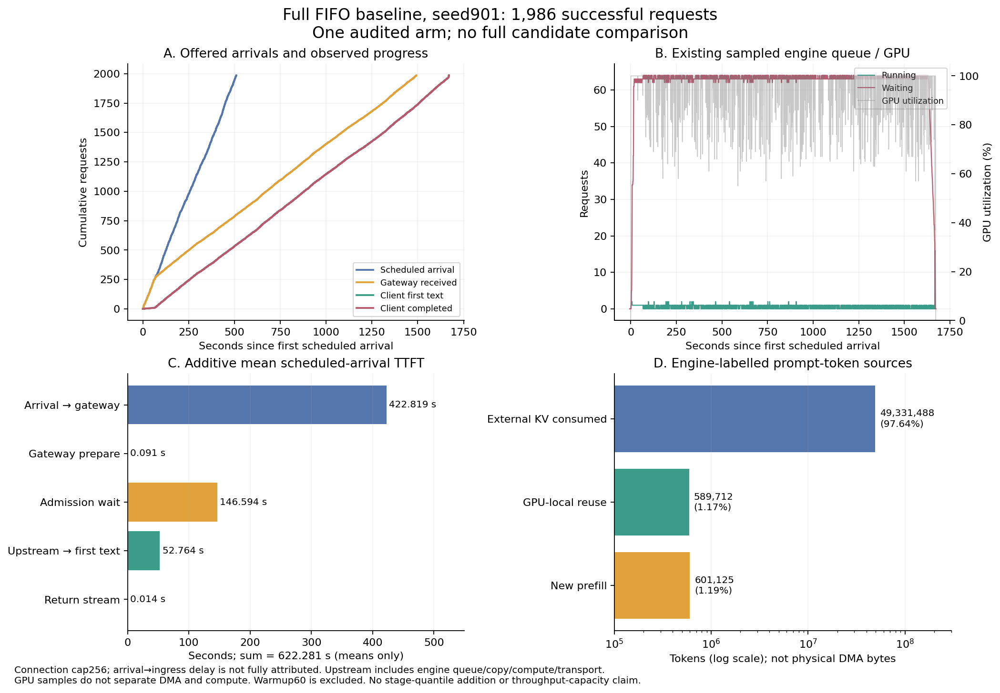
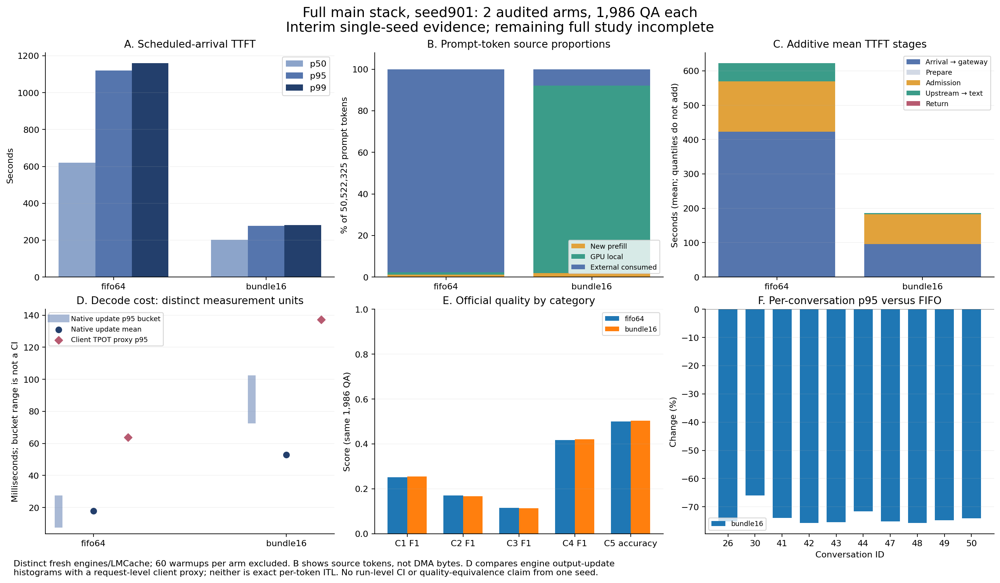
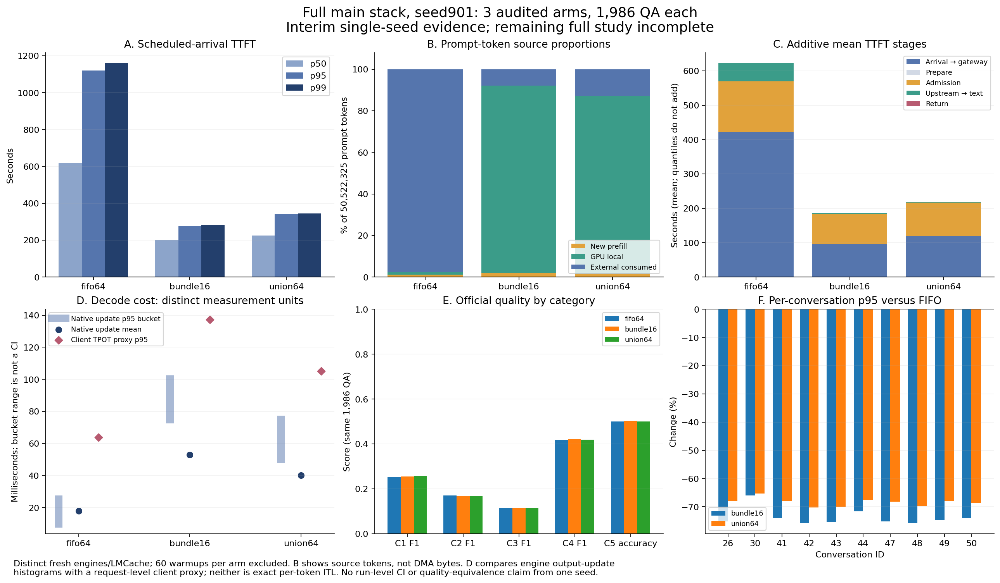

# CacheFlow: tài liệu phỏng vấn Inference Engineer

**Cập nhật 26/10/2026, 23:36 UTC:** Ba full main arms seed901 đã audit đủ1.986QA mỗi arm, không lỗi request; warmups tính riêng. Originalunion giảm p95so vớiFIFO69,435% nhưng **thua bundle23,566%**. Captured chooser counters ghi124,810giâythreadCPU; chưa chứng minh đây là nguyên nhân regression hoặc speedup có thể thu hồi. Readiness đang đo, chưa có full replicated/native conclusion. Tests147/147pass. Các phần V2–V5 giữ scope lịch sử.

**Đính chính resource:** LMCache lazy heap làm tròn lên 64 MiB. Host payload native quan sát là 16.000.745.472 byte, còn main heap là 16.039.018.496 byte (+0,2392%). Budget flag bằng nhau không chứng minh actual cross-engine heap bằng nhau. Lượt stall V5 đã manual abort và giữ đủ client outcomes; nguyên nhân vẫn chưa được chứng minh.

Đọc cùng [báo cáo V6](V6_DEV_EVIDENCE.md), [research questions](PROPOSAL_LOCOMO_AGENTPERF_V2.md), [kế hoạch nghiên cứu](V3_RESEARCH_PLAN.md) [phạm vi baseline/paper](V3_BASELINES.md) và [claim ledger theo từng RQ](V6_RESEARCH_CLAIMS.md). Kết quả tốt về tail không tự chứng minh tốt về median, decode, chất lượng hay liveness.

## 1. Kể project trong hai phút

CacheFlow nghiên cứu cách phục vụ nhiều câu hỏi dùng lại các lịch sử hội thoại dài. Thay vì prefill lại toàn bộ lịch sử mỗi lần, engine có thể tái dùng KV cache của prefix giống hệt về token. GPU nhanh nhưng bộ nhớ hạn chế; CPU RAM giữ được nhiều KV hơn nhưng cần chuyển lại qua PCIe. Project đặt câu hỏi: khi nào tier CPU thực sự giúp, khi nào scheduling có thể tránh việc tính/chuyển dữ liệu thừa, và lợi ích đó còn giữ được khi tính toàn bộ thời gian từ lúc request đến hay không?

Stack hiện tại là Qwen3-4B BF16 trên RTX 3090, vLLM làm inference engine, LMCache giữ CPU KV, và gateway Python điều khiển admission. LoCoMo cung cấp hội thoại thật và QA; arrival là workload được xây dựng có công bố seed, không phải trace production. V2 xác nhận cơ chế tiering và bẫy đo counter. V4 bổ sung admission theo hợp bộ nhớ prefix, đối chiếu vLLM/LMCache và SGLang/HiCache đã tune. V5 sửa mâu thuẫn chỉ dẫn trong prompt và tách rõ lỗi transport. V6 giữ union admission, thêm first-text readiness như một ablation, kiểm trên cả hai backend và đối chiếu source work/quality với controls. Full benchmark và audit nghiên cứu cuối vẫn chưa hoàn tất.

**Câu hỏi: Trong phỏng vấn, nên nói gì là phần mình làm?**

Nói chính xác: xây adapter dữ liệu/prompt có provenance; replay có lịch arrival và capture output; instrument thời gian và source-token counters; xây policy/admission khi có cơ hội đã đo; thiết kế experiment/control/holdout; phân tích latency cùng compute/transfer/quality. Không nhận mình viết vLLM, PagedAttention, LMCache hoặc một thuật toán mới nếu phần đó chưa có.

## 2. Prefill, decode và KV cache

**Câu hỏi: Prefill và decode khác nhau thế nào?**

Prefill xử lý prompt và tạo K/V cho các token đầu vào. Nhiều token có thể được xử lý song song, nhưng attention trên context dài làm chi phí tăng mạnh. Decode tạo từng token mới, mỗi bước đọc lại K/V của lịch sử. Decode thường nhạy với băng thông bộ nhớ và batch size; prefill dài thường sử dụng compute tốt hơn. Đây là mô tả xu hướng: phải profile model, kernel và độ dài cụ thể thay vì mặc định mọi decode đều memory-bound.

**Câu hỏi: KV cache lưu gì, có phải output text không?**

Nó lưu tensor key/value ở các layer attention, không phải câu trả lời hoàn chỉnh. Request sau vẫn phải tính phần suffix khác, sinh output mới và chạy attention. Chỉ token prefix giống hệt, cùng model và các điều kiện cache hợp lệ mới có thể tái dùng trực tiếp. Semantic similarity của hai đoạn văn không đủ để dùng lossless prefix caching.

**Câu hỏi: Tại sao không cache toàn bộ câu trả lời?**

Đó là response caching, một bài toán khác. Hai câu hỏi khác nhau trên cùng lịch sử có thể chia sẻ hàng chục nghìn token KV nhưng cần câu trả lời khác. CacheFlow giữ nguyên inference semantics, tái dùng prefix computation chứ không trả lại một answer cũ.

**Câu hỏi: Tính kích thước KV trên bảng trắng như thế nào?**

Với full attention, xấp xỉ `bytes/token = 2 × layers × KV_heads × head_dim × bytes/element`. Hai lần là K và V. Model4B hiện dùng có36 layer,8 KV head, head dimension128 và BF16 hai byte: `2 ×36 ×8 ×128 ×2 =147.456 byte/token`, tức144KiB/token. Một context32.768token cần4,5GiB KV, chưa tính weights, allocator, activation, runtime và fragmentation. Model1.7B lịch sử có28 layer, tương ứng112KiB/token và3,5GiB cho32K; đó là một geometry khác.

**Câu hỏi: Vì sao dùng KV heads chứ không dùng query heads?**

Model dùng grouped-query attention: nhiều query head dùng chung một số KV head. KV storage phụ thuộc số K/V head thật được lưu. Dùng số query head trong công thức sẽ ước lượng quá cao. Tensor parallelism, KV replication, cache quantization hoặc hybrid attention có thể làm công thức phân bổ theo GPU khác đi.

**Câu hỏi: RTX 3090 24 GiB mà thí nghiệm chỉ cho KV 4/8 GiB có vô lý không?**

Đây là capacity experiment có chủ đích. Ta giữ hardware/model cố định, thay allocated KV budget để kiểm tra điều kiện residency. Không được kết luận workload cần offload khi toàn bộ VRAM khả dụng được cấp cho KV. V2 đo actual capacity 37,440 token ở 4 GiB và 74,896 ở 8 GiB, thay vì chỉ dùng phép chia nominal.

**Câu hỏi: KV cache và prefix cache có phải hai bộ tensor hoàn toàn tách biệt?**

Không nhất thiết. Engine có thể dùng cùng pool block, với reference counts và metadata để phân biệt block đang được request sử dụng với block đã hoàn tất nhưng còn giữ cho reuse. Vì vậy request kết thúc không đồng nghĩa dữ liệu bị xóa; usage của active blocks bằng zero cũng không chứng minh không còn cached prefix.

## 3. Paging, locality và bộ nhớ

**Câu hỏi: PagedAttention giải quyết vấn đề gì?**

Nó cho phép sequence dùng các block vật lý không liên tục, ánh xạ qua block table. Điều này giảm nhu cầu cấp phát một vùng liên tục lớn và hỗ trợ chia sẻ block prefix, copy-on-write khi cần. Nó không tự tạo thêm bandwidth, không làm mọi context cùng fit, và không loại bỏ chính sách eviction/admission.

**Câu hỏi: Vì sao có hit rồi vẫn phải recompute?**

Cần phân biệt hit tại lần lookup, block được giữ đủ lâu để allocation/scheduling thành công, và token cuối cùng thực sự được dùng từ cache. Scheduler có thể thử lại một request nhiều lần. Một counter cộng hit mỗi lần probe có thể lớn hơn tổng input của trace. V2 có trường hợp lookup-hit count cao nhưng actual cached prompt tokens thấp hơn rất nhiều.

**Câu hỏi: Khi cache chỉ còn suffix của một prefix, tại sao chưa chắc dùng được?**

Exact prefix matching thường dựa trên chuỗi block hash có quan hệ với prefix trước nó. Một đoạn cuối còn trong RAM không tự đảm bảo toàn bộ K/V trước đó còn hợp lệ hoặc được engine định vị để resume. Phải xem cấu trúc cache và API cụ thể; không suy từ số byte còn nằm trong pool thành số token có thể dùng.

**Câu hỏi: Working-set size có đủ dự đoán latency không?**

Không. Nó là tín hiệu áp lực, còn latency phụ thuộc reuse distance, arrival burst, request đang chạy, shared blocks, output length, eviction order và queueing. Hai seed có cùng lượng first-pass prefill vẫn có p95 khác đáng kể. Trong V2 holdout, một arm còn tận dụng GPU reuse nhiều hơn arm kia, nên CPU-restored tokens không luôn bằng avoided compute.

**Câu hỏi: Internal và external fragmentation là gì trong bối cảnh này?**

Internal fragmentation là token chưa dùng trong block cuối nhưng block vẫn chiếm chỗ. External fragmentation là còn tổng dung lượng trống nhưng không có vùng liên tục phù hợp; paging giảm vấn đề này. Ngoài ra còn có prefix opportunity loss do chỉ cache/match được block đầy: nó là mất cơ hội reuse, không hoàn toàn đồng nghĩa waste bytes trong allocator.

## 4. CPU ↔ GPU: latency, bandwidth, overlap

**Câu hỏi: Tại sao CPU KV giúp dù CPU chậm hơn GPU?**

Ta thường không chuyển attention computation sang CPU. CPU giữ tensor đã tính; khi cần, dữ liệu được đưa về GPU. Nếu transfer cộng lookup/scheduling nhanh hơn recompute prefix, offload có thể giảm TTFT. Khi prefix vẫn ở GPU, CPU tier có thể chỉ thêm lookup/backup overhead.

**Câu hỏi: Viết điều kiện load-vs-recompute đơn giản thế nào?**

So sánh `T_load ≈ fixed_overhead + bytes/bandwidth + queue_and_sync` với thời gian recompute được đo theo độ dài context/suffix và batch. Nhưng tổng latency không nhất thiết là tổng các phase vì có overlap. Một quyết định tốt cho request riêng lẻ còn có thể làm request khác chậm do chiếm PCIe, SM hoặc KV slots.

**Câu hỏi: Tại sao transfer nhỏ không đạt bandwidth lý thuyết?**

Mỗi transfer có chi phí launch, scheduling và synchronization. Từ Little's Law, throughput I/O lý tưởng liên hệ `X ≈ concurrency × transfer_size / latency`. Nhiều mảnh rất nhỏ có thể bị giới hạn bởi overhead thay vì PCIe throughput. Coalescing hoặc GPU-assisted scatter/gather có thể giúp, nhưng tốn kernel resources và phải bảo toàn mapping dữ liệu.

**Câu hỏi: Pinned memory là gì?**

Đó là host memory được page-lock để DMA có thể truy cập ổn định. Pageable memory có thể cần staging copy. Pinned memory giúp asynchronous H2D/D2H nhưng không miễn phí: dùng quá nhiều làm giảm RAM linh hoạt của OS và có thể ảnh hưởng hệ thống khác. Cần theo dõi allocated pool, resident memory và actual payload riêng.

**Câu hỏi: `non_blocking=True` có bảo đảm overlap không?**

Không. Còn phụ thuộc pinned memory, streams, hardware copy engines, dependency events, tensor lifetime và việc có công việc độc lập để overlap. Một lệnh async sau đó lập tức synchronize vẫn có thể tạo critical-path stall. Phải nhìn timeline hoặc CUDA-event timing, không chỉ nhìn tên API.

**Câu hỏi: CUDA stream và event giúp gì?**

Stream biểu diễn thứ tự công việc; event biểu diễn dependency giữa stream hoặc điểm đo. Transfer stream có thể nạp dữ liệu trong lúc compute stream xử lý phần độc lập, nhưng compute phải chờ event khi thực sự cần KV. Đồng bộ toàn device dễ lập trình nhưng có thể xóa overlap; thiếu đồng bộ gây race/corrupt output.

**Câu hỏi: Vì sao phải quan tâm NUMA/PCIe topology?**

Host memory nằm xa PCIe root complex hoặc thread chạy trên NUMA node khác có thể tăng latency và giảm bandwidth. GPU marketing bandwidth không phải bandwidth end-to-end từ allocation cụ thể đến GPU. Ghi lại topology và pinning khi đo; container có thể hạn chế quyền quan sát hoặc affinity.

**Câu hỏi: LMCache L1 read count có chứng minh có H2D transfer không?**

Không. Ở stack này, L1 là CPU tier. V2 GPU-fit control vẫn có 2,224 L1 read chunks nhưng consumed external KV bằng zero. Lifecycle/read-lock activity, potential cache hits, chunks actually loaded và engine-consumed external tokens là các stage khác nhau. Đây là câu chuyện phỏng vấn tốt về cách phát hiện một measurement bug trước khi kết luận method tốt.

## 5. Queueing và admission

**Câu hỏi: Gateway admission khác engine scheduling thế nào?**

Gateway quyết định request nào gửi vào engine và lúc nào. Engine còn quyết định prefill/decode batch, KV allocation, chunked prefill, preemption và kernel execution. Gateway không có quyền giả định nó kiểm soát được intra-request H2D/recompute nếu chưa có API đã kiểm chứng.

**Câu hỏi: Vì sao giảm engine TTFT có thể là một kết quả sai?**

Nếu gateway giữ request một giây rồi mới dispatch, engine có thể báo nhanh hơn dù client chậm hơn. Primary metric phải là scheduled arrival đến first nonempty generated text. Báo thêm ingress preparation, admission wait, engine queue và execution để giải thích, không thay thế metric end-to-end bằng phase đẹp nhất.

**Câu hỏi: Max inflight có phải max GPU batch size không?**

Không. Inflight của gateway gồm request đang chờ trong engine và đang execute. Engine có `max_num_seqs` và token budget riêng. Gateway cap 16 với engine max sequences 4 có thể chỉ tạo thêm queue, hoặc cho engine thêm lựa chọn để tận dụng shared prefixes. Cap quá thấp cũng có thể giảm batching/throughput.

**Câu hỏi: Vì sao FIFO là baseline cần nhưng chưa đủ mạnh?**

Nó cung cấp đối chứng dễ hiểu, nhưng có thể bỏ lỡ locality hoặc bị một cấu hình cap xấu làm yếu đi. Một method mới cần so với FIFO đã tune, cache-aware ordering như LPM, grouping có aging, và implementation engine mạnh liên quan. Thắng một default FIFO yếu chưa chứng minh đóng góp nghiên cứu.

**Câu hỏi: Tại sao fixed 200-ms delay-hit policy thất bại trong V2?**

Trong các E1 đã đo, FIFO và DHAS có cùng lượng prefill/cache work; vLLM đã tái dùng block theo cơ chế nội bộ trong những điều kiện đó. TTFT có thay đổi nhỏ nhưng đổi dấu theo run/order. Do đó không có bằng chứng delay tạo thêm reuse, và không được xây B5 chỉ để tối ưu tiếp một cơ chế chưa có opportunity.

**Câu hỏi: Làm sao tránh starvation khi ưu tiên cache hit?**

Có thể dùng aging, bound cho số request/cohort liên tiếp, deadline hoặc ưu tiên oldest tại đầu mỗi batch. Nhưng một bound trong policy không tự là bound end-to-end khi queue quá tải. Cần báo cả p95/p99, max wait và nhóm low-reuse, rồi phân biệt intentional deferral với capacity wait.

## 6. Benchmark và correctness

**Câu hỏi: Open-loop và closed-loop khác gì?**

Open-loop giữ lịch arrival độc lập với tốc độ server, cho thấy queue buildup khi offered load vượt capacity. Closed-loop thường duy trì concurrency, gửi request mới khi request cũ xong; server chậm làm arrival giảm. Cả hai có ích nhưng không trộn throughput/latency như cùng một workload. Think-time conversation replay là một mô hình khác cần công bố dependency.

**Câu hỏi: Vì sao percentile của 30 request cần thận trọng?**

p95 được quyết định bởi rất ít request ở đuôi. Repeating ba seed không biến 30 QA thành 90 mẫu dữ liệu nội dung độc lập. Đơn vị uncertainty cho paired experiment là run. Cần nhiều run hoặc steady-state trace dài hơn để kiểm tra tail/SLO, đồng thời giữ failures/timeouts trong báo cáo.

**Câu hỏi: Warmup/reset đúng cần làm gì?**

Chờ không còn active/queued request; dùng cùng warmup cho mọi arm; chờ async stores hoàn tất; clear CPU cache và reset GPU prefix cache; kiểm tra health/gauge và ghi PID. Nếu đổi engine/config, công bố cold restart; không gọi đó là same-engine crossover. Prefill của cold prefixes là một kiểm tra thực nghiệm bổ sung cho reset.

**Câu hỏi: Temperature zero có bảo đảm output y hệt không?**

Không. Batch shape, kernel/reduction order và sai khác số học có thể đổi argmax ở vị trí gần hòa. Hash mismatch chứng minh text khác, không tự chứng minh semantic corruption. Cần giữ text, chấm theo evaluator cố định và xem trường hợp cụ thể; cũng không dùng lý do nondeterminism để bỏ qua một regression thật.

**Câu hỏi: Lossless KV offload có bảo đảm QA quality không đổi không?**

Lossless mô tả cách lưu tensor, không phải một theorem về output của toàn pipeline. Phải bảo đảm đúng model, token positions, dtype, block mapping, synchronization và request isolation. Sau đó vẫn cần audit output/score vì execution shape có thể khác. V2 có score/hash differences nên không claim blanket equivalence.

**Câu hỏi: Vì sao raw-template V2 có F1 thấp?**

Nhiều generation lặp câu và chạm cap 64 token; original evaluator chấm toàn bộ generation nên verbosity/repetition làm precision thấp. Đây là lỗi phù hợp prompt/model/protocol cần công bố. Không được cắt đáp án sau khi nhìn gold để tăng score rồi giữ cùng tên protocol. V3 dùng chat template và concise instruction đã freeze trước comparison mới.

**Câu hỏi: Gold leakage được tránh thế nào?**

Prompt chỉ chứa conversation text, public caption, chronology và câu hỏi. Gold answer và evidence annotation dùng ngoài inference cho grading/checkpoint construction. P-SESSION chỉ lộ history tới checkpoint chứa evidence hợp lệ; full-context QA và adapted checkpoint serving được chấm/report riêng.

## 7. Profiling: cách trả lời có chiều sâu

**Câu hỏi: Bắt đầu profiling từ đâu?**

Đầu tiên xác định symptom: queue tăng, TTFT tăng, GPU idle hay transfer lớn. Tách arrival → receive → tokenize/hash → admission → engine queue → prefill/restore → first token → decode. Thu resource/counter để có giả thuyết, sau đó dùng timeline/events để xác định critical path. Chạy lại unprofiled để kiểm tra overhead của profiler.

**Câu hỏi: CPU wall-clock timing đủ cho CUDA chưa?**

Không, API có thể trả về trước khi GPU xong. CUDA events hoặc GPU-stream callbacks giúp đo execution/transfer thật. Nhưng chúng dùng clock domain khác client monotonic time; cần calibration/correlation và request/session IDs. Thời gian bus subscriber xử lý event không phải thời gian event xảy ra.

**Câu hỏi: Tổng CUDA time có bằng end-to-end latency không?**

Không. Các kernel/copy có thể overlap, CPU có thể stall, queue có thể đợi, và profiler có nhiều stream. Cộng toàn bộ duration có thể double-count overlap. Cần nhìn critical path/union intervals và phân loại phase, đồng thời giữ latency client làm primary outcome.

**Câu hỏi: Chọn ablation thế nào?**

Mỗi ablation bỏ một cơ chế cụ thể: ordering, residency budget, cost model, aging hoặc overlap. Dùng cùng trace/reset và không lén thay output length. Nếu baseline cap tốt đã tạo toàn bộ gain thì phải nói đóng góp chỉ là cap selection, không nhận phần lợi ích đó cho một policy phức tạp hơn.

## 8. Paper/baseline: nói đúng phạm vi

Strata (OSDI 2026) liên quan trực tiếp CPU/GPU I/O và cache-aware scheduling; Cake (ICML 2025) liên quan compute/load overlap; LPC (NeurIPS 2025) là learned eviction; EpiCache (ICML 2026) là episodic compression cho long-conversation QA. Xem nguồn gốc và trạng thái implementation tại `docs/V3_BASELINES.md`.

**Câu hỏi: Nếu không chạy được code paper thì làm gì?**

Ghi chính xác commit, dependency, hardware requirement và lỗi thử chạy. Có thể port một cơ chế, nhưng phải gọi là adaptation và mô tả phần bị bỏ. Không lấy số published trên H100/H200 để làm baseline trực tiếp cho RTX 3090. Nếu baseline cần training, không dùng một predictor random rồi gọi đó là method của paper.

**Câu hỏi: Contribution cần chứng minh điều gì để mạnh hơn V2?**

Cần một cơ chế có thể giải thích bằng profiling, vượt baseline mạnh/tuned ở metric end-to-end hoặc SLO throughput, còn giữ được chất lượng và không che tail/low-reuse regression. Cần confirmation chưa dùng để tune, repeated runs và ablation. Một observation đúng hoặc một speedup so với FIFO chưa tự đáp ứng tiêu chuẩn này.

## 9. Kết quả V3 và phần diễn tập nâng cao

Các phần10–17 giải thích diagnostic và các quyết định phát triển. Phần18 sửa đơn vị ngân sách; phần19 trình bày dev/held-out, tradeoff chất lượng và phân rã latency; phần20 diễn tập tính bộ nhớ/admission. Full benchmark chưa hoàn tất nên các kết luận full vẫn để mở.

## 10. Profiling V3 đã quan sát: bài học có số liệu

Các số dưới đây là diagnostic/screen, chưa phải kết luận contribution cuối.

**Câu hỏi: Bạn từng gặp profiler làm sai kết luận chưa?**

Có. Cùng trace dev 60 QA và cùng cap 16, run bật PyTorch profiler có p95 khoảng 31.03 giây; run unprofiled khoảng 3.57 giây. Nếu xem run có profiler là baseline thật, ta sẽ tưởng queueing là vấn đề lớn hơn thực tế rất nhiều. Profile CUDA window thu được khoảng 8.32 giây, model-kernel union khoảng 6.43 giây; phần này chủ yếu là đầu trace/cold phase. Vì vậy không dùng nó đại diện toàn bộ steady state. Trace được giữ để xem kernel/dependency; latency chính phải lấy từ unprofiled comparisons.

**Câu hỏi: Bạn kiểm tra bandwidth đường CPU–GPU thế nào trước khi tối ưu?**

`nvidia-smi` báo link tối đa thực tế trên host này là Gen3 x16, dù tên card có thể khiến mình nghĩ tới Gen4. Từ encoding PCIe Gen3, băng thông lý thuyết một chiều x16 xấp xỉ 15.75 GB/s, trước protocol overhead. Lightweight LMCache GPU-stream events ghi 56 retrieve events, khoảng 121.7 GB payload, 10.73 giây duration cộng dồn; median event throughput khoảng 11.35 GB/s. Đây là băng thông transfer, không phải throughput request và không phải toàn bộ latency request. Tổng thời gian event có thể overlap, nên không cộng thẳng vào E2E TTFT.

**Câu hỏi: Tại sao không kết luận cần viết kernel H2D nhanh hơn ngay?**

Băng thông đã đạt phần đáng kể giới hạn link; cải thiện kernel có trần lợi ích. Giảm byte phải chuyển bằng residency/locality có thể có headroom lớn hơn, nhưng có nguy cơ tăng queue wait hoặc starvation. Screen cho thấy có policy giảm transfer mà p95 vẫn xấu hơn. Cần tối ưu outcome cuối, không chỉ một resource counter.

**Câu hỏi: Model lớn hơn làm capacity planning thay đổi gì?**

Model 4B hiện dùng có 36 layer thay vì 28. Với 8 KV head, head dimension 128 và BF16, KV là 144 KiB/token; context 32K cần 4.5 GiB KV. Vì vậy không được bê nguyên budget 4 GiB từ model 1.7B rồi gọi OOM là method failure. Model và checkpoint phải được pin/verify trước khi dùng; đoạn này ban đầu được viết trước khi tải xong, còn hiện tại cả ba shard đã được kiểm SHA và các lượt GPU dev/held-out đang được đánh giá.

**Câu hỏi: Một baseline cache-aware mạnh có thể vẫn làm hại fairness như thế nào?**

LPM có thể ưu tiên request khớp prefix vừa dùng, giảm migration từ CPU nhưng làm nhóm khác đợi. Cap 1 có thể giúp locality song làm mất batching. Bundle theo wave giúp một số shared-prefix requests nhưng có thể phải đợi request sinh dài nhất trong wave. Cần cùng cap, cùng engine và cùng trace để phân biệt lợi ích ordering với lợi ích throttle; kiểm tra p95/p99 và từng nhóm request, không chỉ median.

### 10.4. Vì sao “request gần nhất” không đồng nghĩa với KV đang ở GPU?

**Hỏi:** Dùng conversation vừa phục vụ để chọn request tiếp theo có đủ chính xác không?

**Đáp:** Không. Trong thời gian một request decode, những request khác có thể làm các block cũ bị thu hồi. Một conversation cũng có thể chỉ còn một phần prefix trên GPU. LPM-hint của baseline dùng lịch sử request nên chỉ là tín hiệu gần đúng. Baseline actual-GPU LPM và prototype residency V3 đã dùng sự kiện `BlockStored`, `BlockRemoved`, `AllBlocksCleared` mà vLLM phát ra. Gateway tạo cùng chuỗi hash theo block 16 token và đếm prefix liên tiếp còn trong index. Thông tin này vẫn có độ trễ truyền sự kiện; nó là ước lượng phục vụ admission, không phải quyền sở hữu hay khóa block trong allocator.

**Hỏi:** Hash của gateway làm sao khớp hash của engine?

**Đáp:** Phải khớp cả seed của block đầu, thuật toán, cách serialize, kích thước block và các khóa phụ. Bản vLLM đã pin dùng `sha256(pickle((parent_hash, token_ids_tuple, extra_keys)))` cho cấu hình text-only này. Cả hai tiến trình đặt `PYTHONHASHSEED=0`; hash gốc được tạo từ chuỗi `"0"`. Gateway đã được đối chiếu trực tiếp với hàm vLLM trên sáu block nối tiếp. Không được suy ra rằng contract này tự động đúng cho LoRA, multimodal, cache salt hay bản vLLM khác.

**Hỏi:** Nếu subscriber bỏ lỡ một sự kiện thì sao?

**Đáp:** Nếu bỏ lỡ sự kiện remove, gateway có thể tưởng một block đã bị đuổi vẫn còn trên GPU. Mỗi batch có số thứ tự; khi phát hiện khoảng trống, prototype xóa index và chuyển sang FIFO. Chỉ một sự kiện clear đáng tin cậy mới thiết lập lại trạng thái biết chắc từ cache rỗng. Khi gateway mới khởi động, trạng thái mặc định là chưa biết. Health endpoint phải cho thấy subscriber còn chạy, số gap và tuổi của sự kiện cuối. Kết quả đo dùng residency phải kiểm tra các điều kiện này, thay vì thấy tiến trình sống là cho rằng observer hoạt động.

**Hỏi:** Vì sao cần đếm số bản sao của cùng một hash?

**Đáp:** Hai block vật lý có thể biểu diễn cùng nội dung prefix. Một remove chỉ làm mất một bản sao. Nếu dùng tập hợp rồi xóa hash ngay, index sẽ báo miss dù vẫn còn bản sao khác. Prototype dùng bộ đếm tham chiếu; chỉ bỏ hash khi không còn bản sao được quan sát.

### 10.5. Admission theo bộ nhớ khác giới hạn concurrency như thế nào?

**Hỏi:** Cap bốn request có đảm bảo vừa GPU không?

**Đáp:** Không. Bốn request cùng prefix có thể dùng chung phần lớn KV; hai request khác nhau dài 25 nghìn token có thể cần hơn 50 nghìn token KV. GPU KV 4 GiB của model 1.7B trong cấu hình này chỉ chứa khoảng 37.440 token. Vì thế số request là một chỉ báo quá thô.

**Hỏi:** Prototype ước lượng bộ nhớ ra sao?

**Đáp:** Lấy hợp các hash block đầy đủ của các request đang active, mỗi hash chỉ tính một lần. Sau đó cộng riêng đuôi prompt chưa đủ block, ngân sách token sinh và một block dự phòng cho từng request, làm tròn theo block. Đây là dự phòng bảo thủ ở cấp gateway; allocator thật còn có null block, copy-on-write và thời điểm giải phóng bất đồng bộ. Prototype1.7B lịch sử dùng37.424token thay vì37.440 để chừa null block. Cấu hình4B/GPU6GiB hiện dùng43.664token admission so với43.680token pool vật lý. Engine vẫn chịu trách nhiệm bảo vệ bộ nhớ và tính đúng của attention.

**Hỏi:** Khi request đầu hàng không vừa thì phải làm gì?

**Đáp:** Có thể cho một request phía sau dùng chung prefix với nhóm đang active đi trước, nếu dự phòng bộ nhớ vẫn vừa. Nhưng phải giới hạn số lần vượt hàng. Prototype lịch sử cho phép bốn lượt; cấu hình V4 đã khóa cho phép tám lượt, rồi ngừng backfill để các request đang chạy hoàn thành và request cũ được phục vụ. Khi không có active request, luôn cho request cũ nhất tiến lên; nếu chỉ chờ một ước lượng vừa bộ nhớ, một request dài đơn lẻ có thể bị kẹt vô hạn.

**Hỏi:** Đã chứng minh đây là contribution chưa?

**Đáp:** Chưa. Đây là giả thuyết đang được kiểm chứng. Cần thắng FIFO đã tune, LPM có cùng thông tin residency và bundle-wave; cần kiểm tra riêng memory packing, thông tin cache và guard chống starvation. Ngoài p95 còn phải đo p99, độ trễ theo conversation, lượng KV CPU thực sự được tiêu thụ và chất lượng output. Một heuristic giảm transfer nhưng làm hàng đợi lâu hơn không thỏa RQ2.

**Bài học từ lỗi đo thực tế của V3:** Hàm hash nội bộ đã khớp nhưng vẫn chưa đủ: engine mặc định chuyển hash ra ngoài thành số nguyên 64-bit để tương thích cũ. Gateway giữ bytes nên mọi lookup đều miss, dù sự kiện đến đầy đủ. Những lượt screening này được đánh dấu diagnostic và không dùng để kết luận lợi ích từ residency. Cấu hình sửa buộc engine phát bytes bằng `VLLM_KV_EVENTS_USE_INT_BLOCK_HASHES=0`; subscriber kiểm tra cả kiểu dữ liệu lẫn hash của một payload store thật. Đây là ví dụ vì sao “metric có số” và “tiến trình không lỗi” không chứng minh phép đo đúng.

## 11. Thiết kế thí nghiệm và phản biện kết quả

**Hỏi: Ba seed, mỗi seed 60 QA, có phải là 180 câu hỏi độc lập không?**

Không. Cùng 60 QA được phát theo ba lịch arrival khác nhau. Seed kiểm tra độ nhạy với thứ tự và khoảng cách request, không mở rộng độ đa dạng câu hỏi. Khi so latency, đơn vị lặp quan trọng là cặp lượt chạy cùng trace; khi báo chất lượng phải ghi rõ chỉ có 60 QA khác nhau. Lấy 180 hàng làm 180 mẫu độc lập sẽ phóng đại độ chắc chắn.

**Hỏi: Vì sao không chỉ lấy trung bình tất cả request rồi bootstrap?**

Các request trong một run ảnh hưởng cache và hàng đợi của nhau. Một request chậm có thể làm nhiều request sau chậm theo. Bootstrap từng request như thể độc lập sẽ bỏ qua tương quan đó. Với ba run, nên trình bày từng seed, mức biến thiên và cơ chế work-saving; không tuyên bố ý nghĩa thống kê mạnh chỉ vì có hàng trăm hàng log. Muốn confidence interval đáng tin hơn cần thêm run độc lập và workload đa dạng.

**Hỏi: Lấy 20 QA đầu mỗi conversation có nhược điểm gì?**

Thứ tự QA gốc có thể liên quan đến category hoặc độ khó; đây không phải mẫu ngẫu nhiên đại diện toàn LoCoMo. Dev subset giúp screening có chi phí kiểm soát, nhưng kết luận phải giữ đúng phạm vi. Để tuyên bố benchmark tổng quát cần đánh giá toàn bộ phần fit hoặc một mẫu được phân tầng, đóng băng trước khi xem kết quả. Conversation-disjoint holdout kiểm tra một loại tổng quát hóa khác với thay seed trên cùng câu hỏi.

**Hỏi: Throughput đo từ replay open-loop có phải công suất tối đa của server không?**

Không nhất thiết. Nếu arrivals thưa, server chủ yếu chờ request; throughput khi đó bị giới hạn bởi lịch gửi. Nếu arrivals dồn và queue lớn, makespan phản ánh năng lực xử lý rõ hơn nhưng vẫn phụ thuộc trace hữu hạn. Vì vậy cần nhiều offered load, báo queue growth, TTFT và thời gian hoàn tất trace, đồng thời phân biệt achieved throughput với saturated throughput.

**Hỏi: Chất lượng baseline V3 hiện thế nào?**

Audit chính thức của chín lượt baseline dev (ba policy × ba seed, cùng 60 QA) cho F1 khoảng 0,096–0,103. Số output chạm cap 96 token chỉ 0–1/60, cải thiện vấn đề câu trả lời dài của prompt V2, nhưng điểm tuyệt đối vẫn thấp. Không thể gọi đó là chất lượng tốt hoặc kết luận tương đương chỉ từ các giá trị trung bình gần nhau. Cần xem các output thay đổi, điểm theo category và chạy model mạnh hơn với cùng protocol.

**Hỏi: Nếu LPM thật giảm transfer mà p95 tăng thì giải thích thế nào?**

LPM tối ưu mức trùng prefix tại thời điểm chọn, không trực tiếp tối ưu thời gian chờ của request lâu nhất. Nó có thể phục vụ liên tiếp một conversation và làm conversation khác chờ, hoặc cho nhiều request cùng tràn vào engine khiến dự đoán residency mất hiệu lực sau đó. Cần nhìn cả admission wait, engine queue wait, active-memory union, transfer và latency theo conversation. Đó là lý do baseline LPM phải được đo thật và candidate cần guard; không thể suy ra giảm byte chuyển đồng nghĩa giảm tail latency.

## 12. Đối chiếu với một engine độc lập

**Hỏi: Đã chạy được baseline của hệ thống khác trên chính dữ liệu này chưa?**

Đã chạy upstream SGLang0.5.14 với HiCache/LPM trên cùng model 1.7B, prompt V3 và dev trace 60 QA. Một run hợp lệ đã kiểm tra token prompt, capture output và native metrics; p95 khoảng 6,94 giây ở seed101. Cấu hình có decode CUDA graphs, cache GPU37.440 token và CPU16 GB thập phân (đơn vị native HiCache). Đây là kết quả dev ban đầu, còn cần thêm seed và tune backend. Không gọi nó là toàn bộ Strata: việc dùng HiCache không tự động tái hiện mọi thành phần scheduler trong paper.

**Hỏi: Vì sao không so trực tiếp counter giữa SGLang và vLLM?**

Tên và nơi tăng counter khác nhau. vLLM có source-token accounting cho phần KV thực được engine sử dụng; HiCache có counter số token được yêu cầu promote từ host và timer quanh hàm `load_back`. Trong source đã kiểm tra, hàm này enqueue copy bất đồng bộ rồi trả device indices. Timer CPU quanh hàm có thể rất ngắn dù DMA vẫn chạy sau đó. Vì vậy không lấy số byte chia timer này để tuyên bố băng thông PCIe khổng lồ. Cần CUDA events/timeline đúng stream và phải xác minh điểm đồng bộ hoàn tất.

**Hỏi: So hai engine cần kiểm soát thêm những gì?**

Ngoài model/prompt/token budget/arrival/cache capacity, phải ghi attention backend, graph mode thực đã resolve, chunked-prefill size, concurrency, dtype, cache layout, host write policy và phiên bản kernel. Ở baseline này, upstream SGLang tự tắt prefill graphs với Triton dù decode graphs bật. Hai engine cũng có thể sinh output khác nhau ở temperature0; phải chấm câu trả lời thay vì mặc định số học floating-point và batching hoàn toàn bất biến.

**Hỏi: Một phiên bản thư viện cài thành công đã chứng minh baseline khả dụng chưa?**

Chưa. V3 đã gặp wheel native đòi cuBLAS13 trong môi trường torchCUDA12.8, rồi thiếu dependency của HTTP/audio entrypoint dù chỉ phục vụ text. Các cổng kiểm tra theo thứ tự là import native → nạp model → cấp KV/CPU pools → sinh token → replay đúng token/output → audit metrics/quality. Lượt replay đầu HiCache còn gặp lỗi sampler khi một tiến trình con thoát; nó được giữ làm diagnostic và chạy lại với ID mới. Không lấy việc mở cổng HTTP thay cho kiểm chứng phục vụ thật.

### 12.1. Kiểm tra với model mạnh hơn

Qwen3-4B đã được tải ở revision cố định và kiểm SHA cả ba shard. Lượt FIFO đầu trên cùng 60 QA dev của prompt V3 cho F1 **0,3147**, với 3/60 output chạm cap96; đây là kiểm tra chất lượng tốt hơn model1.7B (~0,10), không phải kết quả toàn LoCoMo. Cấu hình 4B dùng KV6GiB, CUDA graphs và maxseq16. Model4B có36 layer,8 KV head, head dimension128: `2 ×36 ×8 ×128 ×2 =147.456 byte/token`, tức144KiB/token. Context32K cần4,5GiB chỉ cho KV, vì thế không thể giữ nguyên budget4GiB của1.7B rồi tuyên bố cùng maximum context.

**Hỏi: Đổi sang model4B có đủ để gọi contribution mạnh hơn chưa?**

Không. Nó giúp kiểm tra rằng workload có câu trả lời hữu ích hơn và cơ chế có tổng quát qua model hay không. Contribution scheduling vẫn cần thắng baseline được tune trên cùng model4B, giữ đúng prompt/output budget, kiểm soát p95/p99 và chấm các output thay đổi. Thời gian giữa model1.7B và4B không phải phép so nhân quả chỉ thay số tham số, vì KV geometry và budget cũng thay đổi. Những kết quả đầu vẫn là dev screening; confirmation chưa được chạy.

## 13. CPU trong gateway có thể làm hỏng một thí nghiệm GPU như thế nào?

**Hỏi: Gateway chỉ admission, tại sao lại ảnh hưởng mạnh đến tail latency?**

Gateway dùng một asyncio event loop. Đoạn tính toán Python đồng bộ chạy lâu sẽ giữ event loop, khiến việc đọc body, xử lý socket, chuyển tiếp token và giải phóng ticket cùng phải đợi. Nếu mỗi waiter thức dậy rồi tính lại một quyết định giống nhau, chi phí còn nhân với số request đang chờ. Đẩy việc chờ ra gateway không loại bỏ chi phí đó: arrival-TTFT phía client vẫn tính tất cả.

**Hỏi: Profiling thực tế đã tìm thấy gì?**

Một CPU microprofile với kích thước prefix lấy từ trace,4 active/50 queued/50 recent cho thấy việc dựng hợp block của cùng nhóm active lặp lại cho từng ứng viên chiếm phần lớn thời gian. Microbenchmark không bật profiler đo bản cũ khoảng12,06ms cho một quyết định; bản tái dùng active union khoảng4,57ms; quyết định lặp lại trên trạng thái không đổi khoảng0,006ms. Nội dung block trong microbenchmark là tổng hợp, không phải một lượt QA end-to-end. Không đem tỷ số đó quảng cáo là speedup của toàn hệ thống.

**Hỏi: Tối ưu cụ thể là gì?**

Tạo tập hợp `A` của block active một lần. Dự phòng thêm cho request mới là số block của nó chưa thuộc `A`, cộng đuôi prompt/output/safety. Dùng phép hiệu tập hợp trong C của Python thay cho dựng lại toàn bộ union hoặc một generator Python chạy qua từng block. Cache lựa chọn khi queue order, active IDs và bypass counts không đổi. Với LPM/residency, khóa cache phải có cả sequence của sự kiện KV; packing không dùng số GPU hit nên không cần vô hiệu hóa chỉ vì một sự kiện cache mới.

**Hỏi: Chứng minh tối ưu không âm thầm đổi policy như thế nào?**

Đối chiếu với source prototype ở commit cố định trên270 lần chọn, bao gồm queue, active set, guard, trạng thái residency và các policy khác nhau. Kiểm tra riêng công thức incremental reservation bằng100 trạng thái có prefix chia sẻ, block khác nhau, block lặp và output budget khác nhau. Các test còn kiểm tra cache phải vô hiệu khi queue/active/guard hoặc KV-event sequence thay đổi. Đây là kiểm chứng logic; GPU repetitions sau đó mới kiểm tra lợi ích vận hành.

**Hỏi: Vì sao giữ cả CPU time và wall time của decision?**

`thread_time_ns` đo CPU của thread chạy scheduler; `perf_counter_ns` đo thời gian thực trôi qua, gồm cả lúc thread bị hệ điều hành ngắt. Hai con số trả lời hai câu hỏi khác nhau. Decision-cache hit count cũng cần thiết: gọi `_choose` hàng nghìn lần không có nghĩa đã tính hàng nghìn quyết định đầy đủ. Không dùng số lần gọi làm số request được admit.

**Hỏi: Các lỗi HTTP502 ban đầu được xử lý ra sao?**

Một số arm cap16 trả ReadError từ upstream; các run đó được đánh dấu invalid, giữ nguyên toàn bộ request lỗi và không so percentile chỉ trên request thành công. Telemetry mới giữ loại exception, cause và nội dung lỗi HTTP. Sau tối ưu, hai lượt chẩn đoán cùng packing16 đều60/60 thành công dù giữ128 hay0 kết nối upstream. Vì thế chưa chứng minh keep-alive là nguyên nhân duy nhất. Các lượt chính tiếp theo chuẩn hóa kết nối local mới và không retry; request lỗi sẽ làm ma trận thông thường dừng.

**Hỏi: Có nên tự động retry để đủ60/60 không?**

Không dùng retry ẩn trong benchmark. Một POST bị mất kết nối có thể đã được engine nhận; gửi lại có thể tạo công việc thừa, thay đổi queue/cache hoặc trùng request ID. Nếu sau này nghiên cứu retry, phải công bố policy, tính cả thời gian/compute của mọi attempt và giữ nguyên lỗi gốc. Trong protocol hiện tại, lỗi được báo và lượt chạy bị loại khỏi kết luận hiệu năng.

**Hỏi: Guard bốn lượt có đảm bảo request chờ không quá200ms không?**

Không. Nó giới hạn số request phía sau được vượt head trong policy packing. Sau ngưỡng đó, policy chờ các request active hoàn thành để head tiến lên. Thời gian còn phụ thuộc decode, tải GPU và độ trễ upstream; không có hard latency bound chỉ từ số lượt bypass. Tham số200ms thuộc baseline DHAS, giới hạn một loại deferral khi có slot, chứ cũng không thể xóa queue do cap hoặc overload. Mọi kết luận dùng arrival-TTFT và thời gian chờ thực, không dùng tên tham số để thay cho SLA.

**Hỏi: Có lỗi prompt/evaluator nào chỉ xuất hiện khi mở rộng toàn bộ QA không?**

Có. Official evaluator của category5 chấm abstention bằng cụm “no information available” hoặc “not mentioned”. Prompt V3 yêu cầu “I don't know”, nên có thể bị chấm sai dù model nhận biết không có thông tin. Những dev cohort60 QA hiện tại không có category5; điểm F1 của chúng không được suy ra cho cả benchmark. Protocol V4 được chuẩn bị trước formal freeze, đổi cùng một hướng dẫn toàn cục thành “No information available.”, giữ nguyên nội dung câu hỏi, context và output budget. Không thay câu trả lời sau khi sinh hoặc đổi evaluator để làm đẹp điểm; các baseline phải chạy lại cùng protocol mới.

## 14. Ma trận HiCache ban đầu và cách giải thích tradeoff

Các số dưới đây là **dev V4 giai đoạn đầu, trước guard**, chưa phải cấu hình cuối hoặc confirmation/toàn LoCoMo. Kết quả cấu hình guard/Direct mới hơn ở phần19. Cùng60 QA được chạy theo ba arrival seed, model Qwen3-4B, GPU KV6GiB, CPU16GB thập phân, FlashInfer/kernel, native LPM16, decode graphs. Gateway giữ nguyên native LPM bên trong. Nguồn: `results/v3/sglang/v4_gateway_dev_analysis.json` và `v4_gateway_dev_quality.json`.

| Policy | Mean p50 TTFT | Mean p95 TTFT | Mean p99 TTFT | Mean answerable F1 |
| --- | ---: | ---: | ---: | ---: |
| Native LPM | 6,149s | 23,062s | 24,694s | 0,3028 |
| FIFO gateway + native LPM | 11,860s | 22,764s | 24,393s | 0,3072 |
| Packing + native LPM | 17,349s | 19,675s | 20,376s | 0,3082 |
| Reuse-gated packing + native LPM | 16,838s | 19,207s | 19,902s | 0,3075 |

**Hỏi: Có thể nói candidate thắng native LPM không?**

Có thể nói nó giảm tail trong điều kiện dev đã đo, nhưng phải nói cùng lúc median tăng rất lớn. Native LPM có thể phục vụ một phần request nhanh, trong khi nhóm khác chờ lâu; packing thay đổi thứ tự và số request được đưa vào engine nên phân bố latency khác. Chưa đủ dữ liệu để quy toàn bộ hiện tượng cho fairness giữa conversation; cần đối chiếu timeline từng nhóm. Nếu sản phẩm coi p50 là mục tiêu chính, đây có thể là một lựa chọn tệ hơn. Research claim cần chỉ rõ mục tiêu tail/fairness, mức giá ở median và miền tải có lợi, rồi xác nhận ngoài dev.

**Hỏi: Tại sao không chỉ so với FIFO gateway?**

Gateway tự có chi phí tokenization, lập lịch, HTTP hop và điều tiết concurrency. Bảng cho thấy riêng FIFO gateway đã tăng median so với native direct. Nếu chỉ so candidate với gateway FIFO, ta có thể bỏ qua baseline native nhanh hơn ở một chỉ số quan trọng. Cần cả native direct, gateway FIFO và candidate trên cùng backend; tiếp tục tune concurrency1/4/16/32 để loại khả năng lợi ích chỉ là giảm concurrency.

**Hỏi: Thay đổi giới hạn bypass cho thấy điều gì?**

Một sweep dev seed101 với native in-batch thresholds1024 cho p95 native20,520s. Bypass0/4/8/16/32 cho35,959/19,169/18,311/19,751/20,348s. Mức0 thực hiện ít uncached prefill nhất nhưng tệ nhất về latency; mức8 tốt nhất về tail trong sweep này nhưng median15,565s vẫn cao hơn native4,800s. Đây là dữ liệu tuning một seed, chưa đủ chọn cấu hình để công bố thắng. Guard quá chặt làm head-of-line blocking và có thể phá locality; quá lỏng làm một nhóm đợi lâu. Audit raw log xác nhận số bypass thực đạt0/4/8/16/19, thay vì suy ra từ tham số cấu hình.

**Hỏi: SGLang đã có kiểm tra memory trước admission, vậy gateway bổ sung gì?**

Trong `PrefillAdder.add_one_req` của phiên bản đã pin, engine kiểm tra phần input còn lại cộng max-new-token và một safety page, rồi kiểm tra lại sau khi lock cache node. Vì vậy không được nói engine bỏ quên memory budgeting. Gateway dùng hợp các block prompt của toàn bộ request đang active để điều tiết **những request nào được nhìn thấy bởi engine và vào thời điểm nào**; nó không sở hữu allocator và không bảo đảm node vẫn resident khi dispatch. Cần ablation với concurrency cap và native scheduler mạnh để chứng minh lợi ích bổ sung.

**Hỏi: Có phải candidate bắt engine restore thay cho recompute không?**

Không. Gateway hiện chỉ điều khiển admission/order. HiRadix có nhánh all-or-nothing trong `load_back`, nhưng standard admission đang gọi `InitLoadBackParams` mà không truyền `mem_quota`, nên mặc định làNone. Không thể nhìn thấy nhánh quota trong source rồi kết luận đó là nguyên nhân của run này. Cần log các lời gọi và kết quả thực, GPU/host prefix tại admission và lượng compute tương ứng. Hook chẩn đoán được tách khỏi benchmark chính; giả thuyết chưa được đo không trở thành kết luận.

**Hỏi: Vì sao có trường hợp candidate promote nhiều CPU token hơn mà tail tốt hơn?**

Ít transfer chưa chắc tốt nếu đổi lại phải tính lại một prefix dài. Trong ba seed dev, reuse-gated packing có trung bình72.278 uncached token, thấp hơn native90.454; đồng thời nó có166.560 host-promotion token trung bình. Counter promotion của native bị thiếu ở một run, nên aggregate native phải đểnull, không tự điền0. Có thể có đánh đổi giữa compute, restore và queueing, nhưng các tổng counter chưa chứng minh causal path của từng request. Số byte và kernel timeline giúp kiểm tra đánh đổi đó; riêng một cache-hit ratio thì không đủ.

## 15. Đo transfer thật: đơn vị, stream và giới hạn kết luận

**Hỏi: Đã đo được byte thật ở LMCache chưa?**

Trong diagnostic riêng bật batch-invariant và event logging, FIFO57 retrieve event có127.628.476.416byte, còn packing10 event có17.477.664.768byte: giảm khoảng86,3%. Tổng retrieve-phase duration11,630→1,617giây; median effective bandwidth khoảng11,03/10,84GB/s. Hai lượt có120/120 request thành công và0/60 output-hash mismatch. Đây là bằng chứng byte/event và correctness trong chế độ diagnostic; latency của nó không thay thế benchmark thường vì batch-invariant thay kernel. Các byte event giữ nguyên semantics LMCache; không đồng nhất một cách mù quáng với số token được engine sử dụng.

**Hỏi: CUDA events trên HiCache đo khác CPU timer thế nào?**

Hook đặt start event trên load stream thực, sau dependency wait của controller, trước layer đầu; đặt end sau layer cuối. Một thread nền dùng `end.query()` rồi mới đọc elapsed, không gọi synchronize toàn GPU. Diagnostic candidate có9 load,166.560token,24.560.271.360byte; coverage token khớp counter promotion. Tổng GPU load-stream span2,175giây, median effective11,29GB/s. CPU enqueue timer chỉ0,120giây cho cùng run, vì đo công đoạn CPU khác. Khoảng GPU này bao gồm cả khoảng hở do CPU chưa enqueue layer kế tiếp; nó không phải tổng thời gian thuần của từng DMA kernel.

**Hỏi: Từ tổng2,175giây có suy ra TTFT giảm đúng2,175giây không?**

Không. Các transfer có thể chồng lên compute, nằm ngoài critical path của một số request, hoặc phải chờ dependency. Tổng thời gian nhiều event cũng không bằng độ dài hợp các interval nếu các event overlap. Muốn nói phần transfer được che bởi compute cần timeline có chung trục GPU, phân loại đúng kernel model và kernel GPU-assisted I/O, rồi lấy giao các interval. CPU timestamp lúc launch cộng CUDA elapsed riêng lẻ chưa đủ dựng timeline GPU chính xác. Hiện chưa có claim overlap steady-state.

**Hỏi: Native không có transfer event thì có được điền counter0 không?**

Chỉ được báo hook quan sát0 lời gọi trong cửa sổ đã instrument. Nếu Prometheus chưa tạo series vì không có observation, giá trị counter nguồn vẫn lànull và coverage với counter chưa xác nhận được. Hai thông tin phải được giữ riêng. Điều này tránh biến thiếu telemetry thành một phép đo âm tính chắc chắn.

**Hỏi: Tại sao phải nâng CPU tier khi chạy toàn bộ1.986 QA?**

Phân tích token của mười conversation cho thấy247.808token prefix dùng chung, làm tròn theo chunk256, tương đương34,03125GiB ở144KiB/token. CPU native16GB của dev không giữ được toàn bộ hotset đó. Cấu hình native48GB (payload sau làm tròn48.002.236.416byte, khoảng44,706GiB) được chuẩn bị cho full benchmark và phải áp dụng giống nhau cho baseline/candidate. Phần QA suffix/output riêng còn cần bộ nhớ hoặc bị eviction;34GiB không phải peak toàn hệ thống. Đổi host budget tạo một regime khác: không được gán mọi khác biệt dev/full cho số conversation hoặc scheduler.

**Hỏi: Vì sao không tăng GPU KV cho vừa tất cả?**

GPU24GiB còn phải giữ weight, activations, graph buffers và workspace. Prefix chung của toàn bộ dataset đã khoảng34GiB KV, vượt cả VRAM vật lý trước khi tính weight. Dùng CPU tier là một regime thực sự cần tiering ở cấu hình này. Tuy vậy arrival process là synthetic exponential trên văn bản LoCoMo, không phải log production; cả kết quả tích cực lẫn giới hạn workload phải được ghi rõ.

### 15.1. Một ví dụ duplicate prefill đã quan sát được trên SGLang

**Hỏi: Có ví dụ cụ thể cho thấy cùng prefix vẫn có thể bị tính lặp không?**

Diagnostic HiCache4B V4 seed101 nối được đầy đủ60 request với token của prompt bằng SHA256, rồi ghi các interval prefill được chọn. Tổng interval82.470token khớp chính xác counter uncached của native. Trong batch được dựng lại số4, bốn QA đầu của conv30 đều bắt đầu compute ở vị trí13.280, trong khi context dùng chung kéo dài đến15.188. Như vậy mỗi request tính lại1.908token context giống nhau trong batch đó; tổng7.632token cho phần này, nhiều hơn tính một lần5.724token. Đây là interval theo vị trí token, không phải suy đoán từ chuỗi văn bản giống nhau.

Trên toàn run native, phần context lặp trong **cùng batch** là16.412token. Diagnostic packing_reuse q8 còn9.928token, tổng prefill75.862token cũng khớp counter. Native không gọi load_back trong cửa sổ; candidate có5 lần,98.288token, tất cả thành công và `mem_quota=None`. Những dữ liệu này phân biệt được bớt tính lặp với việc sử dụng thêm CPU restore; không được gộp hai cơ chế thành một cache-hit ratio.

**Hỏi: Vì sao đã có prefix caching mà vẫn xảy ra như vậy?**

Một producer còn đang prefill theo chunk. Prefix từ các chunk trước đã có trong cache; phần cuối của chunk hiện tại chưa thể phục vụ follower trong cùng forward. Nếu engine chọn cả producer và follower cùng tính phần cuối đó, chúng có chung prefix trong tương lai nhưng chưa có KV sẵn dùng tại thời điểm dựng batch. Cần tách “token giống nhau”, “đã tính ở một chunk trước” và “đang được tính trong batch này”. First-token của producer là một proxy muộn hơn cho full-prefill readiness, không phải thời điểm chính xác mọi layer/block đã sẵn sàng.

**Hỏi: Native đã có in-batch prefix caching, sao không mặc định kết luận engine bị lỗi?**

Native có heuristic chỉ kiểm tra in-batch khi prefix GPU hiện có nhỏ hơn một threshold. Threshold32 hoặc1.024 vẫn bỏ qua trường hợp đã có13.280token nhưng còn một suffix dài cần tính. Đây là một giả thuyết có thể kiểm tra: tăng threshold kiểm tra lên32.768, đo lại latency và work, rồi xem tuning native có giải quyết được không. Phần sort/deprioritize cũng chưa chắc là cấm follower vào cùng batch. Không được gọi đây là bug hay đóng góp mới trước khi kiểm tra baseline được tune và chi phí CPU tăng thêm.

**Hỏi: Bằng chứng này có đảo ngược kết luận fixed-DHAS trên vLLM không?**

Không. Đây là engine SGLang, phiên bản/prompt/concurrency cụ thể và diagnostic riêng. Những lượt vLLM trước không thấy fixed200ms DHAS tiết kiệm work vẫn là kết quả âm tính hợp lệ trong phạm vi của chúng. RQ0 phải trả lời theo engine, trạng thái prefix và lịch arrival; không có một kết luận chung rằng mọi prefix follower đều cần delay.

**Hỏi: Làm sao tin phép dựng lại batch?**

Event ở `add_one_req` ghi số request đã chọn trước đó; event ở `add_chunked_req` đánh dấu continuation được thêm trước. Analyzer bắt đầu batch khi số đã chọn là0 hoặc xuất hiện continuation, rồi kiểm tra số đã chọn khớp độ dài batch đang dựng tại từng bước. Mỗi interval được nối với tokenized prompt thật; tổng phải đối chiếu counter. Phép đo này chứng minh công việc prefill được scheduler chọn, không tự cho biết thời gian kernel hoặc số FLOP thực. Muốn khẳng định chi tiết GPU execution cần timeline/kernel instrumentation bổ sung.

### 15.2. Vì sao xóa KV cache chưa đủ để reset một thí nghiệm scheduler?

**Hỏi: Đã gọi flush_cache rồi, vì sao một run vẫn có thể bị nhiễm trạng thái?**

KV cache của engine và lịch sử của gateway là hai nơi khác nhau. Gateway giữ một deque các request đã hoàn thành để nhận diện prefix từng xuất hiện. Nếu xóa GPU/CPU KV nhưng không xóa deque, một policy reuse-gated có thể bật packing ngay ở lượt sau dù lượt trước bắt đầu với lịch sử rỗng. Không có gold-answer leakage, nhưng trạng thái ban đầu giữa các run đã không còn giống nhau.

**Hỏi: Project đã gặp lỗi này thật chưa và xử lý ra sao?**

Có. Script control mới tái dùng gateway qua nhiều run, trong khi script ma trận Direct/kernel chính restart gateway từng arm. Năm candidate control được phát hiện có decision counter khác0 ngay trước replay và bị đánh dấu invalid. Toàn bộ raw output được giữ; các bảng cap4 cũ có thông báo invalidation, không còn được dùng để nói đã lặp thành công ba seed cho candidate đó. Native direct không tiêu thụ state gateway nên vẫn là phép đo native hợp lệ. Control bị ảnh hưởng cần chạy lại với ID mới.

**Hỏi: Cổng kiểm tra mới chứng minh được gì?**

Benchmark restart gateway khi nó idle, chờ ready, rồi yêu cầu cả số completed-history request và decision calls bằng0. Sau đó mới capture setup/replay với cache engine được reset. Đây là bằng chứng mạnh hơn chỉ nhìn active=queue=0: một scheduler đang rảnh vẫn có thể nhớ nhiều prefix. Kiểm tra này không thay thế audit model/config/token/output hoặc tránh được mọi dạng state khác; mỗi thành phần có cache/lịch sử đều cần một reset contract rõ ràng.

## 16. Tách CPU preparation khỏi event loop: đo gì và không suy ra gì?

**Hỏi: Ngoài scheduler, gateway còn giữ event loop ở đâu?**

Log của các run HiCache4B cho thấy tokenization khoảng68ms và prefix hashing khoảng12ms mỗi request. Đây là CPU work chạy đồng bộ ngay trong async HTTP handler. Trong thời gian đó, event loop cũng không relay token, đọc socket hoặc giải phóng ticket. Tên hàm là `async` không tự làm CPU work bên trong trở thành bất đồng bộ.

**Hỏi: Vì sao chọn một worker riêng thay vì cho32 thread encode đồng thời?**

Tokenizer có cấu hình mutable như truncation/padding. Nhiều thread dùng chung có thể đụng trạng thái đó. Một `ThreadPoolExecutor(max_workers=1)` tuần tự hóa preparation, kể cả khi HTTP task bị cancel mà CPU job chưa dừng. CPU worker tạo token IDs và cả hai loại hash; event loop nhận kết quả rồi mới admission. Cả baseline và candidate đều được bật/tắt cùng chế độ trong phép so phù hợp; không được cấp tối ưu này riêng cho candidate.

**Hỏi: Đã kiểm chứng tương đương và responsiveness ra sao?**

CPU-only microprofile chạy20 prompt dev thật ở trạng thái preparation liên tục, với heartbeat1ms. Hai chế độ trả đúng token IDs, prefix hash256 và engine hash16 giống nhau, đồng thời khớp tokenizer counts của trace. Inline mất1,025giây, worker1,135giây; heartbeat gap lớn nhất giảm161,59→12,86ms, p99 161,04→10,97ms. Bài đo này không dùng GPU và không phải speedup end-to-end; nó chứng minh luồng CPU có thể chậm hơn một chút mà event loop vẫn đáp ứng tốt hơn. Nguồn: `results/v3/prepare_eventloop_profile.json`.

**Hỏi: Đưa sang thread có loại hết tác động của GIL không?**

Không. Rust tokenizer có thể nhả GIL, nhưng hashing và bookkeeping Python vẫn tranh GIL với event loop. Thread cũng có scheduling overhead. Vì vậy heartbeat vẫn có gap hàng chục ms, không có hard latency bound. Cần đo GPU run sau thay đổi để xem stream progress, queue và prefill batching có tốt hơn không; không lấy tỷ số heartbeat làm tỷ số TTFT.

**Hỏi: Thời gian chờ trong executor có bị giấu đi không?**

Không. Client arrival-TTFT vẫn bắt đầu từ scheduled arrival, trước cả HTTP preparation. Gateway ghi riêng `prepare_queue_ms` và `prepare_cpu_ms`; `ingress_prepare_ms` bao gồm preparation và thời gian chờ worker trước admission. Nếu worker quá tải thì số đó và backlog tăng, và kết quả phải thể hiện điều này. Offload chỉ đổi nơi thực thi CPU work, không xóa công việc hoặc thời gian chờ.

**Hỏi: Vì sao còn phải thử cap64 khi engine vẫn chỉ chạy16 request?**

Cap ở gateway quyết định engine được nhìn thấy bao nhiêu request đang chờ; max-running của engine quyết định bao nhiêu request được thực thi. Một FIFO gateway cap16 có thể che đi các request mà native LPM muốn chọn, ngay cả khi cả working set đã vừa GPU. Control GPU-fit của cap16 ghi p95 tăng2,14/5,24/6,48% và median tăng lớn, dù không có host-promotion series. Cần so native direct, FIFO64 và union-admission64 trên cùng engine16 để tách visibility/concurrency khỏi memory policy. Đây là động cơ của phép kiểm tra cap64. Validation mới ở phần19 cho thấy GPU-fit cap64 chỉ tăng p95 khoảng0,48–1,19% trong ba seed; không được biến kết quả này thành bảo đảm cho mọi cache size hoặc mức tải.

## 17. Biến một cơ chế paper thành baseline có thể kiểm tra

**Hỏi: Native in-batch threshold lớn có tái hiện delay-hit deferral trong Strata không?**

Chưa. Kiểm tra prefix và giảm priority không đồng nghĩa cấm follower vào batch đang tính producer. Pilot threshold32K vẫn compute78.662token ở cap16, p95 khoảng20,82s. Component thử nghiệm tiếp theo nhìn vào các request đã được chọn trong batch: nếu follower còn thiếu hơn100token prefix mà producer đang tính, nó tạm chưa được thêm vào batch. Đây là adaptation của một thành phần trong Strata4.3.1, không phải toàn bộ hệ thống paper.

**Hỏi: Guard có đọc KV từ GPU hoặc sửa allocator không?**

Không. Nó đọc độ dài prefix/chunk từ metadata CPU và so sánh exact token arrays của toàn bộ prefix đến interval cần kiểm tra. Host-hit tokens được tính là đã cache để tránh nhầm restore bundle với duplicated compute. `extra_key` phải giống nhau; hybrid/Mamba requests được bỏ qua vì có lifecycle tài nguyên riêng. Native vẫn lookup, lock, allocate, load và execute KV. Không tạo shared KV chỉ vì hai đoạn văn bản giống nhau ở giữa prompt.

**Hỏi: Tại sao trả CONTINUE mà không thêm follower vào can_run_list?**

Trong scheduler phiên bản đã pin, CONTINUE tiếp tục xét request khác; sau batch, engine chỉ xóa khỏi waiting queue các request có trong can_run_list. Follower bị defer vì vậy còn ở queue cho round sau. Trả OTHER sẽ kết thúc scan ngay, có thể bỏ lỡ complementary work. Guard chỉ defer khi đã có producer được chọn, nên bản thân nó không tạo batch rỗng với tất cả request tự chờ nhau. Điều này không hứa hẹn một hard wall-time fairness bound.

**Hỏi: Pilot guard đã chứng minh điều gì?**

Trên dev seed101, ba arm đo chính thức đều60/60 thành công. Native guard p95=17,262s; thêm FIFO64 gateway18,083s; thêm packing64-worker16,049s. Packing giảm p99 khoảng10,66% so với native guard nhưng median tăng4,294→13,490s. Cả ba compute69.590 uncached token, trong khi promotions26.448/0/90.144 khác nhau. Vì thế không được giải thích tail gain này bằng “candidate tính ít token hơn” hoặc “luôn giảm transfer”. Một seed cũng chưa chứng minh được tính lặp lại. Cần xem per-conversation latency, actual bypass, migration và chạy workload lớn trước khi chốt claim.

**Hỏi: Vì sao không gọi baseline này là Strata rồi công bố thắng paper?**

Paper còn có transient nodes xuyên qua in-queue/in-flight, balanced-batch formation và bubble filling. Guard ở đây chỉ xử lý trùng compute giữa các request được chọn trong cùng batch, dùng Python và giữ native LPM. Hiệu năng trên RTX3090/LoCoMo của component adaptation không đồng nghĩa hiệu năng hệ thống Strata đầy đủ. Tên baseline, component scope, source/env hashes và những phần chưa tái hiện đều phải công khai.

## 18. GB, GiB và một phép so sánh có thể sai từ cấu hình

**Hỏi: Hai engine đều ghi CPU cache16, tại sao chưa chắc cùng ngân sách?**

**Đáp:** HiCache chuyển16 thành16 tỷ byte, chia cho byte/token rồi làm tròn lên một page16token. LMCache nhận16 theoGiB, tức16×2^30byte. Với Qwen3-4B144KiB/token, pool native16GB thực là16.000.745.472byte; flag LMCache khớp là14,90185546875GiB. Chênh lệch đơn vị khoảng7% có thể đổi eviction, hit rate và latency. Bởi vậy phải kiểm mã nguồn parser và argv thực tế, không chỉ tên flag trong script.

Các phép so baseline/candidate trong từng engine dev dùng cùng ngân sách nên vẫn có giá trị. Tuy nhiên không được gọi ngân sách CPU của hai engine dev lịch sử là bằng nhau. Trước held-out, revision1 đã sửa cấu hình bằng byte; thuật toán/cap/bypass giữ nguyên. Full dùng48.002.236.416byte ở cả hai stack. Seal revision0 và trace CPU cũ được giữ lại để audit; chúng chưa được chạy GPU.

**Hỏi: Vì sao không sửa trực tiếp cấu hình sau khi nhìn held-out?**

**Đáp:** Khi đã dùng kết quả để chọn phương pháp, tập đó trở thành dev. Chúng tôi khóa source, prompt, ngân sách, cap64 và bypass8 bằng SHA trước lần chạy GPU đầu của conv43/44. Nếu kết quả xấu, phải báo kết quả xấu; một phương pháp sửa tiếp cần protocol và tập xác nhận mới.

## 19. Kết quả tốt phải đi kèm điều kiện áp dụng

**Hỏi: Số liệu dev mạnh nhất hiện tại là gì?**

**Đáp:** Trên vLLM/LMCache,18 lượt đo gồm6 policy×3 arrival seed,60 QA duy nhất, tất cả1080 request thành công. P95 trung bình FIFO64/bundle16/union64 lần lượt36,679/27,948/19,615giây. Union p50=15,463giây so với FIFO64=25,472giây. CPU KV engine thực sự tiêu thụ giảm từ khoảng918.373 xuống75.349token/run. Đây là token-source accounting; chưa được đổi trực tiếp thành byte DMA vì engine có thể đọc thêm chunk hoặc dùng đường truyền khác.

Trên SGLang/HiCache Direct đã bật cùng guard cho mọi arm,33 lượt validation/1668request thành công. P95 union so với nativeLPM giảm11,27–20,62% theo seed; nativeDFS cũng có tail kém hơn union trong dev này. Nhưng median tăng đáng kể: policy có thể trì hoãn nhóm nhanh để nhóm bị pressure được tiến lên. Low-reuse chỉ tăng p95 tối đa khoảng0,23%, GPU-fit khoảng1,19%; ở2QPS có seed tăng p95 tới11,87%. Tôi sẽ trình bày cả các điểm này thay vì nói scheduler luôn thắng.

**Hỏi: Ba seed có nghĩa là180 câu hỏi độc lập?**

**Đáp:** Không. Vẫn60 câu hỏi, chỉ đổi lịch đến và thứ tự chạy policy. Phải giữ paired contrast theo seed và conversation. Ba lần thắng giúp đánh giá độ ổn định serving, không tạo thêm độ đa dạng ngữ nghĩa. Held-out40QA và full1986QA vẫn cần được báo riêng; full còn chứa lại dev/held-out nên không phải1986 câu xác nhận độc lập.

**Hỏi: CUDA trace ít memcpy có chứng minh ít PCIe traffic không?**

**Đáp:** Chưa. Trong diagnostic CPU-hot Direct, counter ghi238.400token được promote, tương ứng35.153.510.400byte KV payload cho mỗi phase12request. Nhưng trace GPU-only không thể hiện đầy đủ bulk transfer dưới dạng event memcpy thông thường. Direct có đường batched-copy; công cụ có thể thiếu coverage API đó. Cần đối chiếu CUDA-event hook và counter trước khi tính overlap. Không được lấy thời gian launch trên CPU cộng duration CUDA rồi gán thành một khoảng GPU tuyệt đối: chúng thuộc hai clock khác nhau.

**Hỏi: Làm sao biết profiler không phá kết quả?**

**Đáp:** Chạy off/on/off cùng prompt và trạng thái CPU-hot, tắt stack/shape, chỉ thu hoạt động GPU. P95 khoảng492/492/493ms, cùng238.400token promote và254token compute mỗi phase. Chênh lệch nhỏ cho thấy overhead thấp trong diagnostic này; không chứng minh profiler hoàn toàn không ảnh hưởng mọi workload. Các lượt này chỉ sinh4token để soi đường truyền, tách khỏi QA cap96 và bảng latency chính.

### 19.1. Held-out đã làm thay đổi kết luận như thế nào?

Ngày26/10/2026, toàn bộ27 lượt xác nhận trên conv43/44 hoàn tất1080/1080request,40QA duy nhất lặp ba lịch đến. Source/config đã khóa trước GPU evaluation; không thay phương pháp sau khi nhìn kết quả. Trên vLLM, union giảm p95 khoảng40,3–43,9% so vớiFIFO64 và25,0–29,7% so vớibundle16. Tuy vậy F1 so vớiFIFO giảm khoảng0,0046–0,0104; so vớibundle có seed tăng, có seed giảm. Không được chỉ nói “latency thắng và quality giữ nguyên”.

Trên SGLang Direct+guard, p95 giảm3,9–8,7% so với nativeLPM ở4QPS và3,8–8,6% so với nativeDFS. Median tăng khoảng41–46% so vớiLPM; F1 giảm0,0034–0,0203 theo cặp. Gain held-out nhỏ hơn dev: đây là bằng chứng phải giảm độ mạnh của claim và xem full quality/category, không phải lý do đổi seed hay retune. Ở2QPS held-out tail lại tốt hơn8,3–14,8%, nhưng không xóa seed dev2QPS bị regression11,9%; hai tập có geometry và thứ tự arrival khác nhau.

**Hỏi: Nếu người phỏng vấn hỏi có thể đưa vào production chưa?**

**Đáp:** Tôi chưa có bằng chứng đủ để bật rộng rãi. Có lợi ích rõ trong một số regime pressure và stack, nhưng tradeoff median và sai khác chất lượng vẫn phải audit. Cần thêm full-data evaluation, SLO theo nhóm và kiểm tra numerical batching. Trong production, policy cần được đánh giá bằng arrival-based latency và chất lượng của cùng output, chứ không chỉ giảm engine queue. Bypass8 chỉ giới hạn số lần vượt đầu hàng trước handoff, không cam kết deadline hay công bằng E2E của native engine.

### 19.2. Làm sao chứng minh không chỉ chuyển queue ra gateway?

Tôi dựng lại từng request từ cùng clock monotonic trên host, rồi kiểm tra tổng các khoảng khớp arrival-TTFT. Với held-out seed701 trên vLLM, FIFO có mean28,16giây; union17,95giây. Union chờ admission13,84giây nhưng phần handoff→token chỉ4,00giây, còn FIFO gần như không chờ gateway nhưng handoff→token28,05giây. Tổng giảm khoảng10,21giây: lợi ích không chỉ là đổi chỗ ghi queue.

Cùng seed trên SGLang, FIFO mean10,97giây còn union15,45giây. Union làm p95 tốt hơn nhưng mean xấu hơn khoảng4,48giây. Vì vậy người review phải thấy cả mean/median/tail, và SLO quyết định tradeoff có hữu ích hay không. Tôi không gọi phần handoff→token là GPU compute: nó còn gồm native queue, KV load và transport. P95 của từng stage cũng không cộng thành p95 tổng vì các request chậm nhất ở mỗi stage có thể khác nhau.

## 20. Diễn tập thiết kế: từ công thức bộ nhớ đến quyết định admission

**Hỏi: Vì sao tám request có thể nhẹ bộ nhớ hơn hai request?**

**Đáp:** Giả sử tám request cùng một causal prefix gồm30.000token đầy block16, và tạm bỏ qua mọi prompt tail. Mỗi request dành96token output cùng16token an toàn. Hợp prefix vẫn chỉ30.000token; phần riêng là8×112=896token. Tổng dự phòng30.896token, nằm trong ngân sách admission43.664token của GPU KV6GiB. Với144KiB/token, phần prefix chung chiếm khoảng4,12GiB; mỗi tail112token tương ứng15,75MiB. Đếm request rồi nhân nguyên prompt tám lần sẽ đánh giá quá cao.

Ngược lại, hai prefix hoàn toàn khác nhau dài28.000 và22.000token cần50.000token trước khi cộng tail/output; không vừa43.664token. Đây là ví dụ lý tưởng hóa để thấy vì sao concurrency cap không thay thế token budget. Trong dữ liệu thật phải tính cả phần header chung, tail chưa đủ block và allocator semantics.

**Hỏi: Khi request đầu hàng không vừa mà request phía sau vừa, làm gì?**

**Đáp:** Policy xét request cũ nhất trước. Khi còn active work và có reuse opportunity, nó có thể chọn request phía sau vừa với hợp bộ nhớ hiện tại. Mỗi lần như vậy tăng bypass của đầu hàng; đạt8 lần thì không tiếp tục vượt đầu đó. Active work được phép hoàn tất rồi đầu hàng tiến lên. Khi không còn active request, luôn cho đầu hàng chạy để tránh deadlock vì dự phòng bảo thủ. Đây là giới hạn số quyết định backfill, không phải lời hứa request được phục vụ trong8ms hay8batch native.

**Hỏi: Hợp các hash bằng nhau có bảo đảm chỉ có một bản KV vật lý không?**

**Đáp:** Không. Hash mô tả causal content trong namespace đã kiểm chứng. Engine vẫn có thể giữ bản sao, block đang ghi, copy-on-write hoặc cấp phát ở thời điểm khác. Admission là mô hình dự phòng để sắp thứ tự, không can thiệp allocator hay thay validation KV. Engine chịu trách nhiệm correctness và bảo vệ bộ nhớ. Cần đo preemption, compute, transfer và output thật để kiểm tra mô hình có hữu ích.

**Hỏi: Vì sao hash của riêng một chunk giống nhau chưa đủ?**

**Đáp:** KV của một token trong causal attention phụ thuộc cả prefix trước nó. Hai chunk cùng chữ nhưng đứng sau hai lịch sử khác nhau thường có KV khác. Vì vậy fingerprint phải nối theo causal prefix và namespace phù hợp, gồm các biến ảnh hưởng KV như model/token IDs hay extra key mà backend dùng. Project từng gặp external hash integer64 của vLLM không khớp bytesSHA256 của gateway; event đến đầy đủ vẫn cho mọi lookup miss. Chúng tôi kiểm một payload store thật thay vì chỉ kiểm tên hàm hash.

**Hỏi: Vì sao không đơn giản chọn request hit CPU nhiều nhất?**

**Đáp:** Cache hit cho biết cơ hội reuse, chưa cho biết KV nằm trên GPU hay CPU, copy có bị lặp giữa nhiều request hay không, và request cũ sẽ chờ bao lâu. Một prefix CPU dài có thể gây nhiều I/O hơn một prefix GPU ngắn. Policy union hiện không có oracle CPU residency hoặc quyền ép restore/recompute. Baseline nativeLPM nhìn cả host/device match, nativeDFS nhóm theo cây; phải so với chúng và kiểm tra counter nguồn, không xem mọi token cached như một đơn vị chi phí giống nhau.

**Hỏi: Tại sao cần DFS khi đã có native LPM?**

**Đáp:** Trong SGLang0.5.14 đã pin, LPM chuyển tạm sangFCFS khi waiting queue dài hơn128 để tránh chi phí match/sort. Full run đầu đã quan sát queue255 ở nhiều sample. DFS không dùng điều kiện fallback LPM đó, nên là đối chứng bổ sung quan trọng khi tải lớn. Gauge1Hz chỉ cho biết trạng thái tại các mẫu, không phải log chính xác mọi lần scheduler quyết định. Tôi không gọi thời gian queue>128 là thời gian đã chứng minh engine chạyFCFS ở từng microsecond.

**Hỏi: Giảm engine queue có chứng minh giảm latency không?**

**Đáp:** Không. Chờ có thể chuyển sang connection pool của client, CPU worker hoặc gateway admission. Arrival-TTFT bắt đầu từ lịch đến dự kiến và kết thúc ở token mà client nhận, nên giữ các khoảng đó trong phép đo. Khi hệ thống quá tải, timeout và reject cũng phải báo cùng tổng request; không được bỏ lỗi rồi lấy p95 của những request còn thành công. Full-study audit chỉ chấp nhận các lượt hoàn chỉnh cho bảng latency chính; các lượt thất bại vẫn là bằng chứng về giới hạn vận hành.

**Hỏi: Hai engine khớp48.002.236.416byte CPU cache có đồng nghĩa dùng cùng tổng RAM không?**

**Đáp:** Không. Đây là cùng ngân sách KV payload. Metadata, index, staging buffer, tokenizer, weights trong lúc load và cách reserve/touch page vẫn có thể khác. Tổng RSS của nhiều process còn đếm lặp shared pages, nên không phải số RAM vật lý độc lập đã dùng. Cần giữ capacity cấu hình, actual payload, RSS và RAM khả dụng thành các phép đo khác nhau. So policy trong cùng stack giúp kiểm soát phần lớn những khác biệt implementation này.

**Hỏi: GPU utilization86% có nghĩa là86% thời gian đang làm GEMM không?**

**Đáp:** Không. Đó là quan sát utilization tổng từ công cụ GPU, lấy mẫu theo giây. Attention, memory kernels và GPU-assisted I/O cũng có thể làm GPU bận; các burst ngắn còn bị trung bình hóa. Muốn nói thời gian GEMM/attention hay overlap với transfer phải phân loại event kernel trên cùng timeline. Với timestamp lấy mẫu không đều, phải tính trung bình có trọng số thời gian thay vì trung bình số dòng. Đoạn lấy mẫu đang chạy cũng chưa cho biết p95 của toàn benchmark.

**Hỏi: Vì sao giá trị cuối counter lớn hơn0 nhưng delta vẫn đểnull?**

**Đáp:** Nếu series không có ở đầu cửa sổ, không thể chỉ từ hai endpoint chứng minh baseline bằng0. Analyzer giữ giá trị đầu/cuối, đồng thời để delta nghiêm ngặt lànull. Nếu mã nguồn chứng minh exporter tạo series lười khi lần đầu observe/inc, có thể bổ sung diễn giải có điều kiện, nhưng phải ghi rõ giả định. Trong full native run đầu, `load_back_tokens_total` có giá trị cuối nhưng không có series ở mẫu đầu; công cụ theo dõi giữ cả hai thông tin. Một gauge cũng không được trừ như counter: `num_retracted_reqs` là gauge, còn `num_retracted_requests_total` mới là counter tương ứng trong phiên bản đã pin.

### 20.1. Full baseline đầu tiên:99% cached vẫn có thể rất chậm

NativeLPM/HiCache đầu tiên đã chạy đủ1.986QA, không lỗi. Trace phát request trong510,151giây, nhưng hệ thống mất1.471,821giây để hoàn tất. Arrival-TTFT p50/p95 là494,661/1.059,893giây. Đây là một baseline đang bị backlog ở4QPS, chưa phải kết quả so với candidate; pipeline còn phải chạyFIFO64, union vàDFS theo protocol đã khóa.

**Hỏi: Cache hit hơn99% thì tại sao TTFT vẫn rất cao?**

**Đáp:**50.211.040 trong50.520.339prompt token được native báo cached, nhưng “cached” không có nghĩa mọi KV đang ở GPU và dùng được miễn phí. CPU-backed KV có thể phải nạp lại quaPCIe; queue và decode cũng giữ tài nguyên. Hơn94% cửa sổ lấy mẫu có queue trên128, là điều kiện khiến LPM bản đang pin chuyển sangFCFS. Cần đo thêm nguồn token và đối chứngDFS/FIFO64 trước khi nói cơ chế nào gây từng phần latency. Counter hit cao một mình không chứng minh hệ thống nhanh.

**Hỏi: Full QA có tốt không?**

**Đáp:**Baseline này có F1 khoảng0,320 trên1.540câu có đáp án, nhưng điểm category5 chỉ0,009 trên446câu adversarial. Có23output chạm cap96. Đây là kết quả text-only, budgeted generation theo evaluator gốc; không phải chất lượng leaderboard hay bảo đảm abstention. Cần báo riêng category5 và so output thay đổi theo từng policy. Một bảng serving latency xanh không làm hạn chế hallucination biến mất.

**Hỏi: P95 hơn1.000giây mà không lỗi, có mâu thuẫn với timeout600giây không?**

**Đáp:**Không thể xem một timeout ở client như deadline E2E của mọi request. Arrival-TTFT cộng cả chờ từ lịch đến, transport/pool, native queue và execution. Timeout được áp dụng ở các công đoạn cụ thể, với phạm vi khác tổng thời gian đó. Bằng chứng của lượt này là toàn bộ1.986request thành công, không phải suy luận từ tên cấu hình. Nếu cần SLO tổng600giây, phải định nghĩa và đo deadline từ scheduled arrival một cách tường minh.

## 21. Tự phản biện: phát hiện một sửa lỗi chưa đủ triệt để

Phần này ghi các bài học V4/V5 và checkpoint lịch sử. Các lượt đã kết thúc; trạng thái và bằng chứng V6 hiện tại nằm ở phần 22.

**Hỏi: Điểm abstention rất thấp có hoàn toàn do model không biết từ chối không?**

**Đáp:** Chưa thể kết luận như vậy. Khi kiểm tra V4 full prompt, tôi phát hiện system yêu cầu `No information available.` nhưng footer user vẫn yêu cầu `I don't know`. Tôi đã sửa system trước đó nhưng bỏ sót renderer phía trong. Cả1.986prompt đều có mâu thuẫn này. Trong446câu category5 của native full,155output đúng nguyên văn câu trả lời legacy,165output chứa nó, còn evaluator chỉ nhận4output theo hai phrase mà nó quy định.

Điểm official0,009 vẫn là số đúng cho output V4 theo evaluator đã pin; cách diễn giải “model hầu như không abstain” thì quá mạnh. Các con số phrase ở trên chỉ là diagnostic về format, không phải thang đo semantic mới. Tôi giữ nguyên output/score cũ, sửa cả system và user trong versionV5, rồi đo lại mọi arm. Không thay `I don't know` thành phrase được chấm điểm trong output sau khi model đã trả lời.

**Hỏi: Sửa prompt có lén làm thay đổi nội dung hội thoại không?**

**Đáp:** Renderer chỉ bỏ đúng footer cấu trúc ở cuối canonical context và thêm footer nhất quán. Nếu hội thoại hoặc câu hỏi có trích dẫn cùng chuỗi chữ, nội dung đó được giữ nguyên. Test còn thay gold answer, category và evidence trong object rồi kiểm prompt không đổi. Toàn bộ1.986QA vẫn fit, tăng đúng1token; cần tokenize và kiểm lại token với server thay vì mặc định thay vài chữ là miễn phí.

**Hỏi: Nếu tập xác nhận đã được xem rồi, V5 có thể gọi nó là held-out mới không?**

**Đáp:** Không. Conv43/44 đã được chạy dướiV4. V5 là lặp kiểm chứng protocol sửa, không tạo ra tập semantic chưa từng thấy. Thuật toán admission/cap/bypass đã khóa trước V4 exposure và giữ nguyên; bản sửa phrase áp dụng toàn cục, không dùng gold hay evidence từng câu. Tôi công bố cả lịch sử exposure và các version, không gộp bảng V4/V5 để tạo một claim mạnh hơn dữ liệu.

**Hỏi: Tại sao phải sửa timeout bên cạnh prompt?**

**Đáp:** Đó là lỗi đo riêng. FullFIFO64 V4 có26ReadTimeout, cả26ởconv30, nhóm có prompt ngắn nhất khoảng15.209token median. Gateway ghi17lần timeout khi chờ upstream và9lần client hủy. NativeLPM ưu tiên chiều dài prefix và có queue/ràng buộc khác tùy visibility; sự tập trung lỗi ở một nhóm là tín hiệu cần audit fairness, chưa đủ để quy toàn bộ nguyên nhân cho một dòng sort.

Để chấm đủ output và đo toàn bộ backlog trong V5, tất cả arm dùng cùng read/pool timeout3600giây; policy, connection limits, ngân sách KV và output cap giữ nguyên. Default lịch sử600giây vẫn được giữ để tái lập V4. Health/summary ghi timeout thật; source proof chỉ cho phép đúng các thay đổi transport/telemetry được liệt kê. Một response sau900giây dưới timeout mới không phải đã đạtSLO600giây, và lỗi V4 không bị xóa khỏi báo cáo.

**Hỏi: Vậy có đo được overlap thật chưa?**

**Đáp:** Đã đo được overlap theo thời gian giữa kernel I/O GPU-assisted và một tập kernel model trong diagnostic kernel/page_first. Có432kernel per-layer khớp12promotion×36layer; counter/event ledger khớp35,15GB payload. Hợp interval I/O dài3,120giây, giao với GEMM/GEMV/attention khoảng0,306giây, tức9,8% thời gian I/O-kernel. Tất cả interval dùng cùng clock GPU.

Đây chưa phải phần PCIe bận thuần hay số giây latency được che hữu ích. Nó cũng không thay thế diagnostic Direct: đường Direct có thiếu coverage bulk-copy trong traceMemcpy thông thường, nên DMA overlap vẫn chưa xác nhận. Off/on/off kiểm tra perturbation riêng: p95 khoảng507/518/513ms, chỉ4output token và12request mỗi phase. Bảng serving chính phải lấy từ các lượt không bật profiler.

**Hỏi: Khi một lượt đo chỉ lỗi một request thì có chạy lại riêng request đó không?**

**Đáp:** Không ghép request chạy lại vào bảng latency của lượt cũ. V5 revision1 FIFO seed102 có một `ReadError` sau6,536ms; gateway chỉ ghi59request thành công và không có request lỗi trong log. Pipeline dừng, giữ marker invalid và toàn bộ raw. Điều này phân biệt lỗi transport trước gateway với timeout dài khi request đã vào hệ thống, nhưng chưa chứng minh chính xác socket nào gây lỗi.

Revision2 dùng kết nối client mới cho mọi arm, giữ max connections256, cùng prompt/phương pháp/ngân sách và timeout3600giây. Đây là một control/mitigation cần đo lại, không phải tuyên bố đã tìm ra nguyên nhân. Cả ma trận được chạy dưới namespace mới; bốn lượt revision1 thành công cũng không được trộn vào primary revision2. Seal/plan/source revision1 được lưu theo SHA để bảo toàn lịch sử. Nếu lỗi tái diễn, tiếp tục chẩn đoán thay vì lặp retry cho tới khi bảng xanh.

### 21.1. Khi aggregate tốt hơn nhưng một nhóm bị bỏ lại

**Hỏi: Tất cả request thành công có nghĩa đã đạt SLO chưa?**

**Đáp:** Không. Full native V4 thành công1.986/1.986, nhưng chỉ1.139request, khoảng57,35%, nhận token đầu trong600giây từ scheduled arrival. Timeout của từng công đoạn không phải deadline E2E. Muốn đánh giá SLO phải định nghĩa mốc bắt đầu, deadline và mẫu số rõ ràng.

**Hỏi: FIFO full có một số chỉ số aggregate tốt hơn thì có thể kết luận công bằng hơn không?**

**Đáp:** Không. Nếu tính cả lỗi là không đạt mốc600giây, FIFO có1.794/1.986(90,33%) đạt mốc này, cao hơn native. Nhưng riêngconv30, FIFO chỉ58/105(55,24%), thấp hơn native77/105(73,33%) và có26lỗi. Các nhóm khác có thể bù aggregate, che khuất một nhóm bị chờ rất lâu. Tôi báo từng conversation, tổng lỗi và toàn bộ các mốc đã định; không lấy p95 chỉ trên1.960request thành công để tuyên bố một lượt hợp lệ.

**Hỏi: V5 đã loại bỏ mọi tradeoff latency chưa?**

**Đáp:** Chưa. Primary dev SGLang revision2 có540/540request thành công: p95 trung bình native/FIFO/union là19,043/19,163/16,803giây. Nhưng p50 native4,894giây cònunion13,564giây. Cả chín lượt đều compute69.650token; union còn có nhiều promotion hơn ở block nhỏ này. Vì vậy lời giải thích đúng không phải “luôn ít transfer/compute hơn”. Đây là tail/median tradeoff phụ thuộc engine, queue và working set; full study cùng các control mới quyết định phạm vi claim.

### 21.2. Không biến một stratum nhỏ thành kết luận toàn benchmark

Nhóm kiểm chứng abstention cố định có12QA, lấy bốn câu category5 đầu tiên theo source index ở mỗi conversation dev. Native vàunion mỗi bên chạy ba seed, tổng72request không lỗi. Mỗi lượt đều được evaluator chấm7/12, không có output chạm cap96. `answerable_f1=null` vì nhóm này không có câu có đáp án; điểm category5 được báo riêng.

**Hỏi: Có thể gọi đây là cải thiện từ0,009 lên0,583 không?**

**Đáp:** Chưa.0,009 là V4 full446câu dưới workload khác, còn0,583 là12câu của một stratum V5. Khác tập câu hỏi và lịch batching nên không phải một ablation chỉ thay template. Chúng tôi đã chứng minh prompt V5 không còn hai chỉ dẫn trái nhau, và quan sát compliance/quality trong stratum nhỏ. FullV5 vẫn cần chấm đủ mọi category để đánh giá phạm vi chất lượng.

**Hỏi: Vì sao phải giữ seed2QPS bị regression dù4QPS có gain?**

**Đáp:** Nó cho thấy policy phụ thuộc regime. Ở V5dev2QPS, p95 union thay đổi+.60/−.25/+8.54% theo ba seed; low-reuse chỉ tăng tối đa khoảng.65% và vượt gate5%. Không thể lấy control tốt để xóa control xấu. Tôi sẽ mô tả một phương pháp hữu ích có điều kiện, thay vì hứa luôn nhanh hơn ở mọi tải.

### 21.3. Đối chứng mạnh hơn và bằng chứng cấu hình thật

V5 đã hoàn tất39lượt validation SGLang,1.740request không lỗi. So nativeDFS, union giảm p95 khoảng12,1–22,9% theo seed, nhưng F1 có một cặp giảm0,0097 và hai cặp tăng. Khi tăng GPU KV lên10GiB trong control dev, p95 union lại tăng khoảng0,53–0,99%, F1 bằng nhau. Kết quả phù hợp với một lợi ích có điều kiện dưới pressure; chưa có lý do hứa thắng mọi tải hay mọi cấu hình cache.

**Hỏi: Tại sao test xanh vẫn chưa đủ chứng minh benchmark đúng cấu hình?**

**Đáp:** Test kiểm logic mà nó bao phủ. Một run còn cần actualargv, health/config và fingerprint source từ process thật. Audit V5 yêu cầu client keepalive0, read/pool3600giây, đúng policy/cap, byte budget, fresh history và source hash. Thiếu fingerprint của replay hoặc dùng transport revision cũ sẽ bị từ chối, dù các request đều trả200. Khi warmup vLLM mới chạy60/60, tôi còn kiểm subscriber có `known=true`, hash contract đã xác minh và không mất sequence. Đây mới là bằng chứng cho phép dùng actual-GPU LPM làm baseline; process sống hoặc một con sốhit không đủ.

### 21.4. TTFT tốt hơn nhưng stream có thể chậm hơn

**Hỏi: Kết quả mới nhất trên vLLM/LMCache là gì?**

**Đáp:** Ma trận V5 dev có18lượt,1.080request thành công, so sánh sáu policy qua ba lịch arrival. P95 TTFT trung bình FIFO64 khoảng35,96giây, GPU-LPM16 khoảng35,26giây, bundle16 khoảng27,47giây, union64 khoảng19,82giây. Union giảm p95 khoảng44–47% soFIFO64 và26–31% sobundle theo từng seed. Counter engine cho biết CPU KV được tiêu thụ giảm từ khoảng918nghìn xuống84nghìn token mỗi lượt; đây là cơ chế khác rõ với nativeSG, nơi compute bằng nhau và promotion của union còn cao hơn.

Tôi chưa gọi đây là kết quả toàn LoCoMo: dev chỉ có60câu hỏi cố định. Full1986QA, chất lượng từng nhóm và fairness vẫn phải kiểm. F1 trung bình union khoảng.3184, FIFO.3139, bundle.3172; các giá trị gần nhau không chứng minh hai hệ thống tương đương chất lượng.

**Hỏi: Có phải chỉ đẩy công việc sang sau token đầu để lấy TTFT đẹp?**

**Đáp:** Đây là câu cần kiểm trực tiếp. Tôi đo thêm từ scheduled arrival đến lúc response đóng. P95 completion trung bình FIFO64/bundle/union lần lượt36,45/28,04/21,27giây; union vẫn cải thiện khoảng40–43% soFIFO ở từng seed. Vì vậy lợi ích dev không chỉ nằm ở token đầu.

Nhưng trải nghiệm streaming có đánh đổi khác. Proxy thời gian trung bình mỗi token của từng request là `(thời điểm đóng response − thời điểm text đầu tiên)/(số output token − 1)`. P95 của proxy, lấy trung bình ba lượt, tăng từ19,38ms/token của FIFO64 lên117,67ms/token của union; bundle khoảng52,27. Một hệ thống có thể bắt đầu và kết thúc sớm hơn nhưng các token ở giữa giãn hơn. Chưa đo đủ để quy nguyên nhân cho một kernel cụ thể; concurrency, prefill/decode interference, batching và output khác nhau đều cần xem.

**Hỏi: Vì sao không gọi117,67ms là p95 ITL?**

**Đáp:** Vì phép tính đã lấy trung bình trong từng request rồi mới lấy p95 giữa các request. ITL đo khoảng cách giữa hai token liên tiếp; hai phân phối có đơn vị quan sát khác nhau. Client còn nhận stream theo chunk, có thời gian metadata/đóng response và cách đếm special token. Request chỉ có một token bị loại khỏi proxy, không gán0để làm đẹp bảng. Không lưu từng timestamp token thì không thể dựng lại chính xác ITL sau này.

Với full study, một observer bổ sung chụp native ITL histogram trước/sau mỗi lượt. Chỉ chấp nhận khi clock nằm ngoài cửa sổ request, PID không đổi và tổng prompt-token tăng đúng ledger. Histogram chỉ cho khoảng chứa quantile theo ranh giới bucket; không tự nội suy thành một p95 chính xác. Thiếu coverage thì ghi null. Đây là quan sát nhẹ qua metrics endpoint, không bật GPU profiler trong bảng latency chính.

**Hỏi: Vậy khi chọn policy cho sản phẩm, nên tối ưu chỉ số nào?**

**Đáp:** Tùy yêu cầu: người dùng chat quan tâm cả lúc bắt đầu lẫn độ đều của stream; tác vụ batch có thể quan tâm completion và throughput hơn. Tôi sẽ đặt deadline TTFT, completion và streaming cụ thể, kiểm tỉ lệ đạt từng yêu cầu trên mọi request, rồi xem từng conversation. Không chọn policy chỉ vì một ô p95 tốt; một nhóm bị bỏ lại hoặc stream chậm hơn có thể làm policy không phù hợp sản phẩm.

### 21.5. Ba seed không phải hàng trăm thí nghiệm độc lập

**Hỏi: Có180request mỗi policy thì confidence interval đã chắc chưa?**

**Đáp:** Chưa. Đó là60câu hỏi chạy lại theo ba lịch arrival; request trong một lượt dùng chung engine, cache, batch và queue. Nếu bootstrap180request như180thí nghiệm độc lập sẽ đánh giá thấp bất định. Tôi báo delta từng cặp seed trước, sau đó thêm interval thăm dò trên ba log-ratio của run. Giả định độc lập/phân phối của mô hình thống kê chưa được xác minh với n=3, nhất là khi tái sử dụng process.

Ví dụ SGnative4QPS có ba delta p95 đều âm, nhưng interval thăm dò khoảng[−24,37%,+3,25%] vẫn qua0. MainFIFO64 khoảng[−49,11%,−40,28%] hẹp hơn trong điều kiện đã đo. Không dùng hai interval này để tuyên bố chắc chắn cho host khác, câu hỏi mới hoặc chất lượng tương đương. Control full một seed không được gắn interval ba seed từ dev.

**Hỏi: Có thể lấy trung bình p95 của các run thay cho p95 của toàn bộ request không?**

**Đáp:** Có thể báo trung bình p95 nếu ghi đúng tên và mục đích: nó tóm tắt các lượt đo. Nó không bằng p95 khi gộp request. Tôi giữ cả quantile từng run, paired delta và định nghĩa aggregate trong artifact để reviewer tái tính. Tương tự, throughput tính bằng tổng output token chia toàn thời gian workload có thể bị giới hạn bởi lịch arrival; không tự gọi đó là capacity tối đa của engine.

### 21.6. Nêu đóng góp mà không vượt bằng chứng

**Hỏi: Nếu trình bày project trong hai phút, nên nói gì ở checkpoint này?**

**Đáp:** “Tôi nghiên cứu admission cho conversational QA có prefix dài và working set lớn hơn GPU KV. Tôi xây policy gom reuse bằng union các block prefix, giữ ngân sách và giới hạn bypass để tiến triển. Tôi đo trên vLLM/LMCache và native HiCache, với baseline FIFO, GPU-LPM thật, bundle, fixed DHAS và native LPM/DFS cùng một component guard. Tôi kiểm nguồn KV và budget bằng byte, giữ cả failed runs, chấm câu trả lời bằng evaluator cố định. Dev cho lợi ích tail rõ trên main stack, nhưng nativeSG có median penalty và lower-load regression; streaming proxy của main cũng xấu hơn. Tôi đang kiểm full benchmark trước khi chốt phạm vi đóng góp.”

Điểm cần tránh là nói đã triển khai đầy đủ Strata hoặc đã thắng mọi baseline mới. Component guard chỉ chuyển thể một phần, SGLang version được pin vì tương thích môi trường, và các policy upstream mới chưa được đo phải ghi rõ. Một kết quả có điều kiện, có cơ chế đo được và giới hạn trung thực sẽ chịu được câu hỏi sâu hơn một lời hứa thắng mọi trường hợp.

**Hỏi: Native ITL histogram có định nghĩa giống nhau giữa hai engine không?**

**Đáp:** Không được mặc định như vậy. Source SGLang0.5.14 lấy thời gian từ lần cập nhật trước chia số token mới, rồi cộng số token đó vào bucket chứa giá trị trung bình. Nếu một cập nhật có nhiều token thì histogram không biết timestamp riêng của từng token. Source vLLM0.22.0 ghi khoảng giữa các output-update timestamp từ engine core sau prefill. Cả hai đều khác clock nhận chunk của client. Tôi lưu SHA source và mô tả trong `results/v3/v5_native_itl_semantics.json`, so policy trong từng engine và không gộp hai histogram thành một bảng xếp hạng token latency.

**Hỏi: Làm sao chứng minh không chỉ chuyển queue từ engine ra gateway?**

**Đáp:** Tôi giữ scheduled arrival làm mốc chung, tái dựng từng request qua nhận ở gateway, chuẩn bị, chờ admission, upstream token đầu rồi client nhận text đầu. Tổng các đoạn khớp arrivalTTFT trong sai số nhỏ hơn1e-6ms ở cả39gateway arm của validation. MainFIFO64 có meanTTFT25,45giây; union15,25giây dù khoảng11,87giây nằm ở admission. Lợi ích tổng vẫn còn. Nhưng SGnative mean7,16giây cònunion13,30giây, nên tail tốt hơn không đủ để gọi trải nghiệm trung bình tốt hơn. Tôi cộng thời gian từng request hoặc mean của các đoạn, không cộng p95 các đoạn vì request ở p95 của mỗi đoạn có thể khác nhau. Đoạn upstream vẫn gồm queue, copy, compute và transport; chưa có GPU timeline thì không được gọi đó là GPU compute thuần.

### 21.7. Healthcheck xanh nhưng request không tiến triển

**Hỏi: Có thể tin `/healthcheck` trả200 là engine đang xử lý tốt không?**

**Đáp:** Không. Trong main repeat V5 seed702, gateway đã hoàn tất27request nhưng còn11đang chờ upstream và2chờ admission. Chuỗi metrics hơn6phút ghi GPU0%, engine0running/11waiting, KV khoảng99,7% và counter prompt/compute/TTFT không đổi. LMCache vẫn báohealthy, không cóL1read/write lock hay công việc store/prefetch đang chờ. Health của HTTP/server khác với liveness của toàn bộ request pipeline.

Tôi giữ đây là quan sát một lượt chưa kết thúc, không tự gắn nhãn nguyên nhân. Source cho thấy async restore và delayed block freeing có thể giữ tài nguyên ở các trạng thái ngoài “running”; cần state/future cụ thể để chứng minh. Logical union của prefix cũng không tự bảo đảm mọi physical block đã chia sẻ được trong lúc restore. Chưa có bằng chứng để gọi đây là deadlock do một dòng code, do dung lượng CPU hay do scheduler riêng của chúng tôi.

**Hỏi: Xử lý một lượt mắc kẹt mà vẫn giữ benchmark trung thực thế nào?**

**Đáp:** Lưu clock/counter/PID và số request đã hoàn tất, giữ timeout như protocol, chờ kết quả terminal hoặc ghi rõ một lần dừng thủ công nếu phải dừng. Không lấy27response thành công tính p95 của một workload40request, không retry13request rồi ghép vào lượt cũ. Snapshot thread/diagnostic là bằng chứng chẩn đoán riêng; không trộn với bảng performance không profiler. Nếu cần sửa admission hoặc connector, phải có protocol/source mới, kiểm chứng rồi đo lại dưới namespace mới.

**Hỏi: Vì sao so đúng flag byte rồi vẫn sai dung lượng thực tế?**

**Đáp:** Flag đi qua nhiều lớp. LMCache đọcGiB thành byte chính xác nhưng allocator lazy lại làm tròn heap lên bội64MiB. Vì vậy16.000.745.472byte cấu hình thành16.039.018.496byte thật trên process đang đo. NativeHiCache làm tròn theo page16token, khác granularity. Tôi phải đọc status/allocator source và ghi riêng requested, allocated, usable capacity; không dùng argv đúng để suy ra actual heap đúng. Sai lệch nhỏ này không tự chứng minh nguyên nhân stall. Nó sửa phạm vi claim resource parity; so policy trong cùng engine vẫn dùng cùng heap.

**Hỏi: Kết quả lặp trên các câu hỏi khác dev có giữ nguyên độ lớn lợi ích không?**

**Đáp:** Không. Phần nativeSG của repair repeats đã audit18lượt/720request không lỗi. So nativeLPM4QPS, union giảm p95 khoảng11,22/7,81/4,34% theo ba seed, nhưng median tăng khoảng38–40%; một seed giảmF1. Đây là40câu conv43/44đã từng dùng ởV4, không phảiholdout mới. SoDFS mức giảm p95 khoảng11,00/9,83/4,40%. Tôi báo hiệu ứng nhỏ hơn dev này cùng với main đang mắc kẹt, không chọn bảng dev tốt nhất làm kết luận. Audit toàn27lượt và full study vẫn chưa đủ, nên ở checkpoint này chưa thể tuyên bố đóng góp đã đạt mục tiêu.

### 21.8. Vì sao manual abort không được gọi là timeout tự nhiên?

Main repeat V5 seed702đã đứng yên gần29phút: GPU0%, engine0running/11waiting, KV99,7%, counter compute/prompt/TTFT không đổi. Sau khi chuyển cả lượt thành diagnostic, tôi ghi thời điểm can thiệp và dừng gateway để client xuất đủ40kết quả. Có27response thành công và13`RemoteProtocolError` sau can thiệp; output hash của cả40record được kiểm. Conv43thành công18/20, conv44thành công9/20. Không tính p95 chỉ trên27response, cũng không gọi13lỗi là timeout3600giây hay lỗi mạng tự nhiên.

**Hỏi: Tại sao không tiếp tục tăng timeout?**

**Đáp:** Timeout dài hơn không tự tạo tiến triển khi engine không thực hiện công việc. Tôi đã giữ nguyên3600giây trong lượt gốc, loại lượt khỏi performance và ghi rõ manual abort, thay vì chờ thêm rồi chọn số đẹp. Diagnostic kế tiếp dùng180giây đồng nhất cho cảoff/on/off, có ID riêng và không đi vào bảng benchmark. Mốc180giây là cách giới hạn thời gian chẩn đoán, không phải sửa SLO hay chứng minh policy đạt deadline đó.

**Hỏi: Tại sao replay cả ba arm trước seed702thay vì chỉ chạy request lỗi?**

**Đáp:** Engine và connector giữ trạng thái qua nhiều lượt ngay cả khi đã reset cache. Nếu lỗi phụ thuộc trạng thái tích lũy hoặc thứ tự, chỉ chạy riêng request có thể làm nó biến mất. Diagnostic prospectively đăng ký đúng warmup→FIFO701→bundle701→union701→union702, lặp off/on/off với process mới cho mỗi phase. Probe ghi status request, block vật lý/refcount và membership của future, không thêm CUDA synchronization. Nó giúp phân biệt logical prefix có vẻ fit với tensor/block đã thật sự chia sẻ và được giải phóng; chưa có snapshot thực tế thì các lời giải thích đó vẫn chỉ là giả thuyết.

## 22. V6: readiness, capacity và giới hạn của bằng chứng hiện tại

Phần này cập nhật bằng chứng V6. Các phần trước giữ bối cảnh V2–V5 và không được gộp số khác model, prompt hay protocol. Nguồn chính là [báo cáo V6](V6_DEV_EVIDENCE.md), audit main 24 arms và audit native 60 arms. Main controls đã hoàn tất 36 arms; full 1.986 QA đang chạy và chưa có full measured arm hoàn tất ở checkpoint này.

### 22.1. Logical sharing khác physical sharing như thế nào?

**Hỏi: Hai request có cùng prefix thì chắc chỉ tốn một bản KV không?**

**Đáp:** Chưa chắc trong mọi trạng thái chuyển tiếp. Union admission tính lượng KV có thể dùng chung theo token prefix. Engine vẫn có thể cấp hai bộ block vật lý trong lúc restore bất đồng bộ chưa publish đủ metadata để follower dùng lại. Logical identity và physical allocation là hai lớp khác nhau.

Diagnostic native vLLM đã ghi hai request ở trạng thái `WAITING_FOR_REMOTE_KVS`, mỗi request giữ 1.776 block. Có 856 block dùng chung, còn 920 logical block có hai bộ physical ID riêng. Tổng là 2.696 block vật lý thay vì 1.776 nếu chia sẻ trọn vẹn. Pool được đối chiếu thành 2.696 block đang giữ + 33 free + 1 null = 2.730 block.

Với block 16 token và 147.456 byte/token, phần cấp phát thêm là `920 × 16 × 147456 = 2.170.552.320 byte`, khoảng 2,021 GiB. Đây là bằng chứng allocation/refcount, không phải kiểm nội dung tensor hay số DMA đã hoàn tất. Snapshot worker gần đó có hai retrieve future nhưng lệch thời gian 8,73 ms, nên không gọi là một phép join nguyên tử.

**Hỏi: Vậy đã tìm được nguyên nhân stall chưa?**

**Đáp:** Chưa. Diagnostic off/on/off mới hoàn tất 660 request mà không tái hiện stall. Duplication xuất hiện ở một lượt bundle rồi tự phục hồi; các điểm lấy mẫu union/target trong diagnostic đó không có duplication. Không thể dùng snapshot này để kết luận nó gây stall gốc.

Lượt V5 bị can thiệp vẫn giữ đủ 40 record: 27 thành công và 13 `RemoteProtocolError` sau khi dừng gateway. Đó là manual interruption, không phải timeout tự nhiên. Không lấy percentile trên riêng 27 response thành công, không dùng diagnostic thành công để xóa lần thất bại.

### 22.2. Readiness gate làm gì và không bảo đảm gì?

**Hỏi: Policy mới thay đổi admission thế nào?**

**Đáp:** Nó giữ union budget, cap 64 và bypass bound 8. Khi có producer cùng exact prefix chưa ra text đầu tiên, follower tiếp tục chờ; request prefix khác có thể được backfill trong bound. Ngưỡng shared prefix là 1.024 token. Mỗi prefix có tối đa một request chưa ra text đầu tiên tại một thời điểm.

Baseline `ready_fifo` có cùng gate và bypass bound nhưng không có union budget. Nhờ nó, ta kiểm được lợi ích đến từ readiness, capacity hay sự kết hợp. FIFO và union cũ được đo lại, thay vì ghép baseline cũ vào candidate mới.

**Hỏi: First text có nghĩa KV đã được pin cho follower không?**

**Đáp:** Không. Nó là tín hiệu frontend sau khi producer bắt đầu phát text, không phải API xác nhận pinning hay ownership. Cache publication, eviction, producer completion và native queue vẫn có thể thay đổi trạng thái sau đó. Gate không cưỡng bức restore/recompute, không bảo đảm native engine luôn tiến triển và không đặt deadline E2E.

**Hỏi: Vì sao thêm gate lại phải sửa decision-cache key?**

**Đáp:** Producer có thể vừa ra first text trong khi tập queue/active ID không đổi. Nếu cache key chỉ chứa ID, scheduler có thể giữ quyết định `None` cũ và không đánh thức follower. Key mới chứa cả readiness bit của active requests; first-text notification, finish và cancellation làm scheduler xét lại. Test kiểm transition đó cùng backfill/drain/cancel, nhưng không thay thế benchmark GPU.

**Hỏi: Tại sao test scheduler qua mà pilot đầu vẫn hỏng?**

**Đáp:** Replay CLI còn danh sách policy cố định nên từ chối hai tên mới trước khi gửi request. Lượt pilot hỏng và source đã đăng ký được giữ nguyên; bản sửa chạy lại toàn pilot trong namespace khác. Sau đó thêm kiểm CLI, launcher equivalence và actual gateway factory argv. Bài học là phải kiểm cả đường deploy, không chỉ class scheduler.

### 22.3. Main matrix chứng minh được gì?

**Hỏi: Kết quả main V6 hiện tại là gì?**

**Đáp:** Ma trận 24 arms đã audit đủ 1.440/1.440 request đo, không lỗi, cộng 1.440 warmup riêng. Mỗi arm có engine/LMCache mới. Nó dùng 60 QA đã tiếp xúc trước đây, lặp ba lịch arrival; không phải 1.440 câu hỏi độc lập hay full benchmark.

Mean của run p95 TTFT: FIFO64 **35,877 s**, bundle16 **27,657 s**, union cũ **19,696 s**, readiness+union **19,383 s**. Readiness+union giảm p95 khoảng 46% so FIFO và 29,9% so bundle. Engine-consumed CPU KV tokens giảm từ 918.496 xuống 76.064, khoảng 91,7%; đây là token theo source ledger, không phải byte DMA đo trực tiếp.

**Hỏi: Có thể nhận gate mới là phần tạo ra gain lớn không?**

**Đáp:** Chưa. Gate-only FIFO gần như giữ nguyên compute/CPU-source work và tails của FIFO. Union cũ đã có phần lớn lợi ích. Readiness so union cũ có p95 −1,66/−3,98/+1,08% theo ba seed; interval thăm dò còn cắt 0. Mean completion p95 là 21,234 s với readiness, so 21,182 s của union cũ. Bằng chứng lớn hiện hỗ trợ union/grouping dưới memory pressure, chưa chứng minh gate cải thiện ổn định hay sửa stall.

**Hỏi: TTFT tốt hơn thì stream cũng nhanh hơn chứ?**

**Đáp:** Không nhất thiết. Client TPOT proxy p95 của FIFO64, bundle, union cũ và readiness lần lượt khoảng 19,3/55,2/110,8/93,6 ms/token. Proxy là trung bình theo request từ first text tới response close; nó chịu ảnh hưởng chunking, output length, special-token accounting và close overhead, không phải exact token ITL.

Native vLLM histogram có coverage hợp lệ ở 22/24 arms; hai FIFO seed101 thiếu baseline vì observer đăng ký muộn. Native update-interval mean là FIFO64 19,5 ms (n=2), union cũ 50,8 ms và readiness 45,8 ms (n=3). P95 chỉ có bucket bounds: FIFO [10,25] ms, readiness [100,150] ms, union cũ [150,200] hoặc [200,300] ms. Nó củng cố việc phải báo decode cost, không biến proxy thành exact client ITL.

### 22.4. Native baselines và input-only oracle

**Hỏi: Có lặp được tác động trên một engine khác không?**

**Đáp:** Native primary có 15 arms, 900/900 request thành công trên ba fresh engine blocks. Trong mỗi block, các arm dùng chung process nhưng flush cache và restart gateway giữa lượt. Protocol này khác fresh-per-arm của main và được báo riêng.

Mean-run p50/p95 của native LPM là 4,374/20,141 s; union cũ 13,441/16,588 s; readiness 13,505/15,910 s. Readiness giảm p95 so native 13,7/26,5/21,7% nhưng median tăng khoảng 168–278%. So union cũ, p95 giảm 2,2–5,7% ở cả ba seed, song interval thăm dò vẫn cắt 0 và F1 thấp hơn ở cả ba seed. F1 mean native/old union/readiness là .316803/.318125/.315315. Không gọi là thắng toàn diện hoặc quality equivalence.

**Hỏi: Mức tham chiếu 65.122 token được tính thế nào?**

**Đáp:** Oracle offline tokenize 60 prompt, kiểm input length/fingerprint rồi xây trie có khóa gồm parent-node và block token. Hai block có cùng nội dung sau hai prefix khác nhau không được gộp. Có 4.045 complete causal blocks và 402 token đuôi lẻ riêng cho request: `4045 × 16 + 402 = 65122`.

Mô hình giả định giữ toàn bộ cache và publish ngay. Nó không mô phỏng bộ nhớ hữu hạn, queue, IO, native transient state hay generated suffix. Oracle không tham gia quyết định admission và không phải chứng minh scheduler tối ưu. Native tokenizer loader/batched path được kiểm riêng trên CPU: 60 vector token ID khớp encoder của oracle.

**Hỏi: Oracle đối chiếu thế nào với số đo?**

**Đáp:** Cả sáu lượt có gate đều ghi 65.122 new-prefill tokens; chín lượt native/FIFO/union cũ đều 69.650, cao hơn 4.528 token. Đây là tác động lặp lại lên source-labelled prefill work, không phải cam kết giảm tương ứng FLOPs, GPU time hoặc transfer.

Gate-only FIFO cũng giảm compute 6,5% nhưng làm p95 xấu hơn 30,4/12,6/7,5% so native. Nó cho thấy work saving chưa đủ: queue, thứ tự đổi prefix, promotion và batch/decode interleaving còn ảnh hưởng critical path. Chưa có trace join từng request thì không tự gán nguyên nhân cụ thể từ aggregate counters.

### 22.5. Đối chứng nào giới hạn claim?

**Hỏi: Native study đã hoàn tất chưa?**

**Đáp:** Đã audit đủ 60 arms, 2.700/2.700 request đo, không lỗi, cộng 1.080 warmup riêng và 18 fresh engine blocks. Cấu hình thực, source/entrypoint, token/output ledgers, official quality, native histogram coverage 60/60 và host payload đều được kiểm. Main controls và full 1.986 QA vẫn còn chờ; hoàn tất dev không hoàn tất nghiên cứu.

**Hỏi: Method tốt ở 4 QPS thì có thể nói không regression ở tải thấp?**

**Đáp:** Không. Ở 2 QPS, union cũ có một seed p95 tăng 9,26%; readiness tăng 3,64%, median cũng tăng mạnh. Với native DFS, readiness giảm p95 khoảng 12–26% nhưng median vẫn tăng 172–280%. Phải giữ seed xấu và phạm vi tải trong claim, không đổi tên control hay chỉ chọn bảng đẹp.

**Hỏi: Ở 2 QPS, main và native có cùng kết luận không?**

**Đáp:** Không. Main low-load đã audit riêng đủ chín arms, 540 request đo và 540 warmup, không lỗi. Union cũ giảm p95 so FIFO khoảng 30–46%, trong khi native LPM có một seed union tăng p95 9,26%. Đây là so policy trong từng stack, không phải phép đo causal engine nào nhanh hơn.

Trong main, readiness so union cũ có p95 −0,44/−0,84/+4,58%, median tăng 4,6–8,6%. Mean upstream giảm 2,94 xuống 0,74 s nhưng admission tăng 5,74 lên 8,51 s, làm total mean tăng 8,76 lên 9,32 s. Tín hiệu backend đẹp hơn chưa đủ để nhận cải thiện E2E. Phải tách từng stack/regime, giữ cả seed xấu và đo từ scheduled arrival.

**Hỏi: Low-reuse gate có qua không?**

**Đáp:** Cả hai policy đã qua ngưỡng p95 regression ≤5% ở ba seed trên từng stack. Native thay đổi khoảng −0,07 đến +0,41%. Main đã audit riêng chín fresh-engine arms, 72 request đo và 540 warmup: old union −0,133/+0,006/+0,065%, readiness −0,088/+0,103/+0,096% so FIFO. Main đều compute 190.916 token, engine-consumed CPU KV bằng 0, không preemption/cap hit; outputs/scores khớp pairwise trong mỗi seed.

Đây chỉ là tám QA riêng biệt lặp các lịch arrival, không phải bảo đảm tail hay chất lượng trên mọi workload. Counter main bằng 0 không chứng minh không có backup/store IO vật lý; native promotion thiếu endpoint vẫn giữ null. Full freezer còn phải chờ đủ main GPU-fit/abstention và audit 36 arms, không chỉ riêng low-reuse gate.

**Hỏi: GPU-fit có làm method thành no-op không?**

**Đáp:** Union cũ gần native: p95 tăng khoảng 0,1–0,9%, outputs/F1 giống nhau. Readiness vẫn đổi thứ tự vào engine vì gate dựa trên pending prefix/first text, không dựa trên API báo CPU restore. Ở 10 GiB dev, nó giảm p95 khoảng 4–6% nhưng tăng median 22–32%, thay đổi outputs và tăng F1 khoảng .0175–.0251. Cap hits là hai thay vì ba mỗi run. Không tự gán gain đó cho tiết kiệm CPU copy; full ten-conversation 10 GiB cũng chỉ là larger-cache control, không phải GPU-fit.

**Hỏi: Main GPU-fit có cùng kết quả với native không?**

**Đáp:** Main đã audit chín fresh-engine arms, 540 request đo và 540 warmup riêng ở 10 GiB. FIFO, union cũ và readiness đều compute đúng 65.122 token, engine-consumed CPU KV bằng 0 và không preemption. Union cũ gần như FIFO: p95 +0,339/−0,062/−0,094%, output hashes và scores giống nhau trong mỗi seed.

Readiness không tiết kiệm thêm compute ở control main này nhưng vẫn tăng median khoảng 7–9%; p95 +3,384/+0,198/−0,291% so FIFO. Nó đổi 3/4/3 outputs, F1 có seed tăng và seed giảm dù cap hits giống nhau. Mean total TTFT tăng 12,569 lên 13,206 s; upstream giảm 12,488 xuống 1,248 s nhưng admission tăng lên 11,871 s. Frontend delay vẫn phải tính vào trải nghiệm client.

Đây là ví dụ gate có chi phí khi không còn cơ hội tiết kiệm work đã đo. Native GPU-fit lại có prefill khác giữa các policy nên không gộp tỷ lệ hai engine. Không sửa rule giữa các arm để che control bất lợi; một policy thích nghi theo pressure thực cần được thiết kế, freeze và đánh giá riêng.

**Hỏi: Answerable F1=null trong abstention test có phải model được 0 điểm?**

**Đáp:** Không. Subset chỉ gồm 12 câu category5, không có answerable questions để tính F1. Accuracy category5 là 7/12 với mọi arm/seed và không có cap hit; cùng bảy câu được trả lời đúng dù raw outputs có khác. Null ở đây là “không áp dụng”, khác null do thiếu counter coverage. Mười hai câu lặp ba seed không trở thành 36 câu độc lập và chưa đại diện đủ 446 category5 của full.

**Hỏi: Abstention control main đã cho kết quả gì?**

**Đáp:** Chín main arms hoàn tất 108 request đo trên 12 câu category5, cộng 540 warmup riêng. Mọi arm đạt 7/12, không cap hit, cùng bảy câu đúng và cùng raw output hashes trong từng main pair. F1 answerable là null vì không có câu answerable. Native có cùng bộ bảy câu đúng trên cohort đó, nhưng không suy thành quality equivalence của 446 câu full hoặc gộp timing hai engine.

Readiness giảm median khoảng 50–52% so FIFO trong control này, nhưng p95 tăng 0,10–1,75%. Ở GPU-fit nó lại tăng median. Vì thế không thể quảng bá một chiều “gate luôn cải thiện latency”; phải giữ cả stratum và quantile trong phát biểu.

### 22.6. Đo queue, counter, capacity và provenance đúng cách

**Hỏi: Bypass tối đa tám lần có nghĩa request chỉ chờ tối đa 200 ms?**

**Đáp:** Không. Bound đếm số lần head bị vượt qua, không chặn thời gian native engine xử lý một request. Main seed101 có max admission wait khoảng 19,6 s ở union cũ và 20,2 s ở readiness dù metadata có mốc 200 ms. Tôi đo deadline overrun, per-conversation waits và giữ admission trong scheduled-arrival TTFT. Bound này không chứng minh production starvation freedom.

**Hỏi: Upstream TTFT giảm 2,44 xuống 0,65 s thì có thể quảng bá nhanh hơn 3,7 lần?**

**Đáp:** Không nếu delay đã chuyển ra trước upstream. Native primary old union có mean admission 10,62 s, readiness 12,48 s; total mean TTFT là 13,15 và 13,21 s. Tôi đối chiếu từng request để các stage cộng đúng vào tổng rồi mới lấy mean. Quantile của các stage không cộng được; upstream còn chứa queue/copy/compute/transport, không phải pure GPU time.

**Hỏi: GPU utilization cao hơn có phải method tốt hơn không?**

**Đáp:** Không. Resource supplement đã đối chiếu đủ 24 main arms: union cũ có mean sampled GPU utilization khoảng 80,1%, readiness 85,0%, nhưng readiness chưa cải thiện p95 ổn định so union cũ. Sample window trung bình là 36,0 và 36,7 s. Utilization không phân biệt model work hữu ích, việc tính/chuyển thừa hay thời gian phục vụ đúng request cần ưu tiên.

Board-energy estimate từ mẫu khoảng 1 Hz tăng 5,1–9,4% ở ba seed readiness so union cũ. Đây chỉ là mô tả cửa sổ lấy mẫu có margin, clock/temperature khác nhau và không đo host energy; chưa phải chứng minh gate gây tăng năng lượng hoặc một kết luận energy efficiency.

**Hỏi: CPU time tăng là CPU của gateway hay engine?**

**Đáp:** Phải đọc nguồn. Sampled vLLM process-tree CPU mean tăng 35,6 lên 38,9 CPU-second; nó không bao gồm gateway. Counter riêng quanh scheduler chooser cho union cũ khoảng 0,49 s, readiness 1,30 s mỗi lượt 60 QA; mean chênh khoảng 0,81 s. Counter này gồm cache-hit calls, không gồm tokenize/HTTP/toàn bộ gateway, và không cộng thẳng vào TTFT của mỗi request. Thiếu counter ở FIFO/bundle không có nghĩa CPU bằng 0.

Đây là overhead thực đã quan sát để cân nhắc cùng work saving. Chưa sửa scheduler giữa các arm đã đăng ký để làm số đẹp hơn; tối ưu tương lai cần phiên bản, equivalence check và GPU comparisons riêng.

**Hỏi: Counter promotion=null có nghĩa là không transfer?**

**Đáp:** Không. Seed101 native/FIFO thiếu cả hai endpoint; union cũ thiếu endpoint đầu nhưng cuối là 90.144. Hai arm sau mới có đủ 90.144→394.800→484.944 để tính delta. Điền null thành 0 sẽ tạo một transfer claim chưa được đo. Native promotion, main engine-consumed-source tokens và profiler byte events cũng là ba đại lượng khác nhau.

**Hỏi: Cùng byte flag hoặc CUDA graphs=true có đủ chứng minh cấu hình tương đương?**

**Đáp:** Không. Native host payload quan sát là 16.000.745.472 byte; LMCache lazy heap 16.039.018.496 byte do round lên 64 MiB. So policy trong cùng engine vẫn matched, nhưng không có actual cross-engine exact parity. Tương tự, native runtime bật graphs nhưng resolved prefill backend vẫn disabled; decode mới là full graph. Phải đọc argv/server_info/allocator status, không chỉ runtime marker.

**Hỏi: Hai SHA-256 đều 64 ký tự sao lại so sai?**

**Đáp:** Vì representation khác nhau. Registration hash byte file JSONL/gzip; manifest/replay hash canonical JSON array của V2TraceRow. Một phép so sánh nhầm đã được control audit bắt trước terminal pipeline. Bản sửa kiểm file/uncompressed/canonical hashes riêng, có regression test Unicode/gzip và real 60-QA CPU path. Không sửa dataset hay replay GPU để làm hash khớp.

**Hỏi: Thêm metadata vào CSV cũ có thể làm sai kết quả không?**

**Đáp:** Có. Project từng có header 35 cột nhưng row mới 38 cột; đọc theo header cũ có thể gán nhầm giá trị. Giữ nguyên raw CSV, tạo index riêng từ JSON có named keys, SHA và invalid status. Percentile của run lỗi/invalid không được đưa vào bảng hoàn chỉnh. Index chỉ là locator; eligibility vẫn cần audit đúng protocol.

### 22.7. Full pipeline và reproduction cần được chứng minh thế nào?

**Hỏi: Có thể gọi test xanh hoặc có seal là full benchmark xong không?**

**Đáp:** Không. Test verifier hiện có cả setup chiếu để cố ý làm sai budget/policy/timeout/source rồi kiểm nó bị từ chối; fixture đó không phải run 48 GB thật. Full study còn cần 30 arms × 1.986 QA = 59.580 request đo, actual host allocation, quality/category5, fairness, resources và native ITL. Ba arrival seed không phải ba bộ semantic data độc lập.

**Hỏi: Tại sao cần khóa cả code phân tích trước full benchmark?**

**Đáp:** Serving code giữ nguyên nhưng cách lọc run, chọn counter hoặc tính percentile có thể đổi kết luận. Seal full dự kiến ghi riêng hash của auditor, evaluator, resource/fairness/wait/decode analysis và phiên bản dependency, rồi kiểm lại trước từng arm và lúc tổng hợp. Một sửa lỗi sau seal phải có provenance riêng; hash chỉ chứng minh cùng byte, không chứng minh công thức đúng.

Ví dụ integration check trước freeze bắt được main audit đặt tên trường `p95_ms_delta_pct`, còn native dùng `p95_delta_pct`. Freezer cũ đọc một tên cho cả hai nên sẽ dừng trước full. Bản sửa đọc đúng schema, yêu cầu đủ ba seed và số hữu hạn, giữ nguyên ngưỡng 5%. Test gate không phải kết quả GPU; actual main low-reuse vẫn phải đo/audit riêng.

**Hỏi: Có đủ 24 arms thành công mà freezer vẫn lỗi thì xử lý thế nào?**

**Đáp:** Phải phân biệt dữ liệu thí nghiệm với schema đọc dữ liệu. Main24 audit cũ không có trường `complete`, trong khi các stage mới có. Strict check được thêm sau đó đọc cùng một field nên sẽ gây `KeyError` trước full launch. Bản sửa nhận đúng artifact legacy với terminal scope, 24 run ID riêng, tổng 1.440 requests và không lỗi; schema mới vẫn bắt buộc `complete=true` cùng các count checks.

Không sửa lại audit gốc để làm validator xanh, vì audit có thể đã được registration khác tham chiếu bằng hash. Test đọc chính main/native audit đã hoàn tất, thêm phản ví dụ thiếu run, trùng ID, sai tổng hoặc cờ false. Đây là sửa integration trước freeze; không phải chạy lại GPU hay biến subset thành full result.

**Hỏi: Cùng số token có đủ để so hai engine?**

**Đáp:** Không: vector có thể dài bằng nhau nhưng ID khác. Preflight full sẽ kiểm mọi token ID trong hai môi trường, cùng model/tokenizer/source/package hashes, và mọi nội dung/metadata ngoài arrival giữa ba trace. Hai-prompt smoke hoặc 60-QA worker check không đủ để qua gate 1.986 QA. Preflight nặng chạy khi serving đã idle, trước GPU/freeze.

**Hỏi: Vì sao main fresh-per-arm, còn native dev fresh-per-block?**

**Đáp:** Main khởi động engine mới cho từng policy/seed sau một anomaly chưa giải thích. Native dev dùng engine mới theo regime/seed rồi flush/restart gateway giữa các arm trong block. Hai cách có state history và đơn vị lặp khác nhau nên được báo riêng. Full dự kiến fresh engine cho từng arm, warmup giống nhau rồi reset; cả hai vẫn chưa chứng minh service chạy lâu không stall.

**Hỏi: Engine PID khác nhau đã chứng minh mỗi arm có fresh CPU tier chưa?**

**Đáp:** Chưa. vLLM và LMCache là các process riêng. Nếu chỉ kiểm engine mới mà CPU-tier process bị giữ lại, lịch sử allocator/cache có thể khác protocol dù đã gọi reset. Final full auditor vì vậy yêu cầu 30 engine PID riêng và 12 LMCache PID riêng cho 12 main arms, đồng thời warmup/measurement của một arm phải cùng process. Native arms dùng HiCache, không có LMCache PID.

Test dùng ledger giả lập đã kiểm trường hợp mọi engine PID khác nhưng LMCache PID trùng và xác nhận bị từ chối. Nó không chứng minh full GPU đã chạy. Numeric PID cũng không chứng minh identity của mọi child process hoặc service không thể stall; phải giữ scope của bằng chứng.

**Hỏi: Nén raw có làm mất khả năng kiểm chứng không?**

**Đáp:** Công cụ chỉ nén sau complete per-run integrity/official quality audit, kiểm gzip roundtrip SHA rồi lưu manifest gồm raw/compressed/audit hashes trước khi thu hồi bản plain dư. Đã thử riêng trên bản sao một run native 60 QA thật và một run main gồm 60 request đo + 60 warmup. Main có 10 raw files, gồm cả hai gateway log. Sau giải nén, mọi byte, full official-quality JSON, integrity của cả warm/measured, fairness, decode, native histogram, additive waits và sampled resources đều khớp. Raw gốc không đổi và không phát sinh inference mới. Đây là kiểm đường archival, không phải full GPU success hay thêm 120 mẫu độc lập.

**Hỏi: `finally` có tự bảo đảm cleanup chạy hết không?**

**Đáp:** Không. Nếu lệnh đầu tiên trong `finally` ném exception, các lệnh sau vẫn bị bỏ qua. CPU fault injection đã tái hiện điều này trong full controller: một lệnh stop gateway thất bại làm các service sau không được dừng và config không được phục hồi. Bản sửa thử dừng từng service, gom lỗi, rồi dùng nested `finally` để vẫn ghi lại config gốc và yêu cầu supervisor reload.

Nếu stop/reload thực sự thất bại thì vẫn phải báo lỗi và giữ raw; không được nhận cleanup thành công hay tiếp tục arm tiếp theo. Test chỉ kiểm control flow bằng mock, không chứng minh native inference không thể stall. Nó cũng không phát sinh stop/restart nào trên job GPU đang đo.

**Hỏi: Tại sao regenerate cùng JSONL mà SHA file gzip lại khác?**

**Đáp:** Gzip còn có header chứa timestamp và có thể có tên file. Ba full traces thật đang có các metadata này, nên đổi thời điểm hoặc tên output có thể đổi stored SHA dù plain/canonical data giống nhau. Vì vậy phải phân biệt hash của file nén, byte sau giải nén và canonical trace.

Recipe hiện lưu header gốc và liên kết tới freeze/preflight. Công cụ chỉ phục hồi ra file mới: plain SHA phải đúng, DEFLATE không đổi, toàn bộ gzip cuối phải khớp SHA gốc rồi mới publish atomically. Nếu payload hoặc compressor output khác thì từ chối; không bỏ qua kiểm input. Các test nhỏ đã qua, nhưng chưa chạy lại toàn bộ source-to-1.986-QA generation trong lúc GPU study đang chạy. Tool metadata không thay thế bằng chứng serving hay tái lập full study.

**Hỏi: Làm sao chạy lại khi registration cũ đã có trong repo?**

**Đáp:** Tạo namespace độc lập từ reference seal. Công cụ sao controller/auditor/protocol, chỉ cho đổi namespace/path strings cùng import bootstrap cố định qua AST proof; action graph phải giữ model, policy, budget, seed và trace. Bản mới vẫn cần preflight/gate/seal riêng. Không xóa evidence cũ, không đổi ID để retry riêng request lỗi và không hứa bit-exact timing/outputs. CLI/import/plan của bundle sinh ra đã có CPU test; chưa có study reproduction GPU mới.

**Hỏi: Hiện nên trình bày contribution thế nào?**

**Đáp:** Nêu một kết quả có điều kiện: admission theo causal-prefix union giảm mạnh CPU-source work và tail latency ở main memory-pressure dev; bổ sung readiness cho thấy một thay đổi prefill lặp lại trên native, đi kèm median/quality costs. Kèm bằng chứng allocation, counter/clock/source audits, controls và những lần thất bại. Không gọi đó là full Strata/Cake reproduction, SOTA, quality equivalence hay stall fix. Hoàn tất main controls, full serving/quality evaluation và requirement audit rồi mới quyết định kết luận nghiên cứu cuối cùng.

### 22.8. Từ development sang full study: hiện đã chứng minh tới đâu?

Main24/1.440, native60/2.700 và main controls36/1.260 đều đã audit hoàn chỉnh; warmups tính riêng. Full preflight đã so đủ 1.986 token vectors, tổng 50.522.325 input tokens, và mọi nội dung ngoài arrival của ba trace: không mismatch. Seal mới khóa code/model/input/config/package/protocol cùng các audit prerequisites trước khi controller full bắt đầu.

Main CPU-tier capacity full đã quan sát 48.049.946.624 byte, xác nhận dự đoán làm tròn lazy heap. Native payload full 48.002.236.416 byte vẫn phải quan sát khi arm native chạy; chưa có actual heap parity giữa hai engine. Capacity không phải physical RSS.

Warmup đầu 60 request đã thành công. Chưa có full measured arm hoàn tất tại checkpoint 22:12 UTC, nên chưa có kết luận full latency, quality của 1.540 answerable/446 category5 hay đủ 30 arms/59.580 requests. Có code, test xanh, seal hoặc preflight đúng không thay thế serving evidence. Chỉ sau per-run integrity/official quality audit mới archive raw; cuối study phải mở lại mọi archive và audit toàn bộ scope.

### 22.9. Audit full run bị lỗi: phân biệt lỗi serving và lỗi kiểm chứng

**Hỏi: Full run đầu tiên thực sự đã xảy ra chuyện gì?**

**Đáp:** FIFO seed901 hoàn tất 1.986/1.986 request đo, không có request lỗi, sau warmup riêng60/60. Controller dừng ở bước audit cấu hình trước khi chạy arm thứ hai. Đây là lỗi kiểm chứng cụ thể: argv có `--max-num-seqs 4` rồi `--max-num-seqs 16`; auditor dùng `list.index` nên đọc lần đầu. Parser của chính vLLM0.22.0 được chạy trên argv đã capture và trả về16, batch8192, GPU KV6GiB. Không khởi động server/model để kiểm tra parser.

**Hỏi: Runtime JSON ghi16 chưa đủ chứng minh engine dùng16 sao?**

**Đáp:** Chưa. JSON chỉ thể hiện ý định; wrapper có thể thêm default, environment override hoặc cờ lặp. Cần đối chiếu actual process argv và cách parser của phiên bản đang cài diễn giải nó. Ở đây launcher V2 thêm default4 trước khi nối override16 của V3. Với scalar store option này, giá trị cuối có hiệu lực. Không được áp dụng quy tắc đó cho mọi loại option: list/append action có thể cộng dồn giá trị. Auditor R1 chỉ xử lý ba integer scalar flags mà contract kiểm, vẫn từ chối nếu giá trị cuối sai dù runtime JSON đúng.

**Hỏi: Sửa auditor sau khi thấy kết quả có làm mất tính minh bạch không?**

**Đáp:** Phải phân biệt sửa phép đọc bằng chứng với đổi method sau kết quả. Source/seal/protocol/marker gốc được giữ nguyên; registration R1 ghi hash raw, setup, lỗi audit và bằng chứng parser thật. Bản sửa chỉ thay cách đọc cờ scalar lặp và cho phép phân tích đúng một marker audit-stage có hash khớp. Toàn bộ kiểm request/token/output/source/config/quality còn nguyên. Không xóa invalid marker, không chạy lại FIFO, không bỏ arm xấu, không đổi timeout hoặc threshold. Các arm chưa chạy được tiếp tục bằng controller/registration mới có tên riêng, vẫn giữ nguyên29action suffix đã seal. Chi tiết ở [amendment R1](V6_FULL_ANALYSIS_R1.md).

**Hỏi: Audit lại có kiểm toàn bộ benchmark hay chỉ test synthetic?**

**Đáp:** Cả1.986 outputs đã được chấm bằng evaluator chính thức, cùng1.986 request/gateway ledgers, token/source/config/host/resources/fairness/native ITL và60warmups. Sau đó10raw files được nén lossless, giải nén kiểm lại integrity/config của warm và measured, rồi chấm lại đầy đủ; quality JSON khớp hoàn toàn. CPU tests133/133 pass tại checkpoint này. Đây là bằng chứng cho một full arm và đường analysis/archival của nó, chưa chứng minh30arms hoàn tất.

**Hỏi: Baseline full đầu tiên cho biết gì về chất lượng và latency?**

**Đáp:** FIFO có TTFT p50/p95/p99 lần lượt619,640/1.119,934/1.159,416giây, makespan1.671,172giây, observed1,188request/s dưới arrival4QPS. Answerable F1 là0,317162 trên1.540QA; category5 đạt223/446=50%;20outputs chạm96-token cap. Đây là một baseline riêng, chưa có paired full result để nói method cải thiện latency hoặc giữ quality. So sánh với prompt cũ đã mâu thuẫn chỉ dẫn sẽ không chứng minh causal quality gain.

**Hỏi: Tại sao TTFT rất lớn dù upstream trung bình khoảng53giây?**

**Đáp:** TTFT tính từ scheduled arrival nên bao gồm cả backlog trước khi gateway nhận request. Mỗi request được nối các mốc timestamp rồi mới tổng hợp; trung bình các phần là:

| Phần của TTFT | Trung bình giây |
| --- | ---: |
| Scheduled arrival → gateway nhận | 422,819 |
| Gateway chuẩn bị prompt | 0,091 |
| Chờ admission trong gateway | 146,594 |
| Dispatch → upstream trả first text | 52,764 |
| Chuyển first text về client | 0,014 |
| Tổng | 622,281 |

Client có giới hạn256connections và dùng keepalive0. Vì vậy offered arrival4QPS không có nghĩa engine hoặc gateway thực sự nhận4request/s đều đặn; pool/socket/backpressure và task scheduling có thể giữ request trước ingress. Mốc đầu chỉ đo toàn bộ scheduled-arrival→received, chưa tách riêng từng nguyên nhân. Không được nhận toàn bộ delay này là gateway policy hoặc GPU time, cũng không được bỏ nó khỏi E2E để làm số đẹp. Các mean cộng được vì đã reconcile từng request; p95 của từng stage không cộng thành p95 tổng.

**Hỏi: Counter và profiling nói gì về CPU↔GPU trong full FIFO?**

**Đáp:** Trong50.522.325prompt tokens, engine ghi601.125new-prefill,589.712GPU-local reuse và49.331.488external-KV consumption; tổng khớp. Không có preemption. Đây là token-source accounting, không phải số byte DMA thực hoặc thời gian copy. Sample window1.679,191giây cho GPU utilization weighted94,367% và power246,944W; không thể từ utilization cao suy ra PCIe không phải bottleneck, vì sampling không phân tách copy và compute. Native ITL histogram có coverage hợp lệ, mean17,970ms/update, p95 chỉ xác định trong bucket10–25ms. Không thay bucket bằng exact per-token percentile.

Full input-only page reference304.885newtokens giả định giữ đủ prefix và publication ngay; FIFO tính601.125. Khoảng cách đó là cơ hội cần giải thích bằng finite-cache/runtime evidence, không chứng minh oracle là một scheduler khả thi hay rằng chênh lệch tương ứng từng ấy FLOP/time tiết kiệm được. Các diagnostics CPU↔GPU và temporal overlap trước đây vẫn giữ phạm vi riêng.

Biểu đồ của đúng full FIFO arm này minh họa backlog và source accounting; mọi đường đều từ raw đã audit, không phải simulation:

Có thể tái tạo figure bằng `PYTHONPATH=src:scripts /venv/main/bin/python scripts/v6_plot_full_fifo_diagnostic.py` khi raw/archive riêng tư còn trên instance. Công cụ mở archive đúng byte, dùng audit R1 đã có và không gọi serving. PNG/SVG cùng source/audit/archive/raw hashes được lưu trong `v6full1_fifo_diagnostic_plot.json`; figure đã được kiểm tra bằng mắt.

### 22.10. Tái tạo input từ nguồn gốc khác gì kiểm lại input đang có?

**Hỏi: Đã kiểm parity1.986token vectors rồi, vì sao vẫn cần tái tạo trace?**

**Đáp:** Parity kiểm hai tokenizer đọc cùng bộ prompt đang lưu và cho cùng token ID. Nó chưa chứng minh người khác có thể dựng lại bộ prompt đó từ LoCoMo gốc. Phép kiểm mới bắt đầu từ JSON chính thức, render lại từng câu hỏi bằng renderer/tokenizer đã pin, sắp thứ tự round-robin và tạo lại lịch arrival của ba seed. Nó chỉ đọc frozen trace để kiểm hash đích, không lấy prompt từ trace cũ làm dữ liệu sinh. Mọi fingerprint prompt/token, plain JSONL, canonical trace và gzip lưu trữ phải khớp trước khi chấp nhận.

**Hỏi: Vì sao không chạy kiểm đầy đủ ngay trong lúc GPU benchmark đang chạy?**

**Đáp:** Tokenization khoảng50triệuinput tokens, đọc/ghi/nén dữ liệu là công việc CPU/I/O đáng kể. Chạy nó đồng thời có thể làm nhiễu đo gateway/engine. Vì vậy job chỉ chờ một controller đã được xác minh bằng PID, birth time và argv; khi process đó kết thúc còn phải kiểm tất cả serving services đã idle rồi mới làm việc nặng. PID bị tái sử dụng không được xem là cùng process. Đây là kiểm lifecycle, không có thêm GPU engine hoặc lệnh dừng benchmark.

**Hỏi: Disk gần đầy thì có thể kiểm bit-exact mà không xóa bằng chứng không?**

**Đáp:** Mỗi full gzip khoảng57MiB. Tạo ba bản sinh lại và ba bản phục hồi cùng lúc cần hơn340MiB, vượt free space hiện tại. Công cụ xử lý từng seed: tạo một bản gzip mới, phục hồi header vào một bản mới khác, kiểm plain/canonical/storedSHA, ghi proof nhỏ, rồi chỉ thu hồi hai bản duplicate vừa tạo đã xác minh. Input gốc và raw serving archive không bị ghi đè hoặc xóa. Nếu thiếu chỗ, payload/compressor khác hoặc hash sai, job dừng và giữ bằng chứng lỗi; không nới SHA để nhận kết quả.

**Hỏi: Phần này đã chứng minh tái lập full benchmark chưa?**

**Đáp:** Chưa. Tại checkpoint23:08UTC, mới có code, test trên nguồn synthetic nhỏ và một waiter đang chờ full controller kết thúc. Chưa có kết quả tái tạo1.986QA thật. Ngay cả khi final input report pass, nó chỉ chứng minh dựng lại đúng input; performance, floating-point batching và output model của một lần serving mới vẫn cần bằng chứng riêng. Cũng không được gọi ba arrival seeds là ba bộ QA độc lập: cả ba vẫn là cùng1.986câu hỏi.

### 22.11. Baseline bundle rất mạnh: đọc kết quả mà không chọn counter thuận lợi

**Hỏi: Kết quả full mới đã chứng minh union tốt hơn chưa?**

**Đáp:** Chưa. Hai arm đã hoàn tất là FIFO64 và bundle16, mỗi arm1.986QA ở seed901. Đây là hai baseline. Union/readiness và native LPM/DFS full còn phải chạy/audit. Observer hiện ghi0/39primary pairs hoàn tất; phép FIFO→bundle được tách rõ thành baseline-strength diagnostic. Không được đổi một baseline thắng FIFO thành kết luận method của mình đã thắng baseline mạnh.

**Hỏi: Có thể nhanh hơn dù tính nhiều prefill hơn không?**

**Đáp:** Có, và full pair này là ví dụ thật. Bundle giảm p95TTFT1.119,934→277,028giây, nhưng new-prefill601.125→930.965tokens (+54,870%). Đồng thời engine-consumed externalKV49.331.488→4.017.024tokens (−91,857%) và GPU-local reuse tăng mạnh. Thời gian tổng phụ thuộc cả việc tính, chuyển, batching và queue; một counter đơn lẻ không đủ dự đoán latency. Counter cho thấy sự đánh đổi này, chưa tách được đóng góp causal của từng thành phần.

**Hỏi: Có phải giảm CPU-KV consumption thì mọi metric đều tốt hơn không?**

**Đáp:** Không. Native output-update ITL mean tăng17,970→52,885ms; p95 chỉ biết nằm trong bucket10–25→75–100ms. Client TPOT proxy p95 cũng tăng63,732→137,329ms/request-average. Chúng là hai phép đo khác nhau, không trộn thành exact per-token ITL. LMCache evicted-chunk counter tăng0→2.625 trong bundle dù E2E nhanh hơn; nó không phải số prompt hoặc số byte DMA và chưa chứng minh là nguyên nhân extra-prefill. Vì thế báo cáo đồng thời TTFT, completion, decode, token sources và quality.

**Hỏi: So sánh FIFO64 và bundle16 có cô lập được hiệu quả sắp xếp không?**

**Đáp:** Không hoàn toàn: admission cap cũng đổi64→16 theo hai cấu hình baseline đã định. So sánh cho biết hiệu năng của hai baseline configurations, không phải ordering-only ablation. Ở development có FIFO16/FIFO64 nhưng chỉ60QA; không dùng nó thay cho full FIFO16control để nhận causal claim trên1.986QA. Các method chính phải cạnh tranh với baseline bundle đã tune này, không chỉ FIFO dễ thắng hơn.

**Hỏi: F1 bundle cao hơn một chút có thể nói quality được giữ nguyên không?**

**Đáp:** Chưa. Mean answerableF1 .317162→.319006, category5 đúng223→225trên446QA, nhưng163outputhash khác. Score từng câu tăng53, giảm57, bằng nhau1.876; số output chạm96-token cap20→18. Mean cao hơn không có nghĩa từng câu đều tốt hơn hoặc quality tương đương. Temperature0 cũng không tự bảo đảm bit-exact giữa batch schedules; numerical/batching effects là khả năng cần kiểm, không phải nguyên nhân đã được chứng minh ở pair này.

**Hỏi: Cả mười conversation đều giảm p95 thì đã chứng minh fairness chưa?**

**Đáp:** Chỉ cho thấy cải thiện66,027–75,767% ở cả mười nhóm trong đúng seed này. Nó không tự chứng minh starvation freedom, deadline guarantee hoặc hiệu quả ở load khác. Scheduled-arrival mean TTFT622,281→186,770giây còn chứa backlog trước gateway; không bỏ phần đó để chỉ báo upstream52,764→3,600giây. Một seed không có run-level confidence interval đáng tin cho reproducibility; vẫn cần các arrival seeds còn lại và toàn bộ controls.

### 22.12. Tái lập bản sửa analysis mà không mang ngoại lệ lịch sử sang study mới

**Hỏi: Vì sao không copy nguyên continuation R1 sang một lần chạy độc lập?**

**Đáp:** Continuation hiện tại xử lý một sự cố cụ thể: FIFO đã chạy xong nhưng auditor bị lỗi. Nó giữ nguyên marker, kiểm hash rồi tái dùng đúng raw đó và chỉ chạy29arms còn lại. Một study độc lập chưa có arm cũ để tái dùng. Nếu copy cả ngoại lệ, ta có nguy cơ cho phép một marked run không thuộc lịch sử mới. Vì vậy namespace mới vẫn chạy đủ30arms với IDs mới, giữ strict invalid-marker rejection, chỉ mang sang sửa đổi cách hiểu ba scalar CLI flags.

**Hỏi: Làm sao kiểm rằng constructor không âm thầm thay method hoặc budget?**

**Đáp:** Bảy source copies chỉ được đổi constant metadata paths/runIDs cùng bootstrap import cố định. Contract được phép thêm đúng hàm `scalar_argv` đã pin bởi R1 parser-proof registration và đúng một lời gọi chuẩn hóa ba flags. Khi bỏ đúng helper/call đó, AST phải khớp contract gốc sau metadata rewrite. Plan của cả30arms phải khớp từng trường, chỉ khác IDs. Test cố ý đổi budget, flag set hoặc helper và xác nhận bị từ chối. Actual captured argv4rồi16 được contract sinh ra nhận đúng; thêm override4ởcuối vẫn bị từ chối. Đây là provenance/equivalence check có phạm vi cụ thể, không phải chứng minh mọi điều kiện đúng đắn của inference bằng AST.

**Hỏi: Đã tái lập được performance độc lập chưa?**

**Đáp:** Chưa. Test đã chạy CLI `--plan` và auditor `--help` trong projected namespace fixtures; chúng không tải weights hoặc serving. Job thật hiện chờ full controller kết thúc, đợi input tái tạo từ LoCoMo pass và services idle, rồi mới kiểm reference nặng, tạo namespace và chạy `--plan`. Nó không tự freeze hay chạy thêm30GPUarms. Chỉ khi có `.result.json` thật mới nói namespace preparation đã pass; performance/outputs và một study độc lập vẫn cần bằng chứng riêng. Lần serving đang chạy vẫn phải hoàn tất nguyên30-arm scope trước khi kết luận nghiên cứu.

### 22.13. Khi full benchmark bác bỏ kết luận từ development

**Hỏi: Union thắng FIFO gần70% rồi, vì sao vẫn nói chưa đạt mục tiêu?**

**Đáp:** Vì baseline mạnh hơn cũng được đo. Ở fullseed901, FIFO/bundle/union có p95lần lượt1.119,934/277,028/342,312giây. Union nhanh hơnFIFO69,435% nhưng chậm hơnbundle23,566%, và p95kém bundle ở cả mười conversation. Development60QA từng có union tốt hơnbundle; nó không bảo đảm full1.986QA với working set/backlog khác. Cần giữ regression, tiếp tục readiness/native/các arrival seeds, rồi mới kết luận hoặc đăng ký một cải tiến mới. Không đổi baseline, bỏ run xấu hay sửa policy đang seal để cứu claim.

**Hỏi: Union có điểm nào tốt hơn bundle trong pair này không?**

**Đáp:** Có: new-prefill930.965→674.901tokens (−27,505%), nativeITLmean52,885→40,015ms/update và clientTPOTproxy p95137,329→105,178ms. Nhưng externalKVconsumption4.017.024→6.531.328tokens (+62,591%), meanE2E186,770→219,429giây và p95xấu hơn. Đây là đánh đổi cụ thể, chưa phải một chiến thắng latency tổng thể. Không chọn chỉ metric thuận lợi.

**Hỏi: Memoization hit99,77% thì scheduler đã gần như miễn phí chưa?**

**Đáp:** Chưa. Fullunion ghi2.519.889chooser calls cho1.986requests, trong đó2.514.189cachehits nhưng tổng124,810giâythreadCPU. Mỗi lần gọi vẫn phải dựng key từ queue/active/bypass/recent state trước khi biết có cache hit hay không. Key có thể tốnO(queue length). Thêm nữa, mỗi waiter bị đánh thức có thể hỏi cùng một chooser; `notify_all` và timeout tạo nhiều lời gọi cho cùng trạng thái.

Đây là phần source được kiểm và counter thật, nhưng không có CPU split riêng cho hit/miss nên không được nói toàn bộ124,810giây nằm ở cache hits. Counter cũng không bao gồm `_next_timeout`, condition handling, tokenizer, HTTP hay toàn bộ processCPU. Max101,850ms là wall time của một call, không phải maxCPU. RatioCPU/runwall14,618% cũng không cho phép trừ124,810giây khỏi latency để dự đoán speedup: CPU có thể chồng với GPU/I/O và việc dispatch thay đổi batching.

**Hỏi: Nếu muốn tối ưu cache key bằng version counter thì phải giữ invariant gì?**

**Đáp:** Đó là hướng chưa triển khai/đo ở checkpoint này. Phải invalidate khi queue, active requests, bypass counts, recent history hoặc readiness/residency state mà policy phụ thuộc thay đổi; bao gồm enqueue, dispatch, first text, finish và cancellation. Bỏ sót một event có thể trả winner/None đã stale, vi phạm fairness hoặc giữ queue vô hạn. Cần kiểm cùng chuỗi events cho cùng lựa chọn, thử lỗi/cancel, profile CPU thật, rồi đăng ký study mới so với cả oldunion và bundle. Không sửa source của study đang chạy hoặc dùng testCPU để nhận E2Espeedup.

**Hỏi: Category5accuracy bằng nhau đã bảo đảm cùng behavior chưa?**

**Đáp:** Không. FIFO vàunion đều đúng223/446, nhưng hai câu từng đúng trở thành sai và hai câu từng sai trở thành đúng. Union còn khác179outputhash so vớiFIFO. So vớibundle, union khác182hash, scores tăng55/giảm55/bằngnhau1.876 và F1giảm.000996. Phải xem paired per-question outcomes, không chỉ so mean hoặc tổng accuracy.

