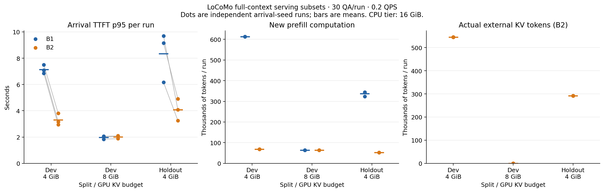

# LoCoMo lossless KV tiering: residency boundary and measurement audit

Current RTX 3090 host, 2026-10-26. All measurements and the final integrity audit completed within the owner’s 90-minute session budget. The experiment was frozen and amended before the corresponding measurements in [the execution plan](V2_E2_PLAN_2026_10_26.md).

## Contribution and research-question answers

**RQ1/H1:** CPU KV tiering reduces arrival-based p95 TTFT on genuine full-history conversational QA when its shared histories exceed allocated GPU KV capacity. The same tier supplies no saved work when those histories fit on GPU. This result generalizes the old synthetic mechanism to a declared LoCoMo serving subset, with fresh conversation holdout and independently generated arrival seeds on the current host.

**Measurement contribution for RQ0/RQ1:** distinguish prefix lookup hits, potential CPU-cache hits and KV actually consumed by the engine. The GPU-fit control has positive LMCache L1 read counts but zero actual CPU restore; raw GPU lookup hits can exceed the entire trace's input budget. A static token-prefix oracle independently predicts the measured residual prefill in the GPU-fit and CPU-backed regimes.

**RQ3:** exact prompt/token budgets and captured outputs are auditable. Outputs are not byte-identical at temperature zero and measured raw-output F1 sometimes decreases. These experiments do not establish broad semantic equivalence. RQ2 adaptive scheduling remains gated by the negative E1 result; no B5 was implemented.

## Replicated tiering result

Each condition uses 30 original QA, canonical complete histories, 64-token output budget, FIFO gateway, open-loop exponential arrivals at nominal 0.2 QPS, and 16 GiB CPU L1 for B2. Each paired run starts a fresh serving stack, performs the same tiny warmup, then clears both caches. Arm order is reversed in the middle seed. These are different-engine cold-start comparisons; B1/B2 connector configurations require distinct processes.

| Condition | Prefix working set / GPU slots | Runs per arm | B2 p95 change vs B1: mean (range) | New prefill tokens B1 / B2 | Actual CPU KV tokens B2 |
| --- | --- | ---: | --- | --- | ---: |
| Dev, 4 GiB | 63,688 / 37,440 | 3 | **-53.86%** (-57.01% to -49.27%) | 613,180 / 67,884 | 545,296 |
| Dev, 8 GiB | 63,688 / 74,896 | 3 | **+1.79%** (+1.56% to +2.10%) | 64,236 / 64,236 | 0 |
| Holdout, 4 GiB | 47,914 / 37,440 | 3 | **-50.54%** (-57.97% to -46.43%) | 323,394–344,450 / 52,482 | 291,968 |

All **540/540** requests in these 18 runs succeeded. Every server prompt-token count equals the frozen trace count. No preemptions were observed; the first B1 dev run has a separate post-replay zero-preemption snapshot rather than a sampled delta. Fixed GPU budgets are verified from actual engine block configuration, including equal 37,440-slot capacity for B1/B2 at 4 GiB; see [capacity audit](../results/v2/e2_capacity_audit.json).



Each dot is one arrival-seed run; coincident points can overlap. Paired t95 intervals use runs rather than requests:

| Contrast | Mean p95 delta B2−B1 | Exploratory t95 interval | Mean relative-change t95 interval |
| --- | ---: | --- | --- |
| Dev 4 GiB | -3,838.19 ms | [-4,143.61, -3,532.77] ms | [-63.96%, -43.76%] |
| Dev 8 GiB | +35.04 ms | [+25.89, +44.19] ms | [+1.09%, +2.49%] |
| Holdout 4 GiB | -4,258.93 ms | [-7,621.53, -896.33] ms | [-66.56%, -34.52%] |

These are exploratory intervals over three arrival seeds on fixed, small conversation subsets. They do not establish population-level significance. GPU-fit p50 overhead is less stable than p95: mean +9.70%, run range +0.77% to +16.16%.

Holdout was fixed before the first B2 dev result: conv-49/conv-50, first 15 QA each, seeds 101/211/307. Its B1/B2 p95 values are 9,688.32/4,071.72; 6,162.14/3,252.54; and 9,154.93/4,904.32 ms. The middle seed runs B2 first. B1 retains substantial GPU reuse in this lower-pressure trace; its detailed internal sharing/eviction path was not instrumented. In seed 307, B1 has 21,056 more GPU-cached tokens than B2, so actual CPU-restored tokens are not identical to avoided prefill in every comparison.

## Static prefix reference and metric-stage trap

The oracle encodes the exact prompts with the pinned tokenizer, computes their longest shared prefix against all prior prompts, and rounds opportunity to 16- or 256-token boundaries. It assumes prior prompts are fully materialized and retained, omits generated text and is **not an execution simulator**.

| Trace | Input tokens | Static prefill at block 16 | Static prefill at chunk 256 | Observed reference match |
| --- | ---: | ---: | ---: | --- |
| Dev 3 conversations | 637,228 | 64,236 | 67,884 | GPU-fit arms / CPU-backed pressure arm, all 3 seeds |
| Holdout 2 conversations | 719,106 | 48,450 | 52,482 | CPU-backed pressure arm, all 3 seeds |
| Incremental session pilot | 80,687 | 16,287 | 19,247 | See supplemental results below |

The held-out 52,482-token reference was recorded before any holdout GPU run. The dev residual 3,648-token gap is consistent with chunk-boundary opportunity loss; a causal chunk-size claim still requires a serving ablation.

B2 dev records **2,224 L1 read chunks at both 4 and 8 GiB**. Multiplying by 256 gives **569,344 tokens**, exactly the static potential CPU-cache opportunity. At 4 GiB, B2 actually consumes 545,296 external tokens and loads 2,134 engine chunks; at 8 GiB it consumes **zero external tokens**, and the loaded-chunk series is absent. Positive L1 reads therefore do not prove CPU-to-engine restore. Missing loaded-chunk counters remain **null**, not zero.

Installed LMCache 0.5.3 `v1/mp_observability/subscribers/metrics/l1.py` subscribes to `L1_READ_FINISHED`; `engine.py` counts positive `retrieved_count` on `MP_RETRIEVE_END`. These are different stages. The precise call path of every read event is not traced here.

B1 dev seed 17 reports **480,672 GPU prefix lookup-hit tokens but only 24,048 actual cached prompt tokens**. Holdout lookup counts can be much larger than total input tokens. Installed vLLM 0.22.0 `v1/core/kv_cache_manager.py:get_computed_blocks` records lookup statistics before `scheduler.py` attempts allocation and can defer a request. The measurement harness now preserves source-labelled prompt counters, captures preemptions and rejects incomplete token accounting. These counters are useful at their own stages; treating them as the same quantity gives false reuse attribution.

## Captured-answer audit

The [official LoCoMo evaluator](https://github.com/snap-research/locomo/blob/3eb6f2c585f5e1699204e3c3bdf7adc5c28cb376/task_eval/evaluation.py) is pinned to the dataset commit, SHA256 `8e3be5d57ff2ff9ec5cd05939592f468c5f3f1fd95d13e431932bdf6bf0fd6fd`, using NLTK 3.9.2 Porter stemming. Its unchanged scoring functions are loaded without unrelated BERTScore imports. Scores use the **entire raw generation**, with no selected answer extraction. Category normalization and multi-answer F1 follow that source; category 5, if present, is separate.

| Main subset / budget | B1 mean F1 | B2 mean F1 | Mean paired delta | Hash mismatches / paired requests | Score changes / paired requests |
| --- | ---: | ---: | ---: | ---: | ---: |
| Dev / 4 GiB | 0.073974 | 0.072746 | -0.001228 | 30/90 | 6/90 |
| Dev / 8 GiB | 0.074773 | 0.074765 | -0.000008 | 9/90 | 3/90 |
| Holdout / 4 GiB | 0.089931 | 0.087090 | -0.002841 | 46/90 | 26/90 |

The 90 comparisons per row repeat **30 distinct QA**, not 90 independent QA examples. Same-policy cross-budget runs also have hash mismatches, so these data do not isolate CPU byte corruption as their cause. F1 changes can reflect formatting/repetition as well as content; no human semantic-equivalence judgement is claimed.

**All 540 main-matrix generations hit the 64-token budget.** The original `locomo-text-v1` raw-completion template often repeats answers and has poor absolute F1. The main result is a serving/cache mechanism result on genuine full-history content, not evidence of a high-quality QA deployment. A separate validation pilot uses the pinned Qwen chat template with thinking disabled; it does not rewrite the main protocol or its scores.

## Supplemental validation and session pilots

**Chat-template validation, one exploratory pair:** conv-47/conv-48, 15 QA each, seed 71, 0.2 QPS, KV 4 GiB. `locomo-qwen-chat-v2` wraps the unchanged full-history user text with the pinned tokenizer chat template and `enable_thinking=False`. B1/B2 p95 is **9,555.80/3,333.80 ms** (-65.11%); p50 3,925.50/605.91 ms. New prefill is **520,562/58,082**, actual GPU reuse is 290,160 in both arms, and B2 consumes **462,480 external KV tokens**, loading 1,820 chunks. All 60 requests succeed without preemptions.

F1 is **0.113467/0.113390** (delta -0.000077); 4/30 output hashes and 1/30 scores differ. Budget hits are 8/30 for B1 and 9/30 for B2. This shows the tiering mechanism also operates in this chat-formatted pilot without every answer hitting the cap. Absolute quality remains weak; different conversation content prevents attributing a score change versus the main matrix solely to the template. It is one pair, not replicated validation of latency or semantic equivalence. See [paired pilot](../results/v2/e2_chat_validation.compare.json) and [QA audit](../results/v2/e2_chat_validation_quality_pairs.json).

**P-SESSION, one exploratory pair:** existing conv-26/conv-30 chronological, evidence-visible checkpoints, 30 requests, base exponential 2-QPS arrivals plus declared 1-second checkpoint gaps, KV 4 GiB. Both arms compute **16,287** prefill tokens, cache **64,400** GPU tokens, and consume **0** external KV tokens, exactly the static GPU reference. B2 still reports 240 L1 read chunks; its loaded series is absent. B1/B2 p95 is **1,471.62/1,607.19 ms** (+9.21%); p50 263.25/316.16 ms (+20.10%). Thus this GPU-fit session pilot offers no CPU-tier work saving and shows overhead in one measured pair, not a replicated regression bound.

All 60 session requests succeed without preemptions. Output hashes differ in 9/30 and scores in 6/30 pairs; F1 B1/B2 is **0.086434/0.092253**. All outputs hit the raw-template budget. Score changes therefore also occur with no actual CPU KV retrieval; this does not establish their precise numerical cause. This adapted checkpoint protocol must remain separate from full-context QA scores. See [session comparison](../results/v2/e3_session.compare.json) and [session QA audit](../results/v2/e3_session_quality_pairs.json).

**Final audit:** 23 new runs and **690/690 successful requests**, including the separate capacity gate; 22 paired-study runs / 660 requests are captured and scored together, with the gate scored separately. Prompt/source/model integrity, reset state, output hashes, budgets, complete source-token accounting and all 11 matched pairs were checked. Tests **21/21**, preflight and shell syntax pass. All V2 services are stopped. See [completion audit](../results/v2/e2_completion_audit.json).

## Provenance, reproduction and artifacts

Hardware/software: current RTX 3090 24 GiB, BF16 Qwen3-1.7B revision `70d244cc86ccca08cf5af4e1e306ecf908b1ad5e`, vLLM 0.22.0, LMCache 0.5.3, 32,768 max context, max-num-seqs 4. See [current-host record](V2_HOST_2026_10_26.md). Qwen KV uses 114,688 bytes/token. Analysis-only dependencies added: matplotlib 3.10.8, nltk 3.9.2; the serving stack was not replaced.

LoCoMo is pinned to commit `3eb6f2c585f5e1699204e3c3bdf7adc5c28cb376`, file SHA256 `79fa87e90f04081343b8c8debecb80a9a6842b76a7aa537dc9fdf651ea698ff4`. Dev IDs conv-26/conv-30/conv-41 use first 10 QA each and seeds 17/29/43. Validation IDs conv-47/conv-48 and holdout IDs conv-49/conv-50 are conversation-disjoint. Canonical text preserves complete histories and released image captions; image URLs, gold answers and QA evidence labels are not inserted into prompts. P-SESSION is separately evidence-visible and chronological.

From the existing checkout/environment/model/source:

```bash
PYTHONPATH=src /venv/main/bin/python -m pytest -q
/venv/main/bin/python scripts/v2_preflight.py
PYTHONPATH=src /venv/main/bin/python scripts/v2_prepare_e2.py
bash scripts/v2_e2_matrix.sh
# Only after checking the dev mechanism and latency evidence:
bash scripts/v2_e2_confirmation.sh
/venv/main/bin/python scripts/v2_analyze_e2.py
/venv/main/bin/python scripts/v2_analyze_e2.py --cohort holdout2 --budgets 4 --seeds 101 211 307
/venv/main/bin/python scripts/v2_plot_e2.py
```

Run IDs refuse overwrite; additional repeats need a fresh recorded namespace. The original dated follow-on script enforces this session's time gate; the individual commands above reproduce the protocol independently. `CACHEFLOW_CAPTURE_TEXT=1` is used for each measured arm. Full requests, outputs, gateway rows and sampled metrics stay ignored under `results/v2/raw/`; small summaries, prompt-free QA scores, trace manifests and plots are tracked. Preserve raw artifacts for audit.

Evaluator download and scoring:

```bash
mkdir -p data/processed/v2/evaluator
curl -fL https://raw.githubusercontent.com/snap-research/locomo/3eb6f2c585f5e1699204e3c3bdf7adc5c28cb376/task_eval/evaluation.py -o data/processed/v2/evaluator/evaluation.py
PYTHONPATH=src /venv/main/bin/python scripts/v2_quality_audit.py --run-ids <paired-run-ids> --output results/v2/e2_quality.json
/venv/main/bin/python scripts/v2_summarize_quality.py --input results/v2/e2_quality.json --output results/v2/e2_quality_pairs.json
PYTHONPATH=src /venv/main/bin/python scripts/v2_prefix_oracle.py --trace data/processed/v2/e2_dev3_qps02_s17.jsonl --output results/v2/e2_prefix_oracle.json
```

The chat validation trace uses `v2_locomo.py trace --qwen-chat-no-think`, IDs conv-47/conv-48, first 15 QA each, seed 71, 0.2 QPS, 32K max context and 64-token budget. Its frozen manifest is in `results/v2/e2_trace_manifests.json`; execute with `bash scripts/v2_e2_supplement.sh chat`. Execute the existing session dev trace with `bash scripts/v2_e2_supplement.sh session`.

Primary artifacts: [dev runs](../results/v2/e2_runs.csv), [dev aggregate](../results/v2/e2_aggregate.json), [holdout runs](../results/v2/e2_holdout2_runs.csv), [holdout aggregate](../results/v2/e2_holdout2_aggregate.json), [dev QA audit](../results/v2/e2_dev_quality_pairs.json), [holdout QA audit](../results/v2/e2_holdout2_quality_pairs.json), [registry](../results/v2/registry.csv). Each per-seed comparison retains all paired request timings and hash-agreement flags. The first B1 missing source/preemption fields remain null; its separate post-replay snapshot is [audited here](../results/v2/e2_first_b1_preemptions_audit.json).

For exact supplemental trace regeneration:

```bash
tokenizer_path=/workspace/.hf_home/hub/models--Qwen--Qwen3-1.7B/snapshots/70d244cc86ccca08cf5af4e1e306ecf908b1ad5e
PYTHONPATH=src /venv/main/bin/python scripts/v2_locomo.py trace --tokenizer-path "$tokenizer_path" \
  --output data/processed/v2/e2_validation_chat_s71.jsonl --sample-ids conv-47 conv-48 \
  --max-questions-per-sample 15 --max-model-len 32768 --qps 0.2 --seed 71 --qwen-chat-no-think
PYTHONPATH=src /venv/main/bin/python scripts/v2_locomo.py trace --tokenizer-path "$tokenizer_path" \
  --output data/processed/v2/locomo_dev_2conv_session.jsonl --sample-ids conv-26 conv-30 \
  --protocol p_session --max-questions-per-sample 15 --max-model-len 32768 --qps 2 --seed 7 --session-gap-ms 1000
```

## Limits and next research step

The allocated 4/8-GiB KV budgets deliberately constrain a 24-GiB GPU. The experiment does not show that these subsets need CPU caching when all available VRAM is assigned to KV. The working set relative to allocated capacity and actual source reuse explain the observed boundary; the numeric budget alone does not.

These are small text-only LoCoMo serving subsets with constructed arrivals, not production arrivals, the full 1,986-QA benchmark or an AgentPerfBench leaderboard entry. The main contrast covers interleaving at one nominal offered load; grouped/low-reuse/high-load regimes remain uncharacterized here. Open-loop achieved requests/s is schedule-limited and is not a peak-throughput claim. The initial two-conversation 2-QPS B1 gate succeeded 30/30 but had substantial queuing (p95 6,631.12 ms); it is a separate capacity observation.

Next: repeat a viable chat-template QA protocol over additional conversation/arrival seeds and load controls; retain source-token accounting and generated-text scoring. A CPU chunk-size ablation can test the granularity explanation. B5 requires a fresh repeatable scheduling-work and arrival-latency opportunity; the existing E1 negative screens still do not supply that gate.
