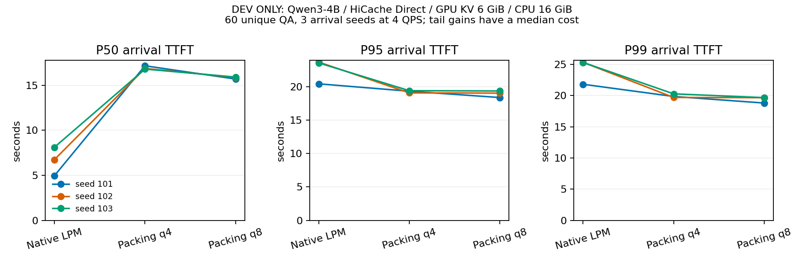
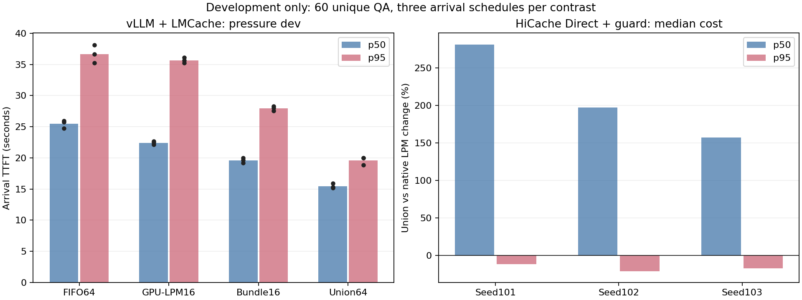

# V4 development evidence — preliminary, unfrozen

Updated2026-10-26 around10:24UTC. This document separates exploratory evidence from confirmation. No V4 held-out or full1986-QA GPU evaluation exists yet. The active goal is incomplete. Results from V3 and V4 prompts must remain separate.

The current method is external **KV-union admission**: reserve the union of active exact16-token prefix blocks plus per-request suffix/output/safety; admit the oldest feasible request, backfill compatible work while bounding bypass of the head. `packing_reuse` applies packing when a queued prefix group matches active/recent work and otherwise falls back to FIFO. That reuse signal is logical history, not verified KV readiness. The gateway controls order/admission; engine allocator and KV validity remain native.

## RQ2: native baseline and the median–tail tradeoff

Qwen3-4B at pinned revision, BF16,32K context,96-token output, V4 concise/no-thinking prompt; LoCoMo dev conv26/30/41 first20QA each.60 unique questions, seeds101/102/103, exponential4QPS. GPU KV6GiB, CPU16GiB, native LPM16,8192-token chunked prefill, FlashInfer and decode graphs. Three seeds vary serving arrivals, not question diversity. All percentile comparisons count time from scheduled client arrival, including gateway and transport waits.

Kernel/page_first matrix: native LPM, FIFO gateway, packing, packing_reuse, balanced orders.720/720 requests, source-token/output audits pass. Mean p95 native23.062s vs packing_reuse19.207s; p99 24.694→19.902s. **Median6.149→16.838s regresses substantially.** Mean F1 .302831→.307545 is not proof of quality equivalence. Per-seed quality changes include negative values. Native host-promotion aggregate remainsnull because one counter series is missing.

Direct/page_first_direct replication compares native, packing_reuse bypass4 and bypass8, with reversed/permuted orders.540/540 measured requests. Every pair verifies identical trace/prompt hashes, server configuration, backend PID, native source SHA, model/output budgets and complete cache/uncached accounting. The output files are hash-audited and graded with the pinned original evaluator.

| Seed | Native p95 | q4 p95 | q8 p95 | q8 p99 change | q8 p50 change | q8 F1 delta |
| --- | ---: | ---: | ---: | ---: | ---: | ---: |
|101|20.435s|19.332s|18.384s|-13.79%|+216.52%|+0.003 approximately|
|102|23.693s|19.078s|19.047s|-22.36%|+135.21%|-0.005 approximately|
|103|23.566s|19.411s|19.366s|-22.31%|+95.98%|-0.001 approximately|

The q8 p95 changes are-10.03%/-19.61%/-17.82%. Its mean paired F1 delta is-.001066; output-hash differences4/8/8 of60. Do not claim standard-mode bit equivalence. Native-direct has a material median advantage. Concurrency1/4/32, DFS-weight, FCFS and I/O tuning must be considered before choosing a baseline. Initial native cap1 measured seed101 p95=28.733s, slower than cap16. Cap4 still pending at this checkpoint.

## RQ0/RQ1: transfer and compute evidence

Native SG source counters preserve their meaning: uncached prompt tokens are reported prompt minus cached tokens; host promotions count native loads. They are not automatically equivalent to vLLM's engine-consumed CPU-token accounting. Direct measurement of executed prefill intervals is being added for a separate diagnostic, since counter totals alone cannot explain every scheduling effect.

An instrumented kernel/HiCache candidate run has9 H2D loads,166560tokens and24,560,271,360bytes. Coverage exactly matches its promotion counter. CUDA events on the real load stream, after controller dependency wait and spanning first→last layer, total2.175s, median effective11.29GB/s. Its CPU enqueue timer totals.120s and measures a different stage. The native diagnostic has0 observed load calls, but its absent Prometheus load series staysnull. Neither measurement establishes steady-state overlap with model compute.

A separate batch-invariant vLLM/LMCache diagnostic (V3 prompt, not V4 performance) has0/60 output-hash differences and retrieve-event bytes127,628,476,416→17,477,664,768 (-86.3%). Preserve its scope: batch-invariant kernel mode and event instrumentation are excluded from ordinary latency claims.

The bypass sweep0/4/8/16/32 at configured native in-batch thresholds1024 completes420/420 requests including warm/native. q0 minimizes uncached tokens but has p95=35.959s, versus native20.520s and q8 18.311s. Optimizing a work counter alone is insufficient. Actual maximum head bypass0/4/8/16/19 verifies the guard. Threshold1024 does not reduce native uncached82470 on this seed. Source inspection also rejects an untested explanation: standard admission passes `InitLoadBackParams` without mem_quota, so quota-based restore rejection is not established as the cause.

## Completion gates still open

- Select candidate/config after native concurrency tuning and new V4 low-reuse/GPU-fit/load controls. q4/q8 dev tuning does not freeze either arm.
- Validate telemetry for native prefix/admission/restore events and separate diagnostic overhead from performance.
- Revalidate V4 on main vLLM/LMCache with tuned baselines; V3 prototype results do not stand in for new-policy V4 results.
- Freeze method/config/protocol before GPU evaluation of untouched conv43/44; at least three balanced repetitions for key confirmation claims.
- Evaluate all1986 fit QA. Static prefix hotset is34.031GiB; matched CPU48GiB support is implemented but full GPU serving/evaluation remains pending. Full is a separate memory regime.
- Audit failures, per-category quality, truncation/budget hits, hash differences, queue/fairness and source/config provenance. Finish report and interview explanations after those results.

## Reproduction and artifacts

- `scripts/v4_sglang_direct_replicate.sh`: the nine measured Direct dev runs plus separate warmup; requires existing correctly configured idle gateway and exclusive GPU use.
- `scripts/v4_sglang_guard_probe.sh`: threshold/guard exploratory sweep, unfrozen diagnostic.
- `scripts/v4_sglang_cap_profile.sh`: native cap1/4 screens and opt-in prefix/load diagnostic, latter excluded from normal performance.
- `results/v3/sglang/v4_direct_repl_audit.json`, `v4_direct_repl_quality.json`, `v4_direct_repl_pairs.json`: strict integrity, official scoring and matched pairs.
- `scripts/v4_plot_dev.py`: figure from audited per-run data, visually inspected.
- `results/v3/sglang/v4_guard_probe_audit.json`, `v4_guard_probe_admission_audit.json`, `v4_cuda_transfer_audit.json`; `results/v3/invariant4b_transfer_audit.json`.
- Raw requests/outputs, metrics, server logs and profiler events remain ignored under `results/v3/raw/`; do not delete them. Native upstream files are unmodified; opt-in import hooks and their source hashes are recorded.

For primary paper provenance and exact feature mapping see `V3_BASELINES.md`. Upstream HiCache with native LPM/DFS is a strong measured implementation of several relevant mechanisms; it is **not a reproduction of the complete Strata scheduler**. No published H100/H200 latency is used as a local RTX3090 comparator.

## Follow-up diagnostic,10:29UTC: exact repeated-prefix intervals

`v4_admission_profile_audit.json` joins all60 exact tokenized prompt digests in each diagnostic with native selection events. Scheduled prefill totals match native uncached exactly:82470 native vs75862 q8. Reconstructed same-batch repeated **common-context** token positions total16412 vs9928. Example native batch4: conv30 q000–q003 each schedules the common interval[13280,15188),1908tokens; that is5724 excess context-token computations within that one batch. QA-specific suffixes are excluded from this duplicate measure. Across-batch repeats and alignment effects are separate.

Candidate loads5 times/98288tokens, all successful, mem_quota=None; native has no load calls in the window. This directly rejects a quota-rejected-load account for this diagnostic and supports partial-prefix readiness as an additional testable mechanism. It does not establish GPU kernel durations or steady-state transfer overlap. Instrumented runs remain excluded from ordinary performance claims.

Native in-batch prefix checking only applies below its configured GPU-prefix threshold.32/1024 cannot cover the observed13280-token partial prefix; a prospective32768/1024 native tuning probe is prepared in `scripts/v4_sglang_full_inbatch_probe.sh`, not yet executed. Test that strong control before attributing novelty to external readiness gating. The earlier fixed-DHAS/vLLM negative results remain unchanged.

Current GPU job: `scripts/v4_sglang_controls.sh`, tool12288, Direct native-cap4 replication then V4 low-reuse/QPS2/GPU-fit comparisons, all profilers disabled. Candidate remains unfrozen. Full benchmark and fresh confirmation are still unrun.

Update10:37UTC, **corrected10:47UTC**: cap4 recorded360/360 request successes, but q8-s102/s103 are invalidated because gateway recent-prefix state was retained across runs. Only seed101 native/q8 p95=19.776/17.337s remains a valid cap4 pair. Do not use the other two candidate pairs or a candidate cap4 mean. The three native-direct runs remain valid and average above cap16, but that does not validate the contaminated candidate ablation. `v4_cap4_repl_*` preserve the old derived entries with explicit invalidation notices.

The new q8 admission diagnostic also has independently covered CUDA load events:5loads,98288tokens,14,493,155,328bytes; summed load-stream span1.282s, median11.279GB/s. CPU enqueue sum.01478s is a separate stage. See `v4_admission_cuda_transfer_audit.json`. These measurements remain diagnostic rather than a latency comparison.

## Gateway-state reset correction,10:47UTC

The control script reset engine KV but reused gateway recent-prefix history. Five affected candidate runs are invalidated in `v4_gateway_reset_invalidation.json`; raw output/metrics and old derived entries remain available. The main kernel and Direct development matrices restarted the gateway per arm and pass the new freshness audit. All new SG candidate benchmarks restart an idle gateway and require zero completed-history entries and zero decision calls before replay. Health now exposes completed-history count. Native-direct controls do not consume gateway state. Fixed controls need new run IDs for affected low-reuse/QPS2 pairs; unreset results cannot support confirmation or no-regression claims. Candidate/config remain unfrozen.

## Clean control and CPU follow-up,11:07UTC

Clean GPU-fit10GiB pairs complete360/360 requests and have no host-promotion series (null, not a sampled zero). Candidate cap16 p95 changes+2.14/+5.24/+6.48%, p50+124.65/+146.51/+96.02%. Native/candidate uncached tokens72678/78838,83318/96294,78790/90614. An external concurrency cap can change the queue visible to native LPM even when memory fits; no universal no-regression claim is warranted. Two clean low-reuse pairs have190908 uncached tokens each, no promotions and p95+.318/+.050%. Only QPS2 seed103 candidate remains clean: p95+.270%, p99-8.733%. `v4_clean_control_*` exclude invalidated runs.

Native check-threshold32768/deprioritize1024 probe completes240/240 including warm. Cap4/16 measured p95=19.503/20.824s; uncached70486/78662. Relative to default thresholds, cap4 compute is unchanged, cap16 saves3808 tokens without a tail gain. This still is not explicit full Strata delay-hit deferral. A standalone same-batch guard prototype inspired by section4.3.1 has three CPU behavior tests, remains unactivated and has no GPU result yet.

Prompt preparation profiling found~68ms tokenization and~12ms hashing per request in gateway logs. An optional serial worker moves this CPU work off the streaming loop while keeping tokenizer access serialized. Exact20-real-prompt id/hash checks pass. Inline/worker preparation takes1.025/1.135s while maximum heartbeat gap161.6→12.9ms. CPU microprofile only; no E2E speedup inferred. Actual GPU comparisons apply the preparation configuration to both FIFO and packing and count worker queue time.

Prospective cap64 screen (live tool43292) keeps native LPM16 and all model/cache budgets fixed.6GiB seed101 measured300/300: native p50/p95=4.969/20.596s; FIFO64-inline5.209/20.708; packing64-inline15.790/18.431; packing64-worker15.770/18.450; FIFO64-worker5.076/20.673. Gateway visibility explains a testable part of the old FIFO16 median penalty; packing's pressure-regime median cost remains.10GiB results are pending. No arm is frozen from this one-seed screen, and source/config changes cannot be silently pooled with the old implementation.

## Completed cap64 pilot and stronger component baseline,11:19UTC

All ten measured cap64 arms pass strict output/token/freshness audits:600/600 requests, with120 separate warmup requests. At GPU10GiB, native/packing64-worker p50=5.767/5.953s, p95=15.142/15.299s (+1.04%), p99=16.911/17.066s (+.92%). Against FIFO64-worker, packing p95+.34%. At GPU6GiB, packing64-worker p95-10.42% and p99-14.20% versus native, but p50+217.38% and F1-.006. One seed cannot establish a no-regression or quality-equivalence claim. Source/config changes are separately versioned. See `v4_cap64_pilot_*`.

The native same-batch guard component is now activated through an opt-in import hook, with actual process env and overlay source hashes recorded. Tests protect token-prefix/chunk boundaries, host-cache bundles, different extra_key namespaces and the MHA-only resource lifecycle. It skips a duplicate candidate while returning native CONTINUE, so other work may fill the batch; the native waiting queue retains the unselected request. Original installed files are unchanged. This adapts only one delay-hit component of Strata4.3.1; it does not implement complete in-flight transient nodes, balanced-batch formation or bubble filling.

Three measured guard arms complete180/180, plus60 warmup: native LPM p50/p95/p99=4.294/17.262/18.369s; FIFO64-worker3.695/18.083/19.278s; packing64-worker13.490/16.049/16.410s. Packing vs native guard p95-7.03%, p99-10.66%, **median+214.16%**, F1-.001 approximately. All arms compute69590 uncached tokens. Host promotions native/FIFO/packing=26448/0/90144. Thus the residual scheduling contrast is not saved compute or universally less transfer; ordering, fairness and migration timing need explanation. It remains a one-seed pilot and must be repeated before freeze. `v4_guard_component_pilot_*` stores audits, quality and matched pairs.

Pipeline tool42783 continues into main vLLM/LMCache V4 validation:18 runs with balanced ordering, FIFO16/FIFO64/actual-GPU-LPM16/bundle16/DHAS16/packing64 and serial CPU preparation across all arms. SGLang is stopped. No full/held-out GPU evaluation or method freeze yet.

## Audited V4 dev and prospective boundary, 2026-10-26 12:59 UTC

The method/configuration is now frozen revision1, before the first conv43/44 GPU replay. See `V4_CONFIRMATION_PLAN.md`, `results/v3/v4_method_freeze.json` and `scripts/v4_verify_freeze.py`. Nothing in the following dev table is an independent held-out or full-benchmark result.

The main-stack matrix has18 measured runs,1080/1080 successes, all strict source/token/output/reset audits passing.60 unique QA are repeated under three arrival seeds; uncertainty is serving-run variation, not180 independent semantic examples. Means below average the three run-level quantiles, not pooled-request quantiles.

| Main-stack arm | p50(s) | p95(s) | p99(s) | Engine-consumed CPU tokens/run | Answerable F1 |
| --- | ---: | ---: | ---: | ---: | ---: |
| FIFO16 |25.427|36.703|37.493|918373|.307944|
| FIFO64 |25.472|36.679|37.456|918373|.307944|
| actual-GPU LPM16 |22.426|35.672|36.968|429056|.306287|
| bundle16 |19.596|27.948|28.462|307819|.306302|
| fixed DHAS16 |25.578|36.904|37.712|918379|.307944|
| union64 |15.463|19.615|20.289|75349|.309299|

Source: `v4_vllm_dev_audit.json`, `v4_vllm_dev_quality.json`, `v4_vllm_dev_findings.json`. No broad quality-equivalence claim follows from nearby means. Token-source reduction is not direct measured DMA reduction. All arms use serial CPU preparation, native maxseq16/graphs/batch8192, GPU6GiB and historical main16GiB CPU, with real byte-hash residency publisher/subscriber uniformly enabled.

Reproduce the figure: `PYTHONPATH=src /venv/main/bin/python scripts/v4_plot_dev.py`. Dots show the three main-stack run-level quantiles; native bars show each seed's paired relative change. SVG is retained beside PNG.

SGLang validation completes33 measured runs/1668 successful requests with guard enabled and profiler disabled. The corrected Bash matrix uses function-local policy variables and an actual dry-run path. Eight already-complete runs were verified against recorded actual policy, source, trace and fresh state; `v4_validation_aliases.json` maps misleading names without renaming raw evidence. The interrupted last child retains `.invalid`. All33 official quality and strict integrity audits pass.

| Contrast, union vs baseline | p95 change by seed101/102/103 | Interpretation |
| --- | --- | --- |
| native LPM,4QPS |−11.269/−20.622/−16.922%|Tail gain with large median cost|
| FIFO64+LPM,4QPS |−10.893/−20.999/−17.082%|Same-backend gateway control|
| native DFS,4QPS |−10.816/−22.218/−17.428%|Strong native-ordering control|
| low-reuse |+.227/+.006/+.141%|Within declared5% regression gate|
| GPU-fit10GiB |+1.192/+.476/+.514%|Small regressions; no universal win|
| native LPM,2QPS |+2.309/−.434/+11.865%|One substantial lower-load tail regression|

Source: `sglang/v4_validation_audit.json` and `v4_validation_quality.json`. Missing host-promotion counters stay null. Primary4QPS and secondary2QPS were fixed before held-out GPU use; these negative controls do not authorize retuning on held-out.

### Corrected resource units

Earlier native sections calling HiCache16/48 **GiB** used the wrong unit. Installed HiCache interprets its flag as decimalGB, then rounds MHA capacity up one16-token page. LMCache's flag isGiB. Historical main16GiB and native16GB are valid within-stack controls, but are not exactly equal host budgets across engines. Prospective revision1 uses actual payload16000745472bytes for16GB native and48002236416bytes for48GB native; equivalent LMCache flags14.90185546875/44.70556640625GiB. See `src/cacheflow/v4_resources.py`, `v4_validation_resource_units.json` and actual argv in each setup. Correction occurred before held-out GPU evaluation; version0 CPU-only traces/seal are retained as superseded.

### Direct CPU-hot profiling coverage audit

`v4_steady_profile_audit.json` reconciles three off/GPU-only-profiler/off phases,12 requests each,4-token diagnostic output. Every phase promotes238400tokens/35153510400KV bytes, independently matched by12 CUDA-event hook records; uncached compute254tokens. Summed load-stream spans2958.74/2952.02/2957.89ms, with TTFT p95 approximately492.00/491.98/493.35ms. This is near-identical diagnostic work with a small profiler perturbation, not main QA performance.

The profile contains603 ordinary GPU memcpy events, but all visible HtoD copies total only22864bytes, including input/index tensors. That is at most0.0000651% of expected KV payload. It cannot represent bulk Direct restore.444 CUDA runtime events are labelled `INVALID`; the installed Direct path references batched-copy API. Those facts suggest a coverage gap, but do not prove every invalid label is that API. **DMA/model overlap remains null.** CPU launch clock plus CUDA-event elapsed time cannot produce an absolute GPU interval. Load-stream spans include enqueue gaps/dependencies and are not pure PCIe busy time. Reproduce: `PYTHONPATH=src /venv/main/bin/python scripts/v4_audit_steady_profile.py`.

A separate kernel-I/O off/on/off diagnostic is scheduled after all frozen full unprofiled runs, using a unique artifact namespace. It is a diagnostic backend variation and will not replace the primary Direct serving measurements or justify an overlap claim before its actual timeline is inspected.

## Frozen held-out confirmation,13:01UTC

All27 measured runs complete1080/1080 requests, zero errors. `v4_confirmation_audit.json` verifies the frozen source/config/resource protocol, exact prompt/token/output identity and fresh state; separate pinned-evaluator audits cover18 SGLang and9 main runs. `v4_confirmation_findings.json` adds all18 contrasts, score-improved/worse/equal counts by category, hash differences and explicit fresh-process DFS labels.

| Union contrast | p95 change, seeds701/702/703 | Answerable F1 delta |
| --- | --- | --- |
| main FIFO64,4QPS |−42.413/−43.922/−40.287%|−.005207/−.010397/−.004614|
| main bundle16,4QPS |−29.749/−27.777/−24.950%|+.002361/−.002829/+.002953|
| native LPM+guard,4QPS |−8.261/−8.704/−3.909%|−.008486/−.020297/−.003393|
| native DFS+guard,4QPS |−8.637/−4.145/−3.820%|−.008486/−.007209/−.003393|
| native LPM+guard,2QPS |−14.787/−14.042/−8.284%|−.007143/−.003445/−.008723|

SGLang4QPS median increases41.3–46.1% vs nativeLPM. Smaller held-out tail gains and systematic negative paired F1 changes preclude claiming universal latency or quality equivalence.40 unique held-out questions repeat three arrival schedules; these are not120 independent QA. Results do not authorize changing frozen method/cap/bypass. Main and native engines are evaluated within their own matched controls; cross-stack latency is not a single-policy causal comparison. Full-data runs remain required and are not replaced by this confirmation.

### Additive arrival-latency reconstruction

`scripts/v4_analyze_waits.py` reconstructs every completed gateway request using the same host monotonic clock: scheduled arrival→gateway receipt→preparation/enqueue→admission handoff→first upstream token→client first token. The reconstructed sum matches recorded arrival-TTFT within1e−6ms for all18 held-out gateway arms. Quantiles of stages do not add; the following are request means for seed701,4QPS, in milliseconds.

| Stack/arm | Arrival→gateway | Preparation | Admission wait | Handoff→upstream token | Return stream | Total |
| --- | ---: | ---: | ---: | ---: | ---: | ---: |
| main FIFO64 |8.32|99.11|.03|28053.73|.54|28161.73|
| main bundle16 |7.50|105.04|15329.42|9604.05|.56|25046.57|
| main union64 |6.63|103.07|13841.43|3999.03|.63|17950.80|
| SG FIFO64 |8.09|96.00|.04|10862.36|1.94|10968.43|
| SG union64 |8.92|98.95|12182.21|3156.75|1.83|15448.66|

This distinguishes a real E2E improvement on main from moving queue time alone: union adds ingress waiting but total mean still falls~10.21s vsFIFO. On SG it raises mean~4.48s despite improving p95; this is a tail/mean tradeoff. The upstream stage includes native queueing, load, compute and transport, so it cannot be called pure GPU compute. Worker CPU/queue are already inside preparation and must not be added a second time. Full results must retain this same arrival-based accounting.

## Full live-resource instrumentation,13:17UTC

The first nativeLPM full run is still live; no complete-run latency/quality result exists. `scripts/v4_analyze_sglang_resources.py` reads the existing1Hz sampler without modifying the GPU server or frozen replay. A live snapshot requires the actual replay PID, validates its command line and excludes a possibly unfinished final JSONL line. It saves the exact consumed file-prefix SHA, clock window and `live_snapshot=true`; do not reuse it as a complete benchmark result.

At698.42s of the first measured sample window,857 requests had completed, native queue255, sampled queue>128 fraction91.6%, time-weighted GPU utilization85.57%, VRAM peak16028MiB. This documents the condition for pinned nativeLPM's FCFS fallback, not a trace of every scheduler decision. NativeDFS remains in the full plan. GPU utilization is not GEMM occupancy or DMA utilization. Summed RSS53.64GB double-counts shared pages and is not physical host-memory usage.

Source reinspection distinguishes gauge `sglang:num_retracted_reqs` from counter `sglang:num_retracted_requests_total`. Missing first-endpoint host-promotion counters stay null in the strict resource delta; absolute endpoint values are retained separately. The frozen benchmark's legacy summary can use a missing-first-as-zero convention for later-created series; the resource audit explicitly discloses its endpoint coverage instead of silently strengthening that convention. Two CPU tests cover irregular time weighting, missing baseline counters and counter reset rejection;44 tests pass overall.

Prepared `v4_analyze_kernel_overlap.py` only accepts the separate kernel/page_first diagnostic, requires12 host promotions and432 per-layer I/O kernels, checks source token coverage, and intersects GPU-clock I/O intervals with GEMM/GEMV/attention intervals. Unknown kernel naming/counts cause rejection for manual inspection. This code has compiled but has **not** run on a kernel trace yet. The full driver's separate diagnostic is still scheduled after all unprofiled full runs. Follow-on `v4_after_full.py` waits on verified driverPID269852 and will run resource/timeline analyses only if the full audit and diagnostic exist; it never retries or restarts GPU work.

## First complete full-data baseline,13:30UTC

`v4c1-full-sg-g6-qps4-native-s901` finishes1986/1986 requests, zero errors, strict prompt/output/source-token audit passed. This is **one native baseline**, not a complete17-run study or candidate contrast. Source: `sglang/v4_full_first_native_audit.json`, `v4_full_first_native_quality.json`, run setup/metrics and `.resources.json`. The pipeline has advanced toFIFO64 on the same nativeLPM process. No method or timeout change was needed; the failure-audit contingency remains unused.

| Quantity | Measured value |
| --- | ---: |
| Scheduled arrival span |510.151s|
| Complete-run makespan |1471.821s|
| Achieved completion rate |1.349requests/s|
| Arrival-TTFT p50/p95/p99 |494.661/1059.893/1189.284s|
| Prompt tokens |50520339|
| Native cached / uncached tokens |50211040 /309299|
| Answerable F1,1540QA |.319602|
| Category5 score,446QA |.008969|
| Output cap96 hits |23/1986|

The resource observation window includes setup/replay/drain and lasts1478.774s, so it is not identical to replay makespan. Sampled native queue>128 for94.47% of that window, peak255; time-weighted GPU utilization82.03%, VRAM peak16034MiB. These are sample estimates, not exact scheduler or SM timelines. The first host-promotion endpoint is absent, last41138064tokens; strict endpoint delta staysnull, while the frozen benchmark's missing-first-as-zero convention reports41138064. Preserve both provenance interpretations. No direct-DMA byte/bandwidth claim is derived from that counter or the7.943s CPU enqueue histogram.

Full category scores:1=.254807(n282),2=.166211(n321),3=.142834(n96),4=.420054(n841),5=.008969(n446). Near-zero category5 performance is a clear absolute abstention limitation, even though all prompts fit and integrity checks pass. It cannot be hidden by the answerable mean, and this single arm does not establish quality preservation by scheduling.

Cached tokens exceed99% but arrival tail is very large under offered4QPS. This establishes why queue/load/source accounting must accompany cache-hit ratios, and why the separately plannedDFS andFIFO64 native controls matter. It does not yet show union admission wins full-data comparisons. All1986 requests succeeded; do not infer a client timeout merely from E2E latency exceeding one configured per-phase timeout.

## Correction: V4 prompt conflict and retirement of its full sweep,14:03UTC

The earlier near-zero category5 score was correctly computed by the original evaluator, but attributing it entirely to model abstention ability was too strong. Exact serialization audit finds conflicting instructions in all1986full prompts: system asks for the official phrase, user footer asks for the legacy phrase.155/446 category5 outputs are exactly the legacy response;165 contain it;4 contain an accepted official phrase. `v4_prompt_conflict_audit.json` records format counts only. Official scores and raw text stay unchanged; no posthoc replacement or semantic-rescore claim.

The V4 full controller was stopped at its wait boundary while FIFO continued, preventing another conflicted-prompt arm from starting. FIFO then ended1960/1986,26ReadTimeouts, allconv30. Its terminal result was observed after the prompt-repair decision. Gateway records17upstream ReadTimeouts and9client cancellations; `v4_full_fifo_failure_audit.json` retains every failure and omits success-only latency quantiles. Failed-resource samples show native1969completed vs1960successful client responses, illustrating that native completion counters are not client goodput; the count difference alone is not an ID-level causal join. The failed FIFO result is not an audited complete-success contrast with native. Controller269852 and its watcher are now terminal;15 other V4 full arms are unrun, and V4 has no full union result.

V5 is a globally consistent prompt repair, plus common longer read/pool measurement timeouts to collect complete backlog/quality. Its algorithm/caps/budgets do not change. The parentV4 source seal remains historical; `v5_method_proof.py` verifies17files byte-for-byte and permits only enumerated transport/telemetry patches in gateway/replay against committed parent sourceSHA. Defaults600s preserve historical behavior, V5 read/pool3600s is explicit in summaries/health. Full latency under that allowance is not a600s SLO success. NewV5 source/input/plan seal13:57:48UTC precedes every V5 GPU replay. See `V5_PROMPT_REPAIR_PLAN.md`; no V4/V5 aggregate pooling and no newly untouched semantic-holdout claim.

## Kernel-I/O temporal overlap completed

The dedicated kernel/page_first off/on/off diagnostic is terminal. Every phase has12requests,238400promoted tokens,254uncached tokens and35153510400payload bytes. Trace classification finds432`hicache_transfer_per_layer` kernels, exactly12×36layers, and11292GEMM/GEMV/attention kernels. I/O interval union3.120311s; heavy-model union1.011080s; intersection.306355s, or9.818% of I/O-kernel time. GPU-event load-stream sum3.122607s independently covers the same12promotions. `v4_kernel_gpu_overlap.json` saves trace/setup SHA and exact kernel names.

TTFT p95 off/on/off506.545/518.228/512.549ms; profiler delta vs mean-off is diagnostic-specific. This is GPU-assisted I/O kernel temporal overlap on one GPU clock, not pure DMA/PCIe occupancy, useful hidden stall or causal E2E speedup. Primary Direct backend remains separate; its ordinary memcpy coverage gap still prevents a Direct DMA-overlap claim. Raw CUDA trace and request ledger remain retained and excluded from serving performance tables.

### V5 revision1 terminal local transport failure and revision2,14:10UTC

Revision1 stops after four measured runs240/240 and one FIFO60-request run59/60. Failure is `ReadError` after6.536ms, no HTTP status, no matching gateway row; the other59 gateway rows are allok. This is not a3600s timeout and not proof of a scheduler failure or a particular socket-reuse cause. `v5_r1_transport_failure.json` preserves exact scope. All revision1 raw/invalid/config artifacts remain, and all11 original sealed source files are archived with exact SHA under `protocol_sources/v5_r1/`.

Revision2 freezes14:08:39UTC before its first GPU use, with client keepalive0 uniformly, max concurrent connections256 unchanged, default legacy behavior still600s/keepalive20, no retries. New `v5r2-*` namespaces rerun the entire fixed matrix; old successes are diagnostic rather than a replacement for failed repetitions. Exact enumerated source proof extends only measurement transport/telemetry; candidate/admission parameters are unchanged.49CPU tests pass. The fresh-client control is a mitigation to validate, not a proven root cause. Pipeline281126/tool32102 is live; revision1 pipeline is terminal. The full research objective remains incomplete.
