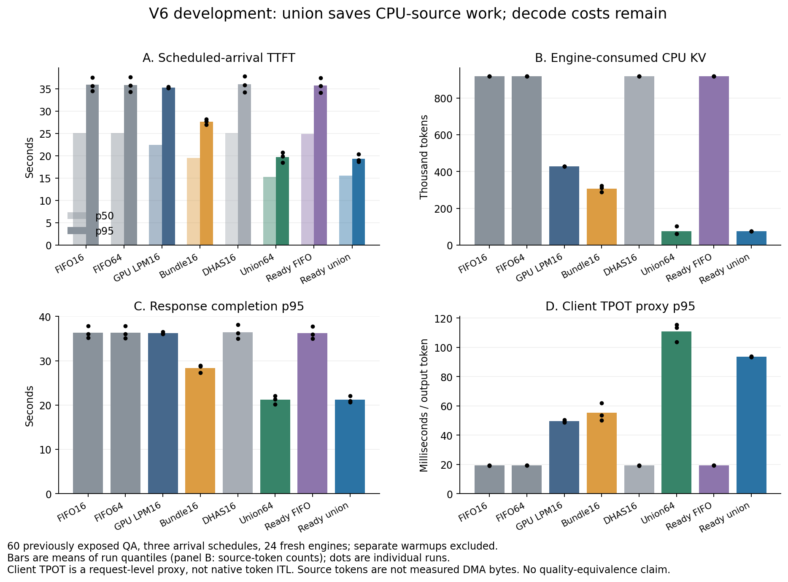
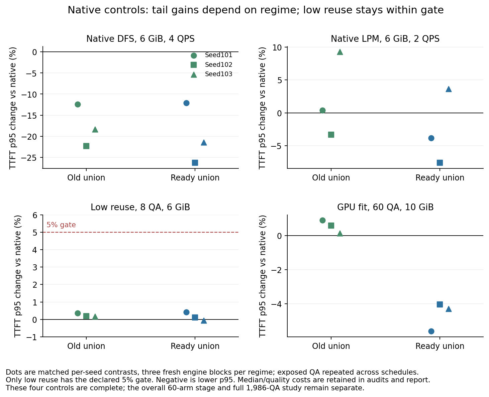
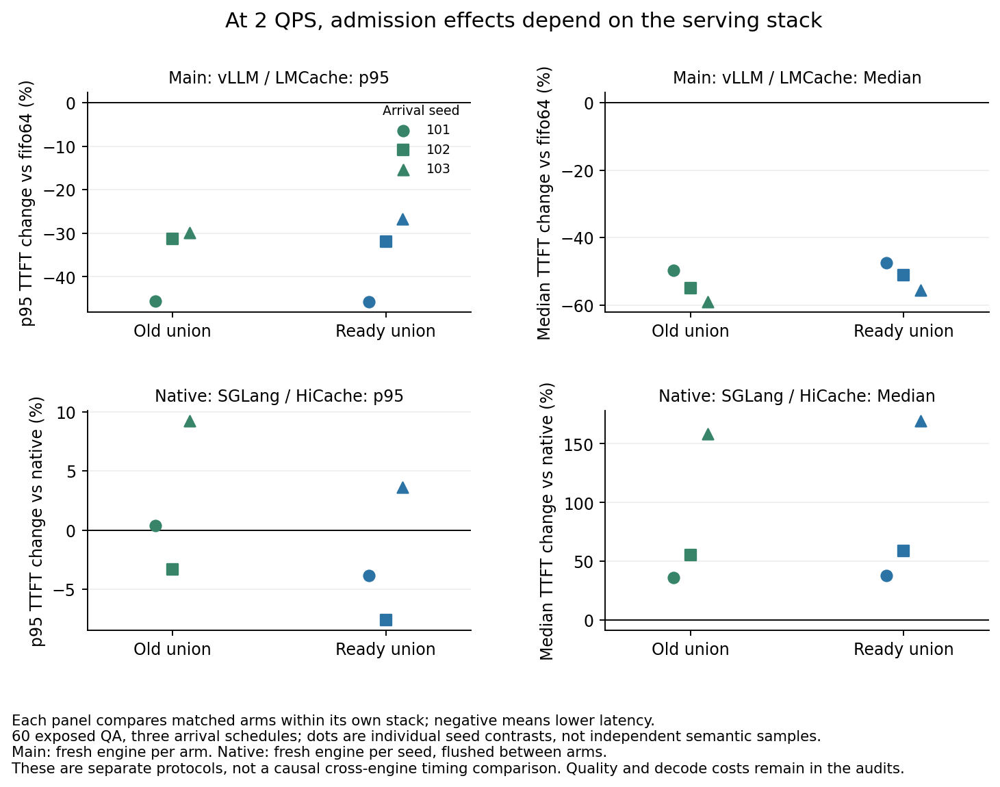
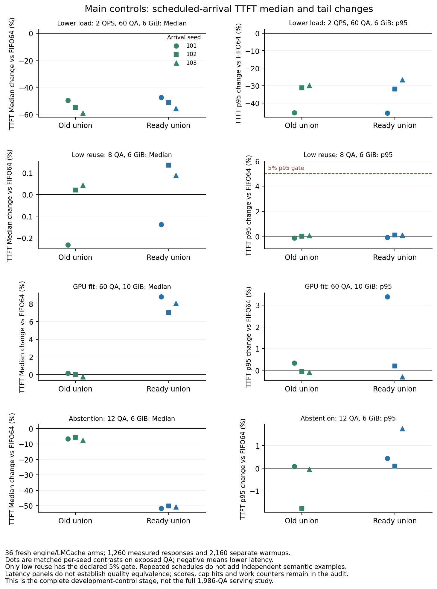

# V6 development evidence: complete main and native stages

**Full update,22:56UTC:** FirstFIFO full arm1986/1986success0errors +60separatewarmup now passes explicit R1 integrity/quality/resource/fairness/ITL audit and verified ten-file archive. Original controller stopped on a duplicate scalar CLI parsing error; original seal/sources/marker remain intact. Installed vLLM parser resolves16sequences, not the first argv occurrence4. A separately registered continuation is starting only the29unexecuted arms, preserving the original full30-arm scope. Read [R1 amendment](V6_FULL_ANALYSIS_R1.md); no complete full comparison, readiness gain or quality-equivalence claim.

Latest (22:12 UTC): main24/1440, native60/2700 and main controls36/1260 are complete and strictly audited, with separate warmups. Full CPU preflight passed all1,986QA with0token-ID/semantic mismatches, and the30-arm full controller has started from a prospective seal. No full measured arm is complete at this checkpoint. Development gains retain median/quality/regime costs and do not complete the research goal.

The registered main matrix completed24measured runs: **1,440/1,440 requests, zero errors**, plus1,440separate warmups. It reuses60previously exposed QA over3arrival schedules, with a fresh vLLM+LMCache process per arm, identical warmup/reset, pinned Qwen3-4B,6GiB GPU KV, observed16,039,018,496byte host heaps, max native sequences16/graphs, preparation worker and uniform180s transport/keepalive0. This is development evidence, not a full1,986QA result, semantic holdout or long-service liveness proof. V5 and shared-process pilot results are separate protocols.

`results/v3/v6dev1_main_audit.json` verifies all24measured/24warmup ledgers, unique process units, exact source/config/actual factory argv, prompt/output/source tokens and official quality. `v6dev1_main_quality.json` contains per-question scores. The plot script reads only this complete audit; PNG/SVG were generated and visually inspected.

Values below are arithmetic means of3run quantiles/counts. The QA population remains60, not180 per arm.

| Arm | TTFT p50 s | TTFT p95 s | Engine-consumed CPU KV tokens | New compute tokens | Answerable F1 |
| --- | ---: | ---: | ---: | ---: | ---: |
| FIFO16 | 25.060 | 35.891 | 918496 | 71810 | .313862 |
| FIFO64 | 25.065 | 35.877 | 918496 | 71810 | .313862 |
| Actual GPU LPM16 | 22.414 | 35.262 | 429082.7 | 69602 | .317511 |
| Bundle16 | 19.516 | 27.657 | 307888 | 67346 | .318357 |
| Fixed DHAS16 | 25.108 | 35.976 | 918496 | 71810 | .313862 |
| Original union64 | 15.320 | 19.696 | 75610.7 | 65676.7 | .316925 |
| Readiness-only FIFO64 | 24.944 | 35.731 | 918496 | 71810 | .313889 |
| Readiness+union64 | 15.535 | 19.383 | 76064 | 65602 | .316955 |

Readiness+union versus FIFO64 reduces mean-run p95 by45.973%, versus bundle by29.916%, and engine-consumed CPU-source tokens by91.719% versus FIFO. These are source-labelled token counts, not measured DMA bytes. Gate-only FIFO retains FIFO's compute/CPU-source work and nearly its latency: it does not explain the large gain. The primary evidence supports union/grouping under this memory-pressure regime.

The additional gate's improvement over original union is not established. Paired p95 changes across the3fresh-process schedule contrasts are **−1.662%, −3.982%, +1.078%**; p50 changes+1.958/−1.463/+3.863%. The exploratory paired-log-ratio t(df2) p95 descriptor is−1.544%, interval[−7.633,+4.947]%. It crosses0and rests on unverified n3independence/normality assumptions, so it is not a significance/population/quality-equivalence result. All three p99 differences favor readiness, but the analogous interval also crosses0. The original stall remains unexplained; no stall-fix claim follows from these successful fresh processes.

Quality F1 readiness−FIFO=.003093, readiness−bundle=−.001402, readiness−oldunion=.000030 on means. Against oldunion per-seed deltas change sign; each pair has4/60output hash differences. All arms have12output-cap hits per180scheduled responses across3seeds. Nearby means and equal cap-hit counts do not prove equivalent answers, and this dev cohort does not measure category5. The expanded native/main controls include separate abstention strata; full quality/category5still must be measured.

Completion p95 mean-run values FIFO64/bundle/oldunion/readiness are36.377/28.344/21.182/21.234s. Readiness therefore does not improve mean-run completion p95 over original union here. Client TPOT proxy p95 is19.263/55.195/110.799/93.580ms/token, respectively: union admission's TTFT gain coexists with a decode cost. This proxy is a per-request average after first text until response close, not individual native token ITL.

Supplemental native histograms have valid outside-window PID/prompt/generation/count/bucket coverage for22/24arms. FIFO16/FIFO64 seed101were explicitly skipped because observer registration was late; no retrospective values were invented. Means of valid per-run native update-interval means are FIFO64=19.516ms(n2), bundle=37.019ms(n3), oldunion=50.787ms(n3), readiness=45.786ms(n3). Native p95bucket bounds are FIFO64[10,25]ms(n2), bundle[50,75]ms, oldunion[150,200]or[200,300]ms, readiness[100,150]ms. These engine-update histograms corroborate a decode-distribution tradeoff but are not exact client token timestamps, and the unequal coverage must remain visible. Do not pool these observations with client TPOT or SGLang's differently weighted histogram semantics.

Per-conversation waits and actual head bypasses are retained in each audited run. New union/gate policies satisfy the observed bypass8bound; this does not imply a200ms admission/E2E deadline. The completed seed101old/newunion maximum admission waits are19.564/20.169s. Moving requests to frontend queues is included in scheduled-arrival TTFT; it cannot be hidden as an apparent engine TTFT improvement.

The native study has now prospectively registered60measured arms/2700requests and started SGLang, with18fresh blocks/1080separate warmups. Before its first registration, the plan was expanded from45arms to include originalunion in every native control; main controls similarly expanded from24to36arms1260requests2160warmups. No native results were used to choose that amendment. Full evaluation keeps both union policies, stronger native LPM/DFS/FIFO and mainFIFO/bundle. Current core/ablation conclusions remain conditional until native/controls/full and the final research requirement audit finish.

## First completed native block: one seed, overall study incomplete

`v6native1_primary_s101_checkpoint_audit.json` independently checks the first5arms/300measured requests and60separate warmups. The full60-arm stage is still running. All5arms share one fresh guarded Direct/LPM6GiB native process, with cache flush and fresh gateway state between arms. Exact prompts, actual source/config/factory, source tokens, captured hashes, native histogram coverage, head bypass and official scores pass. This is not three-seed or full-benchmark evidence.

| Seed101 arm | TTFT p50 s | TTFT p95 s | New prefill tokens | Host promotions delta |
| --- | ---: | ---: | ---: | ---: |
| Native LPM | 3.560 | 18.160 | 69650 | null |
| FIFO64 gateway | 3.646 | 18.189 | 69650 | null |
| Original union64 | 13.521 | 16.025 | 69650 | null |
| Readiness-only FIFO64 | 17.316 | 23.676 | 65122 | 304656 |
| Readiness+union64 | 13.467 | 15.673 | 65122 | 90144 |

Readiness changes native compute in this block:65122versus69650new prefill tokens(−6.501%) for both gate-only and gated union. Yet gate-onlyFIFO p95 worsens30.372% relative to native, while gated union improves13.696%. Reduced prefill work is therefore insufficient to establish a latency benefit. Relative to oldunion, readiness p95 improves2.199% here, with F1−.003060and3/60output hash differences. Relative to native, its median worsens278.331%, F1−.002174and5/60hash differences. These large median/quality costs remain explicit; one seed cannot select a winning method.

The missing promotion deltas must not be replaced with zero. Native/FIFO have absent first and last counters; oldunion's first endpoint is absent and final cumulative endpoint90144. Gate-onlyFIFO has90144→394800and gated union394800→484944, so only those two deltas are fully observed. Cache flush does not reset the cumulative metrics. The completed block therefore does **not** prove gated union reduces transfers versus oldunion/native. CPU-source counters from main and host-promotion counters from native remain different quantities, and neither is a measured DMA duration.

This is a new native scheduling/compute observation on an already exposed development workload, not a traced causal explanation of native partial-prefix work or the historical vLLM stall. Source/trace/fairness/quality evidence is retained for later three-seed and full comparisons; native60/controls36/full30remain required.

## Complete native primary subset: three seeds, controls still running

The three primary blocks now have **15/15measured arms,900/900successful requests, zero errors**, plus180separate warmups. `v6native1_primary_audit.json` combines the independent block audits, verifies exact prompt sets, three fresh block engine PIDs and raw/setup/quality hashes. This is the complete primary subset, not the complete60-arm native stage. Blocks use a shared engine internally after flush; do not pool them with fresh-per-arm main runs.

| Mean of three run values | Native LPM | FIFO64 | Old union64 | Ready FIFO | Ready union |
| --- | ---: | ---: | ---: | ---: | ---: |
| TTFT p50 s | 4.374 | 4.479 | 13.441 | 17.689 | 13.505 |
| TTFT p95 s | 20.141 | 20.149 | 16.588 | 23.397 | 15.910 |
| Completion p95 s | 20.863 | 20.878 | 16.999 | 24.191 | 16.664 |
| New-prefill source tokens | 69650 | 69650 | 69650 | 65122 | 65122 |
| Answerable F1 | .316803 | .316775 | .318125 | .320679 | .315315 |
| Cap hits across180responses | 11 | 11 | 11 | 12 | 9 |

Ready union versus native p95 changes **−13.696/−26.484/−21.687%**, while median changes+278.331/+199.958/+167.548%. Compared with oldunion, p95 improves−2.199/−5.662/−4.294%, but F1 decreases.003060/.002289/.003080and output hashes differ3/4/5outof60perseed. Its mean-run completion p95 improves from16.999to16.664s, unlike the negligible main-stack completion difference. All these protocol-specific tradeoffs must remain visible.

The exploratory n3paired-log-ratio p95descriptor ready union versus native is−20.796%, interval[−35.197,−3.194]%; versus oldunion−4.062%, interval[−8.291,+.361]%. These are assumption-dependent descriptors on three serving schedules, not robust semantic-population tests or quality noninferiority. The latter interval still crosses0, despite favorable p95at every seed. Gate-only FIFO p95 worsens at all3seeds(+30.372/+12.551/+7.453%) even though it matches readyunion's reduced prefill count.

The input-only reference in `v6dev1_input_oracle.json` uses an exact causal prefix trie, not globally deduplicated block payloads. On1,278,178input tokens, it counts4045distinct complete16-token causal blocks plus402private partial-tail tokens: **4045×16+402=65122**. A token-granular trie has64889unique edges. It assumes full retention and immediate block reuse, with no batching/transient-publication/queue/IO/generated-suffix model. It is a structural reference, not a simulator or an optimal native scheduler proof.

All6readiness runs (two variants×3seeds) exactly match65122, while all9native/FIFO/oldunion runs compute69650,4528more. This supports a repeatable change in source-labelled prefill work under readiness, not a6.5%FLOP/runtime/transfer guarantee. The CPU-only native-tokenizer audit calls SGLang's actual auto/huggingface loader and default fast batched path in its isolated environment; all60token-ID vectors match the main-environment oracle, with source/package/artifact hashes retained in `v6dev1_native_tokenizer_parity.json`.

Promotion coverage remains uneven. Fully observed native deltas are0atseed102and26448atseed103, whereas seed101isnull; oldunion has a fully observed90144only atseed102; readyunion has90144at101/103butnullat102. Every gate-onlyFIFO delta is observed(304656/350064/283184). Do not impute missing values, average only a convenient subset and claim transfer savings, or equate main consumed-source tokens with these native promotions. The figure deliberately plots prefill/latency/quality rather than hiding missing promotion coverage in bars.

Remaining nativeDFS/lowerload/lowreuse/GPUfit/abstention controls, main36controls, full30runs and the final research requirement audit are still required. No assertion of production liveness, stall repair, full Strata reproduction, quality equivalence or universal dominance follows from this subset.

## Completed native controls: DFS, lower load, low reuse and GPU fit

Four separate9-arm control audits now verify **1,692/1,692measured requests, zero errors**, plus720separate warmups: DFS540, lowerload540, lowreuse72, GPUfit540. Each regime has3fresh engine blocks, native/oldunion/readiness matched within each block after flush/freshgateway. Resource samples directly report108512host tokens,16,000,745,472payload bytes, in every measured control arm. This differs from main's16,039,018,496byte lazy heap; cross-engine actual parity remains revoked.

| Regime | Old union p95 change vs native, seeds101/102/103 | Ready union p95 change vs native |
| --- | --- | --- |
| DFS,6GiB,4QPS | −12.384/−22.304/−18.364% | −12.070/−26.335/−21.435% |
| LPM,6GiB,2QPS | +.396/−3.313/+9.264% | −3.835/−7.625/+3.639% |
| Low reuse,8QA | +.367/+.183/+.170% | +.412/+.100/−.070% |
| GPU fit,10GiB | +.884/+.578/+.129% | −5.604/−4.045/−4.296% |

The DFS control uses the same DFS backend for both native and gateway arms; it isolates admission without relying on native LPM's large-queue fallback. Ready union still increases median by172–280%versus DFS. Versus oldunion, its p95 changes+.359/−5.187/−3.763%, with mixedF1changes. The extra gate remains a qualified ablation rather than a universal improvement.

At2QPS, oldunion's seed103p95regression reaches9.264%, readiness3.639%; readiness median rises38–170%versus native. Both variants retain the same computed-token pattern as primary: old/native69650, readiness65122. Lower source compute therefore does not ensure lower p95at every load. Keep these failures of no-regression visible; the declared5%acceptance gate applies to lowreuse, not all regimes.

Both policies pass that lowreuse gate at every seed. All9arms compute190916new-prefill tokens, and outputs/scores match pairwise exactly, with0hashmismatches. This is8distinct QA repeated over3arrival schedules, not a broad tail/semantic-population guarantee. Missing native host-promotion counter endpoints remainnull; identical compute/output does not independently prove zero transfers.

At10GiB GPUfit, oldunion remains close to native with identical output hashes/F1. Readiness reduces p95about4–6%but increases median22–32%, changes5/7outputs perseed, and improves F1by.025134/.019691/.017489on this small dev cohort. These quality differences/cap-hit changes must remain part of the comparison. The readiness rule depends on pending prefix/firsttext state rather than a CPU-restore API, so its effects are not confined to declared GPU-cache pressure. Counter/oracle agreement is not proof of the exact native causal path. Full10GiB on ten conversations is a larger-cache control, not GPUfit.

Analysis caught and corrected a digest-domain bug before the60-arm/fullfollow-ons: registration hashes exact file bytes, while manifest/replay hashes the canonical JSONarray ofV2TraceRow values. These differ even for identical requests. New checks validate each independently; streaming canonical hashing is tested against the original implementation, includingUnicode andgzip. The complete60-QA CPU worker branch now passes and matches every main/native token vector, but is rejected as an incomplete1,986-QA preflight. No serving actor/input/timeout changed and no GPU request was replayed. `v6_trace_digest_correction.json` preserves the corrected proof. Primary performance/quality results were unaffected.

The abstention control, complete60-arm native audit, main36controls and full30study remain separate pending evidence at this checkpoint.

## Native60-arm stage terminal and audited,19:55UTC

The complete expanded native stage now passes strict audit: **60arms,2700/2700measured requests,0errors,1080separate warmups**,18distinct fresh engine blocks and60/60valid native histogram windows. Configuration checks include actual resolved dtype/model/policy/GPU/host/page/graph/IO values, mandatory V6 factory/source proof, reset/history, transport, prompt/source accounting, captured output hashes, warmup ledgers, observed host capacity and official quality. `v6native1_audit.json` and `v6native1_quality.json` are authoritative. The completed audit is now immutable because the live main-controls registration references its SHA.

The final abstention subset has9arms108/108successful measured responses on12distinct category5QA repeated3schedules. Every arm scores7/12(.583333), zero cap hits, answerableF1=nullbecause there are no answerable questions. Readiness p95changes−12.109/−12.123/−10.785%vsnative, oldunion+2.688/+2.404/+3.436%. Readiness has1–2output hash differences perpair despite equal category5accuracy. This is neither identical outputs, broad quality equivalence nor evidence on all446category5QA. No causal comparison to the differently prompted V4 full protocol is made.

The complete stage preserves66within-block paired contrasts across all regimes. Native primary/DFS gains, lower-load failures, low-reuse gate passes, GPUfit median/quality differences and missing promotion endpoints all remain part of the result. Sample-window GPU/queue/RSS/counter summaries retain their scope; unknown optional retraction gauges are not zero-filled. The unprofiled runs do not create new DMA timelines or prove the historical stall fixed.

Maincontrols36arms1260requests2160warmups have now started only after native audit success. Their actual registration/source hashes are separate. Full1986QA token preflight, prospective final seal,30fullarms59580requests, final report/quality/fairness/resource review and the research completion audit remain open.

The complete native gateway wait reconstruction checks all42gateway arms(1920measured requests);18direct-native arms have no gateway ledger and are explicitly omitted from the stage split. Per-request timestamps add to scheduled-arrival TTFT before means/quantiles are computed. Native primary mean TTFT/preparation/admission/upstream-to-firsttext, inseconds, is FIFO64=7.267/.072/.000044/7.186; oldunion=13.147/.076/10.621/2.441; gateFIFO=16.436/.075/15.038/1.315; readiness+union=13.208/.072/12.476/.652. Small remaining arrival/return-transport stages are retained in the JSON. Upstream includes native queue,copy,compute andtransport, not pureGPU time.

Readiness therefore reduces observed upstream-to-text mean1.790s versus oldunion while admission rises1.855s; total mean slightly worsens rather than showing a multi-fold speedup. Quantiles are never added, and frontend waiting is not excluded from E2E TTFT. `v6native1_waits.json` links the complete native audit SHA. At GPUfit, cap hits are3pernative/oldunion run versus2perreadiness run; at abstention, all methods preserve the same seven correct question outcomes perseed despite raw output differences. These are exact cohort observations, not quality equivalence over unseen questions.

## Main lower-load control: complete nine-arm subset

The 2-QPS main subset now passes independent integrity/config/source/observer/token/output/official-quality checks: **9 arms, 540/540 measured successes, zero errors, plus 540 separate warmups**, with nine distinct engine and LMCache process IDs. It uses the same 60 exposed QA across arrival seeds 101/102/103. `v6controls1_main_lowload_subset_audit.json` links the registration, analysis sources, quality and raw/setup artifacts. This is a complete subset, not the pending 36-arm controls stage or the full benchmark. The strict terminal auditor is unchanged.

| Mean of three run values | FIFO64 | Old union64 | Ready union |
| --- | ---: | ---: | ---: |
| TTFT p50 s | 19.199 | 8.688 | 9.308 |
| TTFT p95 s | 23.822 | 15.221 | 15.391 |
| New-prefill source tokens | 71810 | 65783.3 | 65676.7 |
| Engine-consumed CPU KV tokens | 918496 | 92266.7 | 82938.7 |
| Answerable F1 | .313862 | .313934 | .316141 |
| Cap hits across 180 responses | 12 | 12 | 12 |

Old union versus FIFO p95 changes are **−45.559/−31.308/−29.883%**; ready union versus FIFO **−45.797/−31.883/−26.671%**. Ready versus old union changes **−.437/−.837/+4.582%**, with median regressions **+4.574/+8.430/+8.631%**. The exploratory n3 paired-log p95 interval for the extra gate is [−6.098,+8.792]%, crossing zero. F1 increases .001370/.002727/.002525 versus old union on this cohort, while 6/5/7 output hashes differ. Equal cap counts or improved mean F1 do not establish quality equivalence.

Per-request additive wait reconstruction (`v6controls1_main_lowload_subset_waits.json`) verifies all 540 responses. Mean total/admission/upstream-to-text seconds are FIFO **19.098/.000047/19.022**, old union **8.762/5.744/2.943**, ready union **9.325/8.511/.738**. The extra gate reduces upstream mean by 2.206 s but adds 2.768 s admission; overall mean worsens by .563 s. Upstream includes engine queue, transfer, computation and transport. Stage quantiles are never added.

Main union therefore retains a large low-load benefit against its FIFO reference, whereas native LPM has a much stronger low-load median and a different admission effect. The figure shows matched contrasts within each protocol; it does not compare engine speed causally. This narrows any portable contribution claim: the beneficial memory-pressure admission regime and its latency/quality costs must be measured for each stack. The readiness increment remains unproven as a stable improvement.

The subset auditor also rejects the still-incomplete low-reuse regime before producing a success table; it writes only a separately named incomplete record. All ten active serving actors and the native audit SHA referenced by the live registration remain unchanged. Main low-reuse/GPU-fit/abstention controls and the prospective full study remain open.

## Main resource supplement: all 24 completed development arms

`v6_analyze_main_resources.py` independently reopens all24 audited main request/output/metric ledgers (1,440 measured responses), checks request hashes against the original audit, validates measured sampler/summary source fingerprints, reconciles strict sampled counter endpoints with both source accounting and original per-run totals, and requires sampling to bracket every scheduled arrival/completion. `v6dev1_main_resources.json` records raw/setup/source hashes, every run and missing-aware aggregates. It issues no serving requests and changes no measurement actor.

| Mean of three run observations | FIFO64 | Bundle16 | Old union64 | Ready union |
| --- | ---: | ---: | ---: | ---: |
| Sample window s | 55.340 | 41.338 | 36.005 | 36.671 |
| Time-weighted GPU utilization % | 87.371 | 81.427 | 80.093 | 85.033 |
| Time-weighted GPU board power W | 255.551 | 252.427 | 252.343 | 266.186 |
| Sampled-window board-energy estimate kJ | 14.141 | 10.434 | 9.086 | 9.761 |
| Sampled vLLM process-tree CPU s | 57.813 | 41.167 | 35.603 | 38.920 |
| Sampled LMCache process-tree CPU s | 3.543 | 2.990 | 2.800 | 2.747 |
| Instrumented scheduler decision CPU ms | Not instrumented | Not instrumented | 491.574 | 1297.963 |

Readiness versus old union has sampled board-energy increases **+9.430/+5.114/+7.788%**, and sampled vLLM CPU increases **+10.191/+7.840/+9.938%** across seeds101/102/103. These are descriptive within-stack observations, not causal energy-efficiency estimates: windows include pre/post-request margins, power is sampled at approximately1Hz, clocks/temperature are not fixed, and host energy is absent. Mean sampled clocks are1585.3MHz old versus1600.4MHz ready, temperatures61.38 versus62.23C. These differences and varying run lengths remain visible rather than assuming equal execution conditions beyond the registered protocol.

Gateway chooser CPU is a different instrumented quantity: old union .519/.481/.475s, readiness1.264/1.345/1.285s over each60-QA run. It includes decision-cache hits and excludes preparation, HTTP and other gateway work. Mean increases by .806s; this is not a timing decomposition of the TTFT difference or proof that those CPU cycles cause the tail outcome. Max observed chooser call is9.54–10.48ms old versus13.39–14.06ms ready. There are161/160/162 non-cache-hit decisions old versus215/222/215 ready, while readiness blocked-decision counts1955/2096/2035 are predicate evaluations, not independent requests. FIFO/bundle missing chooser counters are not treated as zero. Existing registered schedulers remain unchanged.

All24 sampled process-count sequences are three vLLM processes and one LMCache process, with monotonic aggregate CPU samples; counts alone do not prove stable descendant identities. Sampled VRAM peak is15997MiB in every arm, consistent with a largely preallocated engine footprint rather than evidence of identical live KV occupancy. Mean summed RSS peaks vary approximately3.66–3.72GB for vLLM and16.98–17.00GB for LMCache; these sums double-count shared pages and omit gateway/client, so are not physical system memory. GPU utilization is not a percentage of useful model work, kernel busy time or achieved request capacity.

Union's lower sampled utilization coexists with a shorter window and much lower tails than FIFO; readiness's higher utilization coexists with mixed tail gains and worse decode/median/resource observations versus old union. Optimizing utilization alone would miss that tradeoff. The supplement strengthens resource reporting; it does not complete main controls or replace the pending full benchmark, quality/fairness review and final research audit.

## Main low-reuse control: complete nine-arm subset

`v6controls1_main_lowreuse_subset_audit.json` now passes for **9 fresh engine/LMCache arms,72/72 measured successes, zero errors,540 separate warmups**. The same eight exposed QA are replayed across three arrival schedules; they are not72independent semantic examples. Source/config/observer/transport/prompt/token/captured-output and warmup integrity, actual host heap16039018496bytes, official quality and native histogram coverage9/9 are verified. The strict full36-arm auditor remains unchanged and pending.

| Candidate versus main FIFO64 | Seed101 p95 change | Seed102 | Seed103 |
| --- | ---: | ---: | ---: |
| Old union64 | −.133295% | +.006184% | +.064592% |
| Ready union | −.087588% | +.102761% | +.096045% |

Both treatments pass the declared<=5% gate at all three seeds. Every measured arm computes190916new-prefill source tokens, consumes **0 engine-labelled external CPU KV tokens**, records0preemptions and has0cap hits. Pairwise output hashes and official scores match exactly within each main seed, F1=.2307539683. This is a cohort observation, not quality equivalence beyond these eight questions. CPU-source consumption does not count backup/store IO or prove that every physical transfer operation was absent. Native promotions retain their distinct/missing-aware counter interpretation.

Mean run p50/p95 seconds are FIFO24.531/44.294, oldunion24.518/44.285, readiness24.539/44.311. Readiness versus oldunion p95 changes+.045768/+.096571/+.031433%, consistent with negligible additional timing differences in this control; no adaptive scheduling or universal no-regression claim follows. `v6controls1_main_lowreuse_subset_waits.json` verifies per-request additive stage reconstruction for all72responses. Do not add stage quantiles or interpret upstream as pure GPU time.

Together with the completed native low-reuse control, the observed primary low-reuse<=5% condition now holds on both stacks. **This does not authorize a premature full seal:** the freezer still requires the complete36-arm main controls audit, including GPU-fit/abstention, then full CPU token-ID preflight. Main18/36arms612requests are complete at this checkpoint; the30-arm full study and final research conclusion remain unexecuted/unproven.

## Main GPU-fit control: complete nine-arm subset

`v6controls1_main_gpufit_subset_audit.json` verifies **9 fresh engine/LMCache arms,540/540 measured successes, zero errors,540 separate warmups**, using the same60exposed QA at GPU10GiB across three arrival schedules. Config/source/observer/transport/input/token/output/warmup contracts, observed host heap16039018496bytes, official quality and native histogram coverage9/9 pass. `v6controls1_main_gpufit_subset_waits.json` reconstructs every measured request's additive stages.

| Mean of three run values | FIFO64 | Old union64 | Ready union |
| --- | ---: | ---: | ---: |
| TTFT p50 s | 12.526 | 12.524 | 13.522 |
| TTFT p95 s | 14.529 | 14.537 | 14.682 |
| New-prefill source tokens | 65122 | 65122 | 65122 |
| Engine-consumed CPU KV tokens | 0 | 0 | 0 |
| Answerable F1 | .310808 | .310808 | .312178 |
| Cap hits across180responses | 12 | 12 | 12 |

Old union versus FIFO p95 changes **+.339/−.062/−.094%**, with identical output hashes/quality at every seed. Ready versus FIFO p95 changes **+3.384/+.198/−.291%**, median **+8.802/+7.015/+8.059%**. Versus old union, ready p95 changes+3.035/+.260/−.197%, median+8.625/+7.007/+8.296%. Ready changes3/4/3output hashes and F1 by+.002574/+.003787/−.002251versus either reference; equal cap totals and nearby scores are not quality equivalence. All arms record0preemptions.

All nine arms match the independent input-only page16 reference65122, so readiness saves no additional observed prefill in this main GPU-fit control. Main CPU-source consumption0 does not prove absent backup/store or every physical IO operation. Native GPU-fit has a different result: the readiness ablation still reduces observed native prefill relative to its native reference, while increasing median and changing outputs. Keep these as separate within-stack observations; an aggregate cross-engine transfer/compute percentage would be invalid.

Mean total/admission/upstream-to-firsttext seconds are FIFO **12.569/.000029/12.484**, oldunion **12.569/.000031/12.488**, readiness **13.206/11.871/1.248**. Readiness moves waiting into frontend admission and increases total mean by .637s versus oldunion. Upstream includes queue/copy/compute/transport, not pure GPU time, and stage quantiles are never summed. Because readiness tests pending prefix/first text rather than a verified restore-pressure condition, it can change admission even when the declared CPU tier supplies no consumed tokens.

This control supports original union's near-no-op behavior in this measured main GPU-fit regime and explicitly limits the extra gate: additional delay with no observed work reduction, mixed tail/quality differences. The registered methods are unchanged. It does not establish universal non-regression, quality equivalence or a native publication/pinning explanation. Full ten-conversation10GiB remains a larger-cache control, not GPU-fit. Main27/36controls1152requests now complete; abstention, the complete-stage audit and all full-study work remain open.

## Main36-arm controls terminal; full pipeline launched

The complete main controls audit now passes **36 measured arms,1,260/1,260successful requests, zero errors,2,160separate warmups**, with36distinct engine and36distinct LMCache PIDs. Actual source/config/entrypoint/prompt/output/reset/transport/observer/host contracts and native ITL coverage **36/36** pass. `v6controls1_main_audit.json` and `_quality.json` are authoritative and immutable prerequisites of the new full seal. Subset artifacts remain separately scoped; do not rerun or rewrite the seal-linked terminal audit.

The inspected PNG/SVG uses matched per-seed scheduled-arrival TTFT contrasts, showing p50 and p95 separately. `v6controls1_main_plot.json` links the complete audit, plot source and figure bytes. Low-reuse passes the declared5% p95 threshold for both methods at all seeds. Lower load preserves a large main union benefit versus FIFO; GPU-fit preserves old union's near-no-op behavior but exposes readiness median costs with no work saving. These remain conditional observations, not a universal policy win.

The final main abstention subset has9arms108/108successful responses on12distinct category5QA, plus540warmups. Every arm scores **7/12=.583333**, no cap hits, answerableF1=nullbecause the stratum has no answerable questions. All nine main arms agree on the same seven correct questions, matching the completed native cohort's correct set; this is a fixed-cohort observation, not full446-question quality equivalence or a causal cross-engine timing comparison. Main old union has0output hash differences versus FIFO per seed; readiness also has0within-main pair differences.

| Main abstention contrast vs FIFO, seeds101/102/103 | p50 change | p95 change |
| --- | --- | --- |
| Old union | −6.661/−5.765/−7.561% | +.087/−1.766/−.055% |
| Ready union | −51.771/−50.141/−50.827% | +.438/+.096/+1.749% |

Mean p50/p95 seconds are FIFO14.419/15.134, old13.459/15.044, ready7.081/15.249. Readiness reduces median substantially here while tails are slightly worse; the GPU-fit median result has the opposite sign. `v6controls1_main_waits.json` reconstructs additive stages for all36gateway arms/1260requests, preserving all latency and quality costs.

The prospective full seal was written at **22:07:24UTC**, SHA `12f86b1a0698cbb56f3b290f53bb4cf660b38c6380bcece6e328a641228af366`. It binds31actor/helper files,17analysis/evaluator sources, packages/model/input/protocol/prerequisites and the full30-arm graph. All four low-reuse gate records pass; original union and readiness remain separate treatments. Do not edit sealed sources/protocol or linked audits during execution.

Full input preflight verifies all **1,986token vectors**, **50,522,325input tokens**, and identical nonarrival content across seeds901/902/903 in the pinned environments. Token-ID and semantic mismatches are0. The input-only page16 reference is18,195complete causal blocks+13,765private tail tokens=304,885new tokens under full retention/immediate publication assumptions; it is not a finite-cache scheduler or actual full prefill measurement.

The first main full arm has observed host heap capacity **48,049,946,624bytes**, matching the source prediction; native48,002,236,416bytes remains an expected payload until its actual full arm is observed. Capacity is not physical RSS or actual cross-engine heap parity. The first60-request warmup completed without request errors; no1,986-request measured arm has reached complete per-run audit/archival at this checkpoint. Full quality1540answerable/446category5, performance/resources/fairness/nativeITL, all30arms and the final research completion audit remain pending.

## First full FIFO: one-arm diagnostic after explicit analysis correction

The full FIFO seed901 arm succeeds1986/1986 and passes the separate R1 audit after the original configuration validator stopped on a duplicate CLI flag. `v6full1_fifo_diagnostic_plot.json` links audit/archive/raw/source/PNG/SVG hashes. The figure was rendered from retained data and visually inspected; it is one baseline, not a full candidate comparison.

Mean scheduled-arrival TTFT622.281s is dominated by arrival→gateway422.819s and gateway admission146.594s; upstream→first text52.764s also includes engine queue, transport, copy and compute. The connection limit256 shapes delivery despite nominal4QPS arrivals. The cumulative curves show offered arrivals finishing much earlier than serving; do not interpret the observed1.188req/s as a standalone throughput-capacity benchmark. The first interval has not been causally split among pool/socket/backpressure/task scheduling.

The engine accounts50,522,325prompt tokens as49,331,488external consumed,589,712GPU local and601,125new prefill. These sum exactly, while physical DMA volume/duration remain different quantities. The sampled GPU curve is not copy/compute separation. AnswerableF1=.317162, category5=223/446=.5,20cap hits; no full candidate quality equivalence is established. Full input-only reference304,885newtokens assumes unlimited retention/immediate publication and is not a finite-cache optimum.
