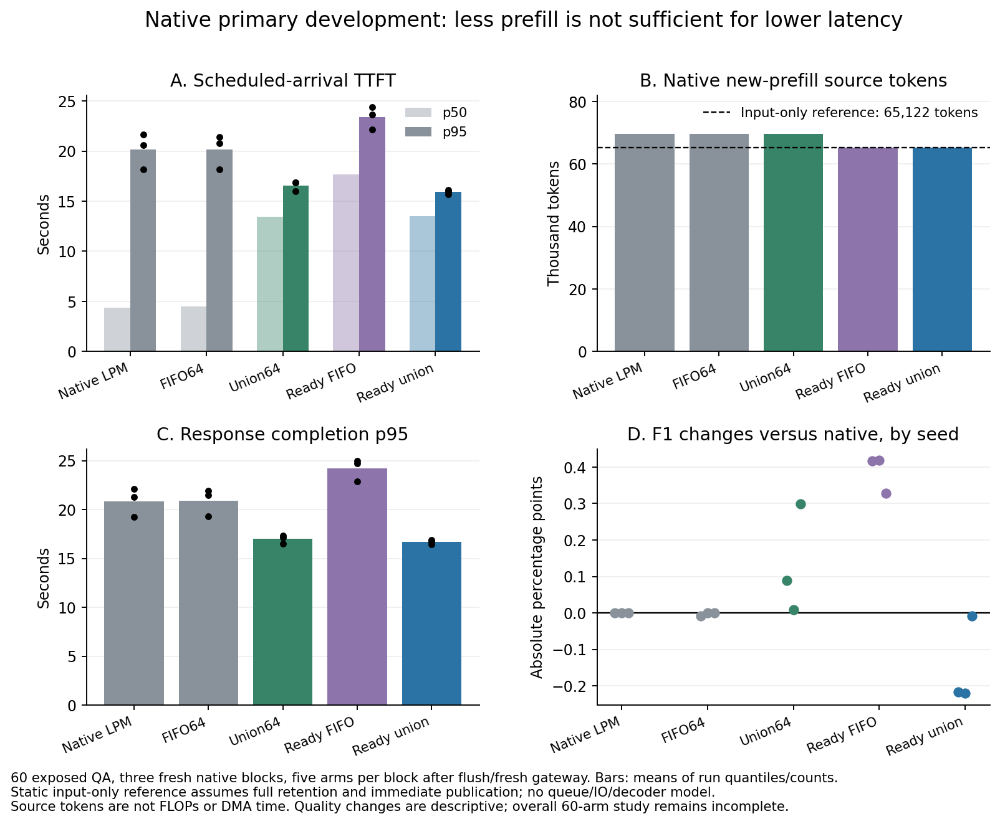

# V6 development evidence: complete main matrix

The registered main matrix completed24measured runs: **1,440/1,440 requests, zero errors**, plus1,440separate warmups. It reuses60previously exposed QA over3arrival schedules, with a fresh vLLM+LMCache process per arm, identical warmup/reset, pinned Qwen3-4B,6GiB GPU KV, observed16,039,018,496byte host heaps, max native sequences16/graphs, preparation worker and uniform180s transport/keepalive0. This is development evidence, not a full1,986QA result, semantic holdout or long-service liveness proof. V5 and shared-process pilot results are separate protocols.

`results/v3/v6dev1_main_audit.json` verifies all24measured/24warmup ledgers, unique process units, exact source/config/actual factory argv, prompt/output/source tokens and official quality. `v6dev1_main_quality.json` contains per-question scores. The plot script reads only this complete audit; PNG/SVG were generated and visually inspected.

Values below are arithmetic means of3run quantiles/counts. The QA population remains60, not180 per arm.

| Arm | TTFT p50 s | TTFT p95 s | Engine-consumed CPU KV tokens | New compute tokens | Answerable F1 |
| --- | ---: | ---: | ---: | ---: | ---: |
| FIFO16 | 25.060 | 35.891 | 918496 | 71810 | .313862 |
| FIFO64 | 25.065 | 35.877 | 918496 | 71810 | .313862 |
| Actual GPU LPM16 | 22.414 | 35.262 | 429082.7 | 69602 | .317511 |
| Bundle16 | 19.516 | 27.657 | 307888 | 67346 | .318357 |
| Fixed DHAS16 | 25.108 | 35.976 | 918496 | 71810 | .313862 |
| Original union64 | 15.320 | 19.696 | 75610.7 | 65676.7 | .316925 |
| Readiness-only FIFO64 | 24.944 | 35.731 | 918496 | 71810 | .313889 |
| Readiness+union64 | 15.535 | 19.383 | 76064 | 65602 | .316955 |

Readiness+union versus FIFO64 reduces mean-run p95 by45.973%, versus bundle by29.916%, and engine-consumed CPU-source tokens by91.719% versus FIFO. These are source-labelled token counts, not measured DMA bytes. Gate-only FIFO retains FIFO's compute/CPU-source work and nearly its latency: it does not explain the large gain. The primary evidence supports union/grouping under this memory-pressure regime.

The additional gate's improvement over original union is not established. Paired p95 changes across the3fresh-process schedule contrasts are **−1.662%, −3.982%, +1.078%**; p50 changes+1.958/−1.463/+3.863%. The exploratory paired-log-ratio t(df2) p95 descriptor is−1.544%, interval[−7.633,+4.947]%. It crosses0and rests on unverified n3independence/normality assumptions, so it is not a significance/population/quality-equivalence result. All three p99 differences favor readiness, but the analogous interval also crosses0. The original stall remains unexplained; no stall-fix claim follows from these successful fresh processes.

Quality F1 readiness−FIFO=.003093, readiness−bundle=−.001402, readiness−oldunion=.000030 on means. Against oldunion per-seed deltas change sign; each pair has4/60output hash differences. All arms have12output-cap hits per180scheduled responses across3seeds. Nearby means and equal cap-hit counts do not prove equivalent answers, and this dev cohort does not measure category5. The expanded native/main controls include separate abstention strata; full quality/category5still must be measured.

Completion p95 mean-run values FIFO64/bundle/oldunion/readiness are36.377/28.344/21.182/21.234s. Readiness therefore does not improve mean-run completion p95 over original union here. Client TPOT proxy p95 is19.263/55.195/110.799/93.580ms/token, respectively: union admission's TTFT gain coexists with a decode cost. This proxy is a per-request average after first text until response close, not individual native token ITL.

Supplemental native histograms have valid outside-window PID/prompt/generation/count/bucket coverage for22/24arms. FIFO16/FIFO64 seed101were explicitly skipped because observer registration was late; no retrospective values were invented. Means of valid per-run native update-interval means are FIFO64=19.516ms(n2), bundle=37.019ms(n3), oldunion=50.787ms(n3), readiness=45.786ms(n3). Native p95bucket bounds are FIFO64[10,25]ms(n2), bundle[50,75]ms, oldunion[150,200]or[200,300]ms, readiness[100,150]ms. These engine-update histograms corroborate a decode-distribution tradeoff but are not exact client token timestamps, and the unequal coverage must remain visible. Do not pool these observations with client TPOT or SGLang's differently weighted histogram semantics.

Per-conversation waits and actual head bypasses are retained in each audited run. New union/gate policies satisfy the observed bypass8bound; this does not imply a200ms admission/E2E deadline. The completed seed101old/newunion maximum admission waits are19.564/20.169s. Moving requests to frontend queues is included in scheduled-arrival TTFT; it cannot be hidden as an apparent engine TTFT improvement.

The native study has now prospectively registered60measured arms/2700requests and started SGLang, with18fresh blocks/1080separate warmups. Before its first registration, the plan was expanded from45arms to include originalunion in every native control; main controls similarly expanded from24to36arms1260requests2160warmups. No native results were used to choose that amendment. Full evaluation keeps both union policies, stronger native LPM/DFS/FIFO and mainFIFO/bundle. Current core/ablation conclusions remain conditional until native/controls/full and the final research requirement audit finish.

## First completed native block: one seed, overall study incomplete

`v6native1_primary_s101_checkpoint_audit.json` independently checks the first5arms/300measured requests and60separate warmups. The full60-arm stage is still running. All5arms share one fresh guarded Direct/LPM6GiB native process, with cache flush and fresh gateway state between arms. Exact prompts, actual source/config/factory, source tokens, captured hashes, native histogram coverage, head bypass and official scores pass. This is not three-seed or full-benchmark evidence.

| Seed101 arm | TTFT p50 s | TTFT p95 s | New prefill tokens | Host promotions delta |
| --- | ---: | ---: | ---: | ---: |
| Native LPM | 3.560 | 18.160 | 69650 | null |
| FIFO64 gateway | 3.646 | 18.189 | 69650 | null |
| Original union64 | 13.521 | 16.025 | 69650 | null |
| Readiness-only FIFO64 | 17.316 | 23.676 | 65122 | 304656 |
| Readiness+union64 | 13.467 | 15.673 | 65122 | 90144 |

Readiness changes native compute in this block:65122versus69650new prefill tokens(−6.501%) for both gate-only and gated union. Yet gate-onlyFIFO p95 worsens30.372% relative to native, while gated union improves13.696%. Reduced prefill work is therefore insufficient to establish a latency benefit. Relative to oldunion, readiness p95 improves2.199% here, with F1−.003060and3/60output hash differences. Relative to native, its median worsens278.331%, F1−.002174and5/60hash differences. These large median/quality costs remain explicit; one seed cannot select a winning method.

The missing promotion deltas must not be replaced with zero. Native/FIFO have absent first and last counters; oldunion's first endpoint is absent and final cumulative endpoint90144. Gate-onlyFIFO has90144→394800and gated union394800→484944, so only those two deltas are fully observed. Cache flush does not reset the cumulative metrics. The completed block therefore does **not** prove gated union reduces transfers versus oldunion/native. CPU-source counters from main and host-promotion counters from native remain different quantities, and neither is a measured DMA duration.

This is a new native scheduling/compute observation on an already exposed development workload, not a traced causal explanation of native partial-prefix work or the historical vLLM stall. Source/trace/fairness/quality evidence is retained for later three-seed and full comparisons; native60/controls36/full30remain required.

## Complete native primary subset: three seeds, controls still running

The three primary blocks now have **15/15measured arms,900/900successful requests, zero errors**, plus180separate warmups. `v6native1_primary_audit.json` combines the independent block audits, verifies exact prompt sets, three fresh block engine PIDs and raw/setup/quality hashes. This is the complete primary subset, not the complete60-arm native stage. Blocks use a shared engine internally after flush; do not pool them with fresh-per-arm main runs.

| Mean of three run values | Native LPM | FIFO64 | Old union64 | Ready FIFO | Ready union |
| --- | ---: | ---: | ---: | ---: | ---: |
| TTFT p50 s | 4.374 | 4.479 | 13.441 | 17.689 | 13.505 |
| TTFT p95 s | 20.141 | 20.149 | 16.588 | 23.397 | 15.910 |
| Completion p95 s | 20.863 | 20.878 | 16.999 | 24.191 | 16.664 |
| New-prefill source tokens | 69650 | 69650 | 69650 | 65122 | 65122 |
| Answerable F1 | .316803 | .316775 | .318125 | .320679 | .315315 |
| Cap hits across180responses | 11 | 11 | 11 | 12 | 9 |

Ready union versus native p95 changes **−13.696/−26.484/−21.687%**, while median changes+278.331/+199.958/+167.548%. Compared with oldunion, p95 improves−2.199/−5.662/−4.294%, but F1 decreases.003060/.002289/.003080and output hashes differ3/4/5outof60perseed. Its mean-run completion p95 improves from16.999to16.664s, unlike the negligible main-stack completion difference. All these protocol-specific tradeoffs must remain visible.

The exploratory n3paired-log-ratio p95descriptor ready union versus native is−20.796%, interval[−35.197,−3.194]%; versus oldunion−4.062%, interval[−8.291,+.361]%. These are assumption-dependent descriptors on three serving schedules, not robust semantic-population tests or quality noninferiority. The latter interval still crosses0, despite favorable p95at every seed. Gate-only FIFO p95 worsens at all3seeds(+30.372/+12.551/+7.453%) even though it matches readyunion's reduced prefill count.

The input-only reference in `v6dev1_input_oracle.json` uses an exact causal prefix trie, not globally deduplicated block payloads. On1,278,178input tokens, it counts4045distinct complete16-token causal blocks plus402private partial-tail tokens: **4045×16+402=65122**. A token-granular trie has64889unique edges. It assumes full retention and immediate block reuse, with no batching/transient-publication/queue/IO/generated-suffix model. It is a structural reference, not a simulator or an optimal native scheduler proof.

All6readiness runs (two variants×3seeds) exactly match65122, while all9native/FIFO/oldunion runs compute69650,4528more. This supports a repeatable change in source-labelled prefill work under readiness, not a6.5%FLOP/runtime/transfer guarantee. The CPU-only native-tokenizer audit calls SGLang's actual auto/huggingface loader and default fast batched path in its isolated environment; all60token-ID vectors match the main-environment oracle, with source/package/artifact hashes retained in `v6dev1_native_tokenizer_parity.json`.

Promotion coverage remains uneven. Fully observed native deltas are0atseed102and26448atseed103, whereas seed101isnull; oldunion has a fully observed90144only atseed102; readyunion has90144at101/103butnullat102. Every gate-onlyFIFO delta is observed(304656/350064/283184). Do not impute missing values, average only a convenient subset and claim transfer savings, or equate main consumed-source tokens with these native promotions. The figure deliberately plots prefill/latency/quality rather than hiding missing promotion coverage in bars.

Remaining nativeDFS/lowerload/lowreuse/GPUfit/abstention controls, main36controls, full30runs and the final research requirement audit are still required. No assertion of production liveness, stall repair, full Strata reproduction, quality equivalence or universal dominance follows from this subset.
