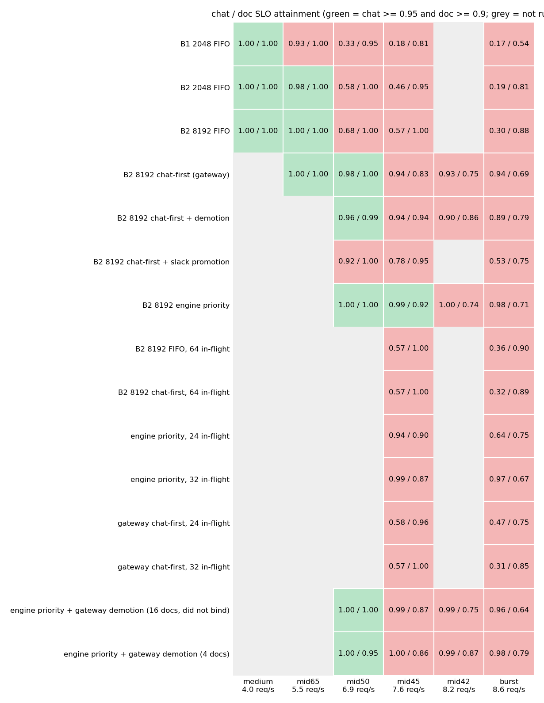

# SLO-constrained capacity, engine-level priority, and real arrival structure

Fifth follow-up. Pre-registered in [capacity_prereg.md](capacity_prereg.md) (Part A capacity ladder, Part B engine priority, Part C BurstGPT windows; an addendum for the control runs was written after seeing the first engine-priority results and is marked as such there). Same host (RTX 3090), stack, model and SLOs (chat TTFT <= 1 s, doc <= 3 s, TPOT <= 100 ms). 56 new runs (36 capacity and engine-priority runs, including the smoke-test run of the seed 7 mid50 engine-priority cell, 12 BurstGPT runs, 8 control runs); earlier cells are reused for the other policies. Data: `results/real60_registry.csv`, `results/s11_registry.csv`, `results/bg_registry.csv`, `results/real/capacity_seed7.json`, `capacity_seed11.json`, `bg_analysis.json`, raw `results/raw/*b2tv*`, `*b2tw*`, `*b2tpw*`, `bg-*`, `*-b1-*`, figures `results/figures/capacity/`.

## Part A: capacity ladder

A configuration *passes* a load level when chat SLO >= 0.95 and doc SLO >= 0.90 (pooled over repeats, over all offered requests). Load levels are the existing arrival profiles; offered load is total requests per second of the trace span (the same for both seeds). Brackets are on the tested levels only; no interpolation.



**Seed 7** (chat / doc SLO; `*` = pass):

| Config | medium 4.0 req/s | mid65 5.5 | mid50 6.9 | mid45 7.6 | burst 8.6 | Heaviest pass |
|---|---|---|---|---|---|---|
| B1 2048 FIFO | 1.00 / 1.00 * | 0.93 / 1.00 | 0.33 / 0.95 | 0.18 / 0.81 | 0.17 / 0.54 | 4.0 req/s |
| B2 2048 FIFO | 1.00 / 1.00 * | 0.98 / 1.00 * | 0.58 / 1.00 | 0.46 / 0.95 | 0.19 / 0.81 | 5.5 |
| B2 8192 FIFO | 1.00 / 1.00 * | 1.00 / 1.00 * | 0.68 / 1.00 | 0.57 / 1.00 | 0.30 / 0.88 | 5.5 |
| B2 8192 chat-first (gateway) | - | 1.00 / 1.00 * | 0.98 / 1.00 * | 0.94 / 0.83 | 0.94 / 0.69 | 6.9 |
| B2 8192 chat-first + demotion | - | - | 0.96 / 0.99 * | 0.94 / 0.94 | 0.89 / 0.79 | 6.9 |
| B2 8192 engine priority | - | - | 1.00 / 1.00 * | **0.99 / 0.92 *** | 0.98 / 0.71 | **7.6** |

Capacity on this ladder rises from 4.0 req/s (B1) to 7.6 req/s (engine priority), 1.9x, in four steps: CPU tier +37% (4.0 to 5.5), larger prefill budget +0% (5.5 to 5.5 at this grid resolution; it lowers p95 within a level but does not move the bracket), gateway chat-first +25% (5.5 to 6.9), engine priority +10% (6.9 to 7.6). Medium-load rows for chat-first, demotion and engine priority were not run (grey cells).

**Seed 11** (only mid50, mid45, burst tested for most configs):

| Config | mid50 6.9 req/s | mid45 7.6 | burst 8.6 | Heaviest pass |
|---|---|---|---|---|
| B1 2048 FIFO | 0.71 / 1.00 | 0.32 / 1.00 | - | below tested range |
| B2 2048 FIFO | 0.77 / 1.00 | 0.58 / 1.00 | - | below tested range |
| B2 8192 FIFO | 0.97 / 1.00 * | 0.72 / 1.00 | 0.47 / 1.00 | 6.9 |
| B2 8192 chat-first | 1.00 / 1.00 * | 1.00 / 1.00 * | 0.99 / 0.83 | 7.6 |
| B2 8192 chat-first + demotion | 1.00 / 1.00 * | 1.00 / 1.00 * | 0.99 / 0.92 * | >= 8.6 (no fail tested) |
| B2 8192 engine priority | - | - | 0.98 / 0.81 | (burst fails) |

On seed 11 FIFO passes at a heavier level than on seed 7 for the 8192 configs and B1/B2 2048 already fail at the lightest tested level, so their brackets are "below tested range". The ordering is the same; the levels shift.

**Hypotheses:**

- **K1 (ordering B1 <= B2 2048 <= B2 8192 FIFO <= {chat-first, demotion} on both seeds): met.** No later configuration has a lighter bracket than an earlier one on either seed.
- **K2 (B2 2048 passes a level heavier than B1): met on seed 7 only** (mid65 vs medium). On seed 11 it was not testable because both fail the lightest level that was run.
- **K3 (best of chat-first / demotion passes heavier than B2 2048): met on both seeds** (seed 7 mid50 vs mid65; seed 11 mid45 or burst vs below range).

> Note added after study 8 ([combo_results.md](combo_results.md)): the engine-priority cells below are single two-repeat measurements; a second effective replicate showed doc SLO differences up to 0.095 between replicates, so the seed 7 mid45 pass (doc 0.917) is within noise.

## Part B: where the priority ordering lives

vLLM `--scheduling-policy priority` (confirmed in `/server_info`), request `priority` 0 for chat and 1 for doc; the gateway passes requests through with 64 in-flight and queueing happens in vLLM's waiting queue (`max_num_seqs` stays 16).

| Cell (seed 7 unless noted) | Gateway chat-first (16 slots) | Engine priority | Gateway chat-first, 64 slots (control) | Gateway FIFO, 64 slots (control) |
|---|---|---|---|---|
| mid50 | 0.98 / 1.00 | 1.00 / 1.00 | - | - |
| mid45 | 0.94 / 0.83 | **0.99 / 0.92** | 0.57 / 1.00 | 0.57 / 1.00 |
| burst | 0.94 / 0.69 | 0.98 / 0.71 | 0.32 / 0.89 | 0.36 / 0.91 |
| seed 11 burst | 0.99 / 0.83 | 0.98 / 0.81 | - | - |

- **V1 (engine priority within 0.03 of gateway chat-first on both classes): not met.** It holds at seed 7 mid50 (chat +0.017, doc 0.000) and seed 11 burst (chat -0.008, doc -0.024). It fails at seed 7 mid45 (chat +0.050, doc +0.083) and burst (chat +0.041, doc +0.024), in the direction of engine priority being better.
- **Controls (added after the first results; reading rule fixed beforehand).** Widening the gateway without engine priority (B2TW, B2TPW) gives FIFO-like results (chat 0.57 at mid45, 0.32 to 0.36 at burst), so the gain is not from the wider gateway; engine-side ordering contributes. With a 64-slot gateway the gateway's own chat-first ordering has nothing to reorder (queue wait 2 to 3 ms).
- **V2 (chat gateway wait near zero under engine priority): confirmed.** Chat gateway wait 2 to 3 ms (vs 273 to 378 ms under gateway chat-first); the engine segment grows from 99 to 298 ms at mid45 and 137 to 412 ms at burst; chat p95 TTFT 785 ms vs 1,080 ms (mid45) and 884 vs 974 ms (burst); doc p95 3,331 vs 3,537 ms (mid45) and 4,651 vs 4,612 ms (burst).
- The mechanism is **not** preemption: vLLM reported 0 preemptions in the mid45 runs and 0 to 1 in the burst runs. I did not isolate why engine-side priority beats a 16-slot gateway queue; candidates (finer-grained, per-step ordering; chat requests join a step that is already prefilling a document chunk) are untested.

## Part C: BurstGPT arrival structure

Two windows of 74 consecutive 'Conversation log' requests from `BurstGPT_1.csv` (jittered inside the second, rescaled to a 10 s span; the 14 longest requests by `Request tokens` become document first visits; content as in the seed-7 trace; q1 = q0 + 1.3 s, q2 = q0 + 8 s). Window w1 spans 845 s of the real trace (gap CV 0.82, peak 10 arrivals in one second, 5.8 req/s overall); window w2 spans 21,079 s (gap CV 2.08, peak 21 per second, 8.7 req/s). The compression factor is large in both, so absolute burstiness is stronger than in the source trace. Offered load is set by the window, not matched to earlier profiles.

| Window | Policy | Chat SLO | Doc SLO | Chat p95 (s) | Doc p95 (s) | Goodput |
|---|---|---|---|---|---|---|
| w1 | FIFO | 0.45 | 1.00 | 1.69 | 1.74 | 3.75 |
| w1 | chat-first | 1.00 | 1.00 | 0.75 | 2.76 | 5.53 |
| w1 | demotion | 1.00 | 0.94 | 0.65 | 6.44 | 5.41 |
| w2 | FIFO | 0.13 | 0.56 | 4.41 | 5.02 | 2.33 |
| w2 | chat-first | 0.38 | 0.24 | 2.23 | 7.52 | 2.25 |
| w2 | demotion | 0.75 | 0.52 | 2.30 | 11.04 | 4.59 |

- **G1 met** (FIFO misses the chat target in both windows): chat-first raises chat SLO +0.55 (w1) and +0.24 (w2), both >= 0.20 (w2 at the cost of doc SLO, -0.32).
- **G2 not met in w1:** demotion keeps chat at 1.00 but doc SLO is 0.94 vs 1.00 (-0.06, CI [-0.13, 0.00]). **Met in w2**, where demotion improves both classes over chat-first (chat +0.38, doc +0.29) and roughly doubles goodput (2.25 to 4.59).
- Under the heaviest, burstiest window demotion is far more valuable than at the earlier synthetic loads (where it added no capacity). This is one window, two repeats, and a heavy overload for every policy (none reaches either target), so I treat it as a pointer, not an estimate.

## What the data support

1. **A capacity measure makes the earlier results comparable.** On seed 7 the SLO-constrained capacity rises 1.9x from B1 to engine priority; the CPU tier and class ordering carry most of it. The ordering of configurations is stable across the two document sets; the load levels are not.
2. **Where the class ordering is implemented matters.** Engine-level priority passed a level that gateway chat-first did not (seed 7 mid45: 0.99 / 0.92 vs 0.94 / 0.83), and the controls rule out the wider gateway as the cause. The cause inside the engine was not isolated.
3. **Engine priority and doomed-document demotion were never combined**; on seed 11 burst demotion passed (0.99 / 0.92) and engine priority did not (0.98 / 0.81), and on seed 7 burst engine priority has the higher chat SLO (0.98 vs 0.89) and the lower doc SLO (0.71 vs 0.79). The obvious next experiment.
4. **The earlier conclusions survive real arrival structure** in direction: chat-first fixes chat under FIFO in both windows. Demotion's benefit appears under heavy bursty overload.

## Limitations

- Two document sets, one host and model, 2 repeats per cell, interval widths from request-level bootstraps. The capacity brackets are on a five-level grid; the load grid is coarse near the edges (e.g. no level between 7.6 and 8.6 req/s).
- Seed 11 lacks lighter-level cells for B1/B2 2048 and the demotion and engine-priority cells at mid45; K2 is not testable there.
- The BurstGPT windows are a re-timing of the arrival process on top of the existing content; class assignment by request length rank is a fixed rule of mine, and the BurstGPT request lengths (1.4K to 2.6K tokens for the longest in each window) are far below the 6 to 8K token documents in the trace.
- The engine-priority runs use vLLM 0.22.0's priority policy with `max_num_seqs` 16; the interaction with the LMCache connector was not studied beyond the fact that it ran.

## Reproduce (from `/workspace`)

```bash
PYTHONPATH=src /venv/main/bin/python -m cacheflow.burst_arrivals            # needs data/raw/burstgpt/BurstGPT_1.csv (HPMLL/BurstGPT)
export TRACE_PREFIX=real60 RUN_PREFIX=r60 REGISTRY=/workspace/results/real60_registry.csv
bash scripts/run_real_workload.sh "B2TV mid50 r1" "B2TV mid45 r1" "B2TV burst r1" "B1 medium r1" "B1 mid65 r1" "B1 mid50 r1" "B1 mid45 r1" \
  "B2 mid65 r1" "B2 mid50 r1" "B2 mid45 r1"            # plus the r2 repeats in reverse order
export TRACE_PREFIX=s11 RUN_PREFIX=s11 REGISTRY=/workspace/results/s11_registry.csv
bash scripts/run_real_workload.sh "B2T mid45 r1" "B2TP mid45 r1" "B2TD mid45 r1" "B1 mid50 r1" "B1 mid45 r1" "B2 mid50 r1" "B2 mid45 r1" "B2TV burst r1"
export TRACE_PREFIX=bg RUN_PREFIX=bg REGISTRY=/workspace/results/bg_registry.csv
bash scripts/run_real_workload.sh "B2T w1 r1" "B2TP w1 r1" "B2TD w1 r1" "B2T w2 r1" "B2TP w2 r1" "B2TD w2 r1"   # plus r2
export TRACE_PREFIX=real60 RUN_PREFIX=r60 REGISTRY=/workspace/results/real60_registry.csv
bash scripts/run_real_workload.sh "B2TPW mid45 r1" "B2TW mid45 r1" "B2TPW burst r1" "B2TW burst r1"             # controls, plus r2
PYTHONPATH=src python -m cacheflow.capacity_analyze --registry results/real60_registry.csv --run-prefix r60 --trace-prefix real60 \
  --gateway results/raw/gateway_*_runs.jsonl --out-json results/real/capacity_seed7.json --figure results/figures/capacity/capacity_seed7.png
PYTHONPATH=src python -m cacheflow.bg_analyze
```

Config letters: `V` = engine-level priority, `W` = 64-slot gateway without engine priority, `P` = gateway chat-first, `D` = chat-first + demotion.
