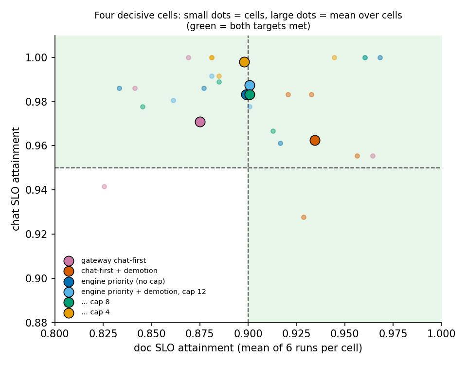

# Ladder hardening and the document-cap sweep

Study 10. Pre-registered in [ladder_capsweep_prereg.md](ladder_capsweep_prereg.md) (written before the runs); motivated by the offline investigation in [variance_investigation.md](variance_investigation.md). Same host, stack, model, SLOs (chat TTFT <= 1 s, doc <= 3 s, TPOT <= 100 ms), B2, `max_num_batched_tokens` 8192. 96 new runs (32 for the ladder, 64 for the cap sweep; random order within repeat blocks). Data: `results/real/ladder_hardened.json`, `results/real/capsweep_analysis.json`, raw `results/raw/*b2tvd8-*`, `*b2tvd12-*`, `*b2tvd4-r[3-6]*`, ladder cells `-r[3-6]`, gateway files `gateway_capsweep_runs.jsonl` and `gateway_ladder_runs.jsonl`; figures `results/figures/capacity/ladder_runlevel.png`, `results/figures/hardening/capsweep.png`, `chat_doc_plane.png`. Analysis: `python -m cacheflow.ladder_analyze`, `python -m cacheflow.capsweep_analyze`, `python -m cacheflow.frontier_plot`.

## Part L: the capacity ladder with run-level statistics

Boundary-defining cells that still had two runs got four more (6 in total). Mean attainment per cell over its runs; pass = chat >= 0.95 and doc >= 0.90.

| Seed | Cell | Runs | Chat | Doc | Pass |
|---|---|---|---|---|---|
| 7 | B1 at mid65 (5.5 req/s) | 6 | 0.928 | 1.000 | fail |
| 7 | B2 at mid65 | 6 | 0.964 | 1.000 | pass |
| 7 | gateway chat-first at mid50 (6.9 req/s) | 6 | 0.978 | 0.996 | pass |
| 7 | chat-first + demotion at mid50 | 6 | 0.958 | 0.984 | pass |
| 7 | engine priority at mid50 | 6 | 1.000 | 1.000 | pass |
| 23 | gateway chat-first at mid50 | 6 | 0.989 | 1.000 | pass |
| 23 | chat-first + demotion at mid42 (8.2 req/s) | 6 | 0.939 | 0.893 | fail |
| 11 | B2 8192 FIFO at mid50 | 6 | 0.958 | 1.000 | pass |

- **L1 (seed 7: the CPU tier raises the bracket, B1 fails mid65 and B2 passes it): met.** B2's chat margin is small (0.964).
- **L2 (seed 7: the three class-ordering policies all pass mid50): met.**
- **L3 (seed 23 chat-first passes mid50 and demotion fails mid42; seed 11 FIFO passes mid50): met.**

Capacity per configuration after all hardening (heaviest offered load passed, req/s; cells far from a threshold keep two runs):

| Configuration | seed 7 | seed 11 | seed 23 |
|---|---|---|---|
| B1 2048 FIFO | 4.0 | below range | below range |
| B2 2048 FIFO | 5.5 | below range | below range |
| B2 8192 FIFO | 5.5 | 6.9 | below range |
| gateway chat-first | 6.9 | 8.2 | 6.9 |
| chat-first + demotion | 6.9 | >= 8.6 (passes burst) | 7.6 |
| engine priority | 6.9 | 8.2 | 7.6 |

"Below range" means the configuration fails the lightest level that was run for that seed (mid50), by a wide margin. Seed 7 ladder: 4.0 (B1) to 5.5 (CPU tier, **+37%**) to 5.5 (larger prefill budget, +0%) to 6.9 (class ordering, **+25%**), so **1.7x over B1**. Seeds 11 and 23 give the same ordering of configurations at heavier levels (the load levels at which each configuration fails shift between document sets; the cause was not isolated).

## Part M: does lowering the document cap reduce the variance? (cap sweep)

Policy `engine_demote`: chat bypasses the gateway and is ordered by vLLM's engine priority; documents are capped at N in flight at the gateway and admitted in demotion order. Caps N = 4, 8, 12; "no cap" is engine priority alone (B2TV); chat-first + demotion (B2TD) is shown as a reference. Four decisive cells, 6 runs each. Chat / doc attainment (run means), `*` = pass, and the doc run-to-run SD:

| Cell | cap 4 | cap 8 | cap 12 | no cap (B2TV) | B2TD |
|---|---|---|---|---|---|
| seed 7 mid45 | 1.00 / 0.88 (SD 0.026) | 0.99 / 0.88 (0.028) | 0.99 / 0.88 (0.015) | 0.99 / 0.88 (0.041) | 0.93 / 0.93 (0.015) |
| seed 23 mid45 | 0.99 / 0.88 (0.010) | 0.97 / 0.91 * (0.029) | 0.98 / 0.90 * (0.023) | 0.96 / 0.92 * (0.033) | 0.98 / 0.93 * (0.018) |
| seed 11 mid42 | 1.00 / 0.94 * (0.012) | 1.00 / 0.96 * (0.044) | 1.00 / 0.96 * (0.033) | 1.00 / 0.97 * (0.025) | 0.96 / 0.96 * (0.010) |
| seed 11 burst | 1.00 / 0.88 (0.037) | 0.98 / 0.85 (0.036) | 0.98 / 0.86 (0.035) | 0.99 / 0.83 (0.034) | 0.98 / 0.92 * (0.012) |

Per series, mean over the four cells:

| Series | Cells passed | Mean chat | Mean doc | Doc run SD | Outcome design effect |
|---|---|---|---|---|---|
| cap 4 | 1 of 4 | **0.998** | 0.898 | 0.021 | **0.77** |
| cap 8 | 2 of 4 | 0.983 | 0.901 | 0.034 | 2.09 |
| cap 12 | 2 of 4 | 0.988 | 0.901 | 0.027 | 1.37 |
| no cap (engine priority) | 2 of 4 | 0.983 | 0.899 | 0.033 | 1.94 |
| chat-first + demotion | **3 of 4** | 0.963 | **0.935** | **0.014** | **0.30** |

- **M1 (the design effect increases with the cap: DE(4) < DE(8) < DE(12) < DE(no cap)): not met.** The values are 0.77, 2.09, 1.37 and 1.94: only cap 4 is clearly below the no-cap configuration; caps 8 and 12 are not distinguishable from it and the order of 8 and 12 is reversed.
- **M2 (a cap of 8 or 12 passes at least 3 of 4 cells): not met** (2 of 4 each).
- **M3 (doc run SD <= 0.02 at the best-passing cap): not met** (0.027 for cap 12).
- **M4 (descriptive):** a low cap costs documents attainment at lighter loads, as seen in study 8: cap 4 gives doc 0.88 in three of the four cells (flat, just under the 0.90 target) and passes only seed 11 mid42; caps 8 and 12 recover that at seed 23 mid45 and seed 11 mid42 but not at seed 7 mid45 or seed 11 burst.



## What the data support

1. **The seed-7 capacity ladder is confirmed at run level (1.7x over B1)**, and the ordering B1 <= B2 <= B2 8192 FIFO <= class-ordering policies holds on all three document sets.
2. **The common-mode explanation of the spread is only partly supported.** The offline investigation ruled out two explanations (more unstable requests, noisier per-request timings) and pointed to positively correlated outcomes (design effect 1.94 for engine priority vs 0.30 for demotion). The cap sweep was designed to test whether moving document queueing to the gateway reduces that correlation in a dose-response way. It did at the extreme (cap 4: design effect 0.77, SD 0.021) but not at caps 8 and 12, and the extreme comes with a cost in doc attainment. Two readings fit and the data cannot separate them: (a) the correlation is caused by queueing in the engine's first-come-first-served queue, and only a cap that removes most of it helps; (b) the correlation falls with the *number of documents in flight* in the engine regardless of where they queue.
3. **Chat-first + demotion without a cap is the most robust configuration in these cells**: 3 of 4 cells passed, lowest spread (SD 0.014), the series with the highest mean doc attainment (0.935, with chat 0.963; the cap-8 and cap-12 variants also lie inside the both-targets region in the mean, but by 0.001 on doc). Its price is chat attainment (0.963, below the 0.98 to 1.00 of the engine-priority family); one of its failures is chat at seed 7 mid45 (0.928).
4. **The engine-priority family sits on a plateau at doc ~0.90** whatever the cap (mean doc 0.898 to 0.901), with chat between 0.983 and 0.998: it buys chat attainment, not document attainment, and capping documents moves the point along chat/doc only slightly.

## Limitations

- Four decisive cells, 6 runs each, one host and a 1.7B model; the caps tested are 4, 8, 12 (and the unbound 16). The design effect is an average over four cells with large per-cell spread (for example 0.1 to 3.1 for the outcome), so differences between caps 8, 12 and no cap are within noise.
- Pre-registered hypotheses M1 to M3 all failed; no further fitting was done. The explanation in point 2(a) versus 2(b) would need per-step scheduler traces or a run that fixes the number of documents in flight while changing the queue location.
- Cells that were not boundary-defining (far from a threshold) still have two runs; seeds 11 and 23 have fewer levels per configuration than seed 7.

## Reproduce (from `/workspace`)

```bash
# 32 ladder runs (repeats 3 to 6) of: seed 7 {B1, B2} at mid65 and {B2TP, B2TD, B2TV} at mid50; seed 23 B2TP at mid50 and B2TD at mid42; seed 11 B2T at mid50
TRACE_PREFIX=real60 RUN_PREFIX=r60 REGISTRY=/workspace/results/real60_registry.csv bash scripts/run_real_workload.sh "B1 mid65 r3"      # one run per call, see docs/ladder_capsweep_prereg.md
# 64 cap-sweep runs: caps 8 and 12 at the four decisive cells for repeats 1 to 6, cap 4 for repeats 3 to 6; e.g.
TRACE_PREFIX=s11 RUN_PREFIX=s11 REGISTRY=/workspace/results/s11_registry.csv bash scripts/run_real_workload.sh "B2TVD8 burst r1"
# offline
PYTHONPATH=src python -m cacheflow.ladder_analyze
PYTHONPATH=src python -m cacheflow.capsweep_analyze
PYTHONPATH=src python -m cacheflow.frontier_plot
PYTHONPATH=src python -m cacheflow.variance_investigate
```
