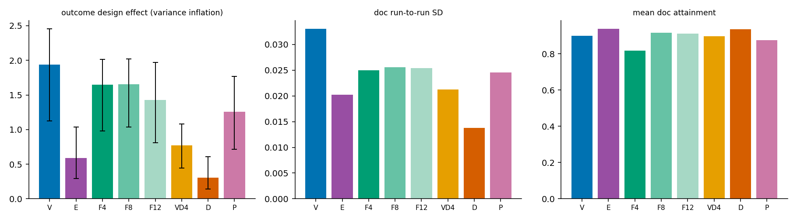

# Queue location, documents in flight, or demotion order: what decorrelates document outcomes?

Study 11. Pre-registered in [locus_prereg.md](locus_prereg.md) (written before the runs). Follows [ladder_capsweep_results.md](ladder_capsweep_results.md), where a cap sweep failed to show a dose-response and left two readings open (queue location vs documents in flight) with a third factor (demotion order) confounded in cap 4. Same host, stack, model, SLOs (chat TTFT <= 1 s, doc <= 3 s, TPOT <= 100 ms), B2, `max_num_batched_tokens` 8192; 97 new runs: configurations S4 and F4 x 4 decisive cells x 6 runs (48), a one-run pilot of S8, and, after the S4 arm collapsed, configurations F8 and F12 x 4 cells x 6 runs (48); random order within repeat blocks. Data: `results/real/locus_analysis.json`, raw `results/raw/*b2tvs4-*` and `*b2tvf4-*`, `results/raw/gateway_locus_runs.jsonl`, figure `results/figures/hardening/locus.png`; analysis `python -m cacheflow.locus_analyze`.

## Design

All configurations use engine priority for chat (chat 0, doc 1). The statistic is the outcome design effect (variance inflation of the per-run mean document outcome relative to independent requests; 1 = independent, > 1 positively correlated, < 1 compensating), averaged over the 4 decisive cells, with a 95% bootstrap interval over runs.

| Series | Document queue | Documents running | Order among documents |
|---|---|---|---|
| V engine priority, no cap | engine | up to 16 | FCFS |
| S4 `max_num_seqs` 4, gateway pass-through | engine | at most 4 (chat shares them) | FCFS |
| F4 / F8 / F12 documents capped at 4 / 8 / 12 at the gateway, chat bypasses | gateway | at most 4 / 8 / 12 | FIFO |
| VD4 cap 4 with demotion order | gateway | at most 4 | demotion |
| D gateway chat-first + demotion | gateway | up to 16 | demotion |
| P gateway chat-first | gateway | up to 16 | FIFO |

## Results (4 decisive cells, 6 runs each)

| Series | Cells passed | Mean chat | Mean doc | Doc run SD | Design effect [95% CI] |
|---|---|---|---|---|---|
| V engine priority, no cap | 2 of 4 | 0.983 | 0.899 | 0.033 | 1.94 [1.12, 2.45] |
| S4 `max_num_seqs` 4 | 0 of 4 | 0.105 | 0.036 | 0.000 | not defined |
| F4 cap 4 at gateway, FIFO | 0 of 4 | 1.000 | 0.818 | 0.025 | 1.65 [0.94, 2.05] |
| F8 cap 8 at gateway, FIFO | 2 of 4 | 0.983 | 0.917 | 0.026 | 1.65 [1.07, 2.07] |
| F12 cap 12 at gateway, FIFO | 2 of 4 | 0.983 | 0.912 | 0.025 | 1.43 [0.82, 1.91] |
| VD4 cap 4 + demotion order | 1 of 4 | 0.998 | 0.898 | 0.021 | **0.77** [0.48, 1.07] |
| D chat-first + demotion | 3 of 4 | 0.963 | 0.935 | 0.014 | **0.30** [0.15, 0.62] |
| P gateway chat-first | 1 of 4 | 0.971 | 0.875 | 0.025 | 1.26 [0.73, 1.82] |



**S4 collapsed.** With vLLM `max_num_seqs` 4 (confirmed effective in the run summaries) the server cannot keep up: at seed 11 burst the run takes 31.5 s instead of 13 s, goodput is 0.26 req/s instead of 7.3, the engine segment of a document averages 20 s, and in every cell nearly every request misses its SLO (chat 0.105, doc 0.036). With no outcome variance the design effect is undefined. S4 therefore changed capacity, not just concurrency, and the V-versus-S4 contrast is not interpretable.

**S8 (pilot) was degenerate too**, by a rule fixed before it was run ([locus_prereg.md](locus_prereg.md), addendum 2): at seed 11 burst the pilot gave goodput 3.31 req/s (below the 4 req/s threshold; chat 1.000, doc 0.071, run duration 19.0 s against about 13 s), so the remaining S8 runs were not run and nothing is inferred from it. Limiting `max_num_seqs` changes capacity, so that knob cannot give a concurrency-only contrast. The concurrency contrast was instead obtained under FIFO order with the gateway cap (F4, F8, F12; chat bypasses, so capacity is preserved: goodput about 6.8 req/s at seed 11 burst for F4 against 7.3 for engine priority).

## Hypotheses against outcomes

- **L1 (DE(F4) <= 1.0): not met** (1.65).
- **L2 (DE(S4) >= 1.3): not evaluable.** S4 has no outcome variance because almost everything fails; the analysis code printed "false" for an undefined value (now reported as undefined).
- **K1 (addendum 3: under FIFO order the cap on documents in flight does not decorrelate, DE(F4), DE(F8), DE(F12) all >= 1.34): met** (1.65, 1.65, 1.43 against 1.94 for engine priority).
- **K2 (DE falls monotonically with the cap with a spread above 0.6): not met.**
- **L3 (|DE(F4) - DE(VD4)| <= 0.4): not met** (0.88).
- **The pre-registered reading rule printed "(b) concurrency" because L1 and L2 both evaluated as false. That output is an artefact:** the rule did not anticipate a degenerate S4, so it must not be read as support for the concurrency reading. I report the decision rule's output as it fired and discard it for that reason; the interpretation below uses only the contrasts that are valid, and it is post hoc.

## What the valid contrasts show

1. **Moving the queue to the gateway and capping concurrency at 4, with FIFO order, does not remove the correlation and costs document attainment** (F4 vs V: design effect 1.65 vs 1.94, intervals overlapping; doc 0.818 vs 0.899). The documents wait at the gateway instead of in the engine (gateway wait about 1.7 s, engine segment 0.32 s at seed 11 burst, against 0.02 s and 1.55 s for engine priority), but their outcomes are still positively correlated.
2. **Raising the cap does not change that under FIFO order** (F4, F8, F12: design effect 1.65, 1.65, 1.43, against 1.94 with no cap; all intervals overlap with each other and with V). So the number of documents in flight, taken by itself, is not what decorrelates the outcomes; the document attainment recovers with a higher cap (0.818 at cap 4, 0.917 at cap 8, 0.912 at cap 12, against 0.899 with no cap) without changing the correlation.
3. **Adding the demotion order at the same cap and location reduces the correlation and restores the attainment** (VD4 vs F4: design effect 0.77 vs 1.65, doc 0.898 vs 0.818). The intervals overlap slightly (VD4 [0.48, 1.07], F4 [0.94, 2.05]), so this is a clear difference in the point estimates and a moderate one statistically.
4. **Across all configurations the common factor in the low design effects is the demotion order**: gateway + demotion (VD4 0.77, D 0.30) versus FIFO order (V 1.94, F4 1.65, P 1.26), at cap 4 and at up to 16 documents running and two queue locations for the FIFO cases. Queue location and the 4-document concurrency cap alone do not.
5. **This also explains the cap-sweep result post hoc**: with a cap of 8 or 12 documents the gateway queue forms less often, so the demotion order has little to act on; it acts at cap 4, where documents queue at the gateway most of the time.
6. **Why compensating outcomes?** Demotion decides at admission time which documents are served now and which are pushed back (those that were going to miss anyway), so a shift in load lands on the demoted ones and the savable documents are insulated; the flips become negatively correlated (design effect below 1). FIFO order, in the engine or at the gateway, lets a delay shift propagate to every document behind it.

## Direct trace of the mechanism (from the gateway's `demoted` flag; `python -m cacheflow.compensation_trace`)

The argument above is inferential. The demotion policy records, per request, whether the gateway demoted it, so its effect can be read directly. Over the 24 runs of chat-first + demotion in the four decisive cells (1,008 document requests):

| | Requests | Missed their SLO |
|---|---|---|
| Documents the gateway **demoted** | 66 | **66 (100%)** |
| Documents it did **not** demote | 942 | **0** |

- **Every miss is a document the gateway had flagged, and every flagged document missed; none of the 942 other documents missed.** The savable documents are completely insulated, and the number of misses per run equals the number of demoted documents (mean 1.8 to 3.3 per run depending on the cell).
- The run-to-run variance of the miss count is therefore the variance of how many documents get demoted: SD 0.41 to 0.75 misses per run, against 1.03 to 1.72 for engine priority in the same cells (where misses are spread over documents in the FCFS queue without a gate).
- So the earlier phrase "compensating flips" is better read as **insulation plus a bounded, pre-identified set of misses**: the covariance between demoted-document misses and other misses is exactly zero because the latter never occur; the design effect below 1 reflects that the miss count is pinned to the (small and fairly stable) number of demoted documents.
- This also shows that the deadline test (waited + expected service > SLO, evaluated when a document is about to be admitted) is a very reliable classifier in these cells: 0 false negatives and 0 false positives among 1,008 documents. The service-time estimate (72 ms per 1,000 tokens, 150 ms for a cached prefix) was never tuned on these runs.

Limits of the trace: it covers the gateway-demotion configuration only (engine priority has no flag, so its misses cannot be split the same way), the four decisive cells at loads where demotion is rare (1.8 to 3.3 documents per run), and one host and model. At heavier loads (more documents doomed) the classifier was not checked here.

## Limitations

- Four cells, 6 runs each, one host, one 1.7B model; per-cell design effects range from 0.15 to 3.3 (so only the cell average is interpreted) and the intervals of F4 and VD4 overlap slightly.
- S4 and S8 both collapsed capacity, so the concurrency contrast inside the engine's own queue (fewer documents running while they queue in the engine) was not obtained; the concurrency contrast we have is under FIFO order with the queue at the gateway (K1). An effect of concurrency specific to the engine queue is not excluded.
- The demotion order could not be tested in the engine's own waiting queue by configuration alone; it was tested later with a small vLLM patch (study 12, [engine_demote_results.md](engine_demote_results.md)): design effect 0.59 with the engine-queue demotion against 1.94 without, so the corner is filled.
- The interpretation in point 6 is a hypothesis consistent with the data, not a traced mechanism.

## Reproduce (from `/workspace`)

```bash
# 48 runs: configs B2TVS4 and B2TVF4 on seed 7 mid45, seed 23 mid45, seed 11 mid42, seed 11 burst, repeats 1 to 6 (random order within blocks), one run per call, e.g.
TRACE_PREFIX=s11 RUN_PREFIX=s11 REGISTRY=/workspace/results/s11_registry.csv bash scripts/run_real_workload.sh "B2TVF4 burst r1"   # and B2TVF8, B2TVF12; B2TVS8 was a one-run pilot
# offline
PYTHONPATH=src python -m cacheflow.locus_analyze
```

Config letters: `VS4` = engine priority with vLLM `max_num_seqs` 4; `VF4` = engine priority, documents capped at 4 at the gateway, FIFO (policy `engine_cap`).
