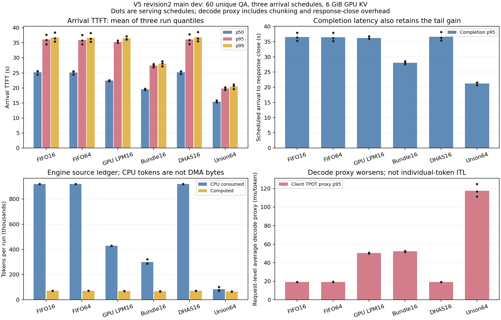

# CacheFlow: live results

**Current V6 research status,22:56UTC:** Main development24/1440, native60/2700 and maincontrols36/1260 are completely audited. Full firstFIFO1986/1986success +60warmup now passes explicit R1 audit/quality/archival; original controller stopped on its auditor reading the first duplicate CLI flag rather than the effective final value. Original artifacts are preserved. A separately registered continuation has launched only the29unexecuted arms. See [current evidence](V6_DEV_EVIDENCE.md), [R1 correction/continuation](V6_FULL_ANALYSIS_R1.md) and [progress](PROGRESS.md). Full comparative research remains incomplete; historical V1–V5 sections below retain their own scopes.

> **Resource correction:** Main development actual heap16039018496bytes vsnative16000745472bytes (+.2392%); full main48049946624bytes is now observed. Full native48002236416bytes remains expected/unobserved. Equal configured payloads do not imply equal actual heaps or RSS. Use within-engine policy contrasts.

The executive findings immediately below describe the historical V1 experiment, not the current V6 full study.

## Executive findings

- On the same eight-document 8K revisit trace at 6 GiB GPU KV, B0/B1/B2 arrival-TTFT p50 was **10,653 / 1,894–2,017 / 1,452–1,541 ms** across the recorded baseline runs. B2 restored 65,536 prompt tokens from LMCache CPU RAM per run and reduced late-revisit mean TTFT from B1's ~2.59 s to 0.33–0.37 s. These tier baselines were taken in separate cold service restarts.
- Original B3/DHAS added **no** cached tokens or saved prefill over B2 in the repeated 8K revisit pairs; paired mean B3−B2 arrival TTFT was **+302 and +31 ms**. A stronger same-engine simultaneous-trace crossover gave **−92 and +109 ms**, opposite signs. No reproducible DHAS latency or throughput win is established.
- The frozen readiness guard's seed 11 holdout bypassed four futile waits per run yet had paired mean TTFT **+3 and +98 ms** versus FIFO, again with unchanged aggregate cache/prefill work. It is retained as a negative refinement.
- CPU-tier benefit followed the working set: at 8 GiB GPU KV, eight documents had zero CPU loads and ~0.1 s late-revisit TTFT under both B1/B2; 12 documents caused 98,304 CPU-restored tokens in B2 and reduced late-revisit mean TTFT from 5.42–5.70 s to 2.00–2.09 s in two pairs.
- OTLP captured eight inclusive CPU KV retrieve spans (median ~149 ms each) but no staging/kernel child spans. Exact H2D and copy/compute overlap are **not instrumented**. Output hashes differed in some paired and same-policy repeats; content materiality is unknown.

These are single-host synthetic-trace measurements, not general performance guarantees. The raw files, run IDs, source SHAs, reset controls, and caveats follow.

## Host audit (2026-10-22)

| Item | Observed |
| --- | --- |
| GPU | GeForce RTX 3090, 24 GiB; idle at audit |
| CPU RAM | 247 GiB total, 183 GiB available at audit |
| Workspace disk | 20 GiB available initially; overlay filesystem |
| Workspace volume | false; sync code and results off-instance before recycle/destroy |
| Python / PyTorch | Python 3.12.3; torch 2.11.0+cu128 in /venv/main |
| vLLM / LMCache | not installed at audit |
| Git repository | absent at audit |

## Primary comparison

| Arm | Stack | Fixed-arrival result | CPU KV restore proof |
| --- | --- | --- | --- |
| B0 | vLLM, prefix cache off | measured below | N/A |
| B1 | vLLM, GPU prefix cache on, FIFO | measured below | N/A |
| B2 | B1 + LMCache CPU tier, FIFO | measured below | verified |
| B3 | B2 + DHAS gateway | two revisit pairs below | verified in revisit |
| B4 | B2 + static prefix grouping | one revisit screen below | verified in revisit |

The B2 CPU-restore smoke probe passed. B0, B1, B2 and B4 now have 8K revisit measurements below. The earlier B1 request pair was a functionality check.

Primary contrast is B3 vs B2 with identical engine, trace, model, token/output budgets, and cache pressure. Record arrival-based TTFT p50/p90/p99, TPOT, output tokens/s, requests/s, errors, GPU/host cache-hit tokens, CPU RAM, GPU memory/utilization, and scheduler queue wait. Report paired per-request deltas and repeat key conditions at least twice. A negative result is valid.

## Evidence gate

Do not label a request as CPU-restored from a prefix match alone. Require GPU-local eviction/absence plus LMCache L1 read or load counters and vLLM host-source cached token evidence if exposed by pinned versions. Missing metrics are marked not instrumented. Keep raw traces and exact Git SHA for every result.

## Setup checkpoint (2026-10-21 17:48 UTC)

Pinned stack installed: vLLM 0.22.0, LMCache 0.5.3, transformers 5.6.2, torch 2.11.0+cu128. Qwen3-1.7B revision `70d244cc86ccca08cf5af4e1e306ecf908b1ad5e` downloaded. B1 server booted and returned two 3,071-token prompt requests with 8 completion tokens each. After the second request, `vllm:prefix_cache_hits_total` was 3,056; this is a smoke check, not a benchmark result. LMCache MP HTTP/metrics server runs on localhost:18080; the later B2 restore probe verified the connector.

## Two-tier and gateway checkpoint (2026-10-21 17:56 UTC)

B2 MP connector booted and completed the CPU-restore probe after a local GPU prefix-cache reset. For the second 3,068-token request: LMCache L1 read +11 chunks, LMCache engine loaded +11 chunks, vLLM external prefix hits +2,816 tokens, and GPU-local prefix hits +0. This supports an actual CPU-tier restore. Raw response: `results/raw/restore_probe.json`. Gateway smoke replay completed 2/2 requests; client and vLLM both counted 4,492 prompt tokens. These are functionality checks, not B2-vs-B3 performance results. Supervisor now manages all three localhost services.

## Development screen: long-doc burst, no forced CPU restore (2026-10-21 18:03 UTC)

32 matched requests, 8,210–8,211 input tokens, 64 output tokens, same trace SHA `94d26c4d0049b9c91acdee9feae1f02ccfc2881e40dd93e6f0ab8e8646c2b576`. Cold B2 FIFO then cold B3 DHAS, one run each. B2 arrival TTFT p50/p90: 3,008/4,582 ms; output throughput: 216.5 tokens/s. B3: 2,906/4,485 ms; 218.7 tokens/s. All 32 output hashes match and all requests succeeded. B3 had 12 inferred delay-hit candidates. Gateway queue wait p50 rose from 1,389 to 1,417 ms. Both arms had exactly 196,608 GPU prefix-hit tokens and 66,128 new prefill KV tokens; neither recorded confirmed external KV loads. **This single AB-order screen does not support a cache-reuse claim or a robust speedup claim.** Repeat in balanced order and use a revisit trace for CPU pressure. Raw data and development figures are in `results/`.

## Development screen: long-document revisit with CPU restores (2026-10-21 18:11 UTC)

The deterministic revisit trace holds each document's last question until after other prefixes have pressured the GPU KV cache. It has 32 matched requests, 8,210–8,211 input tokens, 64 output tokens, and trace SHA `374cf57d2e2631eb5f1c8d605d2b25f453b0679925fe79f4c8989d26fda11781`. Each arm started with fresh B2/B3 services and cache state at Git SHA `cc1ae6536f8ad6cddfc0995fedf8b0ec4f4cffa4`.

| Pair and order | B2 TTFT p50/p90 ms | B3 TTFT p50/p90 ms | Paired mean B3−B2 ms | Output throughput B2/B3 tokens/s | B2/B3 external hit tokens | B2/B3 LMCache loaded chunks |
| --- | ---: | ---: | ---: | ---: | ---: | ---: |
| r1, B3→B2 | 1,426 / 3,954 | 1,808 / 4,408 | +302 | 186.9 / 185.8 | 65,536 / 58,960 | 256 / 231 |
| r2, B2→B3 | 1,754 / 4,253 | 1,805 / 4,288 | +31 | 185.3 / 186.2 | 65,536 / 65,536 | 256 / 256 |

All 128 requests succeeded and output hashes match within each pair. In both pairs, B2 and B3 had exactly 196,608 cached prompt tokens and 66,128 computed prefill KV tokens per arm. Thus the scheduler has **not reduced duplicate prefill** in this trace. Both arms show real CPU-tier reads and loads, but B3 does not consistently increase CPU restores. The large change in B2's timing between r1 and r2 means the magnitude of the TTFT penalty is unstable; request-level bootstrap intervals within one run do not capture run-to-run system variation. These two pairs do not support a DHAS performance win. The later sections record the negative control, B0/B1 baselines, and a simultaneous-arrival trace.

### Why the 200 ms delay cannot work at 8K

The gateway trace audit found 10 delay-hit candidates in each revisit B3 run. Their matching producer's first token arrived a median 1,773 ms (r1) and 1,770 ms (r2) after the follower's scheduled arrival. **Zero of 20** producers reached first token within the 200 ms wait bound. Candidates waited about 200.5–200.6 ms at the gateway. The first-token signal therefore never released these followers early; their deadline did. This is a scheduler feasibility result, not proof about asynchronous KV-store completion. The older burst B3 screen had the same pattern: 12 candidates, zero producer first tokens inside 200 ms, median readiness delay 1,626 ms.

A later [readiness-window sweep](../results/figures/readiness/readiness_feasibility.png) reclassified the *observed* producer first-token times plus the configured 20 ms grace at hypothetical 50–2,500 ms windows. At the tested 200 ms, **0/20** 8K revisit and **0/24** simultaneous 8K candidates were ready; 4K multi-turn had **4/9**, and the 2K burst **18/24**. Even at 1,000 ms, neither 8K trace had a ready candidate. At 1,500 ms, the counts reached 4/20 and 15/24 respectively. The 2K burst's many timely first tokens still produced **no additional cached tokens** under DHAS. This is an observational feasibility curve, not a replay at different wait budgets: changing admission times would change contention and possibly which producer is matched, and first-token readiness does not prove LMCache store visibility.

## Negative control: distinct 2K prefixes (2026-10-21 18:20 UTC)

32 requests per arm; trace SHA `839d484e1ef447e69c01971ab2e697748605392224c23cfc7fc2054bcbc5b020`; Git SHA `46fb90a212e4a90579c66a89e8127fec877d8fcb`. Order B2→B3→B3→B2, each cold restart. All 128 requests succeeded, and output hashes match within each pair. No request was marked a delay-hit candidate, and both arms had zero cached prompt tokens, zero GPU/external prefix hits, and 66,016 computed prefill KV tokens per run.

| Pair | B2 TTFT p50/p90 ms | B3 TTFT p50/p90 ms | Paired mean B3−B2 ms | B2/B3 output tokens/s |
| --- | ---: | ---: | ---: | ---: |
| r1 | 2,123 / 3,634 | 2,198 / 3,709 | +75 | 317.4 / 315.5 |
| r2 | 2,123 / 3,647 | 2,252 / 3,793 | +129 | 315.2 / 306.3 |

The no-reuse control does not meet a zero-overhead goal: B3 is slower in both runs despite no intentional deferral. vLLM queue-time sums rose from 9.18 to 9.82 seconds in r1 and from 8.94 to 10.04 seconds in r2; this is consistent with more host/engine contention but not enough to isolate the cause. Request-level bootstrap intervals are not used as evidence for a run-level causal effect.

A later phase audit found near-identical gateway receive-to-enqueue preparation (~5.0–5.2 ms mean per request) and gateway CPU-time deltas (B2 0.44/0.46 s, B3 0.42/0.49 s) across these four runs. B3's mean enqueue-to-dispatch interval exceeded B2 by 39/73 ms and dispatch-to-first-token by 37/57 ms in the two pairs, approximately accounting for the observed +75/+129 ms arrival-TTFT differences. With zero delay-hit candidates, the data do **not** isolate Python policy-matching cost as the cause; serving and queue timing changed as well. These timings are run-level observations, not a calibrated gateway-overhead microbenchmark.

## Tier baselines: same 8K revisit trace (2026-10-21 18:28 UTC)

All runs share the 32-request trace SHA `374cf57d2e2631eb5f1c8d605d2b25f453b0679925fe79f4c8989d26fda11781`, 64 output tokens per request, cold service restarts, and the same GPU KV budget. All 160 requests succeeded. B0/B1/B2 benchmark summaries record Git HEAD `46fb90a212e4a90579c66a89e8127fec877d8fcb`; the B0/B1 launcher status handling was repaired locally before these replays and is included in the next commit. Serving engine and gateway policy code were unchanged.

| Arm/run | Arrival TTFT p50/p90 ms | Output tokens/s | Cached prompt tokens | Newly computed prefill tokens | Late revisit TTFT mean ms |
| --- | ---: | ---: | ---: | ---: | ---: |
| B0 r1, no prefix cache | 10,653 / 14,686 | 77.9 | 0 | 262,736 | 13,666 |
| B1 r1, GPU prefix cache | 1,894 / 4,025 | 134.6 | 131,072 | 131,664 | 2,585 |
| B1 r2, GPU prefix cache | 2,017 / 4,100 | 135.2 | 131,072 | 131,664 | 2,598 |
| B2 r3, GPU + CPU tier | 1,541 / 4,054 | 183.9 | 196,608 | 66,128 | 334 |
| B2 r4, GPU + CPU tier | 1,452 / 3,980 | 182.9 | 196,608 | 66,128 | 373 |

B2 restored 65,536 prompt tokens from the external CPU tier in each measured B2 run, with 256 LMCache chunks loaded. The late revisit requests fell from about 2.59 s under B1 to 0.33–0.37 s under B2 (86–87% lower mean TTFT for that subset), while whole-run output throughput rose from ~135 to ~183 output tokens/s. B0→B1 establishes the much larger benefit of GPU prefix caching in this trace. These are development results from one host, not a universal speedup claim.

The [cache-accounting figure](../results/figures/cache_accounting/cache_accounting.png) makes the source distinction explicit for one representative run per B0–B4 arm on the same trace. Each bar totals 262,736 prompt tokens: B0 computes all, B1 computes 131,664 and reuses 131,072 from GPU, and B2/B3/B4 each compute 66,128, reuse 131,072 from GPU and restore 65,536 from CPU. This validates that the extra cache contribution comes from the CPU tier, while DHAS and static grouping add **zero** cached tokens over FIFO. The chosen B0–B4 runs came from separate time/source blocks, so the figure is token-accounting evidence, not a latency effect estimate.

Output hashes were not perfectly stable across modes or repeated runs at temperature zero: each B1-vs-B2 pair had one mismatching request out of 32, and B0-vs-B1 had one. The deviations were on `doc-06-q2` in B2 r3, `doc-05-q3` in B1 r2, and `doc-02-q2` in B0 respectively; all still produced 64 output tokens. B2-vs-B3 pairs had zero output hash mismatches. The current runner stores hashes rather than the full generated text, so the materiality of those three deviations is not known.

## Static grouping control: 8K revisit (2026-10-21 18:33 UTC)

On the same trace and Git SHA `ac328da4af68e3e17aae892074b8c52d701a06ff`, B2 FIFO r5 had TTFT p50/p90 1,695/4,199 ms and output throughput 185.3 token/s; B4 static-group r1 had 1,709/4,284 ms and 186.3 token/s. Paired mean B4−B2 TTFT was +31 ms; all 32 outputs matched. Both arms had **identical** 196,608 cached prompt tokens, 66,128 computed prefill KV tokens, 65,536 external hit tokens, and 256 LMCache loaded chunks. Static grouping did not change cache reuse in this condition; one pair is only a screening result.

The new resource sampler reported B2/B4 GPU KV peak fractions 0.894/0.895, CPU L1 peak 7.0 GiB in both, VRAM peak 10,503 MiB in both, and minimum host available RAM 165.6/172.3 GiB. Mean sampled GPU utilization was 46.2/44.8%; these averages include idle samples and do not measure H2D transfer time. No memory-capacity or swapping problem was observed.

On the distinct-prefix 2K negative control at the same Git SHA, B2 FIFO r3 had TTFT p50/p90 2,291/3,805 ms and 307.3 output tokens/s; B4 static-group r1 had 2,424/3,971 ms and 300.3 output tokens/s. Paired mean B4−B2 TTFT was +133 ms with all 32 output hashes matching. Both had no cache hits. Grouping thus added latency where locality was absent in this one pair.

## Multi-turn sessions: 4K fit regime (2026-10-21 18:39 UTC)

The 32-request session trace SHA `1edc3c30f6f8b817d71dba092ff3bfde91a00d6b565ac005501966009c24266e` uses 4K target context and 64 output tokens, Git SHA `ac328da4af68e3e17aae892074b8c52d701a06ff`. B2 FIFO had arrival TTFT p50/p90 1,395/1,992 ms and throughput 401.9 output tokens/s; B3 DHAS had 1,437/1,978 ms and 400.9 output tokens/s. Paired mean B3−B2 TTFT was +27 ms. Both arms had exactly 98,432 cached prompt tokens, 33,680 computed prefill KV tokens, no external prefix hits, and no engine-loaded LMCache chunks. All requests succeeded, but **10/32 output hashes differed** between the two runs. No change in request input or output-token budget was detected; the runner only saved hashes, so the textual materiality of these deviations is unknown.

The B3 trace had nine inferred delay-hit candidates. Four matching producers emitted a first token within the 200 ms deferral bound, yet this did not increase cached-token reuse. First-token readiness may precede asynchronous KV-store visibility, or vLLM may have already shared these prefixes; the current metrics cannot distinguish those explanations. Do not infer a successful cache hit from a candidate count alone.

## Short 2K document burst: timing opportunity but no additional cache reuse (2026-10-21 18:42 UTC)

The matched 32-request trace SHA `32cadba96b7c4e29876338e6bfaf60cccabcd36990d7d405ec8f54cbf111029f` uses 2K document prefixes, 35 ms question spacing, 64 output tokens, and Git SHA `ac328da4af68e3e17aae892074b8c52d701a06ff`. B2 FIFO TTFT p50/p90 was 156/361 ms and output throughput 462.8 tokens/s; B3 DHAS was 213/523 ms and 457.2 tokens/s. Paired mean B3−B2 arrival TTFT was +82 ms. All requests succeeded; **4/32 output hashes differed**.

B3 marked 24 delay-hit candidates. A trace audit matched all 24 to a producer and found 18 producer first tokens inside the 200 ms bound. Despite the timing opportunity, both arms had exactly 49,152 cached prompt tokens and 16,976 computed prefill KV tokens, with no external CPU restores. vLLM's server-side TTFT sum fell from 5.36 s in B2 to 4.46 s in B3, but B3's arrival-based TTFT rose: gateway waiting moved time outside the engine metric without reducing actual prefill. The 2K result is a single development pair and does not establish a run-level effect magnitude.

## Simultaneous 8K siblings: first pair, mechanism still absent (2026-10-21 18:47 UTC)

The new trace schedules four sibling questions at the same millisecond for each of eight documents, retaining the exact prompt bytes from the earlier 8K burst. Trace SHA `d56acf0d02a03de0694b9701de6df8f628f7f2ffb6cc12ecbc1172ae4ce5589b`, Git SHA `58e6ea5cd1043e344678f5d378a4300c6167d756`. In the first B2→B3 pair, all 64 requests succeeded and all outputs matched. B2 TTFT p50/p90 was 2,884/4,472 ms; B3 was 2,639/4,218 ms, with paired mean B3−B2 −246 ms. Throughput was 221.5/227.9 output tokens/s.

Both arms again recorded exactly 196,608 cached prompt tokens and 66,128 computed prefill KV tokens; external CPU hits were zero. B3 had 12 inferred delay-hit candidates, all of whose producer first tokens came **after** the 200 ms bound (median 1,392 ms); each paid about 201 ms gateway wait. The apparent latency improvement has no measured reduction in duplicate prefill or increase in CPU restores.

The reverse-order B3→B2 pair also had all 64 requests succeed with 0 output hash mismatches. B3 TTFT p50/p90 was 2,584/4,176 ms versus B2 2,958/4,552 ms; paired mean B3−B2 −385 ms and throughput 229.0/219.8 output tokens/s. Cached and computed prefill token totals remained exactly the same as in pair r1. Phase decomposition in r1 gave B3−B2 arrival-to-dispatch −74 ms and dispatch-to-first −172 ms; in r2, −136 and −249 ms. Every one of the 32 requests shifted earlier in both pairs, including leaders, by a fairly uniform amount. The live-engine crossover below tested this possible run-level effect.

## Live-engine ABBA crossover resolves the apparent 8K win (2026-10-21 18:57 UTC)

The crossover used one vLLM PID `37744` and one LMCache PID `37591` throughout four runs in B2→B3→B3→B2 order, with the same 8K simultaneous trace and Git SHA `45145ac5047c24a85045d7fc37cb451f2d72a7d6`. Before each run, a fixed two-request direct-vLLM warmup was followed by LMCache L1 clear and vLLM GPU prefix reset. The first metrics sample of **all four** runs showed 0 L1 bytes and 0 GPU KV occupancy. The four arms all had exactly 196,608 cached prompt tokens, 66,128 computed prefill KV tokens, and zero external CPU hits. Each run succeeded 32/32; output hashes matched 32/32 within both pairs.

| Order pair | B2 TTFT p50/p90 ms | B3 TTFT p50/p90 ms | Paired mean B3−B2 ms | B2/B3 throughput tokens/s |
| --- | ---: | ---: | ---: | ---: |
| B2→B3 | 2,941 / 4,521 | 2,859 / 4,443 | −92 | 220.3 / 222.3 |
| B3→B2 | 2,730 / 4,308 | 2,850 / 4,431 | +109 | 225.9 / 222.6 |

The two run-level paired effects average about **+9 ms for B3**, with opposite signs. In the first pair B3's dispatch-to-first mean fell ~101 ms; in the reversed pair it differed by ~0 ms while arrival-to-dispatch rose ~109 ms. The large restart-based apparent win did not survive this stronger control. These data support a negative conclusion for **cache-based DHAS benefit** on this trace: prefill work was unchanged, and no reproducible arrival-TTFT gain is established. Request-level confidence intervals within one run would miss this run-level instability.

## Separate LMCache transfer-path profile (2026-10-21 19:00 UTC)

A single non-comparative B2 8K revisit replay used LMCache 0.5.3's OTLP tracing into a localhost sink. It completed 32/32 requests; it is excluded from latency comparisons because tracing changes the instrumentation path. `results/raw/otlp-profile.jsonl` contains 124 exported spans: 32 request roots, 32 lookup/prefetch spans, 52 store spans, and **8 retrieve spans**. The eight retrieves report 256 chunks and 7.0 GiB total, matching the external prefix hits and LMCache loaded-chunk counters. Each retrieve reported 896 MiB; span duration median/p90 was 149/157 ms (range 147–164 ms). This inclusive LMCache operation interval contains more than DMA and may overlap with other work, so it must not be presented as pure PCIe bandwidth or added directly to request TTFT. The pinned build did not export separate `transfer.staging` or `transfer.kernel_interval` spans; precise H2D and GPU staging times remain **not instrumented**. The 1-second CPU/GPU utilization plots are coarse overlap evidence only.

The eight `mp.retrieve` intervals in this single profile were non-overlapping: their summed inclusive duration was **1,206 ms** across a **1,666 ms** first-start to last-end window (~72% interval occupancy). This is an observation about exported operation spans, not proof that PCIe copies serialized or that the GPU was idle between them. The missing child spans and lack of a synchronized compute trace prevent a copy/compute overlap claim.

## Readiness-guard development crossover (2026-10-21 19:09 UTC)

One vLLM PID `41476` and LMCache PID `41336` served six 8K revisit runs in B3 original → B3 guarded → B2 FIFO → B2 FIFO → B3 guarded → B3 original order. The source SHA was `5280c743dc54a59e5f860f96af5e84c6bcdf05a4`, seed 7, common trace SHA `374cf57d2e2631eb5f1c8d605d2b25f453b0679925fe79f4c8989d26fda11781`. Fixed direct warmup and empty-cache reset preceded each run. All 192 requests succeeded. Every run reported 196,608 cached prompt tokens, 66,128 computed prefill tokens, 65,536 external hit tokens, and 256 LMCache chunks loaded. The guard did not create extra KV reuse.

| Run order | Policy | Arrival TTFT p50/p90 ms | Paired mean vs adjacent B2 ms | Guard bypasses |
| --- | --- | ---: | ---: | ---: |
| 1 | B3 original | 1,711 / 4,218 | — | 0/10 |
| 2 | B3 guarded | 1,354 / 3,848 | −211 (vs order 3) | 6/10 |
| 3 | B2 FIFO | 1,610 / 4,119 | reference | — |
| 4 | B2 FIFO | 1,727 / 4,315 | reference | — |
| 5 | B3 guarded | 1,753 / 4,247 | −3 (vs order 4) | 4/10 |
| 6 | B3 original | 1,491 / 4,028 | — | 0/10 |

Guarded-vs-original paired mean TTFT was −285 ms in the first bracket and +191 ms in the reversed bracket. The guard bypassed predicted-infeasible holds, reducing bypassed-candidate queue-wait median to ~20–21 ms from original DHAS candidate wait ~200.5 ms. Yet all observed matching producers reached first token later than the 200 ms bound, and the whole-run latency effect changed sign. One output hash differed in the first B2-vs-guard pair and none in the second; one differed in each guard-vs-original comparison. These development runs support a scheduler-wait mechanism, but **do not establish an end-to-end speedup**. The untouched seed 11 holdout results follow below.

## Frozen-guard seed 11 holdout (2026-10-21 19:14 UTC)

The untouched `long_doc_revisit` seed 11 trace SHA is `fece35d29ada31e10d1b17d38789cc50970331759ff3f22a38eea6055d86087d`. Six 32-request runs used the frozen guard at source SHA `5280c74` in original B3 → guarded B3 → FIFO B2 → FIFO B2 → guarded B3 → original B3 order. vLLM PID `44375` and LMCache PID `44163` were unchanged. Each run began with 0 LMCache L1 bytes and 0 vLLM GPU KV occupancy after the same warmup/reset. All 192 requests succeeded.

| Order | Arm | TTFT p50/p90 ms | Paired mean guarded−comparator ms | Output hash mismatches vs guarded |
| --- | --- | ---: | ---: | ---: |
| 1→2 | B3 original → guarded | 1,504 / 4,037 → 1,609 / 4,246 | +111 | 3/32 |
| 3→2 | B2 FIFO → guarded | 1,652 / 4,156 → 1,609 / 4,246 | +3 | 3/32 |
| 4→5 | B2 FIFO → guarded | 1,554 / 4,054 → 1,696 / 4,188 | +98 | 2/32 |
| 6→5 | B3 original → guarded | 1,540 / 4,031 → 1,696 / 4,188 | +118 | 2/32 |

Each guard run marked 10 matching candidates and bypassed 4 predicted-late holds, with bypassed-candidate gateway wait p50 ~20.6–20.8 ms; no matching producer emitted first token inside 200 ms. All six arms cached 196,608 prompt tokens and computed 66,128 prefill KV tokens. The first guard arm used 59,072 external/137,536 GPU-local hit tokens and loaded 231 LMCache chunks; the other five used 65,536 external/131,072 local hits and loaded 256 chunks. Thus the total reuse was equal but one run changed its tier split. Five hash mismatches across the two FIFO-vs-guard pairs are logged; only hashes were retained, so content impact is unknown.

The frozen guard's two run-level effects versus FIFO are **+3 and +98 ms** (guard slower on average); versus original DHAS they are **+111 and +118 ms**. This holdout rejects the proposed latency improvement under this configuration, despite a real reduction in selected gateway waits. With only two run-level replicates, the exact penalty is uncertain. Request-level bootstrap intervals are not a substitute for additional independent runs.

A post-hoc decision-stratified phase audit gives a narrower mechanism. For the four bypassed requests in each guarded run, guarded-vs-original dispatch happened **~180/178 ms earlier**, confirming the guard removed the intended hold. Their dispatch-to-first-token phase then rose **~295/326 ms**, leaving arrival TTFT **+115/+147 ms** for those requests. The 22 noncandidates also shifted **+110/+102 ms** in arrival TTFT across the same bracketing comparisons. This shared shift means the extra engine time cannot be assigned wholly to early dispatch; run-level state/contended scheduling remains a confounder. Against FIFO, bypassed requests had essentially no gateway-wait change (−1/+2 ms), as expected, while the six unbypassed candidates still paid ~177 ms more queue time. Exact group means are in `results/figures/holdout-*/guard_phase_by_decision.json`, regenerated by `cacheflow.stratify_guard`.

## Additional question: GPU KV capacity boundary (2026-10-21 19:25 UTC)

The same seed 7, 32-request 8K revisit trace (`374cf57d…`) was replayed with 4, 6, and 8 GiB vLLM GPU KV budgets. B1 is GPU prefix cache only; B2 adds the same 16 GiB LMCache CPU L1. Four and eight GiB were new balanced, twice-repeated B1/B2 runs at source SHA `a7e04ad`; six GiB uses the earlier twice-repeated tier baseline from another time block/source checkpoint. The exact 12-run matrix is `configs/capacity_matrix.csv`, per-run data and plot are `results/figures/capacity/`. All 384 requests succeeded, all first metrics samples had 0 GPU KV usage, and B2 first samples had 0 L1 bytes. The GPU KV peak gauge was ~0.89–0.90 at 4/6 GiB and ~0.67 at 8 GiB.

| GPU KV | B1 late revisit TTFT mean (two runs) | B2 late revisit TTFT mean | B1/B2 computed prefill tokens per run | B2 CPU hit tokens / loaded chunks | B1/B2 throughput tokens/s |
| --- | ---: | ---: | ---: | ---: | ---: |
| 4 GiB | 2,982 / 3,047 ms | 698 / 573 ms | 131,664 / 66,128 | 65,536 / 256 | 133.2, 132.3 / 178.6, 179.3 |
| 6 GiB (earlier block) | 2,585 / 2,598 ms | 334 / 373 ms | 131,664 / 66,128 | 65,536 / 256 | 134.6, 135.2 / 183.9, 182.9 |
| 8 GiB | 99 / 96 ms | 97 / 109 ms | 66,128 / 66,128 | 0 / 0 | 190.5, 192.7 / 192.7, 191.0 |

At 4 GiB, B2 reduced mean revisit TTFT by 77–81% and raised output throughput by ~34–36% in the matched pairs, with measured CPU restores and half as much newly computed prefill. At 8 GiB the long-document working set fit in GPU KV: both modes computed and cached exactly the same tokens, and B2 recorded no CPU KV loads. The late-request latency was indistinguishable at this resolution; whole-run paired mean B2−B1 was +14 and +291 ms across the two pairs, so **no CPU-tier benefit is established in this fit regime**, and run drift prevents a precise overhead estimate. Four-GiB B1/B2 comparisons had 3/32 output hash mismatches each; eight-GiB pairs had 1/32 and 2/32. These output differences are retained as correctness caveats. The 6-GiB rows came from an earlier measurement block, so the cross-budget trend is descriptive; the zero-to-65,536 CPU-hit transition is directly observed.

## Additional control: larger working set at the same 8 GiB budget (2026-10-21 19:33 UTC)

To distinguish a capacity threshold from a particular numeric budget, the 8 GiB B1/B2 comparison was repeated with **12** distinct 8K documents (48 requests) instead of eight (32 requests). Seed 7 trace SHA `cf8142e4a4638007184f099d90e7a232bf61983fc47c2f7b612213438c659d61`; all four runs used source SHA `37056f9`, full stack restarts, 16 GiB LMCache L1, and B1→B2→B2→B1 order. All 192 requests succeeded; initial GPU KV occupancy was zero in all arms and initial L1 usage zero in B2.

| Pair | B1/B2 TTFT p50 ms | B1/B2 late revisit mean ms | B1/B2 throughput tokens/s | B1/B2 new prefill tokens | B2 CPU hit tokens / loaded chunks | Paired mean B2−B1 TTFT | Output hash mismatches |
| --- | ---: | ---: | ---: | ---: | ---: | ---: | ---: |
| r1 | 4,179 / 2,132 | 5,701 / 2,003 | 139.9 / 203.6 | 197,488 / 99,184 | 98,304 / 384 | −934 ms | 2/48 |
| r2, reverse order | 3,922 / 2,305 | 5,415 / 2,089 | 142.2 / 203.6 | 197,488 / 99,184 | 98,304 / 384 | −562 ms | 2/48 |

At the same 8 GiB budget, the eight-document trace had **zero** CPU loads and ~0.1 s late revisit TTFT in both B1/B2; the 12-document trace forced 98,304 CPU hit tokens in B2 and gave a repeated ~61–65% lower late revisit TTFT than B1. Thus the tier benefit tracks the working set relative to GPU KV capacity, not a universal 8 GiB cutoff. Across the 12-document pairs, B2 throughput was ~43–46% higher. The larger trace also increases request count/load, so only within-trace B1/B2 effects are causal contrasts. `results/figures/workingset/workingset_pressure.png` plots the two document counts; `configs/workingset_matrix.csv` and raw JSONL permit regeneration.

### Mechanism interpretation

The original DHAS did not create additional cached tokens even for simultaneous 8K siblings. [vLLM 0.22's prefix-cache design](https://docs.vllm.ai/en/v0.22.0/design/prefix_caching/) says a full allocated KV block is immediately made reusable by other requests in the same batch. That behavior is **consistent with** the measured identical 196,608 cached / 66,128 computed tokens under FIFO and DHAS; the counters alone do not prove which internal block-sharing path served each sibling. The matched timing audit found all 8K DHAS producer first tokens later than its 200 ms bound, so the gateway's specific wait condition could not release them in time. The negative result is specific to this model, scheduler bound, trace shapes, and vLLM/LMCache versions.

## Paired output-quality audit

`results/quality_audit.jsonl` records 18 selected pairs (640 pair comparisons, including same-policy repeat comparisons). Prompt hashes, input token counts, success status, and output token counts matched in every comparison. **25 output-text SHA-256 comparisons differed**, including seven among same-policy repeats; these are overlapping pair comparisons, not 25 independent bad requests. Full generated text was not retained, so semantic impact cannot be assessed. The exact differing request IDs are in the artifact. This rules out a blanket byte-for-byte output-equivalence claim despite matched inputs and `temperature=0`.

## Admission bound and observed queue fairness

The policy's 200 ms deadline means an eligible ticket stops being *intentionally deferred* at that time. It is **not** a 200 ms cap on actual arrival-to-dispatch wait when the gateway's `max_inflight=16` slots are occupied. `results/figures/admission_audit.csv` audits ten selected 32-request runs (320/320 successful, no observed errors) against the configured bound. In the 2K distinct-prefix negative-control pair, **zero** delay-hit candidates existed, yet 16/32 requests in each B2/B3 run waited over 200 ms; queue-wait p90 was 3,119/3,264 ms. Engine/admission capacity, not DHAS deferral, can therefore produce multi-second waits.

In the 8K revisit r2 pair, B2/B3 had 8/18 requests beyond 200 ms, consistent with B3's ten inferred followers plus capacity-delayed requests; queue-wait p90 was 3,550/3,585 ms. In the short 2K burst, B2 had no over-bound request and B3 had six that dispatched around 201 ms, consistent with the scheduler wakeup granularity. These finite traces show no dropped or starved request, but they do not prove starvation freedom under a sustained arrival stream. The audit uses the logged deadline field where available and reconstructs older runs from the known 200 ms configuration, checking that both calculations agree in newer traces.
# V2 status (2026-10-25)

The owner skipped restoration of the old-host baseline. The full-context LoCoMo tokenizer audit found 0/1,986 QA fitting 12,288 tokens and 1,986/1,986 fitting 32,768 tokens with a 64-token output reserve; all 1,986 prompts retained an exact tokenized shared prefix. These are **data/fit findings**, not serving latency or answer-quality results. The 32K setting still needs a GPU memory pilot. V1 findings above remain tied to their original traces and host. See `docs/V2_DATA_FIT.md` and `docs/V2_NEW_HOST_REPRO.md`.

# V2 measured LoCoMo tiering on the current host (2026-10-26)

This section supersedes the earlier V2 fit-only status. It uses the current RTX 3090 host, pinned Qwen3-1.7B BF16/vLLM 0.22.0/LMCache 0.5.3, and genuine full-history LoCoMo text. V1 timings above remain tied to their old host and synthetic traces. The detailed methods, raw-score caveats, paired confidence intervals, source counters and reproduction commands are in [the V2 report](V2_E2_RESULTS_2026_10_26.md).

Each condition has three run-level arrival seeds, 30 QA/run, constructed interleaved exponential arrivals at nominal 0.2 QPS, FIFO ingress and a 64-token output budget. B1 is GPU-only prefix caching; B2 adds 16 GiB CPU L1. Stacks restart between arms; a uniform warmup and empty-cache reset precede measurement; middle-seed arm order is reversed. Main dev uses conv-26/30/41, first 10 QA each. Confirmation uses untouched conv-49/50, first 15 QA each and new seeds fixed before the first B2 dev result.

| Condition | B2 arrival-TTFT p95 mean change (run range) | B1/B2 new prefill tokens | B2 actual external KV tokens |
| --- | --- | --- | ---: |
| Dev, 4 GiB GPU KV | -53.86% (-57.01% to -49.27%) | 613,180 / 67,884 | 545,296 |
| Dev, 8 GiB GPU KV | +1.79% (+1.56% to +2.10%) | 64,236 / 64,236 | 0 |
| Holdout, 4 GiB GPU KV | -50.54% (-57.97% to -46.43%) | 323,394–344,450 / 52,482 | 291,968 |

All 540 main-matrix requests succeeded with exact trace/server input-token agreement and no observed preemptions. The dev prefixes total 63,688 tokens; actual GPU capacities are 37,440/74,896 tokens at 4/8 GiB. Holdout prefixes total 47,914 tokens. Thus the tiering benefit follows residency pressure and actual CPU reuse rather than the nominal budget alone. These deliberately constrained KV budgets do not prove CPU caching is necessary when all available VRAM is allocated to KV, and schedule-limited achieved requests/s is not a peak-throughput result.

A measurement-method finding accompanies RQ1: both dev B2 budgets report 2,224 LMCache L1 read chunks, yet only 4 GiB restores KV into the engine. L1 read lifecycle counts, GPU prefix lookup hits and consumed external tokens are different quantities. A prompt-only no-eviction oracle independently predicts 64,236/67,884 dev prefill tokens at 16/256-token granularity and predicts 52,482 CPU-backed holdout prefill before those GPU runs. All matching regimes attain these references. This supports the mechanism interpretation while leaving a causal chunk-size ablation open.

RQ3 remains qualified: 30/90 dev-pressure, 9/90 dev-GPU-fit and 46/90 holdout output hashes differ between B1/B2 across repeated seeds. Official-evaluator raw-output F1 means are 0.073974/0.072746, 0.074773/0.074765 and 0.089931/0.087090 respectively. All main generations hit the 64-token cap under the original raw-completion template; these are poor absolute QA scores. Outputs are now retained privately and all per-request scores are audited. The report separately records a Qwen chat-template validation pilot and a chronological P-SESSION pilot; neither rewrites this main protocol. No broad answer-equivalence claim follows from lossless storage or temperature zero.

The useful contribution is an exploratory, reproducible real-content residency boundary plus a source-aware reuse audit. It is not a new caching algorithm or a whole-LoCoMo leaderboard score. RQ0's existing matched E1 screens still show no DHAS cache-work gain, so B5 remains gated.

Supplemental single-pair checks remain separate: chat-template validation on conv-47/48 gives p95 9,555.80 → 3,333.80 ms (-65.11%), 462,480 saved prefill tokens and F1 0.113467/0.113390 (budget hits 8/30 and 9/30). The evidence-visible P-SESSION dev trace fits 4-GiB GPU KV: both arms compute 16,287 tokens, consume zero external tokens, and B2 p95 is +9.21% in this pilot. These are exploratory controls, not replicated quality or regression guarantees. Overall this continuation completed 23 runs / 690 requests without errors, with a complete captured-output/source-accounting audit; tests 21/21 pass and all V2 services are stopped.

# V5 research checkpoint: fixed union admission under KV pressure (2026-10-26)

**Status: incomplete research study; validation results only.** V1/V2 above retain their own model, host, workload and prompt protocols. V3/V4 development history is in [V4_DEV_EVIDENCE.md](V4_DEV_EVIDENCE.md). V5 repairs a conflicting abstention instruction found in all V4 full prompts; no V4/V5 scores or latency are pooled. The algorithm was fixed before earlier confirmation exposure and remains unchanged. The new confirmation stage repeats previously exposed questions under a repaired protocol; it is not a new semantic holdout.

The research question is whether bounded, exact-prefix union admission can reduce arrival-based serving tails under cache pressure relative to FIFO and stronger cache-aware controls. It admits the oldest feasible request under a logical shared-block budget, allows at most eight head bypasses and avoids unbounded preference for popular prefixes. It controls ordering/admission, not a per-request engine restore-versus-recompute choice. Details and prospective source/trace hashes are in [V5_PROMPT_REPAIR_PLAN.md](V5_PROMPT_REPAIR_PLAN.md).

The working stack is pinned Qwen3-4B BF16 on RTX3090,6GiB GPU KV, vLLM0.22.0/LMCache0.5.3 and an isolated SGLang0.5.14/HiCache baseline. Both validation stacks use byte-equivalent configured flags16000745472bytes. The actual LMCache lazy heap rounds higher, as corrected above; this is configured-byte matching, not exact actual cross-engine capacity parity. Prompt cap is32768 with96output tokens; the full1986QA fit, which is a tokenizer-fit fact rather than a completed serving evaluation. Native HiCache controls use Direct I/O, FlashInfer, native LPM/DFS and a uniformly applied local same-batch delay-hit guard. This is a component adaptation inspired by Strata, not the complete published scheduler. [V3_BASELINES.md](V3_BASELINES.md) describes recent-paper grounding and unexecuted components/policies.

All57 measured validation runs pass strict integrity/quality/source/budget audits:2820/2820successful requests, no errors. Eighteen main runs repeat60uniqueQA over three arrival schedules. Table entries are means of run quantiles; CPU-source tokens are engine-consumed tokens, not direct bus-byte measurements.

| Main policy | TTFT p50 / p95 / p99 (s) | CPU-source tokens/run | Answerable F1 |
| --- | --- | ---: | ---: |
| FIFO64 |25.130 /35.963 /36.691|918496|.313862|
| Actual GPU-residency LPM16 |22.444 /35.259 /36.552|429083|.317538|
| Bundle16 |19.592 /27.469 /28.069|300155|.317180|
| Fixed DHAS16 |25.213 /36.125 /36.868|918496|.313862|
| Fixed union64 |15.428 /19.817 /20.478|84443|.318350|

Union paired p95 gains are43.6–46.9% overFIFO64 and25.7–31.1% overbundle. Newly computed prefill declines71810→65725tokens and CPU-consumed KV falls~90.8% vsFIFO64. All arms have12cap hits across180scheduled responses. Mean quality differences are small, but do not establish equivalence; raw outputs and official per-question scores are retained.

Completion latency preserves the dev benefit: p95 FIFO64/bundle/union36.452/28.041/21.266s. However the p95 of a **request-level client TPOT proxy** worsens19.380→117.673ms/token vsFIFO64; bundle52.273. Proxy is first-text→response-close divided by output_tokens−1, excluding single-token responses. It includes chunking, special-token accounting and close overhead; it is not exact native per-token ITL. This is a material streaming tradeoff even with earlier completion.

Thirty-nine nativeSG validation runs cover primary/load/low-reuse/abstention/DFS/GPU-fit conditions. At4QPS, mean p95 native19.043s vsunion16.803s, but median4.894→13.564s and mean7.156→13.298s. Every primary arm computes69650tokens and union has more host promotion, so the main-stack source-saving explanation does not apply. NativeDFS p95 gains12.1–22.9% coexist with mixed F1 deltas. Lower-load2QPS includes+8.544% regression. Low-reuse maximum+.648% passes the predefined5%gate; GPU-fit10GiB control regresses+.530–.993%. The12QA abstention stratum scores7/12for both policies at all three seeds; it is not a full446QA category5 evaluation or a causal improvement estimate against V4.

Three arrival schedules are not independent semantic replications. Raw paired deltas remain primary. An exploratory paired-log-ratio t(df2) descriptor for SGnative p95 spans−24.366 to+3.249%, despite three negative point estimates; assumptions are unverified at n3. MainFIFO64 descriptor spans−49.111 to−40.281%. Neither proves generalization to different hosts/workloads or quality equivalence.

CPU↔GPU profiling is kept separate from unprofiled latency. The Direct diagnostic reconciles35.15GBpayload with events/counters but lacks complete bulk-copy timeline coverage; pure DMA overlap remains unknown. A kernel/page_first off/on/off diagnostic records432per-layer I/O kernels,3.120s union time and.306s overlap with heavy-model kernels (9.818%of I/O-kernel time). That is temporal kernel overlap, not measured bus occupancy, useful stall hiding or causal E2E acceleration. The diagnostic uses12requests/4output tokens and is not the serving workload.

Full study remains pending:27repaired-protocol repeats1080requests, then17full runs33762requests with48GBnative CPU payload matched exactly to LMCache. Required final evidence includes complete-success comparisons against nativeLPM/DFS, full per-category quality including446category5QA, per-conversation fairness/SLO, resource/source accounting and completion/decode tradeoffs. Supplemental native ITL histograms require clock/PID/token-window coverage and retain engine-specific semantics. No universal win, full-paper reproduction or completed research contribution is claimed at this checkpoint.

Authoritative validation artifacts: `results/v3/v5r2_validation_audit.json`, `v5r2_main_dev_findings.json`, `v5r2_validation_secondary_metrics.json`, `v5r2_validation_run_intervals.json` and `v5r2_validation_waits.json`. See [reproduce.md](reproduce.md) for current audit/analysis commands and [INTERVIEW.md](INTERVIEW.md) for accessible Vietnamese explanations and questions.

## V6 complete development main matrix, 2026-10-26 18:36 UTC

All24registered fresh-process arms complete1440/1440measured requests with0errors, plus1440separate warmups, on60exposedQA×3arrival schedules. [Detailed evidence and tradeoff figure](V6_DEV_EVIDENCE.md) report exact source/config/quality/native-ITL/fairness scope. Mean-run TTFT p95 FIFO64/bundle/oldunion/readiness+union is35.877/27.657/19.696/19.383s. Readiness+union consumes76064CPU-source KV tokens versus918496FIFO, but gate-onlyFIFO retains918496; union/grouping explains the large work-saving effect. Source tokens are not DMA bytes.

Readiness versus originalunion has paired p95−1.662/−3.982/+1.078%, exploratory n3interval crossing0, and completion p95mean21.234vs21.182s. Client decode proxy/native histogram costs remain aboveFIFO. No new gate benefit, stall fix, quality equivalence or full benchmark completion is established. The60-arm native stage has started;36-arm maincontrols and30-arm full evaluation are dependent future stages. V5/V6/pilot/shared/fresh protocols remain separate.

### V6 complete development controls and prospective full launch,22:12UTC

Main controls now pass36arms1260/1260measured successes0errors plus2160separate warmups, fresh engine/LMCache perarm and36/36nativeITLcoverage. The inspected median/p95 control plot and full tradeoffs appear in [V6 evidence](V6_DEV_EVIDENCE.md). Main abstention9arms108responses scores7/12everyarm, no cap hits and answerableF1=null; readiness halves median but has+.438/+.096/+1.749%p95changes versus FIFO. Low-reuse gates pass onbothstacks; GPU-fit exposes readiness delay with no additional main work saving. No quality-equivalence/universal-win claim.

Full preflight verifies1,986token vectors/50,522,325input tokens and all nonarrival content across three traces with0mismatches. Prospective fullseal `12f86b1a0698cbb56f3b290f53bb4cf660b38c6380bcece6e328a641228af366` was written22:07:24UTC and the30-arm controller started. Main hostheapcapacity48049946624bytes is now observed, while fullnativepayload remains expected/unobserved. Firstwarm60succeeded; no1986QA measuredarm has completed at this checkpoint. All59,580measured requests, per-run/final integrity+quality+resource/fairness/nativeITLaudits and final research requirement review remain pending.
